# Bayside Development Control Plan 2022 - Appendices

Source PDF: [bayside_dcp_2022_appendices.pdf](bayside_dcp_2022_appendices.pdf)

### Appendices

### Appendix 1

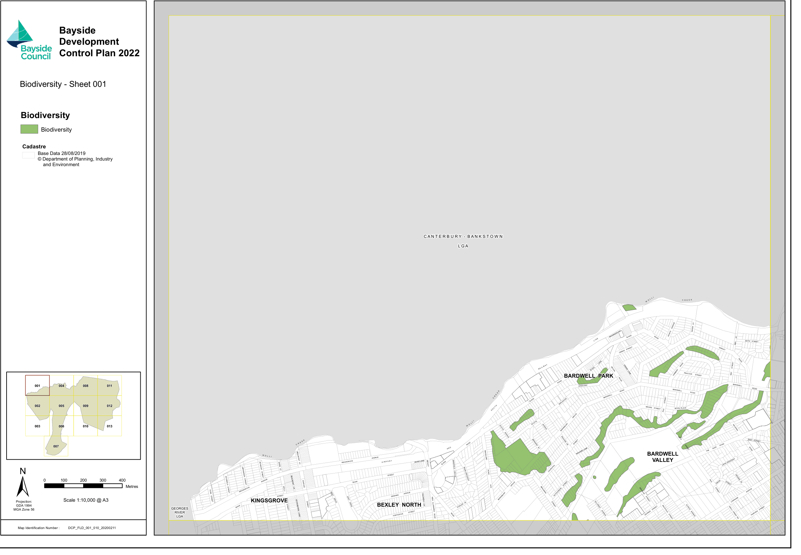

> [Picture on page 3: a picture, saved as a picture (images/appendices-page-3-1.gif, 150 dpi).]

### Development

### Control Plan 2022

### Biodiversity - Sheet 001

### Biodiversity

### Biodiversity

### Cadastre

### Base Data 28/08/2019

### © Department of Planning, Industry

### and Environment

#### 001

#### 008

#### 004

#### 011

#### 002

#### 009

#### 005

#### 012

#### 003 006 010 013

#### 007

#### 0 100 200 300 400

#### Metres

### ±

#### Map Identification Number : DCP_FLD_001_010_20200211

#### GEORGES

#### RIVER

#### LGA

W O L L I

### KINGSGROVE

#### C A N T E R B U R Y  -  B A N K S T O W N

#### L G A

> Words printed on the picture (title and legend, copied from the PDF):
> A N D
> NEW   ILLAWARRA    ROAD
> PROGRESS  LN SLADE
> L I N E
> WOLLI  CREEK  RD

S O U T H

A I R P O R T

### BEXLEY  NORTH

R A I L W A Y

### BARDWELL  PARK

L I

### BARDWELL

### VALLEY

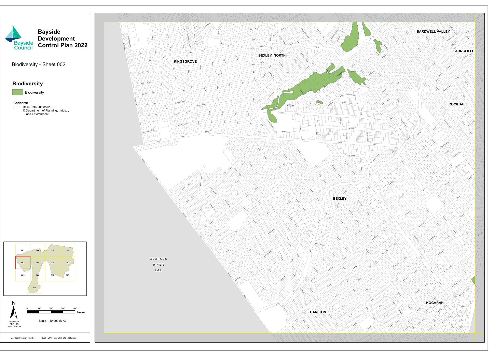

> [Picture on page 4: a map, saved as a picture (images/appendices-page-4-1.gif, 150 dpi); the street names and other small labels are on the picture.]
> Words printed on the picture (title and legend, copied from the PDF):
> EDDYSTONE  RD STREET
> HERBERT OSWELL   STREET
> STH ORIENTAL STREET
> GUINEA ROBERTSON      STREET
> ANDERSON    STREET STREET

### BARDWELL VALLEY

### Development

### Control Plan 2022

### ARNCLIFFE

### BEXLEY  NORTH

### KINGSGROVE

### Biodiversity - Sheet 002

### Biodiversity

### Biodiversity

### Cadastre

### ROCKDALE

### Base Data 28/08/2019

### © Department of Planning, Industry

### and Environment

### BEXLEY

#### 001

#### 008

#### 004

#### 011

#### G E O R G E S

#### 002

#### 009

#### 005

#### 012

#### R I V E R L G A

#### 003 006 010 013

#### 007

### KOGARAH

#### 0 100 200 300 400

#### Metres

### CARLTON

### ±

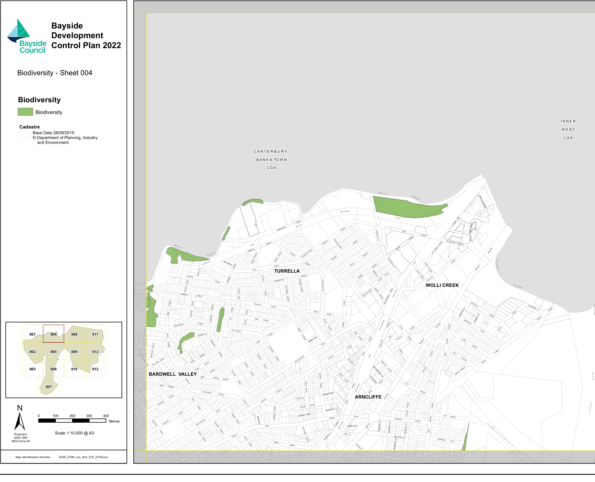

> [Picture on page 5: a map, saved as a picture (images/appendices-page-5-1.gif, 150 dpi); the street names and other small labels are on the picture.]
> Words printed on the picture (title and legend, copied from the PDF):
> L I N E
> W O L L
> MT  OLYMPUS  DRIVE
> L I N E
> A N D
> ROCKWELL   AV STREET
> INNESDALE  LN STREET
> A N D
> THE   GLEN   ROAD
> FARRAR    STREET ESDAILE PL
> STREET WARDELL LN
> SEGENHOE   ST BELLEVUE   ST

### Development

### Control Plan 2022

### Biodiversity - Sheet 004

### Biodiversity

### Biodiversity

### Cadastre

### Base Data 28/08/2019

### © Department of Planning, Industry

### and Environment

#### 001

#### 008

#### 004

#### 011

#### 002

#### 009

#### 005

#### 012

#### 003 006 010 013

#### 007

#### 0 100 200 300 400

#### Metres

### ±

#### I N N E R W E S T L G A

#### C A N T E R B U R Y - B A N K S  TO W N L G A

W O L L I

R A I L W A Y

C A N A L

A I R P O R T

S O U T H

### TURRELLA

A L E X A N D R A

R I V E R

### WOLLI CREEK

R A I L W A Y

I L L A W A R R A

### MASCOT

E R

### BARDWELL  VALLEY HIRST

R I V

S U B U R B S

### ARNCLIFFE

K

S

C

O

O

E A S T E R N

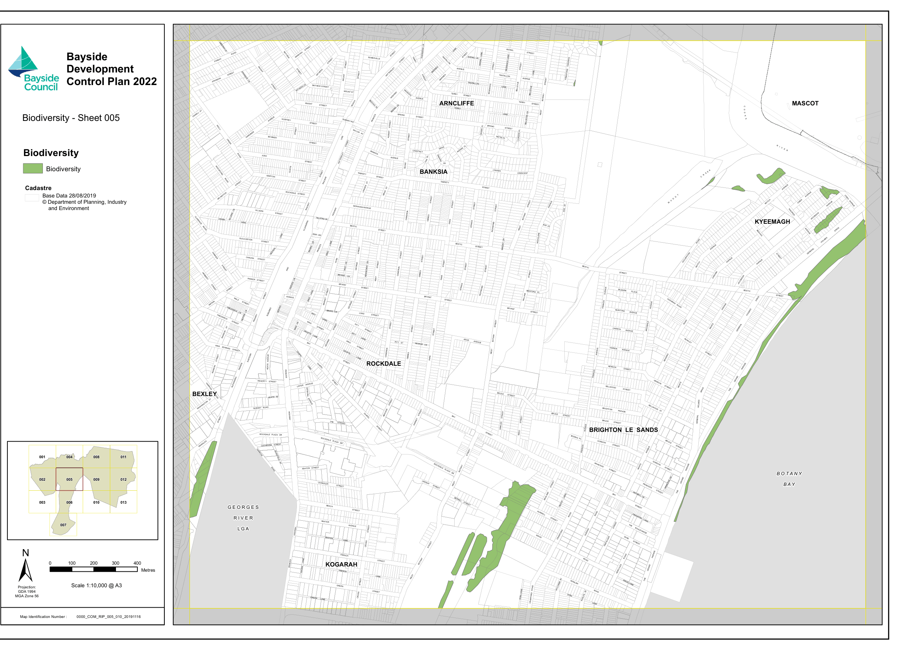

> [Picture on page 6: a map, saved as a picture (images/appendices-page-6-1.gif, 150 dpi); the street names and other small labels are on the picture.]
> Words printed on the picture (title and legend, copied from the PDF):
> TANTALLON AVENAL   LANE
> STREET BAKERY   LN
> HESTEN   LN RAILWAY
> KING   LN STREET
> KING    EDWARD    STREET
> ROCKDALE   PLAZA   DR
> ROCKDALE   PLAZA   DR
> ROCKDALE   PLAZA   DR

### Development

### Control Plan 2022

### MASCOT

### ARNCLIFFE

### Biodiversity - Sheet 005

### Biodiversity

### Biodiversity

### BANKSIA

### Cadastre

### Base Data 28/08/2019

### © Department of Planning, Industry

### and Environment

### KYEEMAGH

### ROCKDALE

### BEXLEY

### BRIGHTON  LE  SANDS

#### 001

#### 008

#### 004

#### 011

#### B O T A N Y

#### 002

#### 009

#### 005

#### 012

#### B A Y

#### 003 006 010 013

#### G E O R G E S R I V E R

#### 007

#### L G A

### PRINCES KOGARAH

#### 0 100 200 300 400

#### Metres

### ±

#### Map Identification Number : 0000_COM_RIP_005_010_20191116

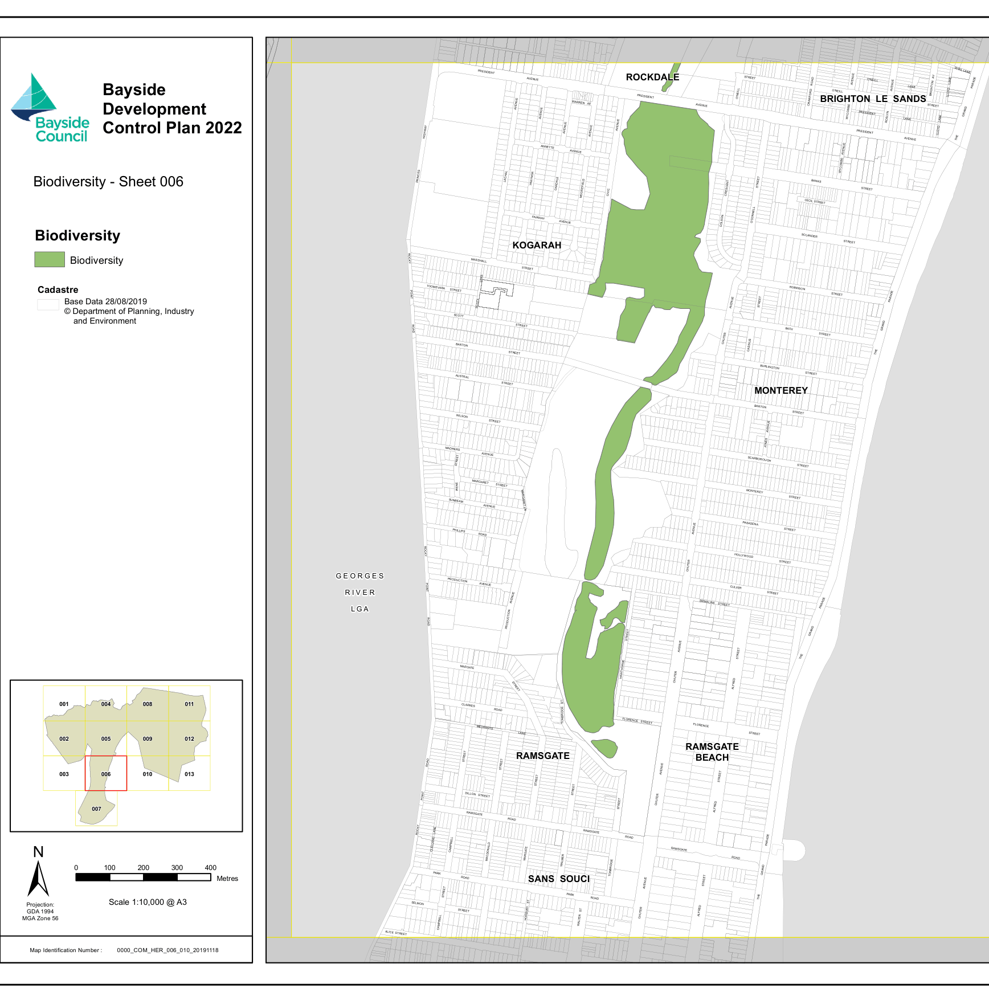

> [Picture on page 7: a picture, saved as a picture (images/appendices-page-7-1.gif, 150 dpi).]

### Development

### Control Plan 2022

### Biodiversity - Sheet 006

### Biodiversity

### Biodiversity

### Cadastre

### Base Data 28/08/2019

### © Department of Planning, Industry

### and Environment

#### 001

#### 008

#### 004

#### 011

#### 002

#### 009

#### 005

#### 012

#### 003 006 010 013

#### 007

#### 0 100 200 300 400

#### Metres

### ±

#### Map Identification Number : 0000_COM_HER_006_010_20191118

> Words printed on the picture (title and legend, copied from the PDF):
> BRIGHTON   AV LLOYD    LANE
> AVENUE MARGARET LN

### ROCKDALE

### BRIGHTON  LE  SANDS

### KOGARAH

### MONTEREY

#### B O T A N Y

#### G E O R G E S

#### B A Y

#### R I V E R L G A

### RAMSGATE

### STREET RAMSGATE

### BEACH

### SANS  SOUCI

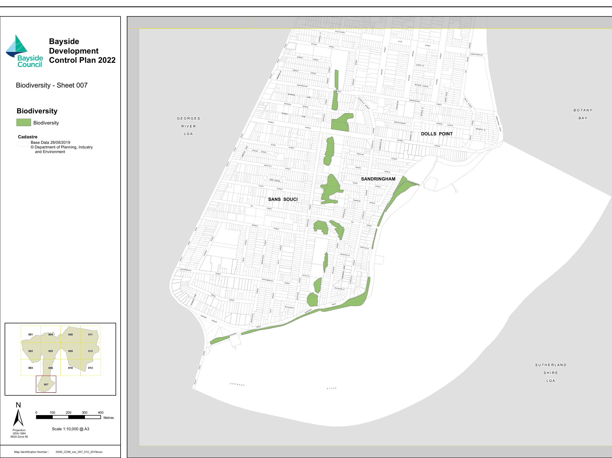

> [Picture on page 8: a picture, saved as a picture (images/appendices-page-8-1.gif, 150 dpi).]

### Development

### Control Plan 2022

### Biodiversity - Sheet 007

### Biodiversity

### Biodiversity

### Cadastre

### Base Data 28/08/2019

### © Department of Planning, Industry

### and Environment

#### 001

#### 008

#### 004

#### 011

#### 002

#### 009

#### 005

#### 012

#### 003 006 010 013

#### 007

#### 0 100 200 300 400

#### Metres

### ±

> Words printed on the picture (title and legend, copied from the PDF):
> SKINNERS   AV CARRUTHERS     DRIVE
> PARKSIDE DR CLAREVILLE
> STREET VANSTON PD

#### B O T A N Y B A Y

#### G E O R G E S R I V E R L G A

### DOLLS  POINT

### SANDRINGHAM

### SANS  SOUCI

#### S U T H E R L A N D S H I R E L G A

G E O R G E S

R I V E R

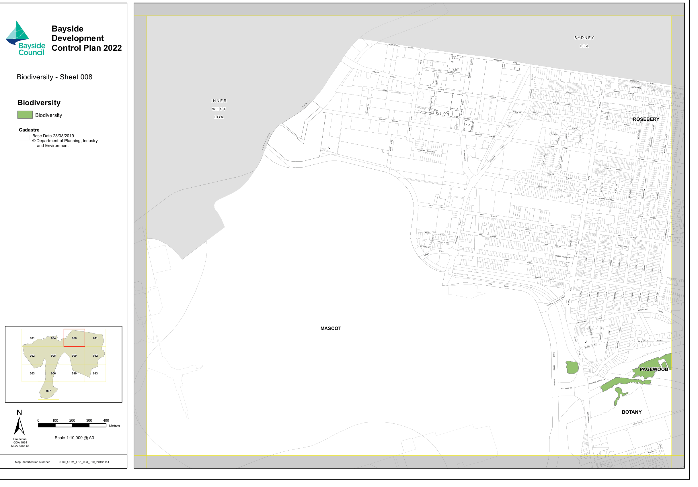

> [Picture on page 9: a picture, saved as a picture (images/appendices-page-9-1.gif, 150 dpi).]

### Development

### Control Plan 2022

### Biodiversity - Sheet 008

### Biodiversity

### Biodiversity

### Cadastre

### Base Data 28/08/2019

### © Department of Planning, Industry

### and Environment

#### 001

#### 008

#### 004

#### 011

#### 002

#### 009

#### 005

#### 012

#### 003 006 010 013

#### 007

#### 0 100 200 300 400

#### Metres

### ±

#### Map Identification Number : 0000_COM_LSZ_008_010_20191114

> Words printed on the picture (title and legend, copied from the PDF):
> WALKER   AV FLORA     ST
> FROGMORE FROGMORE SUTHERLAND
> GENERAL   HOLMES   DRIVE
> BERESFORD     ST MERCHANT     ST
> BRONTI    STREET MCBURNEY
> SOUTHERN  CROSS  DR
> MILL  POND  RD

#### S Y D N E Y

#### U GARDENERS

#### L G A

#### I N N E R W E S T L G A

### ROSEBERY

#### U

A L

DUGUID  ST SARAH   STREET O'RIORDAN

BOTANY HARDIE HARDIE ALFRED ALFRED

### MASCOT

#### U

### PAGEWOOD

### BOTANY

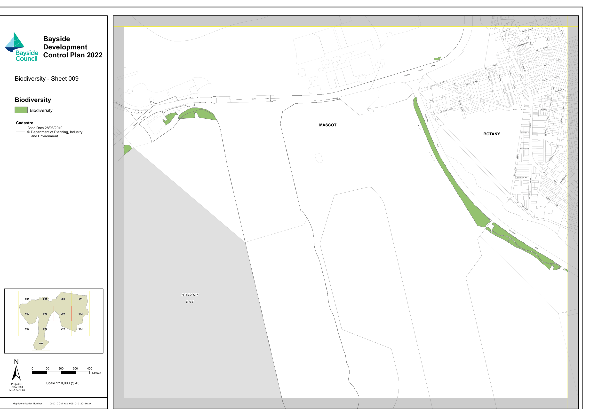

> [Picture on page 10: a map, saved as a picture (images/appendices-page-10-1.gif, 150 dpi); the street names and other small labels are on the picture.]
> Words printed on the picture (title and legend, copied from the PDF):
> GENERAL HOLMES DRIVE
> DAPHNE  ST DAPHNE   STREET
> ROAD TENTERDEN  RD

### Development

### Control Plan 2022

### Biodiversity - Sheet 009

### Biodiversity

### Biodiversity

### Cadastre

### Base Data 28/08/2019

### © Department of Planning, Industry

### and Environment

#### 001

#### 008

#### 004

#### 011

#### 002

#### 009

#### 005

#### 012

#### 003 006 010 013

#### 007

#### 0 100 200 300 400

#### Metres

### ±

#### B O T A N Y B A Y

### MASCOT

### BOTANY

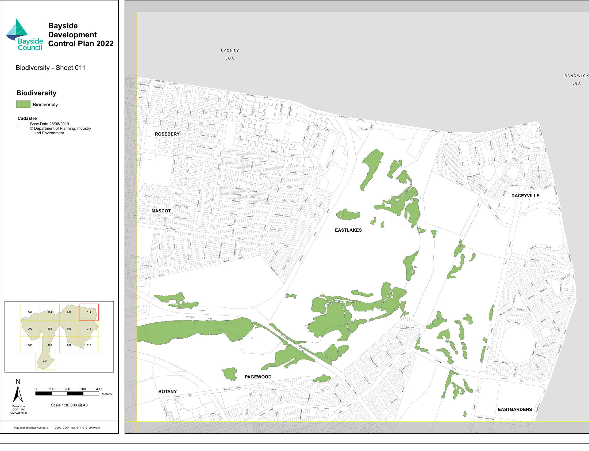

> [Picture on page 11: a map, saved as a picture (images/appendices-page-11-1.gif, 150 dpi); the street names and other small labels are on the picture.]
> Words printed on the picture (title and legend, copied from the PDF):
> ST  HELENA  LN
> O N D
> M I L L
> CAPT JACKA  CR
> ROAD COLENSO CR
> COL  BRAUND  CR

### Development

### Control Plan 2022

### Biodiversity - Sheet 011

### Biodiversity

### Biodiversity

### Cadastre

### Base Data 28/08/2019

### © Department of Planning, Industry

### and Environment

#### 001

#### 008

#### 004

#### 011

#### 002

#### 009

#### 005

#### 012

#### 003 006 010 013

#### 007

#### 0 100 200 300 400

#### Metres

### ±

#### S Y D N E Y L G A

### ROSEBERY

### MASCOT

### EASTLAKES

### PAGEWOOD

### BOTANY

#### R A N D W I C K L G A

### DACEYVILLE

### EASTGARDENS

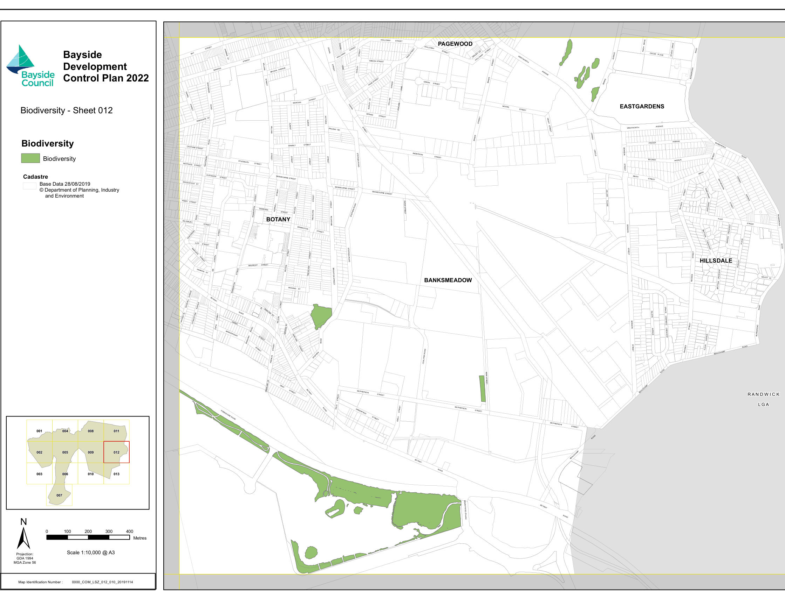

> [Picture on page 12: a map, saved as a picture (images/appendices-page-12-1.gif, 150 dpi); the street names and other small labels are on the picture.]
> Words printed on the picture (title and legend, copied from the PDF):
> ROAD RANCOM   ST
> COAL PIER ROAD
> PENRHYN RD (Private)
> OSCAR   PLACE STUDIO   DRIVE
> GRACE     CAMPBELL     CRESCENT

### Development

### Control Plan 2022

### Biodiversity - Sheet 012

### Biodiversity

### Biodiversity

### Cadastre

### Base Data 28/08/2019

### © Department of Planning, Industry

### and Environment

#### 001

#### 008

#### 004

#### 011

#### 002

#### 009

#### 005

#### 012

#### 003 006 010 013

#### 007

#### 0 100 200 300 400

#### Metres

### ±

### PAGEWOOD

### BOTANY

### BANKSMEADOW

### EASTGARDENS

### HILLSDALE

#### R A N D W I C K L G A

### Appendix 2

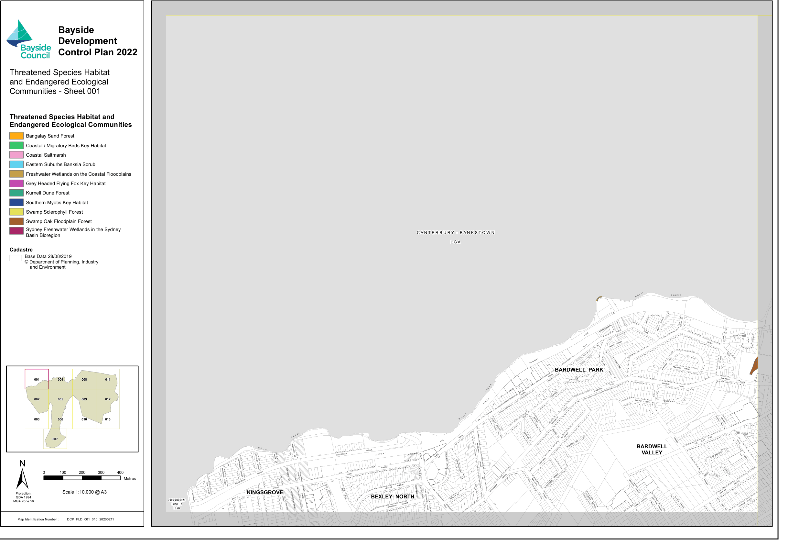

> [Picture on page 14: a picture, saved as a picture (images/appendices-page-14-1.gif, 150 dpi).]

### Development

### Control Plan 2022

### Threatened Species Habitat

### and Endangered Ecological

### Communities - Sheet 001

Threatened Species Habitat and

### Endangered Ecological Communities

Bangalay Sand Forest Coastal / Migratory Birds Key Habitat Coastal Saltmarsh Eastern Suburbs Banksia Scrub Freshwater Wetlands on the Coastal Floodplains Grey Headed Flying Fox Key Habitat Kurnell Dune Forest

### Southern Myotis Key Habitat Swamp Sclerophyll Forest Swamp Oak Floodplain Forest

### Sydney Freshwater Wetlands in the Sydney

### Basin Bioregion

### Cadastre

### Base Data 28/08/2019

### © Department of Planning, Industry

### and Environment

#### 001

#### 008

#### 004

#### 011

#### 002

#### 009

#### 005

#### 012

#### 003 006 010 013

#### 007

#### 0 100 200 300 400

#### Metres

### ±

#### C A N T E R B U R Y  -  B A N K S T O W N

#### L G A

> Words printed on the picture (title and legend, copied from the PDF):
> 16 10 8
> 5 18 16
> 12 1 40
> 21 POWYS     AVENUE 38
> PROGRESS  LN SLADE
> 2 45 28
> 26 MAY     ST 7
> 36 34 32
> 1B 66 71
> 4 4 PEACOCK STREET
> 6 8 10
> 12 8 PILE
> 76 4 7
> AVENUE 51 15
> 21 57 14
> 35 34 30
> 15 24 46
> STOTTS     AVENUE 5 60
> 7 58 25
> 54 29 2
> RICHARD  CR 28
> A N D
> L L I
> 22 - 28
> 2A GEORGE   STREET
> NEW   ILLAWARRA    ROAD
> WOLLI  CREEK  RD

L I

L I N E 56

R A I L W A Y

### BARDWELL  PARK

S O U T H

### BARDWELL

A I R P O R T

### VALLEY

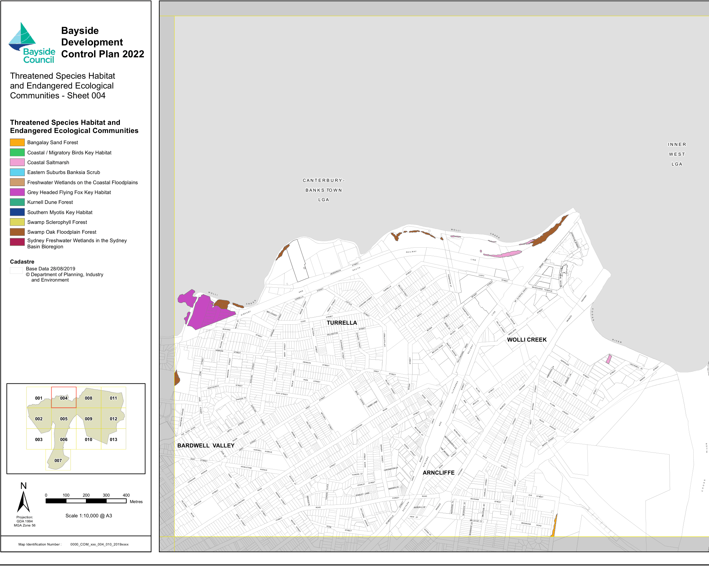

> [Picture on page 15: a map, saved as a picture (images/appendices-page-15-1.gif, 150 dpi); the street names and other small labels are on the picture.]
> Words printed on the picture (title and legend, copied from the PDF):
> L I N E
> W O L L
> MT  OLYMPUS  DRIVE
> L I N E
> A N D
> ROCKWELL   AV STREET
> INNESDALE  LN STREET
> A N D
> THE   GLEN   ROAD
> FARRAR    STREET ESDAILE PL
> STREET WARDELL LN
> SEGENHOE   ST BELLEVUE   ST

### Development

### Control Plan 2022

### Threatened Species Habitat

### and Endangered Ecological

### Communities - Sheet 004

Threatened Species Habitat and

### Endangered Ecological Communities

Bangalay Sand Forest Coastal / Migratory Birds Key Habitat Coastal Saltmarsh Eastern Suburbs Banksia Scrub Freshwater Wetlands on the Coastal Floodplains Grey Headed Flying Fox Key Habitat Kurnell Dune Forest

### Southern Myotis Key Habitat Swamp Sclerophyll Forest Swamp Oak Floodplain Forest

### Sydney Freshwater Wetlands in the Sydney

### Basin Bioregion

### Cadastre

### Base Data 28/08/2019

### © Department of Planning, Industry

### and Environment

#### 001

#### 008

#### 004

#### 011

#### 002

#### 009

#### 005

#### 012

#### 003 006 010 013

#### 007

#### 0 100 200 300 400

#### Metres

### ±

#### I N N E R W E S T L G A

#### C A N T E R B U R Y - B A N K S  TO W N L G A

W O L L I

R A I L W A Y

C A N A L

A I R P O R T

S O U T H

### TURRELLA

A L E X A N D R A

R I V E R

### WOLLI CREEK

R A I L W A Y

I L L A W A R R A

### MASCOT

E R

### BARDWELL  VALLEY HIRST

R I V

S U B U R B S

### ARNCLIFFE

K

S

C

O

O

E A S T E R N

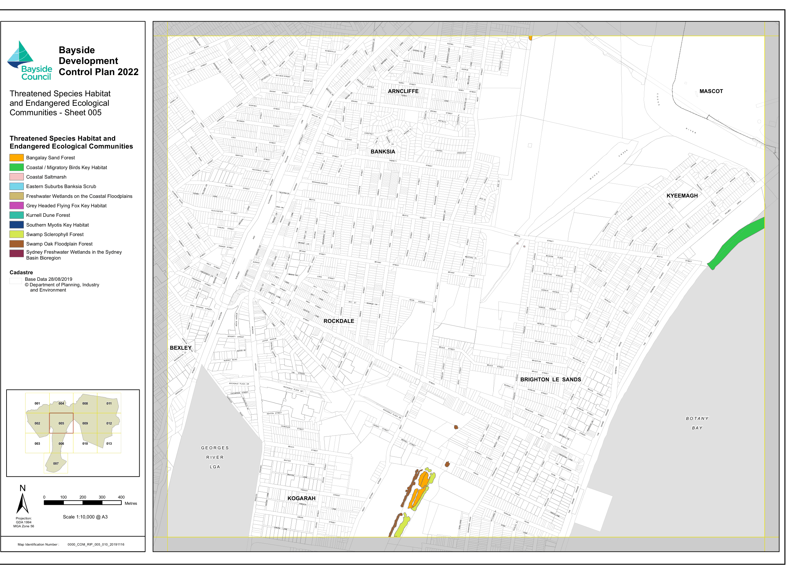

> [Picture on page 16: a map, saved as a picture (images/appendices-page-16-1.gif, 150 dpi); the street names and other small labels are on the picture.]
> Words printed on the picture (title and legend, copied from the PDF):
> TANTALLON AVENAL   LANE
> STREET BAKERY   LN
> HESTEN   LN RAILWAY
> KING   LN STREET
> KING    EDWARD    STREET
> ROCKDALE   PLAZA   DR
> ROCKDALE   PLAZA   DR
> ROCKDALE   PLAZA   DR

### Development

### Control Plan 2022

### Threatened Species Habitat

### and Endangered Ecological

### Communities - Sheet 005

Threatened Species Habitat and

### Endangered Ecological Communities

Bangalay Sand Forest Coastal / Migratory Birds Key Habitat Coastal Saltmarsh Eastern Suburbs Banksia Scrub Freshwater Wetlands on the Coastal Floodplains Grey Headed Flying Fox Key Habitat Kurnell Dune Forest

### Southern Myotis Key Habitat Swamp Sclerophyll Forest Swamp Oak Floodplain Forest

### Sydney Freshwater Wetlands in the Sydney

### Basin Bioregion

### Cadastre

### Base Data 28/08/2019

### © Department of Planning, Industry

### and Environment

#### 001

#### 008

#### 004

#### 011

#### 002

#### 009

#### 005

#### 012

#### 003 006 010 013

#### 007

#### 0 100 200 300 400

#### Metres

### ±

### MASCOT

### ARNCLIFFE

### BANKSIA

### KYEEMAGH

### ROCKDALE

### BEXLEY

### BRIGHTON  LE  SANDS

#### B O T A N Y B A Y

#### G E O R G E S R I V E R L G A

### PRINCES KOGARAH

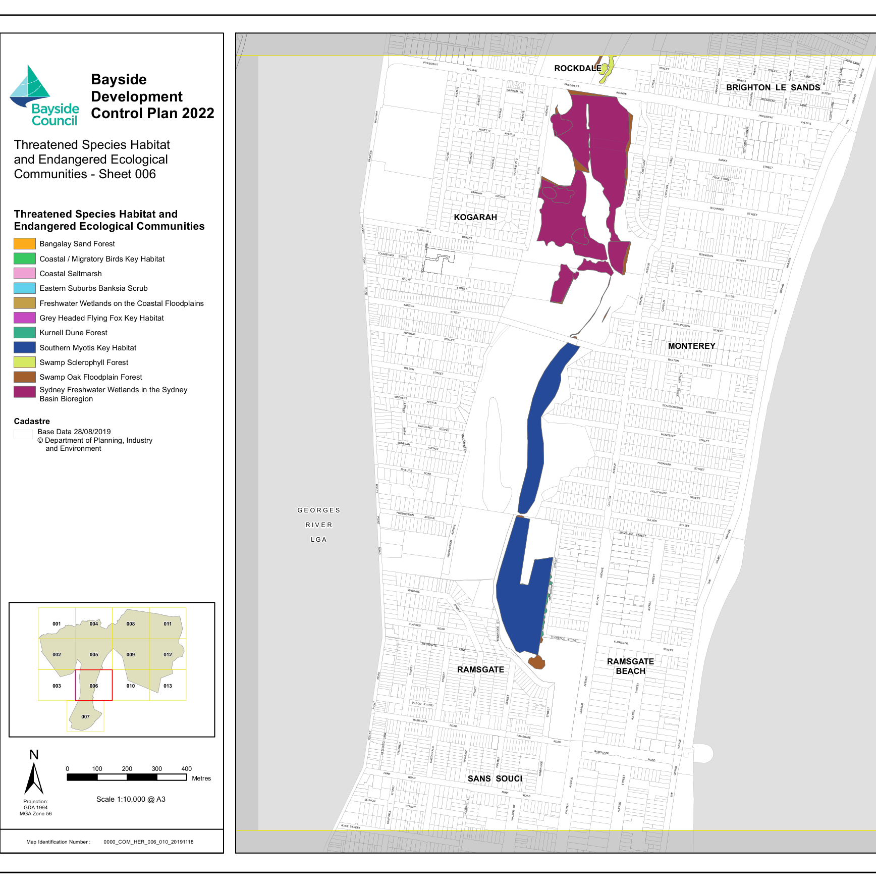

> [Picture on page 17: a picture, saved as a picture (images/appendices-page-17-1.gif, 150 dpi).]

### Development

### Control Plan 2022

### Threatened Species Habitat

### and Endangered Ecological

### Communities - Sheet 006

Threatened Species Habitat and

### Endangered Ecological Communities

Bangalay Sand Forest Coastal / Migratory Birds Key Habitat Coastal Saltmarsh Eastern Suburbs Banksia Scrub Freshwater Wetlands on the Coastal Floodplains Grey Headed Flying Fox Key Habitat Kurnell Dune Forest

### Southern Myotis Key Habitat Swamp Sclerophyll Forest Swamp Oak Floodplain Forest

### Sydney Freshwater Wetlands in the Sydney

### Basin Bioregion

### Cadastre

### Base Data 28/08/2019

### © Department of Planning, Industry

### and Environment

#### 001

#### 008

#### 004

#### 011

#### 002

#### 009

#### 005

#### 012

#### 003 006 010 013

#### 007

#### 0 100 200 300 400

#### Metres

### ±

> Words printed on the picture (title and legend, copied from the PDF):
> BRIGHTON   AV LLOYD    LANE
> AVENUE MARGARET LN

### KOGARAH

### MONTEREY

#### B O T A N Y

#### G E O R G E S

#### B A Y

#### R I V E R L G A

### RAMSGATE

### STREET RAMSGATE

### BEACH

### SANS  SOUCI

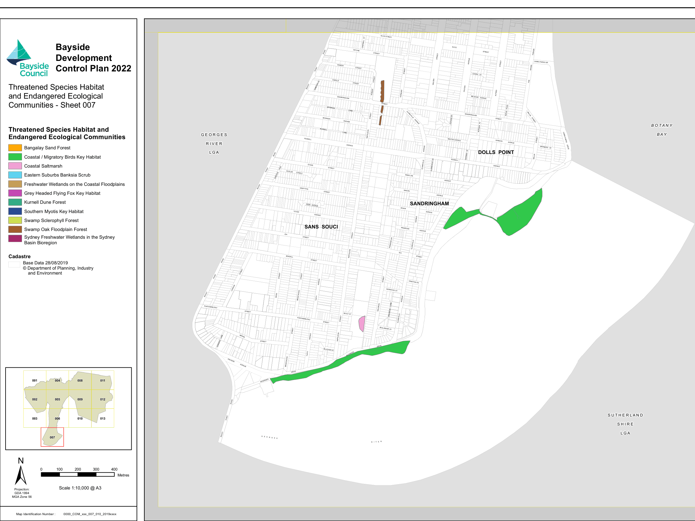

> [Picture on page 18: a picture, saved as a picture (images/appendices-page-18-1.gif, 150 dpi).]

### Development

### Control Plan 2022

### Threatened Species Habitat

### and Endangered Ecological

### Communities - Sheet 007

Threatened Species Habitat and

### Endangered Ecological Communities

Bangalay Sand Forest Coastal / Migratory Birds Key Habitat Coastal Saltmarsh Eastern Suburbs Banksia Scrub Freshwater Wetlands on the Coastal Floodplains Grey Headed Flying Fox Key Habitat Kurnell Dune Forest

### Southern Myotis Key Habitat Swamp Sclerophyll Forest Swamp Oak Floodplain Forest

### Sydney Freshwater Wetlands in the Sydney

### Basin Bioregion

### Cadastre

### Base Data 28/08/2019

### © Department of Planning, Industry

### and Environment

#### 001

#### 008

#### 004

#### 011

#### 002

#### 009

#### 005

#### 012

#### 003 006 010 013

#### 007

#### 0 100 200 300 400

#### Metres

### ±

> Words printed on the picture (title and legend, copied from the PDF):
> SKINNERS   AV CARRUTHERS     DRIVE
> PARKSIDE DR CLAREVILLE
> STREET VANSTON PD

#### B O T A N Y B A Y

#### G E O R G E S R I V E R L G A

### DOLLS  POINT

### SANDRINGHAM

### SANS  SOUCI

#### S U T H E R L A N D S H I R E L G A

G E O R G E S

R I V E R

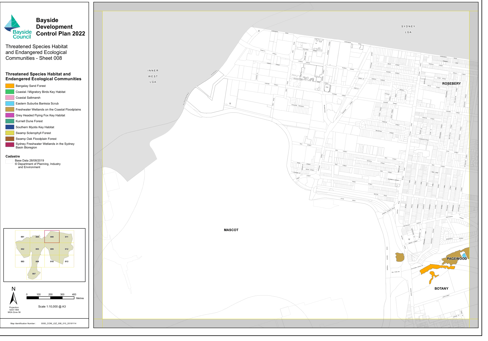

> [Picture on page 19: a picture, saved as a picture (images/appendices-page-19-1.gif, 150 dpi).]

### Development

### Control Plan 2022

### Threatened Species Habitat

### and Endangered Ecological

### Communities - Sheet 008

Threatened Species Habitat and

### Endangered Ecological Communities

Bangalay Sand Forest Coastal / Migratory Birds Key Habitat Coastal Saltmarsh Eastern Suburbs Banksia Scrub Freshwater Wetlands on the Coastal Floodplains Grey Headed Flying Fox Key Habitat Kurnell Dune Forest

### Southern Myotis Key Habitat Swamp Sclerophyll Forest Swamp Oak Floodplain Forest

### Sydney Freshwater Wetlands in the Sydney

### Basin Bioregion

### Cadastre

### Base Data 28/08/2019

### © Department of Planning, Industry

### and Environment

#### 001

#### 008

#### 004

#### 011

#### 002

#### 009

#### 005

#### 012

#### 003 006 010 013

#### 007

#### 0 100 200 300 400

#### Metres

### ±

> Words printed on the picture (title and legend, copied from the PDF):
> WALKER   AV FLORA     ST
> FROGMORE FROGMORE SUTHERLAND
> GENERAL   HOLMES   DRIVE
> BERESFORD     ST MERCHANT     ST
> BRONTI    STREET MCBURNEY
> SOUTHERN  CROSS  DR
> MILL  POND  RD

#### S Y D N E Y

#### U GARDENERS

#### L G A

#### I N N E R W E S T L G A

### ROSEBERY

#### U

A L

DUGUID  ST SARAH   STREET O'RIORDAN

BOTANY HARDIE HARDIE ALFRED ALFRED

### MASCOT

#### U

### PAGEWOOD

### BOTANY

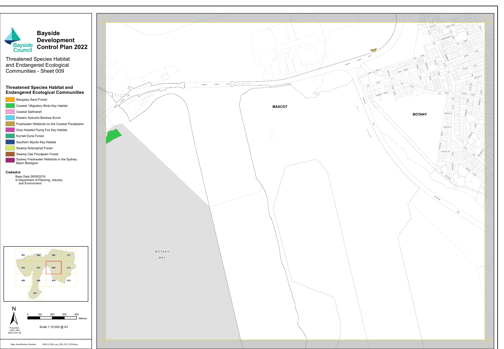

> [Picture on page 20: a picture, saved as a picture (images/appendices-page-20-1.gif, 150 dpi).]
> Words printed on the picture (title and legend, copied from the PDF):
> GENERAL
> HOLMES
> DRIVE

### Development

### Control Plan 2022

### Threatened Species Habitat

### and Endangered Ecological

### Communities - Sheet 009

GENERAL HOLMES DRIVE

Threatened Species Habitat and

### Endangered Ecological Communities

### Bangalay Sand Forest Coastal / Migratory Birds Key Habitat

> Words printed on the picture (title and legend, copied from the PDF):
> DAPHNE  ST DAPHNE   STREET
> ROAD TENTERDEN  RD

### MASCOT

Coastal Saltmarsh Eastern Suburbs Banksia Scrub Freshwater Wetlands on the Coastal Floodplains Grey Headed Flying Fox Key Habitat

Kurnell Dune Forest Southern Myotis Key Habitat Swamp Sclerophyll Forest Swamp Oak Floodplain Forest

### Sydney Freshwater Wetlands in the Sydney

### Basin Bioregion

### Cadastre

### Base Data 28/08/2019

### © Department of Planning, Industry

### and Environment

#### B O T A N Y

#### 001

#### 008

#### 004

#### 011

#### B A Y

#### 002

#### 009

#### 005

#### 012

#### 003 006 010 013

#### 007

#### 0 100 200 300 400

#### Metres

### ±

### BOTANY

ROAD

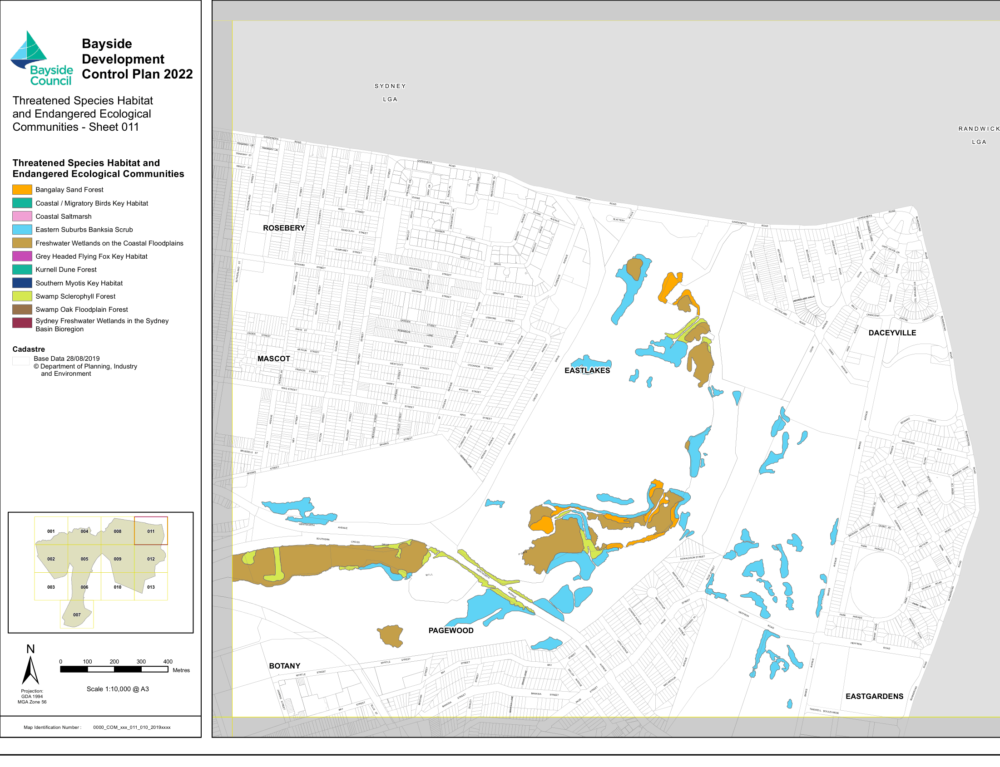

> [Picture on page 21: a map, saved as a picture (images/appendices-page-21-1.gif, 150 dpi); the street names and other small labels are on the picture.]
> Words printed on the picture (title and legend, copied from the PDF):
> ST  HELENA  LN
> O N D
> M I L L
> CAPT JACKA  CR
> ROAD COLENSO CR
> COL  BRAUND  CR

### Development

### Control Plan 2022

### Threatened Species Habitat

### and Endangered Ecological

### Communities - Sheet 011

Threatened Species Habitat and

### Endangered Ecological Communities

Bangalay Sand Forest Coastal / Migratory Birds Key Habitat Coastal Saltmarsh Eastern Suburbs Banksia Scrub Freshwater Wetlands on the Coastal Floodplains Grey Headed Flying Fox Key Habitat Kurnell Dune Forest

### Southern Myotis Key Habitat Swamp Sclerophyll Forest Swamp Oak Floodplain Forest

### Sydney Freshwater Wetlands in the Sydney

### Basin Bioregion

### Cadastre

### Base Data 28/08/2019

### © Department of Planning, Industry

### and Environment

#### 001

#### 008

#### 004

#### 011

#### 002

#### 009

#### 005

#### 012

#### 003 006 010 013

#### 007

#### 0 100 200 300 400

#### Metres

### ±

#### S Y D N E Y L G A

### ROSEBERY

### MASCOT

### EASTLAKES

### PAGEWOOD

### BOTANY

#### R A N D W I C K L G A

### DACEYVILLE

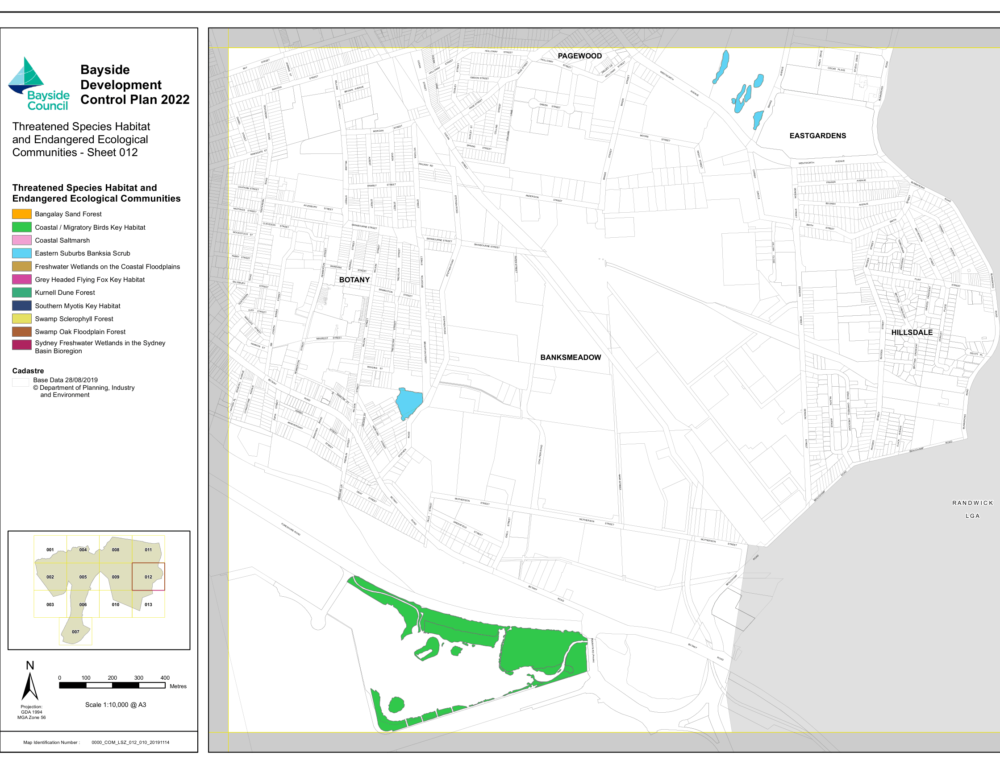

> [Picture on page 22: a map, saved as a picture (images/appendices-page-22-1.gif, 150 dpi); the street names and other small labels are on the picture.]
> Words printed on the picture (title and legend, copied from the PDF):
> ROAD RANCOM   ST
> COAL PIER ROAD
> PENRHYN RD (Private)
> OSCAR   PLACE STUDIO   DRIVE
> GRACE     CAMPBELL     CRESCENT

### Development

### Control Plan 2022

### Threatened Species Habitat

### and Endangered Ecological

### Communities - Sheet 012

Threatened Species Habitat and

### Endangered Ecological Communities

Bangalay Sand Forest Coastal / Migratory Birds Key Habitat Coastal Saltmarsh Eastern Suburbs Banksia Scrub Freshwater Wetlands on the Coastal Floodplains Grey Headed Flying Fox Key Habitat Kurnell Dune Forest

### Southern Myotis Key Habitat Swamp Sclerophyll Forest Swamp Oak Floodplain Forest

### Sydney Freshwater Wetlands in the Sydney

### Basin Bioregion

### Cadastre

### Base Data 28/08/2019

### © Department of Planning, Industry

### and Environment

#### 001

#### 008

#### 004

#### 011

#### 002

#### 009

#### 005

#### 012

#### 003 006 010 013

#### 007

#### 0 100 200 300 400

#### Metres

### ±

### BOTANY

### BANKSMEADOW

### EASTGARDENS

### HILLSDALE

#### R A N D W I C K L G A

### Appendix 3

### Exempt Tree Species List

| Scientific name | Common name |
|---|---|
| Ailanthus altissima | Tree of Heaven |
| Bambusa spp, Phyllostachys spp and others | Bamboo |
| Cinnamonum camphora | Camphor Laurel Note: Only trees under 5 metres high |
| Citrus spp. | Lemon, Orange, Mandarin |
| Cotoneaster spp. | Cotoneaster |
| Erythrina crista-galli. | Coral Tree Note: Only trees under 5 metres high |
| Ficus elastica | Rubber Tree |
| Morus alba | Mulberry |
| Nerium oleander | Oleander |
| Olea europaea subsp. cuspidata Olea europaea | African Olive European Olive |
| Prunus spp. (fruiting species) | Fruiting species only (Peach, Plum, Apricot, Cherry). Note: Does not apply to ornamental/sterile varieties. |
| Pyrus spp. (fruiting species) | Fruiting species only (Pear). Note: Does not apply to ornamental/sterile varieties. |
| Schefflera actinophylla | Umbrella Tree |
| Syagrus romanzoffiana | Queen Palm Note : only palms less than 5 metres |

Note: The above exemptions do not apply to trees upon land in a Heritage Conservation Areas or on land in

### which a listed Heritage Item is located or any tree listed on a Significant Tree List.

### Appendix 4

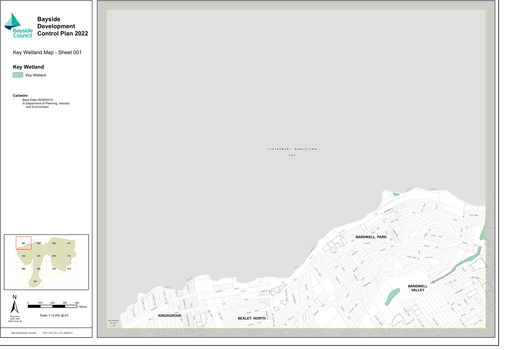

> [Picture on page 26: a picture, saved as a picture (images/appendices-page-26-1.gif, 150 dpi).]

### Development

### Control Plan 2022

### Key Wetland Map - Sheet 001

### Key Wetland

### Key Wetland

### Cadastre

### Base Data 28/08/2019

### © Department of Planning, Industry

### and Environment

#### 001

#### 008

#### 004

#### 011

#### 002

#### 009

#### 005

#### 012

#### 003 006 010 013

#### 007

#### 0 100 200 300 400

#### Metres

### ±

W O L L I

#### C A N T E R B U R Y  -  B A N K S T O W N

#### L G A

> Words printed on the picture (title and legend, copied from the PDF):
> A N D
> NEW   ILLAWARRA    ROAD
> PROGRESS  LN SLADE
> L I N E
> WOLLI  CREEK  RD

S O U T H

A I R P O R T

R A I L W A Y

### BARDWELL  PARK

L I

### BARDWELL

### VALLEY

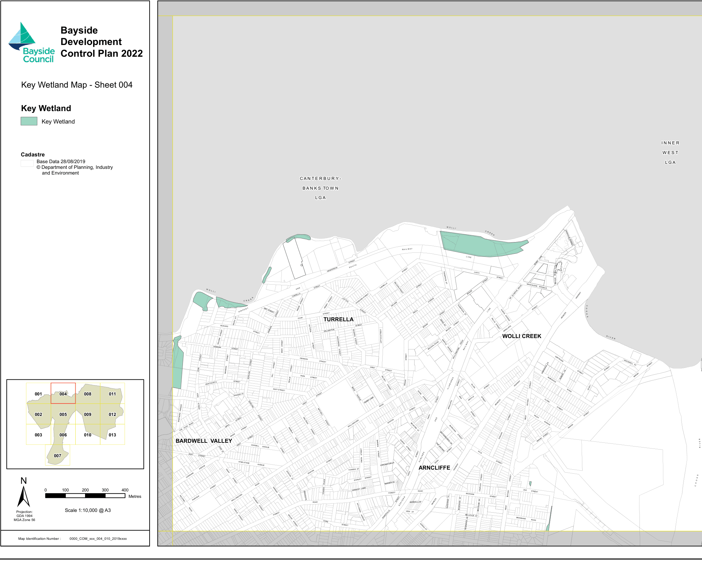

> [Picture on page 27: a map, saved as a picture (images/appendices-page-27-1.gif, 150 dpi); the street names and other small labels are on the picture.]
> Words printed on the picture (title and legend, copied from the PDF):
> L I N E
> W O L L
> MT  OLYMPUS  DRIVE
> L I N E
> A N D
> STREET THOMPSON   ST
> ROCKWELL   AV STREET
> INNESDALE  LN STREET
> A N D
> THE   GLEN   ROAD
> QUEEN      STREET THE  ARCADE
> FARRAR    STREET ESDAILE PL
> STREET WARDELL LN
> SEGENHOE   ST BELLEVUE   ST

### Development

### Control Plan 2022

### Key Wetland Map - Sheet 004

### Key Wetland

### Key Wetland

### Cadastre

### Base Data 28/08/2019

### © Department of Planning, Industry

### and Environment

#### 001

#### 008

#### 004

#### 011

#### 002

#### 009

#### 005

#### 012

#### 003 006 010 013

#### 007

#### 0 100 200 300 400

#### Metres

### ±

#### I N N E R W E S T L G A

#### C A N T E R B U R Y - B A N K S  TO W N L G A

W O L L I

R A I L W A Y

C A N A L

A I R P O R T

S O U T H

### TURRELLA

A L E X A N D R A

R I V E R

### WOLLI CREEK

R A I L W A Y

I L L A W A R R A

### MASCOT

E R

### BARDWELL  VALLEY HIRST

R I V

S U B U R B S

### ARNCLIFFE

K

S

C

O

O

E A S T E R N

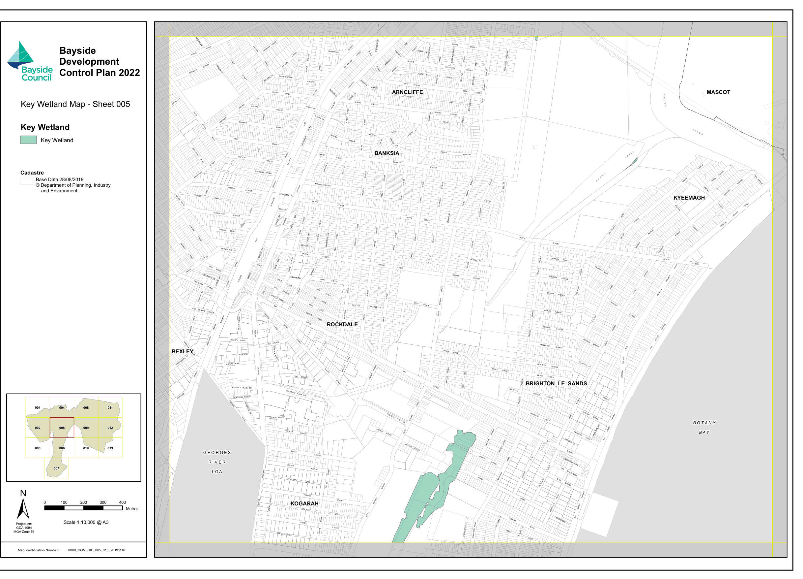

> [Picture on page 28: a map, saved as a picture (images/appendices-page-28-1.gif, 150 dpi); the street names and other small labels are on the picture.]
> Words printed on the picture (title and legend, copied from the PDF):
> TANTALLON AVENAL   LANE
> STREET BAKERY   LN
> HESTEN   LN RAILWAY
> KING   LN STREET
> KING    EDWARD    STREET
> ROCKDALE   PLAZA   DR
> ROCKDALE   PLAZA   DR
> ROCKDALE   PLAZA   DR

### Development

### Control Plan 2022

### MASCOT

### ARNCLIFFE

### Key Wetland Map - Sheet 005

### Key Wetland

### Key Wetland

### BANKSIA

### Cadastre

### Base Data 28/08/2019

### © Department of Planning, Industry

### and Environment

### KYEEMAGH

### ROCKDALE

### BEXLEY

### BRIGHTON  LE  SANDS

#### 001

#### 008

#### 004

#### 011

#### B O T A N Y

#### 002

#### 009

#### 005

#### 012

#### B A Y

#### 003 006 010 013

#### G E O R G E S R I V E R

#### 007

#### L G A

### PRINCES KOGARAH

#### 0 100 200 300 400

#### Metres

### ±

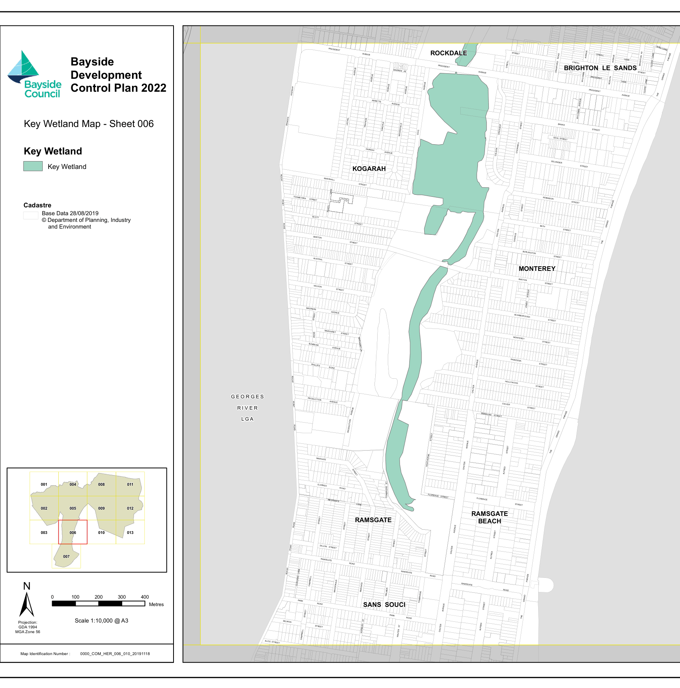

> [Picture on page 29: a picture, saved as a picture (images/appendices-page-29-1.gif, 150 dpi).]

### Development

### Control Plan 2022

### Key Wetland Map - Sheet 006

### Key Wetland

### Key Wetland

### Cadastre

### Base Data 28/08/2019

### © Department of Planning, Industry

### and Environment

#### 001

#### 008

#### 004

#### 011

#### 002

#### 009

#### 005

#### 012

#### 003 006 010 013

#### 007

#### 0 100 200 300 400

#### Metres

### ±

> Words printed on the picture (title and legend, copied from the PDF):
> BRIGHTON   AV LLOYD    LANE
> AVENUE MARGARET LN

### KOGARAH

### MONTEREY

#### B O T A N Y

#### G E O R G E S

#### B A Y

#### R I V E R L G A

### RAMSGATE

### STREET RAMSGATE

### BEACH

### SANS  SOUCI

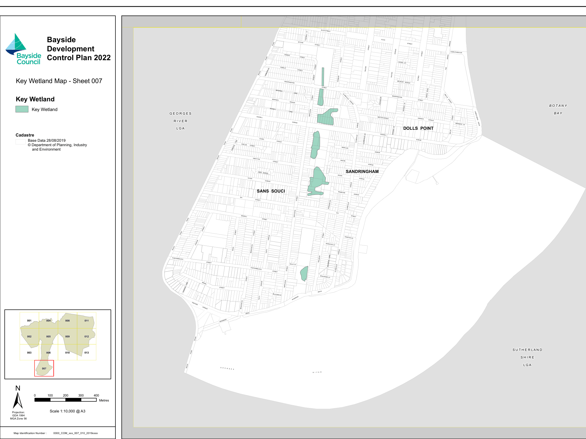

> [Picture on page 30: a picture, saved as a picture (images/appendices-page-30-1.gif, 150 dpi).]

### Development

### Control Plan 2022

### Key Wetland Map - Sheet 007

### Key Wetland

### Key Wetland

### Cadastre

### Base Data 28/08/2019

### © Department of Planning, Industry

### and Environment

#### 001

#### 008

#### 004

#### 011

#### 002

#### 009

#### 005

#### 012

#### 003 006 010 013

#### 007

#### 0 100 200 300 400

#### Metres

### ±

> Words printed on the picture (title and legend, copied from the PDF):
> SKINNERS   AV CARRUTHERS     DRIVE
> PARKSIDE DR CLAREVILLE

#### B O T A N Y B A Y

#### G E O R G E S R I V E R L G A

### DOLLS  POINT

### SANDRINGHAM

### SANS  SOUCI

#### S U T H E R L A N D S H I R E L G A

G E O R G E S

R I V E R

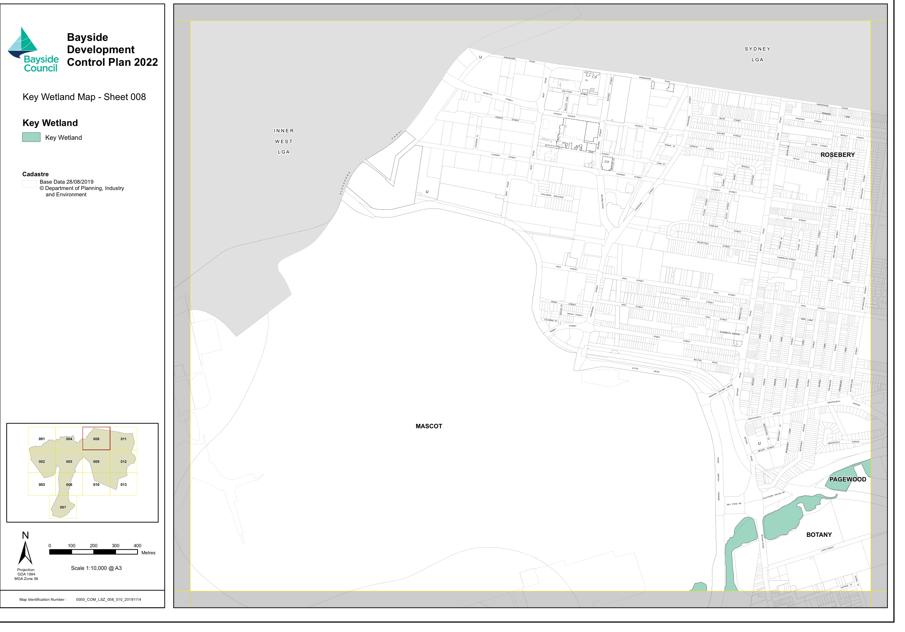

> [Picture on page 31: a picture, saved as a picture (images/appendices-page-31-1.gif, 150 dpi).]

### Development

### Control Plan 2022

### Key Wetland Map - Sheet 008

### Key Wetland

### Key Wetland

### Cadastre

### Base Data 28/08/2019

### © Department of Planning, Industry

### and Environment

#### 001

#### 008

#### 004

#### 011

#### 002

#### 009

#### 005

#### 012

#### 003 006 010 013

#### 007

#### 0 100 200 300 400

#### Metres

### ±

> Words printed on the picture (title and legend, copied from the PDF):
> WALKER   AV FLORA     ST
> FROGMORE FROGMORE SUTHERLAND
> GENERAL   HOLMES   DRIVE
> BERESFORD     ST MERCHANT     ST
> BRONTI    STREET MCBURNEY
> SOUTHERN  CROSS  DR
> MILL  POND  RD

#### S Y D N E Y

#### U GARDENERS

#### L G A

#### I N N E R W E S T L G A

### ROSEBERY

#### U

A L

DUGUID  ST SARAH   STREET O'RIORDAN

BOTANY HARDIE HARDIE ALFRED ALFRED

### MASCOT

#### U

### PAGEWOOD

### BOTANY

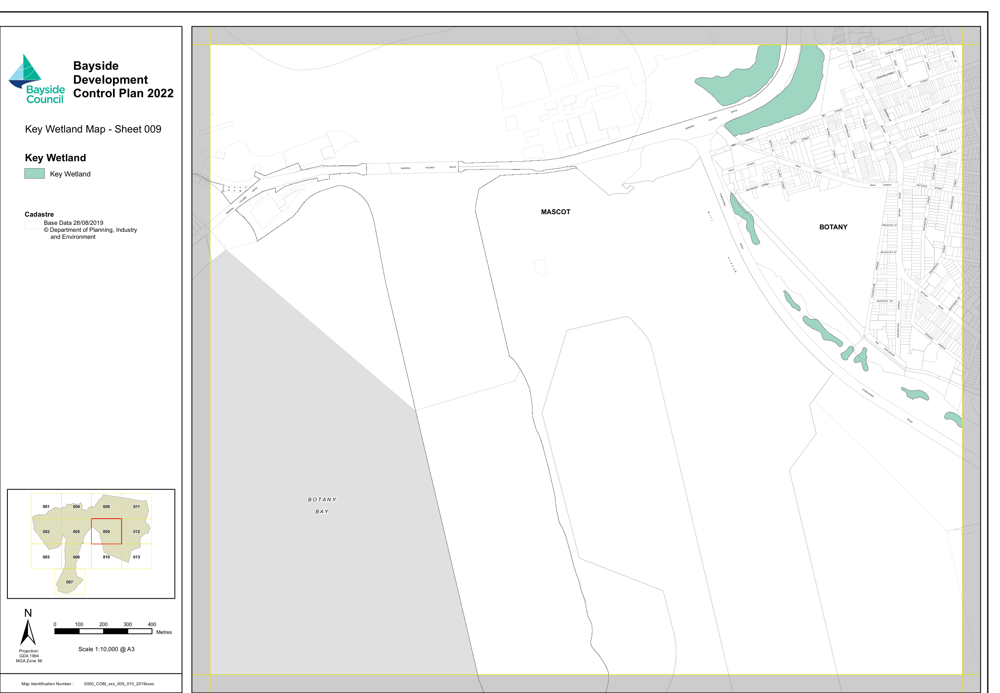

> [Picture on page 32: a picture, saved as a picture (images/appendices-page-32-1.gif, 150 dpi).]
> Words printed on the picture (title and legend, copied from the PDF):
> GENERAL
> HOLMES
> DRIVE

### Development

### Control Plan 2022

### Key Wetland Map - Sheet 009

### Key Wetland

### Key Wetland

### Cadastre

### Base Data 28/08/2019

### © Department of Planning, Industry

### and Environment

#### 001

#### 008

#### 004

#### 011

#### 002

#### 009

#### 005

#### 012

#### 003 006 010 013

#### 007

#### 0 100 200 300 400

#### Metres

### ±

#### B O T A N Y B A Y

GENERAL HOLMES DRIVE

> Words printed on the picture (title and legend, copied from the PDF):
> DAPHNE  ST DAPHNE   STREET
> ROAD TENTERDEN  RD

### MASCOT

### BOTANY

ROAD

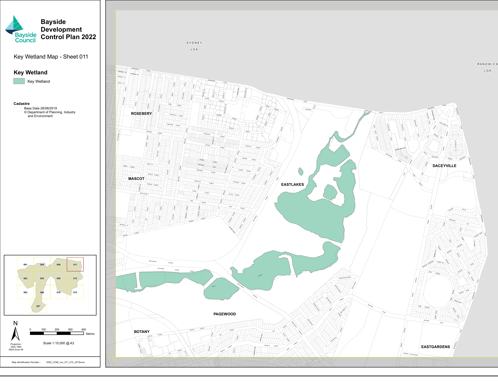

> [Picture on page 33: a map, saved as a picture (images/appendices-page-33-1.gif, 150 dpi); the street names and other small labels are on the picture.]
> Words printed on the picture (title and legend, copied from the PDF):
> ST  HELENA  LN
> O N D
> M I L L
> CAPT JACKA  CR
> ROAD COLENSO CR
> COL  BRAUND  CR

### Development

### Control Plan 2022

### Key Wetland Map - Sheet 011

### Key Wetland

### Key Wetland

### Cadastre

### Base Data 28/08/2019

### © Department of Planning, Industry

### and Environment

#### 001

#### 008

#### 004

#### 011

#### 002

#### 009

#### 005

#### 012

#### 003 006 010 013

#### 007

#### 0 100 200 300 400

#### Metres

### ±

#### S Y D N E Y L G A

### ROSEBERY

### MASCOT

### EASTLAKES

### PAGEWOOD

### BOTANY

#### R A N D W I C K L G A

### DACEYVILLE

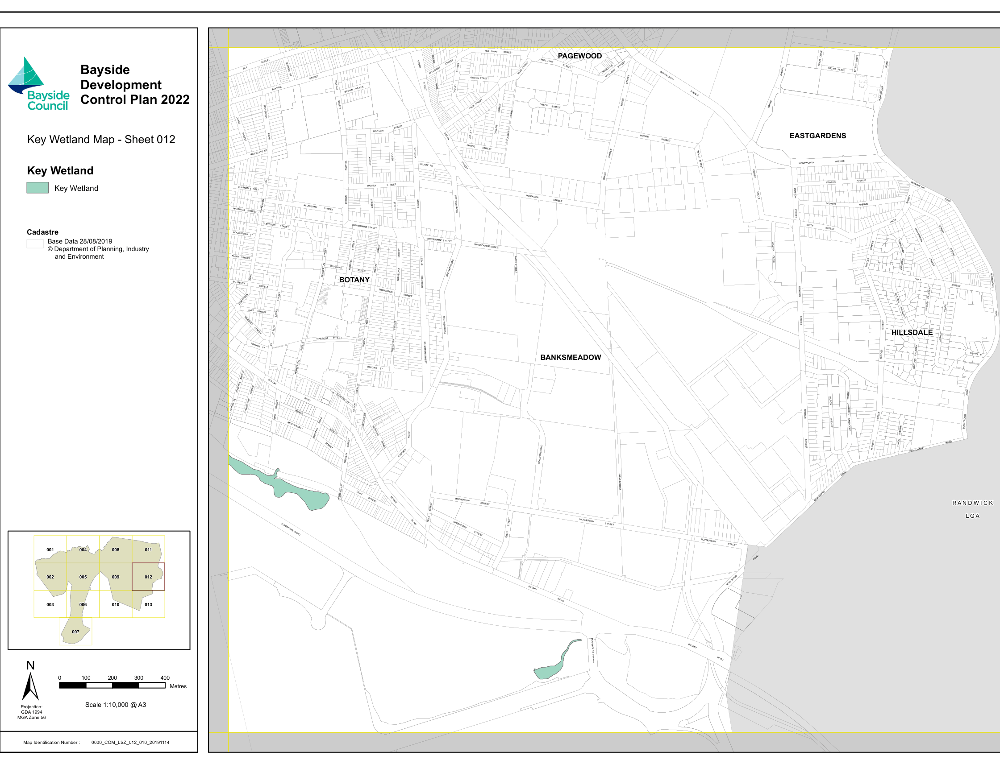

> [Picture on page 34: a map, saved as a picture (images/appendices-page-34-1.gif, 150 dpi); the street names and other small labels are on the picture.]
> Words printed on the picture (title and legend, copied from the PDF):
> ROAD RANCOM   ST
> COAL PIER ROAD
> PENRHYN RD (Private)
> OSCAR   PLACE STUDIO   DRIVE
> GRACE     CAMPBELL     CRESCENT

### Development

### Control Plan 2022

### Key Wetland Map - Sheet 012

### Key Wetland

### Key Wetland

### Cadastre

### Base Data 28/08/2019

### © Department of Planning, Industry

### and Environment

#### 001

#### 008

#### 004

#### 011

#### 002

#### 009

#### 005

#### 012

#### 003 006 010 013

#### 007

#### 0 100 200 300 400

#### Metres

### ±

### BOTANY

### BANKSMEADOW

### EASTGARDENS

### HILLSDALE

#### R A N D W I C K L G A

### Appendix 5

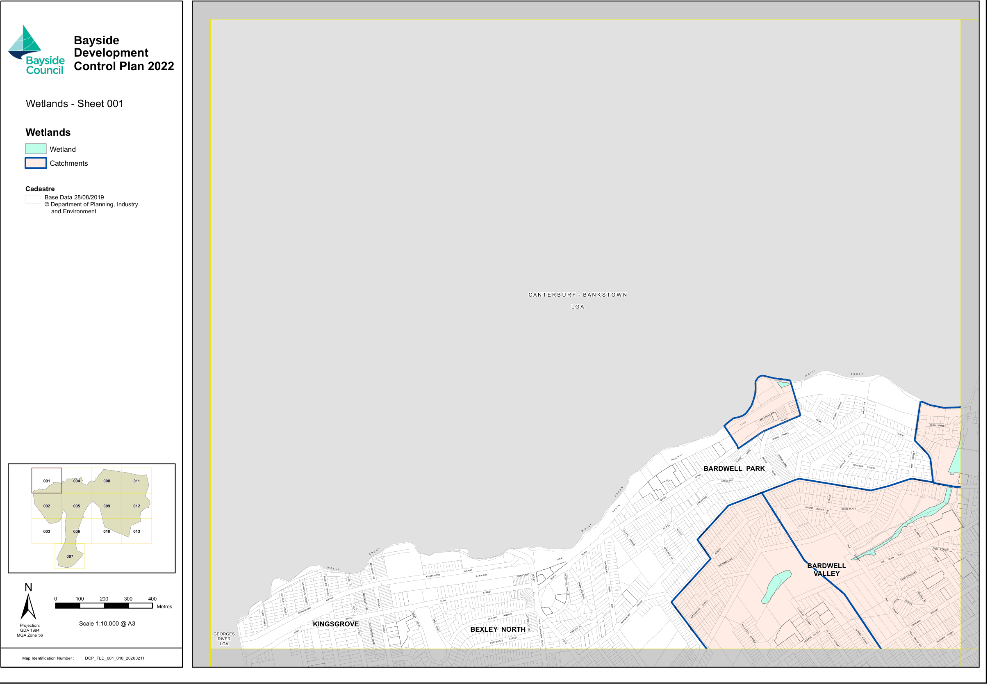

> [Picture on page 36: a picture, saved as a picture (images/appendices-page-36-1.gif, 150 dpi).]

### Development

### Control Plan 2022

### Wetlands - Sheet 001

### Wetlands

### Wetland Catchments

### Cadastre

### Base Data 28/08/2019

### © Department of Planning, Industry

### and Environment

#### 001

#### 008

#### 004

#### 011

#### 002

#### 009

#### 005

#### 012

#### 003 006 010 013

#### 007

#### 0 100 200 300 400

#### Metres

### ±

> Words printed on the picture (title and legend, copied from the PDF):
> A N D
> NEW   ILLAWARRA    ROAD
> PROGRESS  LN SLADE
> L I N E
> WOLLI  CREEK  RD

W O L L I

#### C A N T E R B U R Y  -  B A N K S T O W N

#### L G A

S O U T H

A I R P O R T

R A I L W A Y

### BARDWELL  PARK

### BARDWELL

### VALLEY

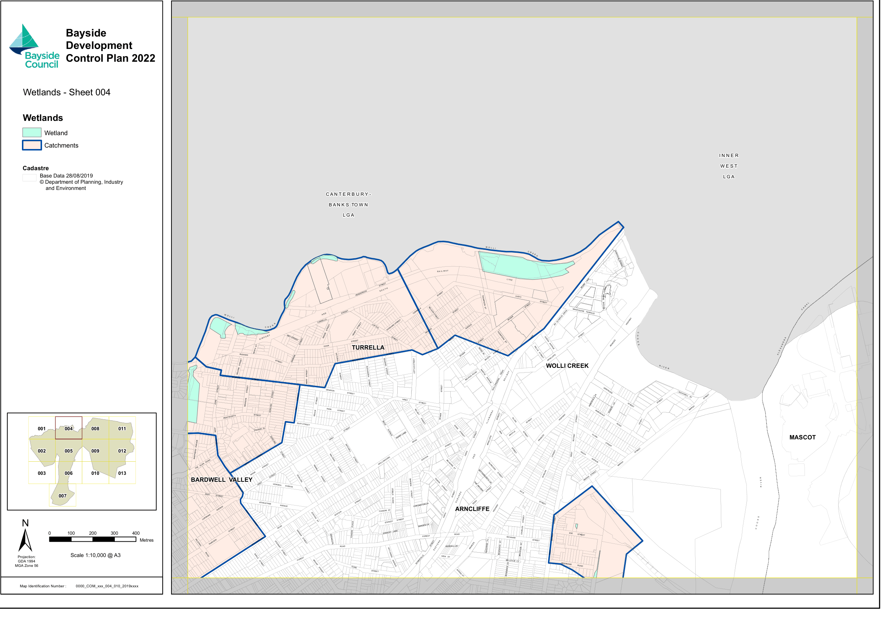

> [Picture on page 37: a map, saved as a picture (images/appendices-page-37-1.gif, 150 dpi); the street names and other small labels are on the picture.]
> Words printed on the picture (title and legend, copied from the PDF):
> L I N E
> W O L L
> MT  OLYMPUS  DRIVE
> L I N E
> A N D
> ROCKWELL   AV STREET
> INNESDALE  LN STREET
> A N D
> THE   GLEN   ROAD
> R I V
> FARRAR    STREET ESDAILE PL
> STREET WARDELL LN
> SEGENHOE   ST BELLEVUE   ST

### Development

### Control Plan 2022

### Wetlands - Sheet 004

### Wetlands

### Wetland Catchments

### Cadastre

### Base Data 28/08/2019

### © Department of Planning, Industry

### and Environment

#### 001

#### 008

#### 004

#### 011

#### 002

#### 009

#### 005

#### 012

#### 003 006 010 013

#### 007

#### 0 100 200 300 400

#### Metres

### ±

#### I N N E R W E S T L G A

#### C A N T E R B U R Y - B A N K S  TO W N L G A

W O L L I

R A I L W A Y

C A N A L

A I R P O R T

S O U T H

### TURRELLA

A L E X A N D R A

R I V E R

### WOLLI CREEK

R A I L W A Y

I L L A W A R R A

### MASCOT

### BARDWELL  VALLEY HIRST

S U B U R B S

### ARNCLIFFE

E A S T E R N

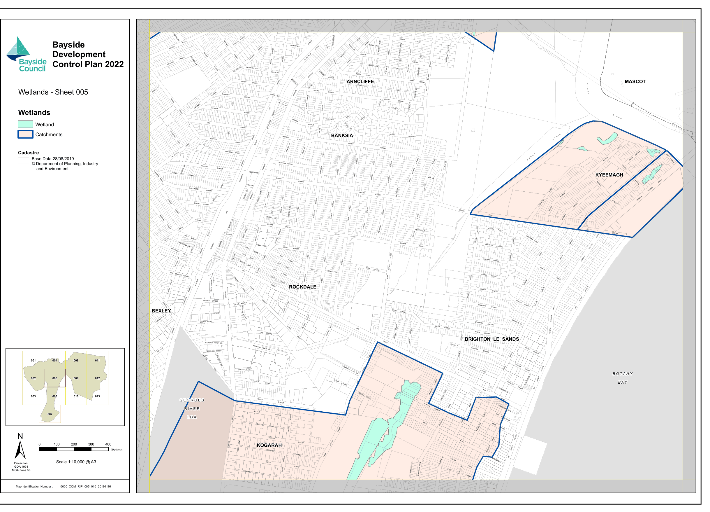

> [Picture on page 38: a map, saved as a picture (images/appendices-page-38-1.gif, 150 dpi); the street names and other small labels are on the picture.]
> Words printed on the picture (title and legend, copied from the PDF):
> TANTALLON AVENAL   LANE
> STREET BAKERY   LN
> HESTEN   LN RAILWAY
> KING   LN STREET
> KING    EDWARD    STREET
> ROCKDALE   PLAZA   DR
> ROCKDALE   PLAZA   DR
> ROCKDALE   PLAZA   DR

### Development

### Control Plan 2022

### MASCOT

### ARNCLIFFE

### Wetlands - Sheet 005

### Wetlands

### Wetland Catchments

### BANKSIA

### Cadastre

### Base Data 28/08/2019

### © Department of Planning, Industry

### and Environment

### KYEEMAGH

### ROCKDALE

### BEXLEY

### BRIGHTON  LE  SANDS

#### 001

#### 008

#### 004

#### 011

#### B O T A N Y

#### 002

#### 009

#### 005

#### 012

#### B A Y

#### 003 006 010 013

#### G E O R G E S R I V E R

#### 007

#### L G A

### PRINCES KOGARAH

#### 0 100 200 300 400

#### Metres

### ±

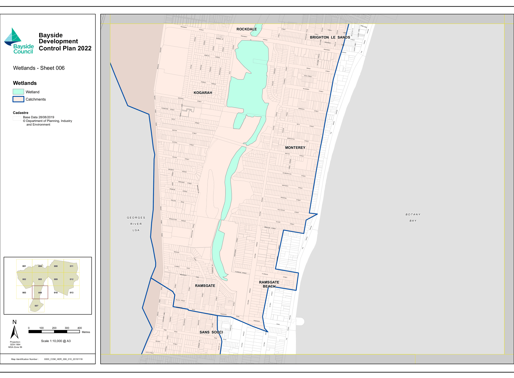

> [Picture on page 39: a map, saved as a picture (images/appendices-page-39-1.gif, 150 dpi); the street names and other small labels are on the picture.]
> Words printed on the picture (title and legend, copied from the PDF):
> BRIGHTON   AV LLOYD    LANE
> AVENUE MARGARET LN

### Development

### Control Plan 2022

### Wetlands - Sheet 006

### Wetlands

### Wetland Catchments

### Cadastre

### Base Data 28/08/2019

### © Department of Planning, Industry

### and Environment

#### 001

#### 008

#### 004

#### 011

#### 002

#### 009

#### 005

#### 012

#### 003 006 010 013

#### 007

#### 0 100 200 300 400

#### Metres

### ±

### KOGARAH

### MONTEREY

#### B O T A N Y

#### G E O R G E S

#### B A Y

#### R I V E R L G A

### RAMSGATE

### STREET RAMSGATE

### BEACH

### SANS  SOUCI

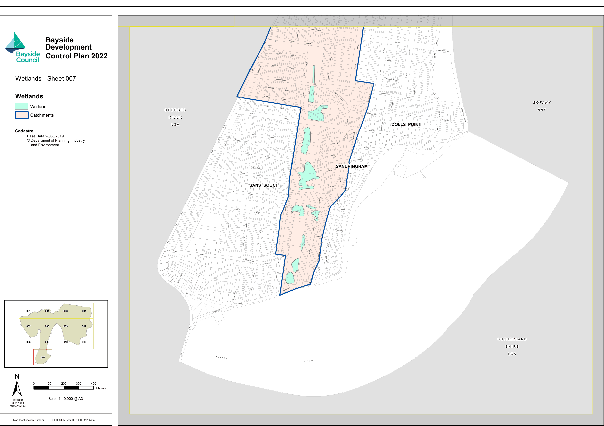

> [Picture on page 40: a picture, saved as a picture (images/appendices-page-40-1.gif, 150 dpi).]

### Development

### Control Plan 2022

### Wetlands - Sheet 007

### Wetlands

### Wetland Catchments

### Cadastre

### Base Data 28/08/2019

### © Department of Planning, Industry

### and Environment

#### 001

#### 008

#### 004

#### 011

#### 002

#### 009

#### 005

#### 012

#### 003 006 010 013

#### 007

#### 0 100 200 300 400

#### Metres

### ±

> Words printed on the picture (title and legend, copied from the PDF):
> SKINNERS   AV CARRUTHERS     DRIVE
> PARKSIDE DR CLAREVILLE
> STREET VANSTON PD

#### B O T A N Y B A Y

#### G E O R G E S R I V E R L G A

### DOLLS  POINT

### SANDRINGHAM

### SANS  SOUCI

#### S U T H E R L A N D S H I R E L G A

G E O R G E S

R I V E R

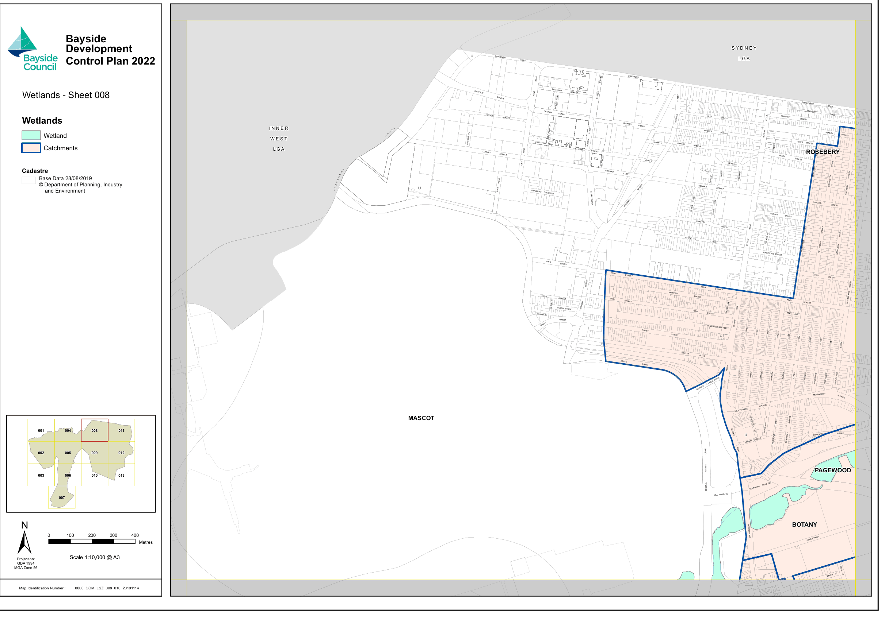

> [Picture on page 41: a map, saved as a picture (images/appendices-page-41-1.gif, 150 dpi); the street names and other small labels are on the picture.]
> Words printed on the picture (title and legend, copied from the PDF):
> WALKER   AV FLORA     ST
> FROGMORE FROGMORE SUTHERLAND
> GENERAL   HOLMES   DRIVE
> BERESFORD     ST MERCHANT     ST
> BRONTI    STREET MCBURNEY
> SOUTHERN  CROSS  DR
> MILL  POND  RD

### Development

### Control Plan 2022

### Wetlands - Sheet 008

### Wetlands

### Wetland Catchments

### Cadastre

### Base Data 28/08/2019

### © Department of Planning, Industry

### and Environment

#### 001

#### 008

#### 004

#### 011

#### 002

#### 009

#### 005

#### 012

#### 003 006 010 013

#### 007

#### 0 100 200 300 400

#### Metres

### ±

#### S Y D N E Y

#### U GARDENERS

#### L G A

#### I N N E R W E S T L G A

### ROSEBERY

#### U

DUGUID  ST SARAH   STREET O'RIORDAN

BOTANY HARDIE HARDIE ALFRED ALFRED

### MASCOT

#### U

### PAGEWOOD

### BOTANY

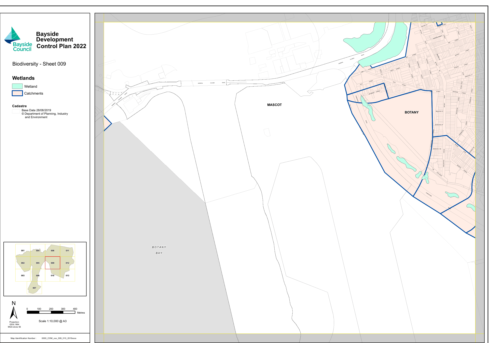

> [Picture on page 42: a map, saved as a picture (images/appendices-page-42-1.gif, 150 dpi); the street names and other small labels are on the picture.]
> Words printed on the picture (title and legend, copied from the PDF):
> GENERAL HOLMES DRIVE
> DAPHNE  ST DAPHNE   STREET
> ROAD TENTERDEN  RD

### Development

### Control Plan 2022

### Biodiversity - Sheet 009

### Wetlands

### Wetland Catchments

### Cadastre

### Base Data 28/08/2019

### © Department of Planning, Industry

### and Environment

#### 001

#### 008

#### 004

#### 011

#### 002

#### 009

#### 005

#### 012

#### 003 006 010 013

#### 007

#### 0 100 200 300 400

#### Metres

### ±

#### B O T A N Y B A Y

### MASCOT

### BOTANY

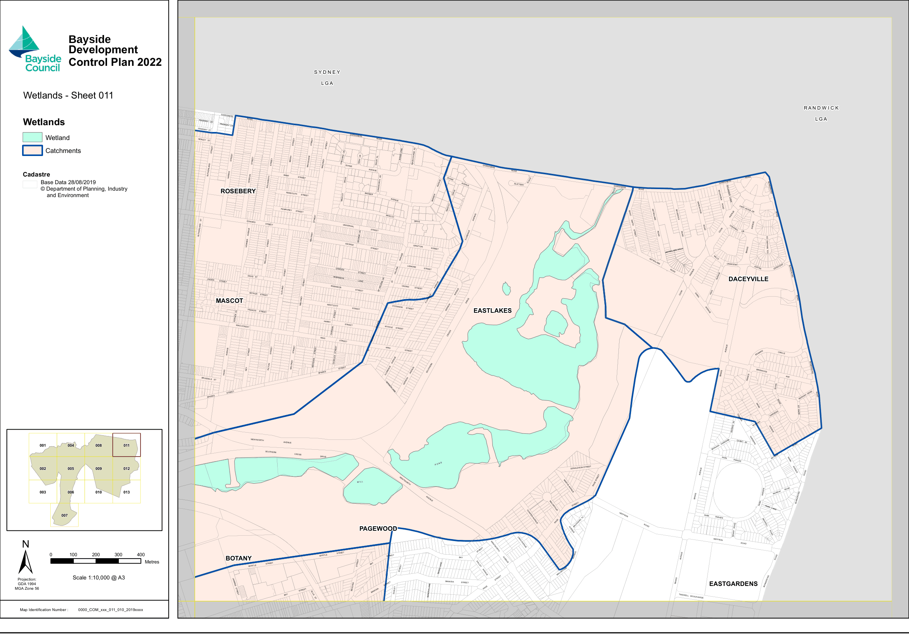

> [Picture on page 43: a map, saved as a picture (images/appendices-page-43-1.gif, 150 dpi); the street names and other small labels are on the picture.]
> Words printed on the picture (title and legend, copied from the PDF):
> ST  HELENA  LN
> O N D
> M I L L
> CAPT JACKA  CR
> ROAD COLENSO CR
> COL  BRAUND  CR

### Development

### Control Plan 2022

### Wetlands - Sheet 011

### Wetlands

### Wetland Catchments

### Cadastre

### Base Data 28/08/2019

### © Department of Planning, Industry

### and Environment

#### 001

#### 008

#### 004

#### 011

#### 002

#### 009

#### 005

#### 012

#### 003 006 010 013

#### 007

#### 0 100 200 300 400

#### Metres

### ±

#### S Y D N E Y L G A

### ROSEBERY

### MASCOT

### EASTLAKES

### PAGEWOOD

### BOTANY

#### R A N D W I C K L G A

### DACEYVILLE

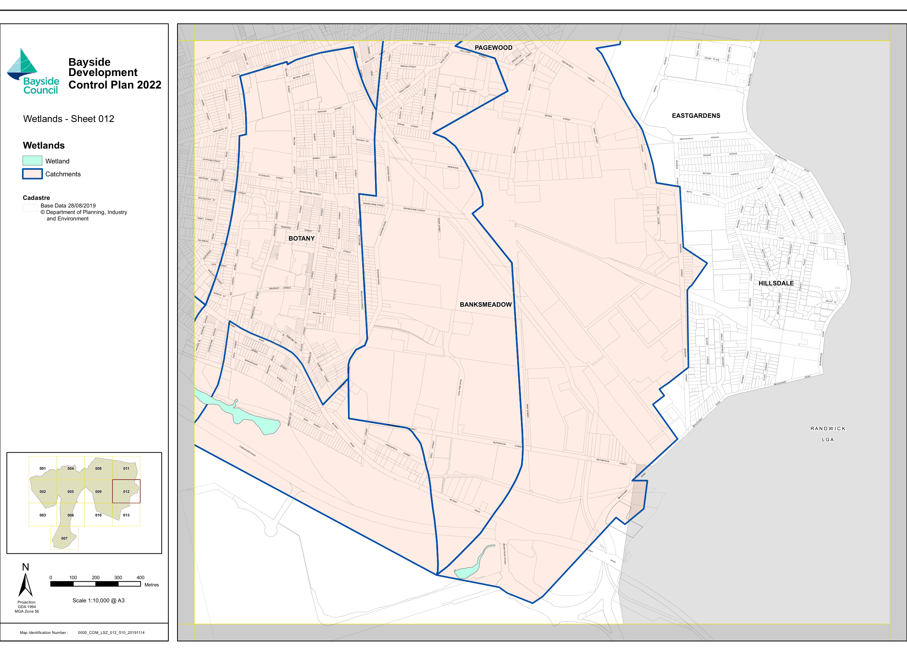

> [Picture on page 44: a map, saved as a picture (images/appendices-page-44-1.gif, 150 dpi); the street names and other small labels are on the picture.]
> Words printed on the picture (title and legend, copied from the PDF):
> RAILWAY  RD STREET
> ROAD RANCOM   ST
> COAL PIER ROAD
> PENRHYN RD (Private)
> OSCAR   PLACE STUDIO   DRIVE
> GRACE     CAMPBELL     CRESCENT

### Development

### Control Plan 2022

### Wetlands - Sheet 012

### Wetlands

### Wetland Catchments

### Cadastre

### Base Data 28/08/2019

### © Department of Planning, Industry

### and Environment

#### 001

#### 008

#### 004

#### 011

#### 002

#### 009

#### 005

#### 012

#### 003 006 010 013

#### 007

#### 0 100 200 300 400

#### Metres

### ±

### BOTANY

### BANKSMEADOW

### EASTGARDENS

### HILLSDALE

#### R A N D W I C K L G A

### Appendix 6

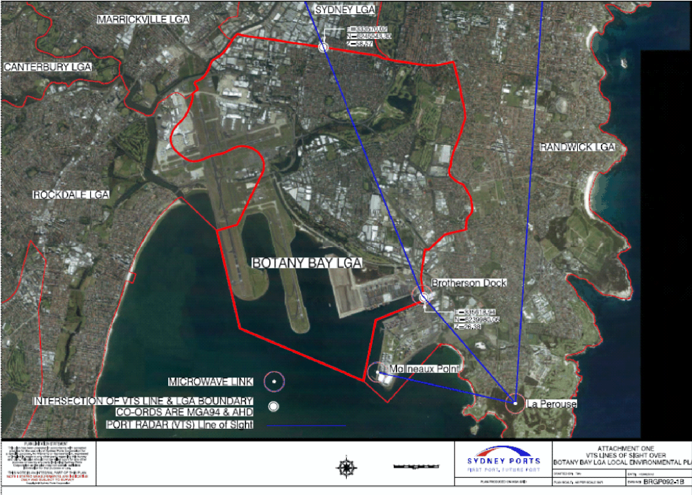

> [Picture on page 46: a picture, saved as a picture (images/appendices-page-46-1.gif, 150 dpi).]

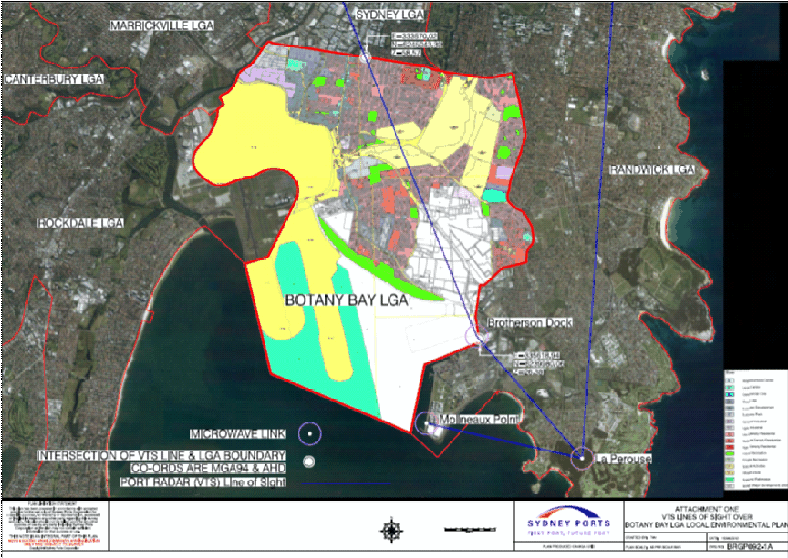

> [Picture on page 47: a picture, saved as a picture (images/appendices-page-47-1.gif, 150 dpi).]
