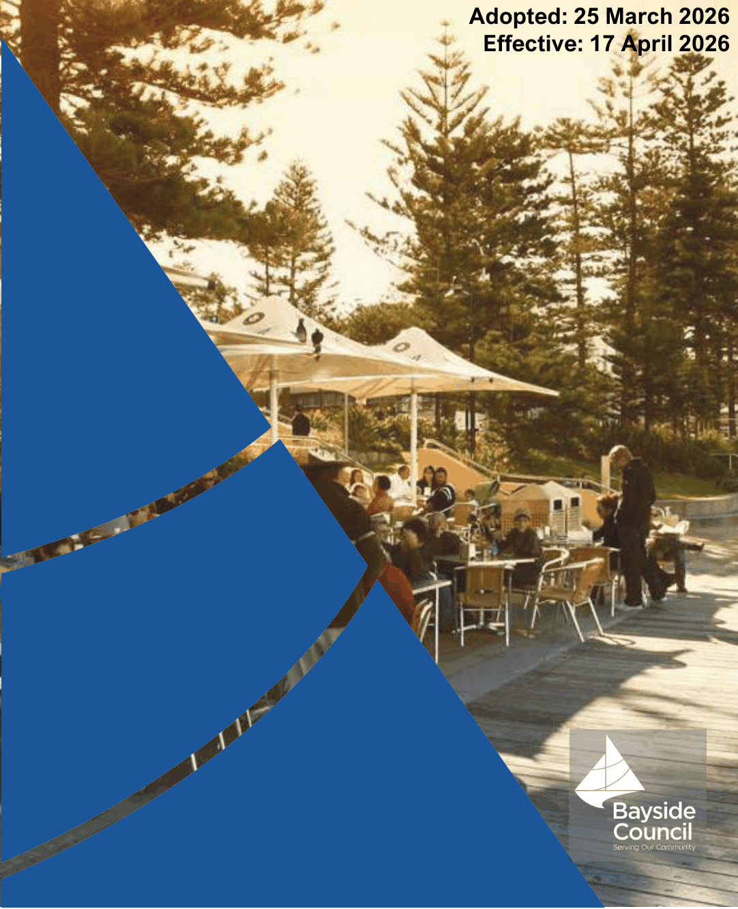

# Bayside Development Control Plan 2022 - Cover and Contents

Source PDF: [26 102612  Bayside Development Control Plan 2022 - Amendment 2 - Cover and Contents.pdf](26%20102612%20%20Bayside%20Development%20Control%20Plan%202022%20-%20Amendment%202%20-%20Cover%20and%20Contents.pdf)

### Bayside Development

### Control Plan 2022

#### Adopted: 25 March 2026

> [Picture on page 1: a picture, saved as a picture (images/cover-and-contents-page-1-4.gif, 150 dpi).]

#### Effective: 17 April 2026
