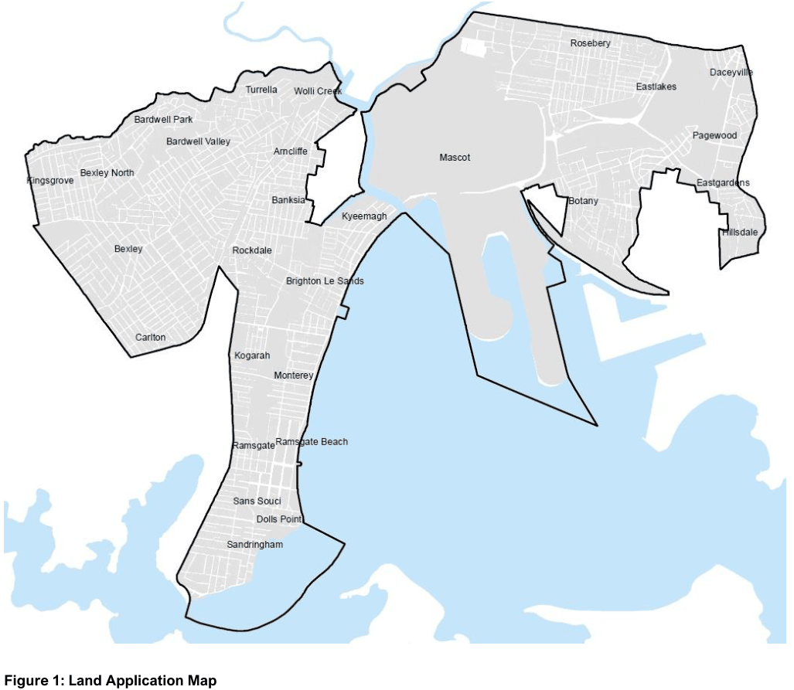

# Bayside Development Control Plan 2022 - Section 2 Preliminary Information

Source PDF: [26 102612  Bayside Development Control Plan 2022 - Amendment 2 - Section 2 Preliminary Information.pdf](26%20102612%20%20Bayside%20Development%20Control%20Plan%202022%20-%20Amendment%202%20-%20Section%202%20Preliminary%20Information.pdf)

### Preliminary Information

## 2 Preliminary Information

#### Name of this Development Control Plan (DCP)

This plan is the Bayside DCP 2022. This DCP has been prepared in accordance with Part 3, Division 3.6 of the Environmental Planning and Assessment Act 1979 (EP&A Act) and the Environmental Planning and Assessment Regulation 2021 (EP&A Regulation).

#### Adoption and Commencement

This DCP was originally adopted by Council on 22 March 2023 and came into effect on 10 April 2023.

#### Review of the Plan

Bayside Council will review this plan periodically to assess whether the plan is fit for purpose, given any changes to the related local environmental plan (LEP) and changes in population, infrastructure, strategic direction, and other key indicators.

#### Application and Consent Authority

This plan applies to land within the Bayside Local Government Area (LGA), excluding land subject to State Environmental Planning Policy (Precinct – Eastern Harbour City) 2021, Chapter 6 Cooks Cove, and State Environmental Planning Policy (Transport and Infrastructure) 2021, Chapter 5 Three ports – Port Botany, Port Kembla and Port of Newcastle.

Under section 4.15 of the EP&A Act, Bayside Council is required to take into consideration the relevant provisions of any applicable DCP when determining an application for development.

Refer to Figure 1 to view the Land Application Map, for land to which this plan applies.

> [Picture on page 3: a picture, saved as a picture (images/section-02-preliminary-information-page-3-1.gif, 150 dpi).]

#### Figure 1: Land Application Map

Bayside Council is the consent authority for all development in the area to which this DCP applies, unless otherwise authorised by the EP&A Act. Bayside Council will use this DCP in its assessment of a planning application for development. This DCP provides strategies, objectives and development guidelines for the assessment of Development Applications (DA) and complements the provisions of the Bayside Local Environmental Plan 2021 (BLEP2021).

#### Aims and Objectives of the Plan

This Plan aims to make development control provisions for land in Bayside in accordance with Division

3.6 of the EP&A Act.

The particular aims and objectives of this Plan are as follows:

• To ensure development is economically, environmentally and socially sustainable;

• To protect and enhance the natural environment, in particular waterways and biodiversity;

• To ensure development respects desired existing and future local character as identified in this Plan;

• To ensure development is sited and designed, including through its density, height and bulk, that is appropriate to its context;

• To protect Aboriginal and European heritage items and heritage conservation areas;

• To ensure development achieves a high standard of design, and encourages design excellence, particularly in important and large-scale development;

• To provide an amount and choice of housing that caters for the needs of the Bayside community in appropriate locations, including focussing higher density development close to centres and public transport corridors;

• To promote the role of Bayside’s centres and local hubs for vibrant cultural and economic activity, including surrounding communities;

• To retain and appropriately manage business, industrial and urban services land;

• To provide for an efficient and safe transport network that caters for all users, encourages more sustainable modes of transport such as public and active transport and supports the economic functioning of employment areas;

• To provide for an integrated, high amenity public open space network that caters for the needs of the Bayside community, including a diverse range of passive and active recreation uses;

• To ensure development respects and contributes to Bayside’s distinct landscape and scenic features;

• To ensure development achieves high levels of amenity for occupants and adjoining properties, including through consideration of solar access, wind and visual and acoustic privacy;

• To reduce carbon emissions through improved management of energy, water and waste;

• To protect and grow the international trade gateways of Sydney (Kingsford Smith) Airport and Port Botany;

• To minimise land use conflict, particularly between residential and industrial land uses; and

• To ensure people and property are not exposed to unacceptable risk from urban or natural hazards.

#### Compliance

Section 4.15 of the EP&A Act requires Council to take this DCP into consideration when determining applications. Compliance with the provisions of this DCP does not necessarily guarantee that consent to a DA will be granted. Each DA will be assessed having regard to the current LEP, DCP, adopted Council policies, State Environmental Planning Policies, and any other matters listed in Section 4.15 of the EP&A Act.

#### Relationship to other plans, standards, and codes

DCPs are part of a broader planning framework that is used to manage development in the Bayside LGA. This includes:

• acts and regulations;

• strategic plans, including region plans, district plans and local strategic planning statements;

• environmental planning instruments, including State environmental planning instruments and local environmental planning instruments; and

• other council adopted strategies, plans and policies such as development contributions plans.

A provision of a development control plan (whenever made) has no effect to the extent that:

• it is the same or substantially the same as a provision of an environmental planning instrument applying to the same land,

• or it is inconsistent or incompatible with a provision of any such instrument. This DCP is to be read in conjunction with the environmental planning instruments and policies that apply to Bayside, namely: Acts and Policies

• Environmental Planning and Assessment Act 1979;

• Environmental Planning and Assessment Regulation (2021);

• Local Government Act 1993;

• Roads Act 1993;

• Biodiversity Conservation Act 2016;

• Protection of the Environment Operations Act 1997;

• Relevant Regional and District Plans, and Local Strategic Planning Statements, as identified from time to time;

• Any relevant State Environmental Planning Policy (SEPP);

• Any relevant Land and Environment Court Planning Principle;

• National Construction Code and Building Code of Australia;

• Any relevant Australian Standard (identified or not in this Plan); and

• Any applicable policy or guideline adopted by Council.

• The National Airports Safeguarding Framework (NASF) which includes the ten following Guidelines: o Principles for National Airports Safeguarding Framework; o Guideline A: Managing Aircraft Noise; o Guideline B: Managing Building Generated Windshear and Turbulence; o Guideline C: Managing Wildlife Strike Risk; o Guideline D: Managing Wind Turbine Risk to Aircraft; o Guideline E: Managing Pilot Lighting Distraction; o Guideline F: Managing Protected Airspace Intrusion; o Guideline G: Communications, Navigation and Surveillance; o Guideline H: Protecting Strategically Important Helicopter Landing Sites; o Guideline I: Managing the Risk in Public Safety Areas at the Ends of Runways; These guidelines can be accessed at https://www.infrastructure.gov.au/infrastructure-transport-vehicles/aviation/aviation-safety/aviation-environmental-issues/national-airports-safeguarding-framework/national-airports-safeguarding-framework-principles-and-guidelines

It is the responsibility of the applicant to identify all relevant legislative requirements. The NSW Legislation website should be regularly checked for the most up-to-date version of all legislation and can be accessed at: www.legislation.nsw.gov.au

#### Savings Provisions

If an application has been made before the commencement of BDCP2022, but not finally determined, the development application must be determined as if BDCP2022 had not commenced. All applications made after the commencement date of an amendment to the BDCP2022 are subject to BDCP2022 as amended at the date of lodgement. Please refer to the Amendment History at the front of BDCP2022 for relevant commencement dates. A reference to an application in the paragraph above is a reference to:

• a development application;

• an application to modify a development consent;

• an application to review a determination of a development application; or

• an application to review an application to modify a development consent.
