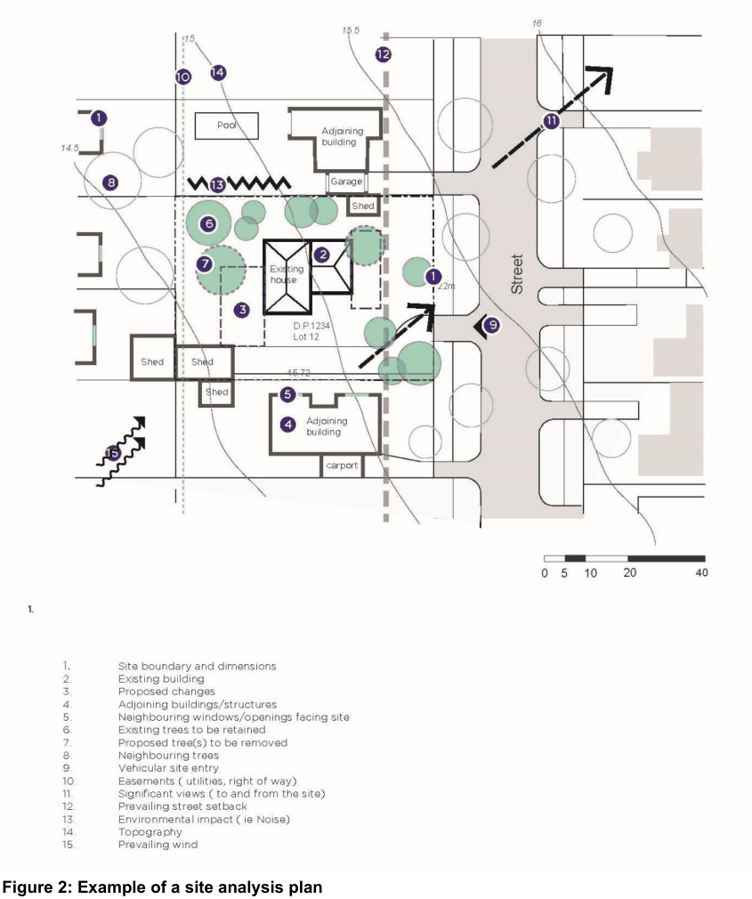

#### 3.1.1 Site Analysis Plan

A site analysis will typically include both a written statement and a plan which identifies contextual, built, and natural elements of the environment. The level of detail required for a site analysis plan and explanatory statement depends on the scale and nature of the proposed development.

| Objective |  |
|---|---|
| O1. | To identify the prevailing existing conditions of an area within which a development site is located. |
| O2. | To ensure site analysis plans and statements identify key site features, opportunities, and constraints, such as topography, views, landmarks, trees, vegetation structures, drainage, services, access, orientation and microclimate. |
| O3. | To identify the relationship between a development and its surrounds. |
| O4. | To ensure all new developments are well integrated with adjoining development and the wider street by responding to urban from, topography and landscape, view corridors and the local street and pedestrian networks. |

| Control |  |
|---|---|
| C1. | Development Applications are to include a Site Analysis which includes both a sketch/diagrammatic Site Analysis Plan and a written component. |
| C2. | An example of a Site Analysis Plan is provided in Figure 2. |
| C3. | The Site Analysis Plan is to be drawn to a scale of either 1:100 or 1:200 and must include the following with respect to the subject site: a. the legal description of the site, including the lot and DP number b. site dimensions and site area c. spot levels, contours, and north point d. existing easements e. existing vegetation, including the height, and spread of established trees, as well as identifying any protected vegetation/biodiversity f. location of existing buildings and other structures g. significant noise sources (including traffic and aircraft noise) h. significant views to and from the site i. pedestrian and vehicular access j. identification of filled areas k. location of fences, boundaries, retaining walls and any other notable features l. prevailing winds for buildings 6 storeys and over |

| Objective | Control |  |
|---|---|---|
|  |  | m. overshadowing to the site |
|  | C4. | For surrounding land, the Site Analysis Plan should show: a. the location, height, and use of buildings (including doors and windows), private open spaces, and out-buildings on adjoining properties b. items of heritage significance and heritage conservation areas c. characteristics of any public open spaces d. location and height of walls built to the site’s boundary e. views and solar access enjoyed by adjacent residents f. major trees on adjacent properties, particularly those within 9 metres of the site g. street frontage features such as poles, street trees, kerb crossovers, bus stops and other services h. adjacent or nearby parkland, bushland and wetlands; including potential wildlife corridors i. topography of surrounding land j. location of neighbouring solar roof panels (if any) k. The location of any nearby industrial uses. |
|  | C5. | Applicants are to demonstrate as a part of their Development Application how the Site Analysis has informed the design outcomes at the site. This should be identified within the Statement of Environmental Effects. |

> [Picture on page 4: a picture, saved as a picture (images/section-03-general-development-provisions-page-4-1.gif, 150 dpi).]

#### Figure 2: Example of a site analysis plan
