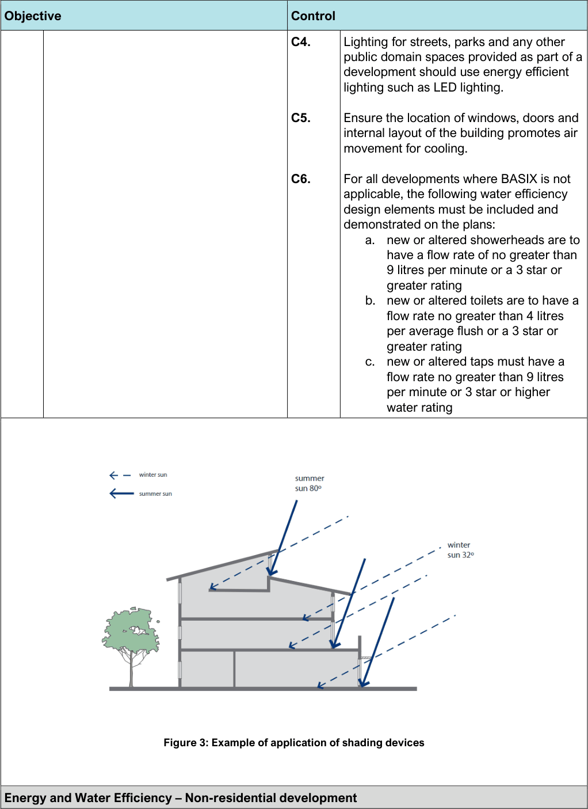

#### 3.3.1 General Controls

| Objective |  |
|---|---|
| Energy and Water Efficiency – General |  |
| O1. | Development: a. ensures that energy efficiency is a fundamental component of the design and construction of residential development. b. minimises consumption of resources including energy, water, waste and soil for the lifecycle of the building/development c. applies principles and processes that contribute to ecologically sustainable development (ESD) d. minimises green-house gas emissions |
| O2. | To reduce the potable water consumption of all new residential developments. |

| Control |  |
|---|---|
| C1. | Areas of glazing are located to avoid energy loss and unwanted energy gain. |
| C2. | Development provides appropriate sun protection during summer for glazed areas facing north, west and east, whilst allowing for penetration of winter sunlight (see Figure 3). |
| C3. | Extensive areas of glazing that are unprotected from sun during summer are not permitted. Shading devices include eaves, awnings, balconies, pergolas, external louvers, and projecting sunshades. Unprotected tinted windows are not acceptable. |

> [Picture on page 13: a picture, saved as a picture (images/section-03-general-development-provisions-page-13-1.gif, 150 dpi).]

Figure 3: Example of application of shading devices

| Objective | Control |  |
|---|---|---|
|  | C4. | Lighting for streets, parks and any other public domain spaces provided as part of a development should use energy efficient lighting such as LED lighting. |
|  | C5. | Ensure the location of windows, doors and internal layout of the building promotes air movement for cooling. |
|  | C6. | For all developments where BASIX is not applicable, the following water efficiency design elements must be included and demonstrated on the plans: a. new or altered showerheads are to have a flow rate of no greater than 9 litres per minute or a 3 star or greater rating b. new or altered toilets are to have a flow rate no greater than 4 litres per average flush or a 3 star or greater rating c. new or altered taps must have a flow rate no greater than 9 litres per minute or 3 star or higher water rating |

#### Energy and Water Efficiency – Non-residential development

| Objective | Control |
|---|---|
| O3. Design and construction of non-residential C7. Development is to be designed and development: constructed to reduce the need for active a. incorporates energy efficiency as heating and cooling by incorporating a fundamental component passive design measures including design, b. minimises adverse impacts on the location and thermal properties of glazing, environment, including preventing natural ventilation, appropriate use of pollution of air, soil, and water thermal mass and external shading, including vegetation. O4. To design developments to improve water C8. Rainwater tanks are to be installed for all conservation and increase on-site storage non-residential developments, including of rainwater for reuse. major alterations and additions that have access to a roof form from which rainwater can be feasibly collected and plumbed to appropriate end uses. C9. Development is to be designed and constructed to meet the rating systems shown in Table 1. Development type Energy Water Hotels (new hotels only) Minimum 4.5-star NABERS Minimum 4-star NABERS rating or rating or equivalent equivalent (new hotels only) Office development over Base building to achieve a Base building to achieve minimum 4- 1,000sqm NLA (including minimum 5-star NABERS rating star NABERS rating or equivalent within mixed use schemes or equivalent (0.65kL of water use/sqm/year) and significant alterations (140kgCO2e/sqm/year) and additions valued at over $5m) Shopping centres/retail Base building to achieve Base building to achieve minimum 4- development over minimum 5-star NABERS rating star NABERS rating or equivalent 15,000sqm GLAR or equivalent (0.95kL/sqm/year) (100kgCO2e/sqm/year) Industrial development over Minimum 5-star Green Star Minimum 5-star Green Star rating or 20,000sqm GFA rating or equivalent equivalent Table 1: Energy and Water Efficiency – Non-residential development |  |
