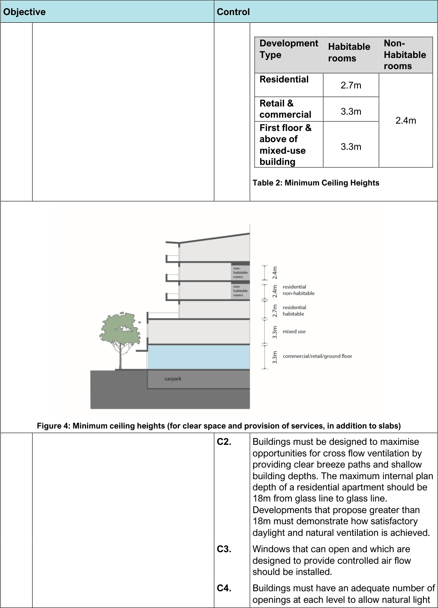
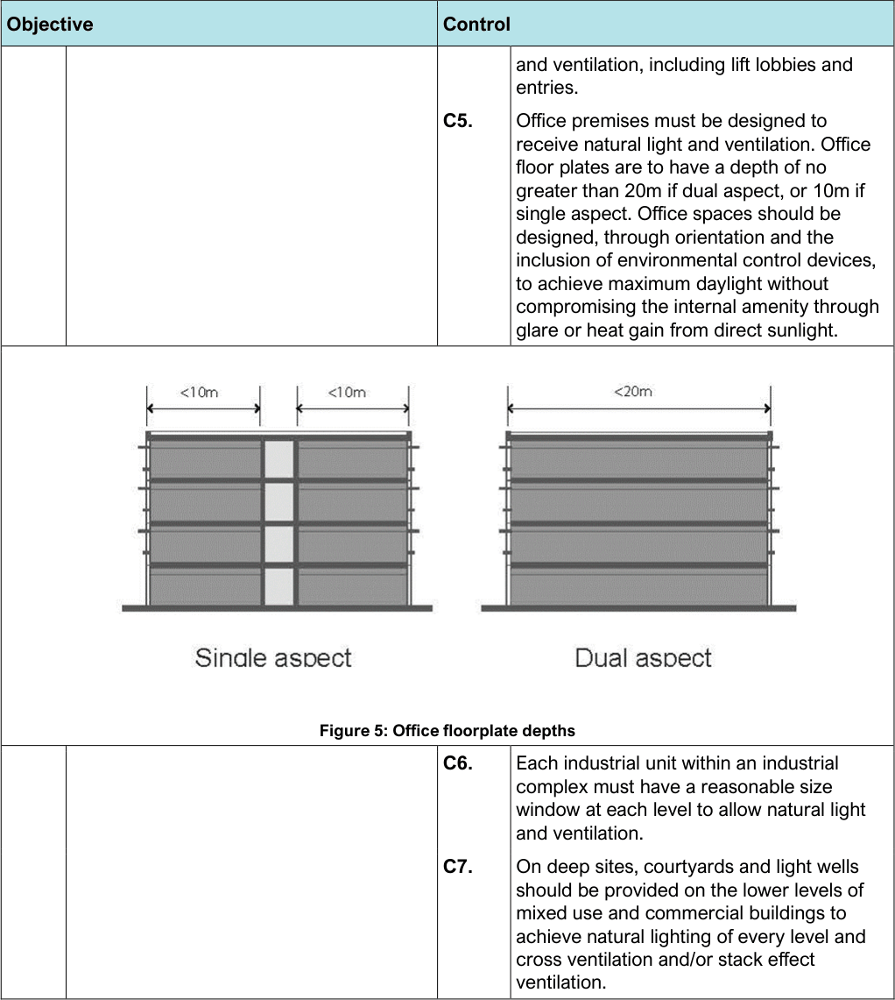

#### 3.3.2 Natural daylight and ventilation (passive design)

| Objective |  | Control |  |
|---|---|---|---|
| General |  |  |  |
| O1. | To maximise the benefits of passive solar design and minimise reliance on artificial lighting in residential development. | C1. | Buildings must comply with the following minimum ceiling heights to facilitate adequate natural lighting and ventilation: |

> [Picture on page 15: a picture, saved as a picture (images/section-03-general-development-provisions-page-15-1.gif, 150 dpi).]
> Words printed on the picture (title and legend, copied from the PDF):
> 2.7m
> 3.3m
> 2.4m
> 3.3m

Table 2: Minimum Ceiling Heights

Figure 4: Minimum ceiling heights (for clear space and provision of services, in addition to slabs)

#### Objective

#### Control

#### Development Type

#### Habitable rooms

#### Non- Habitable rooms

Residential Retail & commercial First floor & above of mixed-use building

C2. Buildings must be designed to maximise opportunities for cross flow ventilation by providing clear breeze paths and shallow building depths. The maximum internal plan depth of a residential apartment should be 18m from glass line to glass line. Developments that propose greater than 18m must demonstrate how satisfactory daylight and natural ventilation is achieved.

C3. Windows that can open and which are designed to provide controlled air flow should be installed.

C4. Buildings must have an adequate number of openings at each level to allow natural light

> [Picture on page 16: a picture, saved as a picture (images/section-03-general-development-provisions-page-16-1.gif, 150 dpi).]

Figure 5: Office floorplate depths

| Objective | Control |  |
|---|---|---|
|  |  | and ventilation, including lift lobbies and entries. |
|  | C5. | Office premises must be designed to receive natural light and ventilation. Office floor plates are to have a depth of no greater than 20m if dual aspect, or 10m if single aspect. Office spaces should be designed, through orientation and the inclusion of environmental control devices, to achieve maximum daylight without compromising the internal amenity through glare or heat gain from direct sunlight. |
