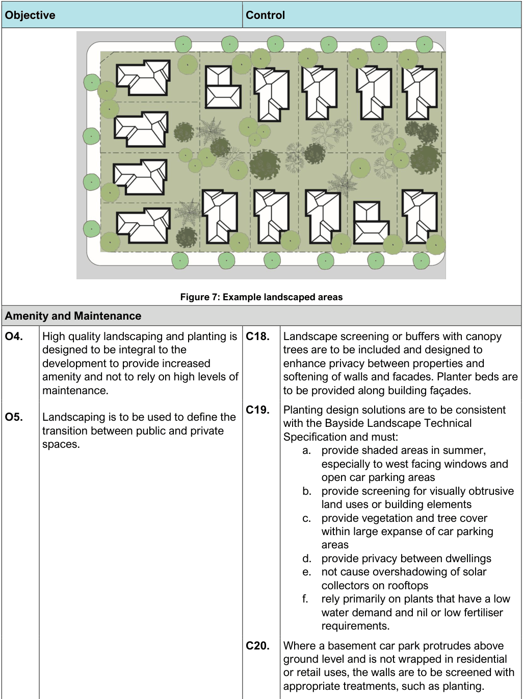

#### 3.7.1 Landscaping

Landscaping includes all areas of the site that are not occupied by buildings and structures or primarily used for other purposes such as vehicle parking, access and manoeuvring and should predominantly be made up of grasses, plants and other landscape elements such as outcrops or pervious paving.

One of the purposes of landscape controls are to retain and increase canopy cover and drainage/water quality within the site and respond to biodiversity/drainage corridors on adjoining sites, while also supporting efforts for ‘urban cooling’ and responding to flood risks.

| Objective |  |
|---|---|
| General Design and Layout |  |
| O1. | Encourage landscape planning and design in conjunction with planning the layout of buildings, structures, vehicle circulation and ancillary areas on a development site. |
| O2. | To preserve existing trees as part of future development, to increase canopy cover, particularly medium and large canopy trees and contribute to the urban forest, and character of the area. |
| O3. | The amount of landscaped open space on site is sufficient to cater for the recreation needs of site occupants. |

| Control |  |
|---|---|
| C1. | Development must comply with Council’s Technical Specification – Landscape and documentation is required to be submitted in accordance with Schedules – Chapter 9.3 of this DCP. |
| C2. | For all development the layout and design of driveways, pedestrian entries and services maximises deep soil and retention of existing trees and planting of new trees. The location and use of outbuildings, swimming pools and spa pools should not impact on landscaped area / areas for tree planting and the amenity of adjoining private and public open space. |
| C3. | Landscaping is primarily located in larger, useable areas preferably located to the front and / or rear of buildings. (Note: council will not support small, narrow, fragmented or otherwise unsuitable areas being counted to achieve minimum landscape requirements). |
| C4. | At least 20% of the front setback area of a residential development is to be provided as landscaped area. |
| C5. | Side setbacks included in the landscape area shall be maximum 20% of the total landscape area provision. |
| C6. | Landscaped areas located between driveways/ pathways and side boundaries have a minimum width of 1.0m at the narrowest dimensions and a minimum of 75% landscaped area must consist of planting, grass and trees, but not gravel/paving. |
| C7. | A minimum of one tree in front setback and one tree in the rear open space in scale with the proposed built form shall be included in low and medium density residential developments. |
| C8. | For residential accommodation on a site having an area greater than 500sqm, the rear yard must include at least one medium or large canopy tree. |
| C9. | When site constraints associated with more urban contexts such as local centres and active frontages do not enable achievement of the minimum landscape area required, the development shall incorporate ecologically sustainable approaches such as extensive or |

| Objective | Control |  |
|---|---|---|
|  |  | intensive green roofs (with a detention layer), roof gardens, green walls. The extension and quality of the approach shall be evaluated by Council for each development. |
|  | C10. | The arrangement of buildings, secondary dwellings, pods, car parks, driveways, ancillary building and paved vehicle/other circulation spaces must consider existing trees and incorporate them into the site layout. Permeable paving surfaces to driveways, car parking bays and paved areas should be priorities over non-permeable. |
|  | C11. | Each property should have at least 1 tree (within the property boundary) where practicable. Where this cannot be achieved, compensatory planting bond / fund must be established. |
|  | C12. | The minimum amount of landscaped area within the site is as follows: Development Type Min. landscaped area (of the site area) Low and medium density 25% residential Residential flat buildings 15% Mixed use (with shop top housing) 10% Highway commercial 10% Industrial 10% Child care centres 20% Table 7: Minimum Landscaped Area Note: Further details about the amount of landscaped area for specific development types is provided below. |
|  | C13. | If an Arborist Report / Tree Assessment is required, it must comply with the relevant other requirements of this DCP and use an appropriate replacement ratio and appropriate species. Refer to 3.8.2 (C3) for replacement ratio. |
|  | C14. | Street trees are to be provided in accordance with Council’s Street Tree Masterplan. Note: Council may require that all street trees be planted at the Site Establishment Phase or during Stage 1 of a staged development so that |

| Objective | Control |  |
|---|---|---|
|  |  | trees become established and soften the development by practical completion. |
|  | C15. | Existing trees, including street trees, and natural formations including rock formations must be preserved where possible. The development proposal must demonstrate all efforts have been done to preserve significant features, like trees or outcrops. |
|  | C16. | Landscaped areas to the rear of a property should adjoin the landscaped area of neighbouring properties and shall assist with provision of privacy between dwellings and provide a contiguous corridor of landscape and vegetation. |
|  | C17. | To ensure aviation safety, the management of vegetation in areas that are close to Sydney Airport needs to be considered. This includes avoiding the planting of tree species that will either attract wildlife or grow to a height that would intrude into Sydney Airport’s prescribed airspace. In particular: a. Significant landscaping and/or tree planting which includes large numbers of flowering trees should be avoided within 3 km of Sydney Airport. b. Trees that are likely to eventually grow to a height that would intrude into one or more of Sydney Airport’s prescribed airspace surfaces should be avoided. c. Proposals involving large-scale tree- planting that could provide habitat for roosting species – such as the Grey- Headed Flying Fox – should be accompanied by a risk assessment, to be provided to Council and Sydney Airport Corporation, considering the risk of roosting species flying across the Sydney Airport airfield or in the vicinity of the airport’s flight paths. Note: Sydney Airport Corporation can provide a list of tree species that should be avoided on request. |

#### Objective

#### Control

> [Picture on page 74: a picture, saved as a picture (images/section-03-general-development-provisions-page-74-3.gif, 150 dpi).]

#### Figure 7: Example landscaped areas

| Amenity and Maintenance |  |  |  |
|---|---|---|---|
| O4. | High quality landscaping and planting is designed to be integral to the development to provide increased amenity and not to rely on high levels of maintenance. | C18. | Landscape screening or buffers with canopy trees are to be included and designed to enhance privacy between properties and softening of walls and facades. Planter beds are to be provided along building façades. |
| O5. | Landscaping is to be used to define the transition between public and private spaces. | C19. | Planting design solutions are to be consistent with the Bayside Landscape Technical Specification and must: a. provide shaded areas in summer, especially to west facing windows and open car parking areas b. provide screening for visually obtrusive land uses or building elements c. provide vegetation and tree cover within large expanse of car parking areas d. provide privacy between dwellings e. not cause overshadowing of solar collectors on rooftops f. rely primarily on plants that have a low water demand and nil or low fertiliser requirements. |
|  |  | C20. | Where a basement car park protrudes above ground level and is not wrapped in residential or retail uses, the walls are to be screened with appropriate treatments, such as planting. |
|  |  | C21. | All fencing and wall details will be provided in the Landscape Documentation and comply with the relevant Parts of the DCP. |

| Objective |  |
|---|---|
| Water Sensitive Urban Design |  |
| O6. | To enhance stormwater management and water quality by incorporating Water Sensitive Urban Design (WSUD) principles into the landscape design. |
| Landscaped Areas – Dual Occupancy |  |
| O7. | To ensure landscaped areas for dual occupancy developments are functional and contribute to residential amenity and local character. |
| Landscaped Areas – Medium Density Housing |  |
| O8. | To ensure landscaped areas for medium density housing are functional and contribute to residential amenity and local character. |

| Control |  |
|---|---|
| C22. | A contrast of paving materials is required to break up large sections of paving and to delineate pedestrian areas, entries, car parks, special use areas or transition zones between different uses. Porous paving is to be utilised wherever possible. |
| C23. | The amount of hard surface area is to be minimised to reduce runoff by: a. directing run-off from the overland flow of rainwater to pervious surfaces such as garden beds, and b. utilising semi-pervious paving materials wherever possible c. other WSUD Such as Rainwater tank for irrigation and/or outdoor taps such as: d. bioswales, e. permeable pavements, f. raingardens. |
| C24. | When proposing more than 5 car spaces at grade WSUD principles, including permeable paving, shall be included in the proposal. |
| C25. | The minimum area of landscaped area in the front setback is 25%. |
| C26. | Development retains existing canopy trees. A minimum of 2 indigenous canopy trees that will attain a minimum mature height of 5m must be planted within the rear yard. |
| C27. | A 1m deep soil landscaped setback to neighbouring properties is to be provided along driveways to basement car parks. |
| C28. | Driveway walls adjacent to the entrance of a basement car park are to have a high standard of finish or are to be consistent with the external finish of the building. |
| C29. | At grade car parking must not be located within the primary setback to the street. |
| C30. | Development must retain existing canopy trees. |
| C31. | The minimum area of landscaped open space in the front setback is 25%. |
| C32. | A 1m deep soil landscaped setback to neighbouring properties is to be provided along driveways to basement car parks. |

| Objective | Control |  |
|---|---|---|
|  | C33. | Driveway walls adjacent to the entrance of a basement car park are to have a high standard of finish or are to be consistent with the external finish of the building. |
|  | C34. | At grade car parking must not be located within the primary setback to the street. |
|  | C35. | A minimum of 2 indigenous canopy trees that will attain a minimum mature height of 5m must be planted within 3m of the front boundary. |
|  | C36. | A minimum of 2 indigenous canopy trees that will attain a minimum mature height of 5m must be planted within 2m of the rear boundary. |
