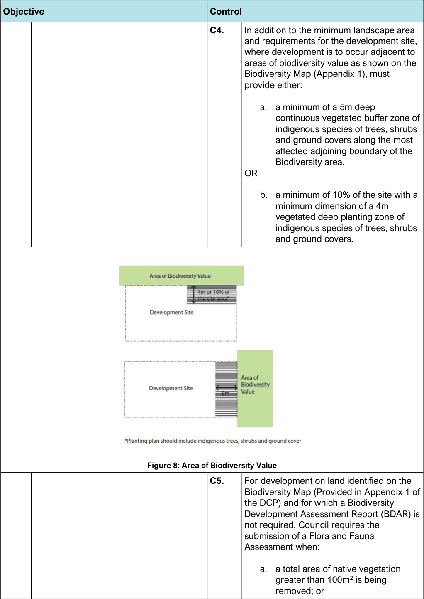

#### 3.7.6 Biodiversity

#### Overview

Biodiversity can be defined as the variety of living animal and plant life from all sources, and includes diversity within and between species and diversity of ecosystems. Biodiversity conservation aims to create a balanced existence between humans and the environment. Biodiversity can be maintained and enhanced by protecting threatened and endangered species, trees and vegetation, planting vegetation using a variety of indigenous species as well as native species and by retaining, enhancing, and providing new habitat and wildlife corridors. The amount of land that sustains native plants and animals in Bayside has progressively reduced since European settlement. However, despite being heavily urbanised, Bayside has an important network of remnant bushland and wetland areas that sustain a diversity of ecological communities including endangered or vulnerable flora and fauna. Indigenous, native, and cultural vegetation within public and private lands also contributes to Bayside’s biodiversity. Our waterways, remnant bushland, trees and other vegetation in parks, streets and gardens provide habitat for a range of fauna species which are resident (e.g. frogs and possums), migrant (some shorebirds and microbats), and transitory (Grey-headed Flying-fox). Biodiversity exists in our streets, our gardens, in brownfield sites and other unexpected places. Any development application or modification to an approved development that involves clearing of native vegetation or potential impacts to threatened species or ecological communities, will be subject to the biodiversity assessment requirements of the Biodiversity Conservation Act 2016.

This Part seeks to conserve and enhance Bayside’s biodiversity by identifying and appropriately managing key environmentally biodiverse areas not managed in Part 2.1.2: Key Threatened Species Habitat and Endangered Ecological Communities. (Note that specific controls for threatened fauna species habitat and endangered ecological communities are managed in section 1.1.2). All Controls in this Part must also be implemented in accordance with Council’s Technical Specifications – Landscape, which provides a list of suitable plants. Mapping which supports this Part includes:

• Biodiversity Map (Provided in Appendix 1 of the DCP)

• Threatened Species Habitat and Endangered Ecological Communities (Provided in Appendix 2 of the DCP)

| Objective |  |
|---|---|
| O1. | Protect and enhance biodiversity through the protection and conservation of native flora and fauna, their habitats and ecological functions. |
| O2. | Improve the diversity and abundance of locally indigenous flora and fauna species across the local government area (LGA). |
| O3. | Enhance biodiversity corridors to assist existing native plant and animal communities and protect from further fragmentation to ensure there is no net loss of biodiversity values within the Bayside LGA as a result of development. |
| O4. | Protect remnant bushland and areas containing biodiversity value to reduce impacts of the urban heat island effect, and maintain the biodiversity across the LGA. |

| Control |  |
|---|---|
| C1. | All development to which this Part applies must also comply with Section 3.8 - Tree Preservation and Vegetation Management of the DCP. |
| C2. | For all new residential development, mixed use and non-residential development (including commercial and industrial) that provides landscaped open space, where any part of the lot is located within the Biodiversity Map (Provided in Appendix 1 of the DCP), a landscape plan must be prepared by a suitably qualified professional such as a landscape architect or ecologist. |
| C3. | All development identified above and where any part of the lot is located within the Biodiversity Map (Provided in Appendix 1 of the DCP) are to: a. Incorporate a minimum of 80% indigenous species in the proposed landscaping in accordance with Part 2.3 - Tree Preservation and Vegetation Management of the DCP and Bayside Councils Landscape Technical Guidelines which provides a list of suitable native and indigenous species. b. Maximise the retention of native vegetation. c. Incorporate trees, shrubs and ground covers of indigenous species. d. Consider bushland and riparian corridors that are either adjoining or in proximity of the development. e. Minimise the impacts of the completed development on any adjoining terrestrial or riparian corridors e.g. incorporating measures to minimise the impact of stormwater runoff. |

> [Picture on page 84: a picture, saved as a picture (images/section-03-general-development-provisions-page-84-1.gif, 150 dpi).]

Figure 8: Area of Biodiversity Value

| Objective | Control |  |
|---|---|---|
|  | C4. | In addition to the minimum landscape area and requirements for the development site, where development is to occur adjacent to areas of biodiversity value as shown on the Biodiversity Map (Appendix 1), must provide either: |
|  |  | a. a minimum of a 5m deep continuous vegetated buffer zone of indigenous species of trees, shrubs and ground covers along the most affected adjoining boundary of the Biodiversity area. OR |
|  |  | b. a minimum of 10% of the site with a minimum dimension of a 4m vegetated deep planting zone of indigenous species of trees, shrubs and ground covers. |

| C5. | For development on land identified on the Biodiversity Map (Provided in Appendix 1 of the DCP) and for which a Biodiversity Development Assessment Report (BDAR) is not required, Council requires the submission of a Flora and Fauna Assessment when: a. a total area of native vegetation greater than 100m2 is being removed; or |
|---|---|

| Objective | Control |  |
|---|---|---|
|  |  | b. when more than three (3) remnant trees are being removed; or c. when a total area of native or exotic vegetation (excluding exotic grasses) greater than 200m2 is being removed; or d. If required by Council Officers. The Flora and Fauna Assessment is to assess the impact of the development on the native flora and fauna and identify controls to be adopted to minimise any impacts. |
|  | C6. | Development is to respond to habitat features including natural landforms, waterbodies, rock outcrops, trees and vegetation and landscaping which links biodiversity and green corridors. Where council grants consent for the removal of an existing tree on land identified on the Biodiversity Map (Provided in Appendix 1 of the DCP) and Part 3.8 – Tree Preservation and Vegetation Management of the DCP, and for which a BDAR is not required, the replacement of the tree(s) on the subject land or offsite is required at the ratios outlined in Council’s Tree Offset Policy. Replacement tree species must be an indigenous species of a type suitable for the site (unless an alternative non-native species is required for solar access) and in accordance with Council’s Landscape Technical Guidelines. |
