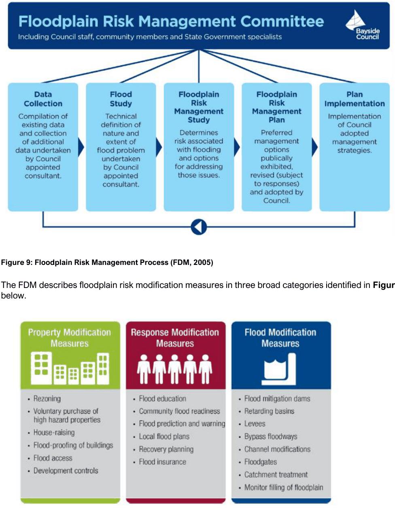

#### 3.10.3 Background

The local Government is the primary authority responsible for both flood risk management and land use planning in New South Wales. Both Local Government and State Government (principally through the State Emergency Service (SES)) are responsible for managing floodplain risk.

The State Government’s flood policy provides a flexible merit-based approach to be followed by local government when dealing with planning, development and building matters on flood-prone land. For Council to fully carry out its responsibilities for the management of flood-prone land, it is necessary to prepare a local flood risk management plan for all developments.

The FDM requires that Councils prepare Floodplain Risk Management Studies (FRMS) as a prelude to the formulation of a Floodplain Risk Management Plan (FRMP) that, among other things, would control development and other activity within the floodplain. The process for preparing the FRMS and FRMP is depicted below in Figure 9.

> [Picture on page 102: a picture, saved as a picture (images/section-03-general-development-provisions-page-102-1.gif, 150 dpi).]

#### Figure 9: Floodplain Risk Management Process (FDM, 2005)

The FDM describes floodplain risk modification measures in three broad categories identified in Figure 10 below.

#### Figure 10: Typical Flood Risk Modification Measures

Prevention of flood risk, through property and response modification measures, is the option most feasible with the least impact on natural flood flows and is primarily reliant on land use planning and development controls for implementation.  Flood modification measures are the least preferred option, being costly, prone to failure and most likely to adversely affect the natural environment.

The controls identified in this chapter represent an application of the State Government’s “Flood Prone Land Policy” are consistent with the FDM, and reflect local circumstances identified through FRMS and FRMP.
