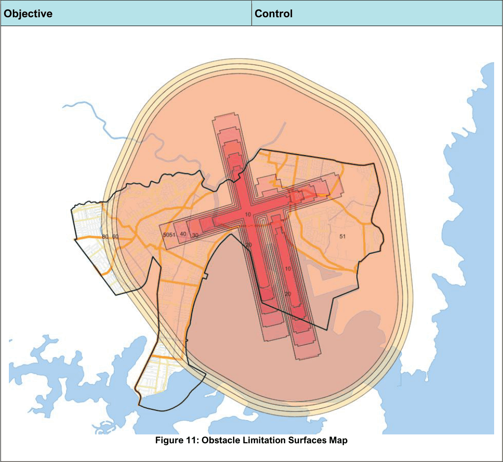
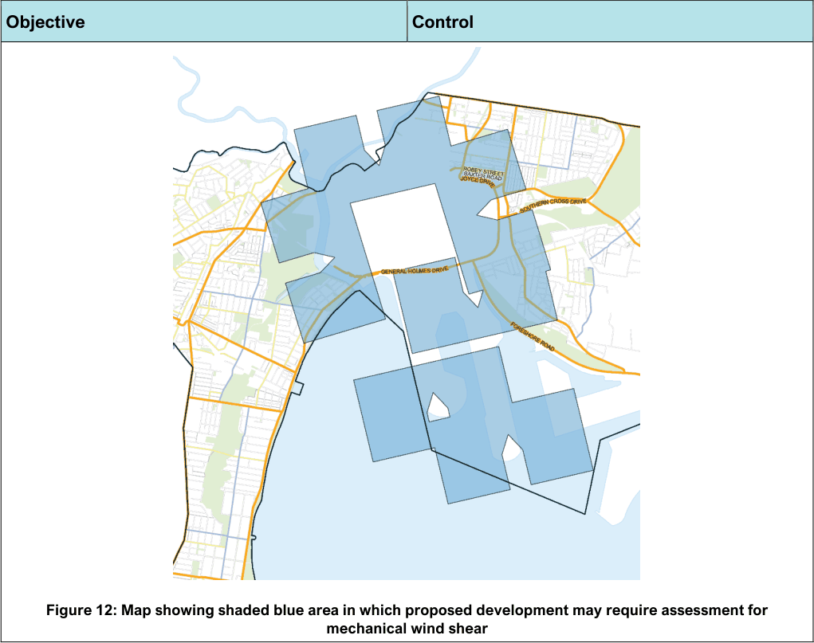

#### 3.12.5 All other development

| Objective |  |
|---|---|
| O1. | Development is to be in accordance with the Objectives outlined in Sub-section 3.5.7. |

| Control |  |
|---|---|
| C1. | Sufficient space must be provided to accommodate the storage of waste and recycling likely to be generated on the premises between collections and any associated equipment. |
| C2. | Waste storage rooms or areas are to be located a maximum 10m from pick up point. Waste rooms are not to be used for any purpose other than the storage of waste. |
| C3. | Waste and recycling receptacles must be stored at all times within the boundary of the site and concealed from the public and commercial domains unless otherwise approved by Council under Section 68 of the Local Government Act 1993. |
| C4. | All waste and recycling must be inside Council approved bins or skips, with lids closed to reduce littering, stormwater pollution, odour and vermin. Waste and recycling not presented in the correct manner will not be collected. |
| C5. | Waste and recycling storage rooms must be: |

| Objective | Control |
|---|---|
|  | a. Enclosed to prevent noise, odour and visual impacts; b. Designed to store the entire fleet of bins plus 0.2m between bins to allow adequate manoeuvrability room; c. Designed with a 1.8m unobstructed clearance zone between the stored bins and the entrance for access and manoeuvrability; d. Designed with suitable door and corridor access to enable bin movement; e. Constructed of concrete or other approved materials at least 75mm thick; f. Finished with a smooth even surface to be easily cleaned; g. Coved at the intersection with walls and plinths with a ramp to the doorway where necessary; h. Graded and drained to the sewerage system and approved by Sydney Water; i. Fitted with a close fitting and self- closing door that can be opened from within the room; j. Designed with adequate lighting and naturally/mechanical ventilation to meet Building Code of Australia requirements; k. Fitted with smoke detectors in accordance with the relevant Australian Standards; l. Equipped taps supplying hot and cold water, mixed through a centralised mixing valve with a hose cock and fitted with an aerator to increase water efficiency; m. Designed to include a clear and easy-to-read “NO STOPPING” sign and “DANGER” sign on the external face of waste storage rooms where appropriate; n. Designed to ensure waste-water from the cleaning of the waste storage area and bins, is not to drain into the stormwater system; and o. Fitted with childproof compacters or mechanical devices where used in the storage of waste. |

| Objective | Control |  |
|---|---|---|
|  | C6. | All new developments are to provide adequate storage for waste to accommodate future change of use, including increased waste generation rates and grease traps. |
|  | C7. | Kitchens, office tea rooms, and the like are to be designed with sufficient space for the interim storage of recyclable, organic and regular waste in separate receptacles. |
|  | C8. | A waste service compartment (waste and recycling area) is to be provided on each floor of the building and have sufficient capacity to store at least 1 day’s volume of waste and recycling likely to be generated on that floor. |
|  | C9. | Sufficient space must be allocated within the building for the storage of reusable items such as crates and pallets. |
|  | C10. | Separate space must be allocated for the storage of liquid wastes and oils etc. The liquid waste storage areas must be undercover, bunded and drained to a grease trap. The area is preferably to be within the building, however if circumstances do not permit, an area that is screened from the public and commercial domains may be negotiated with Council. |
|  | C11. | Liquid waste from grease traps must only be removed by licensed contractors approved by Sydney Water and NSW EPA. |
|  | C12. | For commercial premises whose waste contains 20% or more food waste, or other waste which is considered by Council to have potential amenity impacts, a daily waste collection is required, unless an alternative is agreed upon with Council. |

Development in areas subject to aircraft noise and affected by Sydney Airport’s prescribed airspace

#### Overview

This Part of the DCP provides a means of assessing the effect of aircraft noise on development proposals by utilising an appropriately endorsed Australian Noise Exposure Forecast (ANEF) chart that takes into account long-term operating procedures and air traffic forecasts at Sydney (Kingsford-Smith) Airport. This Part also provides potential applicants with an understanding of the predicted level of the potential height limits due to prescribed airspace on proposed development sites and the potential for proposed developments to cause mechanical windshear.

The aircraft noise controls apply to all development in Bayside LGA within the 20 ANEF and above contour on the ANEF chart. The ANEF chart for Sydney Airport will be the ANEF chart adopted by Council based on the most up-to-date information on operating procedures and air traffic forecasts at Sydney (Kingsford Smith) Airport. The potential height limit controls, due to prescribed airspace for Sydney (Kingsford Smith) Airport, apply to all land within the Bayside LGA.

| Objective |  |
|---|---|
| O1. | To ensure development does not adversely affect air safety of Sydney Airport. |
| O2. | Development is located and designed: a. to prevent certain noise sensitive developments from being located near the Sydney (Kingsford-Smith) Airport and its flight paths, b. to assist in minimising the impact of aircraft noise from the airport and its flight paths by requiring appropriate noise attenuation measures in noise sensitive buildings, and c. to ensure that development in the vicinity of that airport does not hinder or have any other adverse impact on the ongoing, safe and efficient operation of the airport. |
| O3. | To provide guidance to applicants of the approval process required in areas impacted by Sydney (Kingsford Smith) Airport prescribed airspace. |
| O4. | To ensure that developments do not adversely impact on the prescribed airspace for Sydney (Kingsford Smith) Airport. |
| O5. | To determine whether or not an assessment for mechanical windshear |

| Control |  |
|---|---|
| C1. | Where council considers a proposal has the potential for an adverse impact on the air safety of Sydney Airport it may not grant consent. Council will consider the following matters as part of its assessment: a. building height impact on the OLS and PANS-OPS; b. emission of light; c. reflection of sunlight (e.g. from solar panels); d. emissions from smoke, dust or any other airborne particulate; e. creation of air turbulence; and f. storage and handling of dangerous goods. |
| C2. | Development on land within an ANEF affected area (ANEF 20+) must be designed and constructed in accordance with the relevant Australian Standard and other guidelines issued by relevant agencies and authorities. |
| C3. | Development on land within an ANEF affected area (ANEF 20+) is to be supported by a Noise Impact Assessment demonstrating indoor design sound levels in AS 2021—2000 can be achieved. |
| C4. | Aircraft noise sensitive uses, such as but not limited to, residential development, educational establishments, hospitals, nursing homes are not to be located within the 30+ ANEF contour. Child care centres are also discouraged from being located |

| Objective | Control |  |
|---|---|---|
| impacts is needed for any proposed development. |  | within 30+ ANEF contours and must demonstrate appropriate noise attenuation measures. |
|  | C5. | Where a building site is considered by Council to be located on or immediately adjacent to an ANEF contour, and could be affected by aircraft noise, the subject development will be assessed as if it was located within the relevant ANEF contour. |
|  | C6. | For residential development located within the 25+ ANEF contour, the external environment (i.e. deck and pergola) to the dwelling must be considered for aircraft noise impacts. The Noise Impact Assessment must consider the external environment in accordance with AS 2021- 2015. |
|  | C7. | If a building is located within a specific area identified on the OLS map or seeks to exceed the height limit specified in the map, notice of the proposal must be given to Sydney Airport Corporation. Note: Any development over 7.62 metres from existing ground level in the area bounded by Hollingshed Street, Sutherland Street, Sparks Street, Wentworth Avenue, Myrtle Street, Lord Street and Botany Road is required to be referred to Sydney Airport Corporation for consideration on height grounds. Note: Development outside the area detailed in Note 1 above, which is 15.24 metres or over in height is required to be referred to Sydney Airport Corporation for consideration on height grounds. |
|  | C8. | Development must consider the operating heights of all construction cranes or machinery (short term controlled activities) that may penetrate prescribed airspace. Consideration should be given to the timing and location for the proposed control activity on site for referral to Sydney Airport Corporation. Note: Refer to Clause 6.7 of Bayside LEP 2021 for provisions relating to development that may project above the OLS. |

| Objective | Control |  |
|---|---|---|
|  | C9. | Approval to operate construction equipment (i.e. cranes) must be obtained by the relevant authorities prior to any commencement of construction, where the prescribed airspace is affected. Note: Please contact Council for advice as to whether or not your Development Application is required to be referred to Sydney Airport Corporation Limited (SACL). |
|  | C10. | An assessment for mechanical windshear is required where: a) the proposed development is located within the blue shaded area identified in the below figure; or b) as recommended by National Airports Safeguarding Framework (NASF) Guideline B ‘Managing the Risk of Building Generated Windshear and Turbulence at Airports’, available to view at: https://www.infrastructure.gov.au/infrastr ucture-transport- vehicles/aviation/aviation-safety/aviation- environmental-issues/national-airports- safeguarding-framework/national- airports-safeguarding-framework- principles-and-guidelines |
|  | C11. | Where an assessment for mechanical windshear is required, the development application is to be forwarded to SACL for its assessment. |
|  | C12. | Development in proximity to Sydney Airport is to be undertaken in accordance with the relevant NASF. |

> [Picture on page 128: a picture, saved as a picture (images/section-03-general-development-provisions-page-128-1.gif, 150 dpi).]

Figure 11: Obstacle Limitation Surfaces Map

#### Objective

#### Control

> [Picture on page 129: a picture, saved as a picture (images/section-03-general-development-provisions-page-129-1.gif, 150 dpi).]
> Words printed on the picture (title and legend, copied from the PDF):
> mechanical wind shear

Figure 12: Map showing shaded blue area in which proposed development may require assessment for

#### Objective

#### Control

#### Noise, Wind, Vibration and Air Quality
