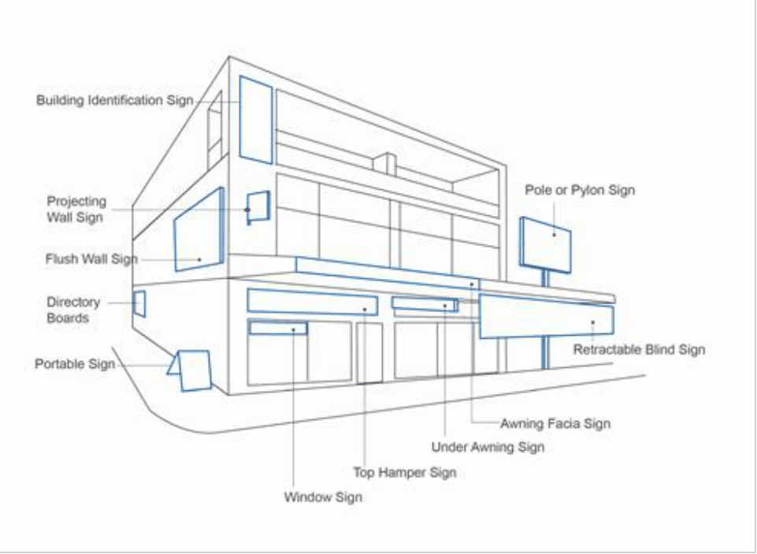

#### 3.16.3 Signage Types

| Objective | Control |  |
|---|---|---|
| O1. | To provide for appropriate outcomes based on the type of sign being proposed, which minimise visual clutter, ensure signage compliments the building form, and minimises impacts on the surrounding area. See Figure 13. |  |
| Under Awning Signage |  |  |
|  | C1. | Awning signage is to be contained entirely within the dimension of the awning and tenancy on which it is located. |
|  | C2. | The content of awning signage must only contain the name and logo of the tenant. |

| Objective | Control |  |
|---|---|---|
|  | C3. | Signage that is suspended under awnings must have a high standard of design and materials. |
|  | C4. | The maximum dimensions of an under- awning sign are to be 2.5 m in width, 0.5 m in height and 0.15 m in depth. |
|  | C5. | Under awning signs must be separated by a minimum of 3 m. |
| Top Hamper Signage |  |  |
|  | C6. | Top hamper signs are to be attached to the transom of a doorway or display window of a building. |
|  | C7. | A maximum of one (1) top hamper sign per premises is permitted. |
|  | C8. | A maximum projection of 100mm from the building façade is permitted. |
|  | C9. | Top hamper signs are to provide a minimum clearance of 2.13m above ground level. |
|  | C10. | The dimensions of a top hamper sign are to be proportionate to the size of the top hamper fascia. |
|  | C11. | Top hamper signs are not to exceed: a. 600mm in vertical height b. 4m in length |
|  | C12. | Top hamper sign should not obscure the top hamper, by allowing a proportion of the wall surface area of the top hamper to be exposed. |
|  | C13. | Top hamper signage should not extend beyond any wall/boundary or below the top of the door/window head. |
|  | C14. | The content of top hamper signage is to be first party signage only. |
| Above Awning Signage |  |  |
|  | C15. | Above awning signage is not permitted. |
| Wall Signage |  |  |
|  | C16. | Projecting flush wall signage, including flags, banners, placards, posters, permanent or temporary are not permitted between the footpath and awning of any building. |
|  | C17. | Non-projecting ground level flush wall signage must: |

| Objective | Control |  |
|---|---|---|
|  |  | a. be located directly above the main pedestrian entry to a shop/business b. be located above the main shopfront window next to the pedestrian entry at the street level c. be located only on frontages that have a public entrance d. be restricted to one (1) sign per shopfront or business e. not exceed a maximum advertising display area of 1m² with no more than 600mm in height f. be designed to relate to the horizontal proportions of the shopfront or business doorway or window above where it is to be located g. not protrude more than 150mm from the shopfront or business frontage to the outside edge of the sign |
|  | C18. | Wall signs above the ground level must not project more than 300mm from the wall. |
|  | C19. | A small wall plaque is permitted directly next to the shop or business entry, in addition to the above. |
|  | C20. | The maximum area of a plaque is 0.1m². |
|  | C21. | Projecting wall signs between the first floor and parapet are not permitted. |
|  | C22. | Painted wall signs are permitted on side elevations where it can be demonstrated that it will contribute to improving the public domain. |
| Awning Fascia Signage |  |  |
|  | C23. | Awning facia signs should: a. be attached to the fascia or return of an awning b. form part of the awning c. not be illuminated d. not project above or below the awning fascia e. contain sign writing that is limited to the street number, name and general nature of the business f. not include product identification |

| Objective | Control |  |
|---|---|---|
| Directory Boards |  |  |
|  | C24. | Directory boards should: a. be designed and constructed of high-quality material and incorporated into the architecture of the site b. be of a size proportionate to that of the site on which it is located c. not dominate landscaped areas |
| Pole or Pylon Signs |  |  |
|  | C25. | Pole or pylon signs should: a. be erected on a pole or pylon independent of any building or other structure b. have a maximum height of 6m c. be set back from the street alignment d. be limited to one pole sign erected on each street frontage of the site |
| Portable Signs (Including A-Frames) |  |  |
|  | C26. | Portable signs should: a. be a portable, freestanding sign consisting of one or two boards b. have a maximum height of 1m and length and width of 500mm Portable signs displayed on public land should be in accordance with Council’s Commercial Use of Footways policy. |
| Retractable Blind Signs |  |  |
|  | C27. | A retractable blind sign must be used for business identification purposes only. |
| Window Sign |  |  |
|  | C28. | A window sign attached to, or displayed on, the shop window must not exceed 40% coverage of that window. |

> [Picture on page 149: a picture, saved as a picture (images/section-03-general-development-provisions-page-149-1.gif, 150 dpi).]

#### Figure 13: Types of Signage
