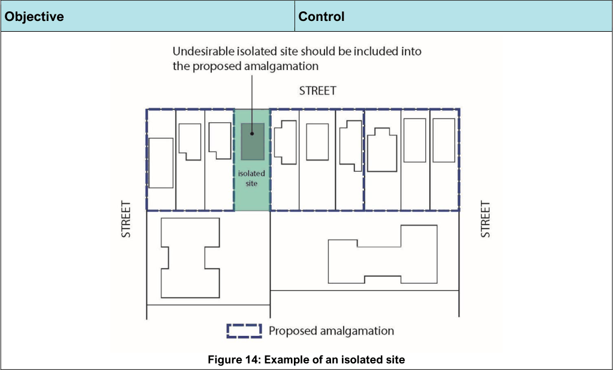

#### General

Common subdivision types include Torrens title (including boundary adjustments and consolidation), Strata title, and Community title. Subdivision and amalgamation of land allows for future development in a manner which may be different to its original state in regard to its use or intensity. It is therefore important to consider the future development potential of land and the potential impacts it may have on existing land uses and networks within the vicinity.

Such consideration may result in limitations being placed on the subdivision and amalgamation including maximum building envelopes, minimum setbacks, building heights, zoning, connectivity, and environmental management requirements to ensure future development does not adversely impact on the surrounding locality.

| Objective |  |
|---|---|
| O1. | Subdivision or amalgamation: a. is consistent with the prevailing or desired lot pattern b. minimises the degree and scale of likely adverse impacts of subdivision and development on the amenity of neighbouring properties |
| O2. | To ensure new allotments are capable of accommodating development that reflects and reinforces the desired future character of the area. |
| O3. | To prevent the fragmentation of land which would prevent the achievement of the extent of development and nature of uses envisioned for particular locations. |
| O4. | To prevent the intensification of residential land uses in environmentally sensitive locations. |
| O5. | To avoid increasing the community’s exposure to coastal hazards. |
| O6. | To ensure that lot sizes allow buildings to be sited to protect natural or cultural features including Heritage Items and retain special features such as trees, landscaping, and views. |
| O7. | To ensure lots have a usable site frontage within business zones. |
| O8. | To ensure that the creation of new lots does not result in a reduction of |

| Control |  |
|---|---|
| C1. | Subdivision or amalgamation must not compromise any significant features of the existing or adjoining sites including streetscape character, landscape features or trees. |
| C2. | Where no minimum lot size exists for a site under Bayside Local Environmental Plan 2021, any proposed subdivision or amalgamation must have characteristics similar to the prevailing subdivision pattern of lots fronting the same street, in terms of area, dimensions, shape and orientation. Note: Council generally considers the ‘prevailing subdivision pattern’ to be the typical characteristic of up to ten allotments on either side of the subject site and corresponding number of allotments directly opposite the subject site. Properties located in the surrounding streets do not usually form part of the streetscape character and are therefore not taken into consideration when determining the prevailing subdivision pattern. |
| C3. | Subdivision results in a density of dwellings that is consistent with that prevailing in the surrounding area. |
| C4. | Applications must demonstrate that the following has been considered: a. site topography and other natural and physical features b. existing services c. existing vegetation d. existing easements or the need for new easements |

| Objective |  |
|---|---|
|  | pedestrian or vehicular connectivity within the existing street network and provides safe access points and servicing areas. |
| O9. | Development is to: a. avoid the creation of isolated sites b. encourage the development of existing isolated sites in a manner that responds to the site’s context and characteristics and that maintains a satisfactory level of amenity |
| O10. | To ensure access is provided for new allotments. |
| O11. | To ensure new allotments have adequate stormwater drainage. |
| O12. | To ensure subdivision maintains the efficiency and safety of the road network. |

| Control |  |
|---|---|
|  | e. vehicle access f. any land dedications required (e.g. road widening) g. existing vegetation h. potential flood affectation and stormwater management requirements i. contamination of the land j. existing buildings or structures k. heritage Items, Conservation Areas and adjoining Heritage Items Note: Development Applications for subdivision where in the Council’s opinion will create a new lot that contains significant features, such as streetscape character, landscape features or trees, the DA is to include the construction of any buildings on the new allotment and the residual allotment. |
| C5. | In accordance with the planning principles established under Parrot v Kiama [2004] NSWLEC 77, where a proposal for subdivision or site amalgamation involves the creation of new allotments that are smaller than typical allotments, are environmentally sensitive, or where it is considered that there could be significant impacts on neighbours as a result of future development, the development application must be accompanied by a conceptual building plan, demonstrating that the relevant DCP controls can be satisfied. |
| C6. | Subdivision which results in additional residential allotments of land within an Australian Noise Exposure Forecast (ANEF) contour of 30+ is not permitted. |
| C7. | Subdivision and amalgamation is not permitted in areas identified to be affected by projected 2100 sea level rise by NSW State Government unless it can be demonstrated that potential impacts can be mitigated (refer to Sydney Coastal Council and CSIRO – Mapping and Responding to Coastal Inundation, February 2012). |
| C8. | Subdivision must not result in the creation of a new lot that contains significant site features that would render the land unable to be developed (e.g. creation of |

| Objective | Control |  |
|---|---|---|
|  |  | allotments that are solely burdened by easements, flooding, highly contaminated land, land that contains significant trees or land of a size which could not facilitate development as per the zoning and controls applicable to the land). |
|  | C9. | Proposed lots shall have street frontage widths not less than the prevailing subdivision pattern within the business zone and are to have a compatible shape and orientation. Note: The prevailing subdivision pattern does not include the subdivision pattern shown in zones adjoining the business centre. Properties located in the surrounding streets do not usually form part of the streetscape character and are therefore not taken into consideration when determining the prevailing subdivision pattern. |
|  | C10. | Developers are to demonstrate to Council’s satisfaction that adjoining parcels not included in their development site are capable of being economically developed. |
|  | C11. | The development of existing isolated sites is not to detract from the character of the streetscape and is to achieve a satisfactory level of residential amenity for its occupants. Note: Development of existing isolated sites may not achieve the maximum potential, particularly height and floor space ratio and will be assessed on merit. |
|  | C12. | All lots created shall have at least one (1) frontage to the street. |
|  | C13. | Inter-allotment draining easement is to be provided if any proposed lots are not able to drain stormwater runoff from the site to a street or public drain way. |
|  | C14. | On corner allotments, the dedication to Council for road widening purposes is a minimum 3 metres splay. |

> [Picture on page 5: a picture, saved as a picture (images/section-04-subdivision-consolidation-and-boundary-adjustment-page-5-1.gif, 150 dpi).]

Figure 14: Example of an isolated site

#### Objective

#### Control
