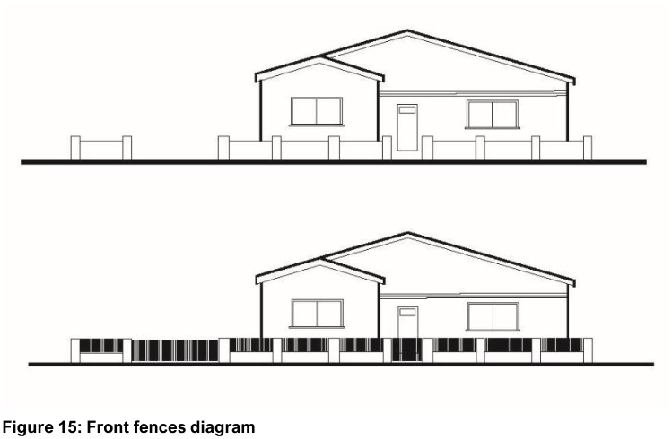

## 5 Residential & Mixed-Use Developments

#### All residential

#### 5.1.1 Fences and Retaining Walls – General Controls

| Objective |  |
|---|---|
| O1. | To provide a fence height that achieves privacy and security and activates the public domain. Note: Matters related to fencing arrangements between neighbouring lots are regulated by the Dividing Fences Act 1991. |
| O2. | To provide a fence height that responds to the characteristics of the site, streetscape and the amenity of adjoining land. Note: Fences perform a number of functions that have the potential to conflict with each other. On this basis, decisions on fences are based on merit. It is recommended that the applicant consult with Council early in the design development stage to discuss an appropriate approach to fencing. Note: Matters related to dividing fencing arrangements between neighbouring lots behind the front building line are regulated by the Dividing Fences Act 1991. |
| O3. | To provide retaining walls that respond to the characteristics of the site, streetscape, and the amenity of adjoining land. |

| Control |  |
|---|---|
| C1. | The maximum height of front fences are: a. 1.5m if at least 50% transparent b. 1.2m if less than 50% transparent (Refer to Figure 15) NB: Council may consider taller fences where properties adjoin significantly busy or hostile road corridors. The visual impacts of taller fencing must be offset by means of additional landscaping provision. |
| C2. | For dwelling houses, the top 50% of a front fence is to be transparent or open style to allow for passive surveillance. |
| C3. | The maximum height of a fence along a road is: a. 1.5m along a road other than a classified road, where C1 is met b. 1.5m along a classified road c. 1.8m where at least 30% transparent along a classified road |
| C4. | Fencing located along side boundaries tapers down from the front building line to the street frontage. |
| C5. | The height of a fence and/or wall along a sloping street shall be: a. a maximum combined height of 2.0m, regularly stepped so there is a maximum height above footpath level of 1.2m |
| C6. | The maximum height of a fence along a side or rear boundary is 1.8m. |
| C7. | Fences do not cause unreasonable amenity impacts on adjoining land, in particular in relation to solar and daylight access, natural ventilation, outlook or views. |
| C8. | The maximum height of retaining walls along a road is 1m. |
| C9. | Retaining walls along a road are located to allow site responsive tree planting within the setback. |
| C10. | Retaining walls do not cause unreasonable amenity impacts on adjoining land, in particular |

| Objective | Control |  |
|---|---|---|
|  |  | in relation to solar and daylight access, natural ventilation, ponding, outlook or views. |
|  | C11. | Fence controls for Heritage Items and in Heritage Conservation Areas must be consistent with the requirements of Section 3.4 (Heritage) of this DCP. |

> [Picture on page 3: a picture, saved as a picture (images/section-05-residential-mixed-use-developments-page-3-2.gif, 150 dpi).]

#### Figure 15: Front fences diagram

#### Fence design and materials

| Objective |  |
|---|---|
| O1. | To ensure fence design, pattern, style, materials, and construction are compatible with the envisaged streetscape and local character. |

| Control |  |
|---|---|
| C1. | Sandstone fences and walls that are significant or represent important character elements for a locality are to be retained and, if necessary, repaired. |
| C2. | Modifications to existing stone fencing and walling are to utilise the same materials and construction technique. |
| C3. | Fences and walls are constructed of robust and durable materials which reduce the possibility of graffiti. |
| C4. | The siting, height, scale, design, materials, colours and other elements of the fences are to: a. where in a heritage conservation area, be compatible with the period or architectural style of existing development on the site be compatible |

| Objective |  |
|---|---|
| Fence design to manage hazards |  |
| O2. | To minimise nuisance when locating and designing fences, such as stormwater, flooding, vehicular access, traffic, and the like. |

| Control |  |
|---|---|
|  | with the predominant fencing pattern in the streetscape |
| C5. | Fences along a road comprise: a. decorative timber metal slats, battens or picket masonry |
| C6. | Fences along a road do not include colourbond. |
| C7. | Post tops and paling tops visible from the public domain are to be shaped or tuned in a decorative manner that complements the development. |
| C8. | Fences are to be designed to highlight entrances and be compatible with buildings, letterboxes and garbage storage areas. |
| C9. | Provision is to be made for access to public utility installations. |
| C10. | Landscaping documentation provided with any development application is to provide details of all proposed fencing, including: a. style (manufacturer, product code and name) b. materials and colour/s installation method |
| C11. | Where in floodways: a. fences are not erected b. where fences are necessary, they are of open construction so as to not restrict the flow of water |
| C12. | Fences do not obstruct existing overland flow paths or stop or redirect surface waters so as to cause a nuisance. |
| C13. | Fences over 1m in height take into consideration sightline issues where adjoining vehicular access. Note: Fence design can address this control by setbacks or by using splays with minimum dimensions of 900mm x 900mm in accordance with Figure 3.3 in Section 3.2.4 of AS/NZS 2890.1. |
| C14. | For low and medium density residential development where a vehicular entrance is proposed in conjunction with a fence greater than 1.2m in height, a 45 degree splay or its equivalent is to be provided either side of the |

| Objective | Control |  |
|---|---|---|
|  |  | entrance to ensure driver and pedestrian safety. Note: The splays are to have minimum dimensions of 900mm x 900mm in accordance with Figure 3.3 in Section 3.2.4 of AS/NZS 2890.1. |
|  | C15. | Gates that are manually operated are to be setback a minimum of 5.5m from the kerb line to allow a vehicle to stand fully off the road. |
|  | C16. | Gates must not encroach over the street alignment when opening or closing. |
