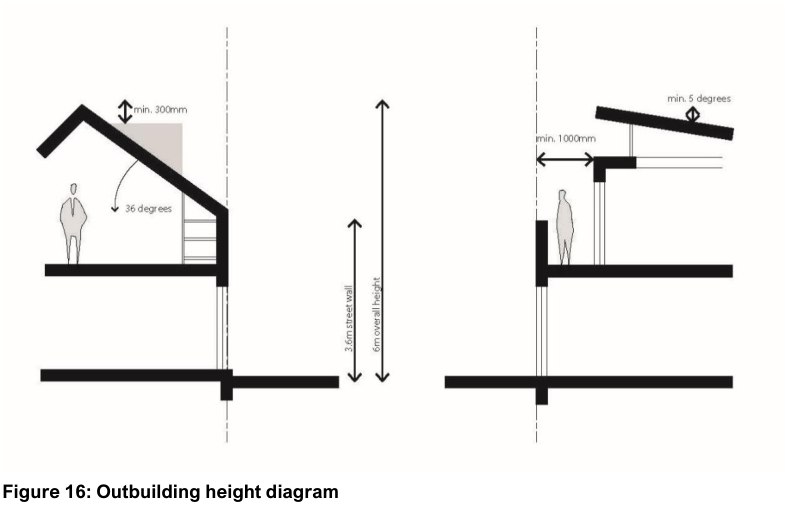

#### 5.1.2 Ancillary residential uses - rear and side lane additions, detached garages, secondary dwellings and studios

This Section outlines controls for the non-primary building located on a site. These controls primarily relate to secondary dwellings or ‘granny flats’ and small-scale studio spaces, as well as other miscellaneous outbuildings.

#### General

| Objective |  |
|---|---|
| O1. | To minimise control the size, bulk and scale of ancillary structures and their visual impact on public spaces and minimise amenity impacts on surrounding properties. |

| Control |  |
|---|---|
| C1. | Buildings must have a minimum setback to a side and rear boundary of 900mm. Windows and glass doors are to face into the property. High and opaque windows may face onto a neighbouring property where lack of adverse impact can be demonstrated. Note: A nil setback is to be considered if implementing masonry building walls with no eaves, gutters or windows and for carports and open structures, such as pergolas, awnings and the like for narrow lots where impacts are minimal and this is the prevailing pattern in the area. Compliance with the Building Code of Australia is required. |
| C2. | Outbuildings are not to result in non- compliances relating to minimum landscaped area, private open space, overshadowing, privacy and other relevant provisions which apply to the development, including those outlined in SEPP (Housing) 2021. |

| Objective | Control |  |
|---|---|---|
|  | C3. | Where the LEP height control enables the development of a 2 storey outbuilding, the second storey of the building must have a traditional pitched form with dormer windows and generally be contained as an attic. |
|  | C4. | Outbuildings are to be located behind the main street face of the development. |
|  | C5. | Where multiple ancillary structure outbuildings are proposed on one property, combining these within a single structure is encouraged. Consideration is to be given to roof form and pitch to ensure bulk and scale impacts are minimised. |
|  | C6. | Where multiple outbuildings and/or a secondary dwelling are/is proposed on one property, the cumulative floor area is not to exceed 70m². |
|  | C7. | Outbuildings attached to a secondary dwelling are not to provide direct access between them. Solid wall construction must be provided. |
|  | C8. | The selection of materials and colours must be compatible with the surrounding natural environment and the dwelling. |
|  | C9. | Where an outbuilding is proposed within a Heritage Conservation Area, the built form controls of that HCA prevail over any inconsistencies with this Section. |

#### Development on Side and Rear Lanes

| Objective |  |
|---|---|
| O1. | To ensure buildings to rear or side lanes are compatible with the principal dwelling and adjoining sites, maximise safety, ensure adequate vehicular access and minimise amenity impacts. |

| Control |  |
|---|---|
| C1. | The prevailing setback to a rear or side lane is to be retained. Note: A minimum setback of 900mm is to be provided from any garage or carport to a rear lane to ensure access complies with AS2890 and adequate site lines are achieved. |
| C2. | The secondary dwelling/outbuilding on a lot adjoining a rear lane is to be clearly subservient to the principal dwelling. |
| C3. | For properties with rear lane access or fronting another street, the secondary |

| Objective | Control |  |
|---|---|---|
|  |  | dwelling/outbuilding must address the lane/street as if it were the primary frontage. |
|  | C4. | Outbuildings with a frontage to a rear lane or side lane may include an attic level subject to compliance with other relevant controls (including, but not limited to, the height control and overshadowing provisions) and the following: a. the structure does not exceed a maximum street wall height (or side wall height if not presenting to a street) of 3.6m b. the structure does not exceed a maximum roof height of 6 m c. the pitch of the roof does not exceed 36 degrees d. dormer windows are permitted provided each complies with the following design criteria: i. the minimum distance between the main roof line and the dormer window structure is 300mm measured vertically ii. the dormer window does not have a total width of more than 25% of the width of the roof, or 1.2m, whichever is the lesser iii. adverse privacy impacts do not result (surveillance of laneways is encouraged) |
|  | C5. | On lots smaller than 150m2, a secondary dwelling is not permitted unless it can achieve a minimum consolidated area of private open space for the principal dwelling of 16sqm with a minimum dimension of 3m. |
|  | C6. | Where a rear lane is highly intact, the pattern of original outbuildings, fences and laneway widths must be retained. |
|  | C7. | Development is to retain the predominant scale of the lane, particularly where that scale is single storey, and any landscape features including mature trees. |

> [Picture on page 8: a picture, saved as a picture (images/section-05-residential-mixed-use-developments-page-8-1.gif, 150 dpi).]

#### Figure 16: Outbuilding height diagram
