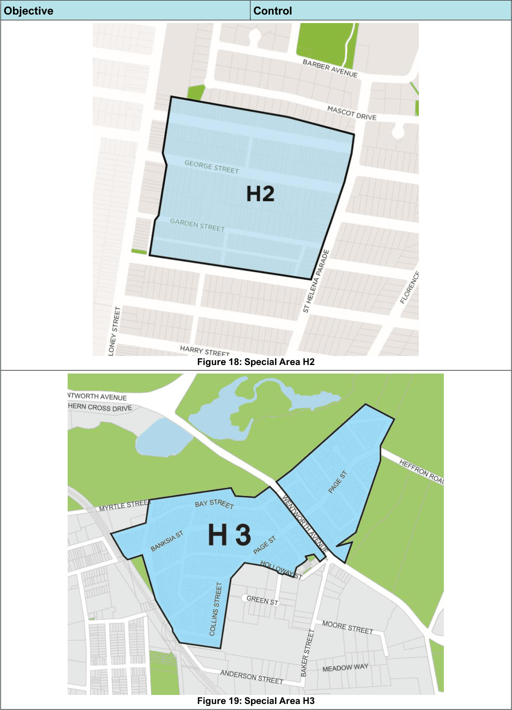
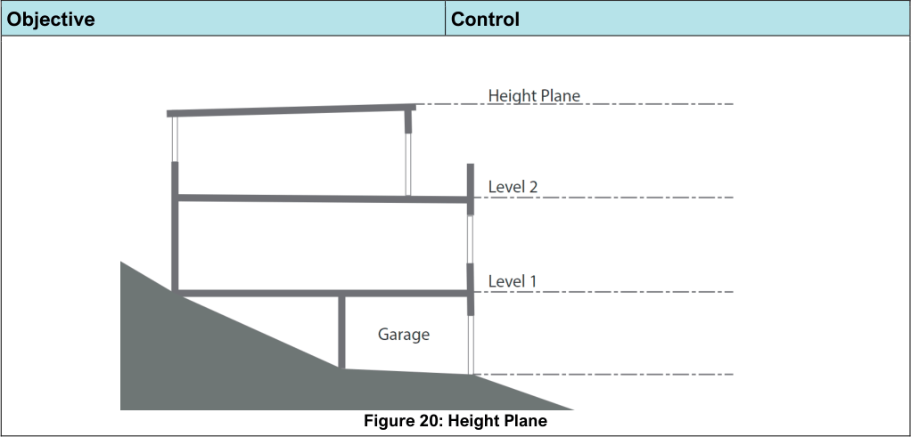

#### 5.2.1 Low-density residential (dwellings, dual occupancy, semi-detached dwellings)

These controls should be read in conjunction with the General residential housing controls and are the primary controls relevant to low-density dwelling typologies including dwellings, dual occupancy dwellings and semi-detached dwellings. Additional particular controls relevant for semi-detached and dual-occupancy dwellings are also outlined.

#### Streetscape, Local Character and Quality of Design

| Objective |  |
|---|---|
| O1. | To ensure that dwellings are compatible with the envisaged local streetscape and desired future character. |
| O2. | To create visual interest through building articulation and a variety of compatible materials, finishes and colouring. |

| Control |  |
|---|---|
| C1. | Development is to be designed to reflect the relevant local character in Chapter 7 and reinforce the architectural features and identity which contribute to the desired future character of the area. |
| C2. | Development is oriented to be parallel with the primary road. Development sites with two or more frontages should address both frontages. Note: Council may vary this control where the lot has an irregular boundary to the primary road. |
| C3. | Proposed materials for low density dwellings should not include extensive areas of glass sheeting and glass blocks. Painting, rendering, or bagging of any original unpainted masonry or sandstone surfaces or cladding that provides a positive contribution to the streetscape character and requires maintenance is not permitted. |
| C4. | Where alterations or additions are proposed, the materials must be compatible with those of the existing building and/or desired future character of the streetscape. |
| C5. | Elevations should avoid large expanses of blank walls through the following: a. a harmonious composition of varied building elements b. recesses and projections c. changes in texture, material, detail and colour Note: for Dwelling Houses, Semi-Detached Dwelling and Secondary Dwellings, |

| Objective | Control |  |
|---|---|---|
|  |  | completely rendered buildings with a box shape envelope will not be supported. |
|  | C6. | Development on sites with two or more frontages should address both frontages. |

#### Built Form Controls

| Objective |  |
|---|---|
| O1. | To ensure building height is compatible with the existing and envisaged built form of the site’s surrounds, having regard to natural landform (topography), amenity and local character. Note: Preferred future local character for specific localities is identified in Chapter 7 – Location Specific Controls of this DCP. |
| O2. | To ensure building length is broken up to reflect the low-density character of adjoining sites. |
| O3. | To ensure roof form, pitch, materials, and colours are compatible with those prevailing in the surrounding area. |
| O4. | To ensure that void spaces in dwelling houses are designed to increase the amenity of a dwelling, and that the provision of such spaces does not lead to diminution in the amenity of adjacent properties. |

| Control |  |
|---|---|
| C1. | Maximum building height above ground level in metres complies with clause 4.3 of the Bayside LEP 2021. |
| C2. | Maximum building height above ground level (existing) in storeys excluding basements is: a. for a Dwelling House, Semi- Detached Dwelling and Dual Occupancy: 2 storeys b. for a Secondary Dwelling: 1 storey c. for any of the above uses located at the rear of a site or on a battle axe: 1 storey. |
| C3. | A Secondary dwelling may be located at first floor level above a garage or outbuilding which fronts a rear lane or side street subject to compliance with: a. outbuilding controls in Sub-section 5.1.2 b. relevant provisions in Chapter 3 – General c. other relevant provisions in this section |
| C4. | Maximum building length is compatible with that of adjoining sites. Two or three storey developments are only permitted towards the front of an allotment and may only extend to a maximum of 70% of the depth of the site measured from the front property boundary. Note: For Secondary Dwellings the total length of both the Secondary Dwelling and Dwelling House is to be considered. |

| Objective | Control |  |
|---|---|---|
|  | C5. | Buildings must provide horizontal and vertical articulation of external walls to create visual interest and reduce building bulk. |
|  | C6. | Where roof forms in a streetscape are predominantly pitched, roof pitches are to be between 22.5 degrees and 40 degrees. |
|  | C7. | Flat or skillion roof forms may be located to the rear of a development site provided it is not a corner location and does not detract from the streetscape. |
|  | C8. | Pitched roofs must have a minimum eave overhang of 450mm (excluding gutters). |
|  | C9. | An attic may be used as a habitable room provided that: a. it is part of the dwelling immediately below b. it is incapable of being used as a separate dwelling c. it is contained wholly within a roof space above the ceiling line of the storey immediately below, except for minor elements such as dormer windows d. windows are limited to small dormer windows |
|  | C10. | Voids are to connect related uses and spaces and should not compromise the useability of spaces or result in an unreasonable loss of amenity for the residents. |
|  | C11. | Void spaces must be designed so as not to be reasonably capable of future infill. Voids in developments which exceed the permitted FSR will not be supported. Similarly, the infill of any existing void must not result in overdevelopment of the site by exceeding the maximum permitted FSR. |

#### Setbacks

| Objective |  | Control |  |
|---|---|---|---|
| O1. | To ensure building setbacks are compatible with the envisaged | C1. | Minimum building setback to a primary road is either: |

| Objective |  |
|---|---|
|  | streetscape and provide a reasonable level of amenity based on the adjacent road environment. |
| O2. | To ensure an appropriate level of visual and acoustic privacy between a development and its adjoining sites, as well as providing sufficient space for access, landscaping and private open space. |
| O3. | To positively contribute to the streetscape through building articulation and building elements that encourage engagement between the development and public domain. |
| O4. | To ensure an appropriate level of visual and acoustic privacy between a development and its adjoining sites as well as providing sufficient space for access, landscaping and private open space. |

| Control |  |
|---|---|
|  | a. the average of the dwellings on adjoining lots; b. otherwise, 6m. |
| C2. | Minimum building setback to a secondary road is 1.5m |
| C3. | Minimum building setback to a rear lane is: a. where habitable: 1.5m b. where non-habitable: 1m |
| C4. | Minimum building setback to a road identified as a Key Freight Route may be required to have a greater setback. Key Freight Routes are identified at: https://data.datahub.freightaustralia.gov.au/ ne/dataset/national-key-freight-routes-map |
| C5. | Minimum building setback to a rear boundary is 5m. |
| C6. | Minimum building setback to a side boundary is 0.9m (ground floor) and 1.5m (first storey and above). |
| C7. | A dwelling house with a setback from a primary road of at least 3m may have an articulation zone that extends up to 1.2m forward of the minimum required setback from the primary road. |
| C8. | The following ground-floor building elements may be located in the articulation zone: a. an entry feature or portico b. a balcony, deck, pergola, terrace or verandah c. a window box treatment d. a bay window or similar feature e. an awning or other feature over a window f. a sun shading feature g. an eave h. any other small scale building element that in the opinion of council provides visual interest to the elevation Note: The maximum total area of all building elements in the articulation zone, other than a building element specified in e), f) or g), does not comprise more than 25% of the area of the articulation zone. |
| C9. | Minimum building setback for an awning or verandah is: a. to classified roads: 1.5m |

| Objective | Control |
|---|---|
|  | b. to local roads that intersect with classified roads: 1.5m for a distance of 100m from the intersection with the classified road c. to any signalised intersection: 1.5m for a distance of 100m from the signalised intersection |

#### Landscaping and Private Open Space

| Objective |  |
|---|---|
| O1. | To ensure new dwellings have functional and high-quality landscaping and open space. |
| O2. | To ensure rooftop terraces do not result in excessive bulk and scale or adverse impacts to the visual and acoustic privacy of adjoining sites. |

| Control |  |
|---|---|
| C1. | New development must comply with the minimum private open space and landscaping provisions contained within Section 3.7 (Landscaping and Biodiversity). |
| C2. | The maximum area of a rooftop terrace is 24m2 and should not represent the principal private open space for a dwelling. The roof top terrace is to be enclosed by in-built planter boxes. |
| C3. | The rooftop terrace must be oriented to minimise impacts on the visual and acoustic privacy of adjoining sites. |
| C4. | Where part of a rooftop terrace is oriented to a side boundary, its perimeter must be bordered screening vegetation. The floor of the rooftop terrace area must be differentiated from the rest of the flat roof. The enclosure of the roof top terrace area with built-in planter boxes may be required. |
| C5. | Roof terrace balustrades must not be transparent. |
| C6. | The trafficable area of the roof top terrace and balustrade shall be setback at least 1.5m from the building edge. |
| C7. | The roof top entry point should not be excessive in size and should only be used as access to the terrace area. |
| C8. | Overlooking into the internal private and external open space of adjoining neighbours should be avoided. |

#### Solar Access and Overshadowing

| Objective |  |
|---|---|
| O1. | To ensure that sunlight access: • is provided to private open space and habitable rooms within the development; and • is not unreasonably diminished for neighbouring properties and the development site. |

| Control |  |
|---|---|
| C1. | Dwellings within the development site and adjoining properties should receive a minimum of 2 hours direct sunlight in habitable living areas (family rooms, rumpus, lounge and kitchen areas) and in at least 50% of the primary private open space between 9am and 3pm in mid-winter. Council may grant consent to a development that does not comply with the 2 hours of solar access requirement. However, Council must not grant consent, unless the applicant has satisfactorily addressed the questions identified in the Land and Environment Court Sunlight Planning Principle. The Planning Principle is updated by Court decisions and is available to view on the Land and Environment Court’s website (www.lawlink.nsw.gov.au/lec). For development adjoining a semi-detached dwelling, first floor additions may need to be setback in order to provide adequate solar access to the living areas within the adjoining dwellings and their primary open space areas. |
| C2. | Consideration must be given to neighbouring properties’ solar panels and the loss of sunlight to these panels as a result of any development proposal. |

#### Parking and Access

| Objective |  | Control |  |
|---|---|---|---|
| O1. | To ensure that low-density residential development is consistent with Council’s provisions related to parking, access, and active and sustainable transport. | C1. | Development must be consistent with the requirements in Section 3.5 (Transport, Parking and Access). |

#### Visual and Acoustic Privacy

| Objective |  | Control |  |
|---|---|---|---|
| O1. | To site and design development to ensure a reasonable level of acoustic and visual privacy for residents within a development | C1. | Habitable room windows above the ground floor, which face side or rear boundaries that adjoin a residential property, must provide: |

| Objective |  |
|---|---|
|  | and between a development and adjoining sites. |
| O2. | To ensure attics do not result in excessive bulk or adverse impacts to the visual privacy of adjoining sites. |

| Control |  |
|---|---|
|  | a. offsetting of the edge of one window to the edge of the other window by a sufficient distance to limit views; or b. sill heights 1.5m above the floor level of that storey; or c. opaque glazing in any part of the window below 1.5m above floor level; or d. fixed external screens with 50% transparency or less. |
| C2. | Balconies, terraces, and the like should be located to minimise overlooking of an adjoining property’s open space or windows. Techniques such as recessing, screens or landscaping may be used to prevent direct views into habitable rooms or private open spaces. |
| C3. | The form and placement of attic windows must respect the visual privacy of neighbouring properties and minimise overlooking. |
| C4. | Access to attics must be provided by internal, not external, stairs. |
| C5. | First floor rear balconies are only permitted adjacent to a bedroom and must be contained wholly above the building footprint of the ground floor. |

#### Special Height Controls

| Objective |  |
|---|---|
| Generals |  |
| O1. | To encourage specific low density-built form outcomes in Special Areas. |

| Control |  |
|---|---|
| C1. | Increased height and density in the form of terrace style housing is encouraged in the Special Height Areas H1 and H2 which covers parts of Botany, Mascot, Rosebery, and Eastlakes. Development in this area should include significant landscaping in the front setbacks. |
| C2. | Height in the H2 Special Height Area is permitted and encouraged as 2 storeys with attic, with the maximum ridge height to be consistent with adjoining two (2) storey buildings. |
| C3. | In the H3 Special Height Area, low density residential accommodation in the form of |

| Objective | Control |
|---|---|
|  | detached/attached dwellings is encouraged with a maximum height of 2 to 3 storeys (10 metres height limit) depending on the slope of the land with a FSR of 0.55:1 within Special Height Area H3. The bottom storey of the dwelling must only consist of garages or non-habitable rooms such as bathrooms, laundries, storage areas or the like (as defined by the BCA). Note: At any part of the perimeter of the building, the height is not to exceed 2 storeys unless one of the storeys being the basement or lowest level contains a non- habitable space not exceeding 40m² in area. |
| Figure 17: Special Area H1 |  |

> [Picture on page 20: a picture, saved as a picture (images/section-05-residential-mixed-use-developments-page-20-1.gif, 150 dpi).]

Figure 18: Special Area H2

Figure 19: Special Area H3

#### Objective

#### Control

> [Picture on page 21: a picture, saved as a picture (images/section-05-residential-mixed-use-developments-page-21-1.gif, 150 dpi).]

Figure 20: Height Plane

#### Objective

#### Control
