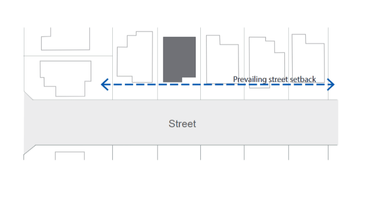
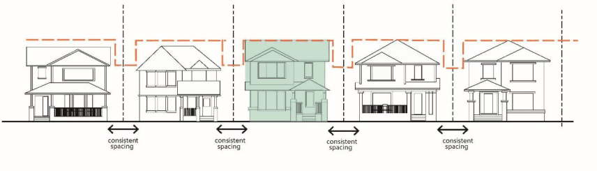

#### 5.2.2 Additional Controls for Dual Occupancy and Semi-Detached Dwellings

| Objective |  |
|---|---|
| O1. | To ensure new semi-detached and dual occupancy development responds to predominant streetscape qualities. |
| O2. | To integrate new semi-detached development with the adjoining semi- detached dwellings and is viewed as a pair from the public domain. |
| O3. | To ensure alterations or additions to semi-detached dwellings integrate with the other adjoining semi-detached dwelling and do not dominate the streetscape. |
| O4. | To ensure dual occupancy development does not result in excessive bulk that detracts from the amenity of the streetscape. |

| Control |  |
|---|---|
| C1. | Alterations and additions to existing semi- detached dwellings must integrate with the existing and adjoining building and not compromise future development of the adjoining semi-detached dwelling. |
| C2. | The new dwellings that constitute the semi- detached dwelling are compatible with the existing in siting, scale, form, material, and colour when viewed from a road. |
| C3. | Alterations or additions above the ground storey to one of a pair of semi-detached dwellings must be set back beyond the apex or main ridge of the principal roof form of the building. |
| C4. | Building setbacks to a side boundary less than the minimum are only permitted on lots with a width less than 12.5m. |
| C5. | Minimum lot width for dual occupancy dwellings must be 15m. Note: A variation to the minimum lot width may be supported where the development satisfies each of the following points: a. minimum setbacks requirements are achieved b. development complies with the maximum FSR and Height in accordance with the Bayside LEP 2021 |

| Objective | Control |  |
|---|---|---|
|  |  | c. privacy is maintained between adjoining properties and overshadowing complies with the requirements set out in this DCP d. development does not contribute unreasonably to bulk and scale and is consistent within the neighbourhood and street character e. minimum landscaped area requirement is achieved |
|  | C6. | A contemporary design of dual occupancy dwellings is encouraged and should take into consideration predominate architectural features, style and design of the neighbouring buildings, streetscape and local character. |
|  | C7. | Two or three storey development is only permitted on the front of an allotment and may extend to a maximum of 70% of the depth of the site measured from the property boundary. |

> [Picture on page 22: a picture, saved as a picture (images/section-05-residential-mixed-use-developments-page-22-2.gif, 150 dpi).]

Figure 21: Minimum building setback to a primary road is the average of the dwellings on adjoining lots

> [Picture on page 22: a picture, saved as a picture (images/section-05-residential-mixed-use-developments-page-22-4.gif, 150 dpi).]

#### Figure 22: Building setbacks are compatible with streetscape rhythm
