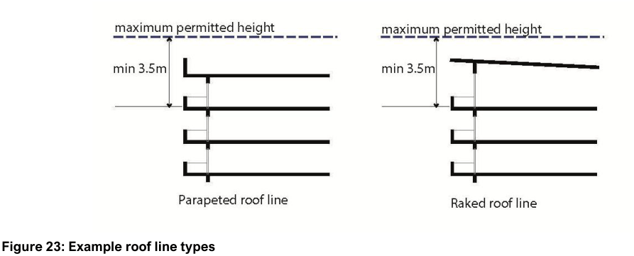

#### 5.2.4 High density residential

The controls in this section apply to high density development, including residential apartment buildings. Where the controls in this section are inconsistent with the principles in SEPP 65 and the Apartment Design Guide, the Apartment Design Guide prevails.

#### Streetscape, Local Character, and Quality of Design

| Objective |  |
|---|---|
| O1. | To create high-quality and functional architecture that contributes to local character and assists with legibility. |
| O2. | To create visual interest through building articulation and a variety of compatible materials, finishes and colouring. |
| O3. | To provide for high quality high density residential development that: a. responds appropriately to its site and context b. contributes positively to local character and streetscape c. provides a high level of amenity for residents and adjoining properties |
| O4. | To positively contribute to the streetscape through unobstructed alignment of built form to the public domain. |
| O5. | To provide differentiation in built form where development occurs over a street block. |
| O6. | To conceal utilities and building bulk from residents and the public domain. |

| Control |  |
|---|---|
| C1. | Development is to be designed to reflect the relevant local character in Chapter 7 and reinforce the architectural features and identity which contribute to the desired future character of the area. |
| C2. | Where involving development that is three or more storeys and has four or more dwellings, development considers the relevant objectives and design criteria of the Apartment Design Guide. Note: this DCP requires the preparation of a context and site analysis to support a Development Application. Note: Local character is articulated for specific localities in Chapter 7 – Specific Places |
| C3. | Important corners are expressed by giving visual prominence to parts of the façade through a change in building articulation, material, colour, roof expression or increased height. |
| C4. | The building line of a street wall building must be parallel with the street boundary alignment. |
| C5. | Buildings provide opportunities for people to engage with the public domain through well designed, legible elements such as: a. entry lobbies b. entry porches c. loggias |
| C6. | Elevations are to be articulated into smaller elements in both the horizontal and vertical planes that provide visual detail and interest within a cohesive overall design including through the use of: a. building entries b. balconies and other private outdoor recreation areas c. windows d. doors e. eaves, overhangs, and other sun shading devices f. blade walls and fins |
| C7. | Large expanses of blank walls are avoided through the use of architectural design features. |

| Objective | Control |  |
|---|---|---|
|  | C8. | Where in the same street block, buildings should vary in size, height, form, and architectural expression so that the street block presents as a group of buildings rather than a singular architectural design or building. |
|  | C9. | Design incorporates a range of measures to provide for a high level of residential amenity such as: a. sun shading devices b. noise barriers c. privacy screens d. careful location of balconies, terraces and loggias |
|  | C10. | Plumbing services/fire boosters/substations are to be integrated and within building footprint. |
|  | C11. | All overhead wires (including electrical and telecommunication services) fronting the site are to be relocated underground as part of the development. The redundant power poles are to be removed and replaced with underground supplied street lighting columns. All works shall be carried out at the applicant’s expense. |

#### Built Form Controls

| Objective |  |
|---|---|
| O1. | To ensure roof form, pitch, materials, and colours are compatible with those prevailing in the surrounding area. |
| O2. | Dwellings provided at the ground storey have a high level of engagement with the adjoining public domain. |

| Control |  |
|---|---|
| C1. | Where in the same street block, buildings vary in size, height, form, and architectural expression so that the street block presents as a group of buildings rather than a singular architectural design or building. |
| C2. | Western elevations incorporate design measures that reduce solar gain from direct summer afternoon sunlight such as: a. external, fixed devices such as balconies, eaves, or overhangs b. external movable devices such as screens c. glazing or transparent glass that reduces the amount of heat entering a building (mirrored glass is not permitted, and coloured glass is only permitted where it is transparent) |
| C3. | Building utilities such as clothes drying areas and air conditioning units are screened from view from the public domain. |

| Objective | Control |  |
|---|---|---|
|  |  | Air conditioning units must not reduce the minimum private open space area of a dwelling. |
|  | C4. | The floor level of the upper most storey must be at least 3.5m below the maximum permitted height to achieve a variety of roof forms. |
|  | C5. | Where provided on a roof, plant rooms, lift overruns and mechanical ventilation are to be integrated into the building design and are not visible from the public domain public place. Note: It is Council’s preference that these items be located in the basement of the building. |
|  | C6. | Upper storeys are to be articulated through measures such as differentiated roof forms, maisonettes or mezzanine penthouses. |
|  | C7. | Ground floor dwellings fronting a street are to have individual street entries. |
|  | C8. | Dwellings provided at the ground storey are encouraged to be designed in a form similar to 2 storey terrace houses, including framing fin walls to delineate individual dwellings. |
|  | C9. | The maximum difference in height between the public and private domain at the lot boundary is 1m. |
|  | C10. | Where the difference in height between the public and private domain at the lot boundary is greater than 1m, a detailed section is to be provided to demonstrate that an appropriate relationship is provided between ground floor dwellings and the adjacent street. Casual surveillance of the street must be achieved and the privacy of the unit maintained. |
|  | C11. | Ground floor units must not be located below the level of the adjacent street. |
|  | C12. | Elements forward of the main building line such as private open space and fencing must be designed to facilitate opportunities for passive casual surveillance of the adjoining public domain. |
|  | C13. | Existing residential flat buildings with no existing balcony enclosures are not permitted to enclose any balcony. Applications for balcony enclosures may only be considered when the enclosures are: |

| Objective | Control |  |
|---|---|---|
|  |  | a. integrated with a design for the entire building; and b. improve internal amenity through environmental control. |
|  | C14. | Large expanses of blank walls are to be avoided through the use of architectural design features, modelling and fenestration. |

#### Setbacks

| Objective |  |
|---|---|
| O1. | To ensure building setbacks are compatible with the envisaged streetscape character and provide a reasonable level of amenity based on the adjacent road environment. |
| O2. | To ensure an appropriate level of visual and acoustic privacy between a development and its adjoining sites as well as providing sufficient space for access, landscaping, and private open space. |

| Control |  |
|---|---|
| C1. | Building setback to a road is compatible with: a. the predominant front setback b. the setback defined in Chapter 7 – Location Specific Controls |
| C2. | Development setbacks to the side and rear are to be consistent with the Apartment Design Guide. Where the ADG doesn’t apply: a. Minimum building setback to a side boundary: i. up to four storeys (approximately 12m): 3m between habitable rooms/balconies ii. four storeys (approximately 12m) and above: 4.5m b. Minimum building setback to a rear boundary shall be, whichever is greater: i. 6m ii. 15% of the length of the site |
| C3. | Minimum building setback for an awning or verandah must comply with the following: a. to classified roads: 1.5m b. to local roads that intersect with classified roads: 1.5m for a distance of 100m from the intersection with the classified road c. to any signalised intersection: 1.5m for a distance of up to 100m from the signalised intersection |
| C4. | Where land dedications are required resulting in a new lot line, all setbacks are to |

| Objective | Control |  |
|---|---|---|
|  |  | be provided from this new boundary line, including basement car parking setbacks. |
|  | C5. | Minimum building setbacks to all lot boundaries are to be clear of intrusions, including all or part of: a. buildings b. structures c. basements d. vehicle access or parking e. infiltration systems |

#### Landscaping and Private Open Space

| Objective |  |
|---|---|
| O1. | To ensure new dwellings have functional and high-quality landscaping and open space. |
| O2. | To ensure rooftop terraces do not result in excessive bulk and scale or adverse impacts to the visual and acoustic privacy of adjoining sites. |

| Control |  |
|---|---|
| C1. | New development must comply with the minimum private open space and landscaping provisions contained within Section 3.7 (Landscaping and Biodiversity). |
| C2. | New development must comply with the landscaping, private, communal open space and deep soil criteria within the Apartment Design Guide. |
| C3. | Any rooftop terrace must be oriented to minimise impacts on the visual and acoustic privacy of adjoining sites. |
| C4. | Perimeters of roof tops terraces bordering side or rear boundaries must be screened to minimise potential privacy issues. The use of planters within screens is encouraged. the location of screens must not contribute to the perceived bulk of the building form. |
| C5. | The trafficable area of the roof top terrace and balustrade shall be setback at least 1.5m from the building edge. |
| C6. | The roof top entry point and associate roof form must not contribute to the perceived bulk of the building. |

#### Solar Access and Overshadowing

| Objective |  |
|---|---|
| O1. | To ensure that sunlight access: a. is provided to private open space and habitable rooms within the development; and b. is not unreasonably diminished for neighbouring properties and the development site. |

| Control |  |
|---|---|
| C1. | Adjoining properties that the ADG does not apply to should receive a minimum of 2 hours direct sunlight in habitable living areas (family rooms, rumpus, lounge, and kitchen areas) and at least 50% of the primary private open space between 9am and 3pm in mid-winter. |
| C2. | Council may grant consent to a development that does not comply with the 2 hours of solar access requirement. However, Council must not grant consent, unless the applicant has satisfactorily addressed the questions identified in the Land and Environment Court Sunlight Planning Principle. The Planning Principle is updated by Court decisions and is available to view on the Land and Environment Court’s website (www.lawlink.nsw.gov.au/lec). |

#### Parking, Access and Circulation

| Objective |  |
|---|---|
| O1. | To provide access and circulation areas that are comfortable, of a high amenity and accessible for all. |
| O2. | To ensure that medium-density residential development is consistent with Council’s provisions related to parking, access and active and sustainable transport. |

| Control |  |
|---|---|
| C1. | Development must be consistent with the requirements in Section 3.5 (Transport, Parking and Access). |
| C2. | Apartment design complies with the provisions of chapter 4F Common circulation and spaces of the Apartment Design Guide. |
| C3. | All common corridors have a minimum width of 2m to enable bulky goods (white goods, furniture etc) to be easily transported through the building. |
| C4. | All common corridors are to be provided with natural light and ventilation. |
| C5. | The minimum dimensions of lift cars are to achieve compliance with relevant Australian Standards. |
| C6. | Where provided, lifts are to be accessible from all levels of the building, including all basement levels. |
| C7. | Level access to the lift from all basement levels is provided. |
| C8. | Each dwelling on a level above the sixth storey has access to two lifts. |

| Objective | Control |  |
|---|---|---|
|  | C9. | In buildings of more than four storeys served by elevators, ensure that alternative access to another elevator is available in the event that any elevator is out-of-service due to breakdown or routine servicing. |
|  | C10. | All applications are to include a statement on how the development will comply with the provisions of the Disability Discrimination Act and comply with Part 4.10 – Universal, Accessible and Adaptable Design. |

#### Visual and Acoustic Privacy

| Objective |  |
|---|---|
| O1. | To site and design development to ensure a reasonable level of acoustic and visual privacy for residents within a development and between a development and adjoining sites. |
| O2. | To ensure attics do not result in excessive bulk or adverse impacts to the visual privacy of adjoining sites. |

| Control |  |
|---|---|
| C1. | Habitable room windows above the ground floor, which face side or rear boundaries that adjoin a residential property, must provide: a. offsetting of the edge of one window to the edge of the other window by a sufficient distance to limit views; or b. sill heights 1.5m above the floor level of that storey; or c. opaque glazing in any part of the window below 1.5m above floor level; or d. fixed external screens with 50% transparency or less. |
| C2. | Balconies, terraces and the like should be located to minimise overlooking of an adjoining property’s open space or windows. Techniques such as recessing, screens or landscaping may be used to prevent direct views into habitable rooms or private open spaces. |
| C3. | The form and placement of attic windows must respect the visual privacy of neighbouring properties and minimise overlooking. |
| C4. | Overlooking into the internal private and external open space of adjoining neighbours must be avoided. |
| C5. | Rooms with snorkel windows are discouraged. |

#### Materials and Finishes

| Objective |  |
|---|---|
| O1. | To create visual interest through building articulation and a variety of compatible materials, finishes and colouring. |
| O2. | To incorporate sustainable materials and technologies into development. |
| O3. | To ensure development is resilient to graffiti, low maintenance and durable. |
| O4. | Materials and finishes: a. complement the overall building composition and emphasise the scale, proportion and rhythm of elevations b. are low maintenance c. are energy efficient d. maximise the life of buildings and reduce energy costs in demolition, reconstruction and recycling |

| Control |  |
|---|---|
| C1. | The building base or key elements incorporate visually heavier materials such as brick, stone, and concrete. |
| C2. | Lighter materials such as glazing, cladding and lightly coloured rendered surfaces are used to reduce perceived bulk and add relief to the façade. |
| C3. | The colour scheme for external elevations comprises a compatible selection of lighter, softer, and more visually recessive colours. Note: Lighter, softer, and more visually recessive colours are those such as whites, creams, greys and browns. |
| C4. | A Schedule of Finishes and a detailed colour scheme for the building facade will accompany all Development Applications involving building works (refer to Council’s Development Application Lodgement Checklist). The Schedule of Finishes will consist of: a. samples of materials with manufacturer’s details and product code b. detailed colour scheme to be shown in the form of illustrated building elevations which is cross- referenced with a colour sample chart showing manufacturer’s details and product code |
| C5. | A 1:20 or 1:50 detailed construction section is to be provided detailing at a minimum the materials and finishes to be used, as well as shading screens or noise attenuation measures. |
| C6. | Solar panels are integrated into the design of a building. |
| C7. | Materials and elements on the exterior of the building are durable, low maintenance and graffiti resistant such as combinations of concrete, brick, timber, and glass. |

#### Entries

| Objective |  |
|---|---|
| O1. | To ensure building entries are easily identifiable, accessible, and positively contribute to the streetscape. |

| Control |  |
|---|---|
| C1. | The entry is to be designed so that it is a clearly identifiable element of the building in the street. |
| C2. | Entrances must provide shelter and be well-lit and safe spaces to enter the building, meet and collect mail. |
| C3. | At least one main entry with convenient universal, barrier-free access must be provided in all new developments. |
| C4. | Where a ramp access is provided, it is not visually dominant from the adjoining public domain. |
| C5. | Provide separate entries from the street for: a. pedestrians and cars b. residential and commercial users |
| C6. | Design entries and associated circulation space of an adequate size to allow movement of furniture between public and private spaces. |
| C7. | Pedestrian entries are to be located on primary road frontages. |
| C8. | Building entries providing access to more than one dwelling maximise visual connections between the private and public domain through layout and materials such as large expanses of transparent glass. |
| C9. | Street numbering and mailboxes must be clearly visible from the primary street. |
| C10. | Devices such as open fencing may be necessary along the front boundary to ensure visibility and security of the entry. Note: Entrances to dwellings are to provide shelter, and well-lit safe spaces to enter the building for residents and visitors. |
| C11. | Pedestrian lifts to meet accessibility requirements are not recommended. |

> [Picture on page 38: a picture, saved as a picture (images/section-05-residential-mixed-use-developments-page-38-1.gif, 150 dpi).]

#### Figure 23: Example roof line types
