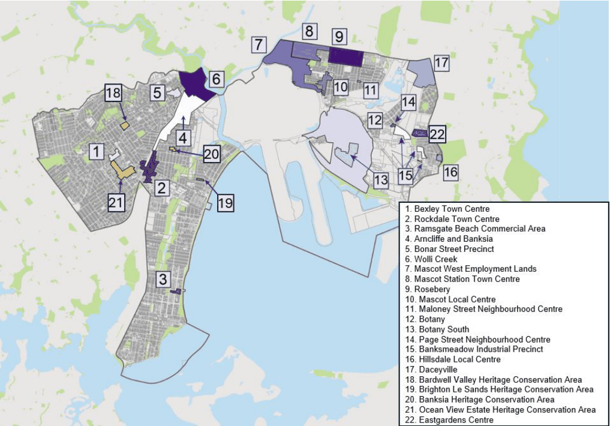

## 7 Specific Places

#### Introduction

Many places in the Bayside LGA have a unique built form and natural environment or have been the subject of more detailed master planning and urban design studies to determine the most appropriate development outcomes. In such cases, more specific controls and considerations need to be applied to ensure that development is respectful towards an established existing character or contributes positively towards a future desired character.

This chapter provides controls for areas within the Bayside LGA where more specific controls exist. This ranges from wider precincts, which may be at a suburb scale, as well as a series of town and local centres, business parks, industrial areas, and individual sites.

#### How To Use This Chapter

This chapter applies to areas listed within the subsequent chapters and shown in Figure 24 below. The provisions in the chapter prevail over any similar provisions in other sections of the DCP.

This chapter structures Place-specific controls in a tiered fashion. For example, some wider precincts contain smaller localities (like a centre or a business park) or key sites. In those cases, development applications are to respond to both the wider objectives and controls, as well as the more specific objectives and controls. In the event of any inconsistency, the more specific objectives and controls are to apply.

> [Picture on page 2: a picture, saved as a picture (images/section-07-specific-places-page-2-19.gif, 150 dpi).]

#### Figure 24: Specific Places Applying to this Part

#### Bexley Town Centre
