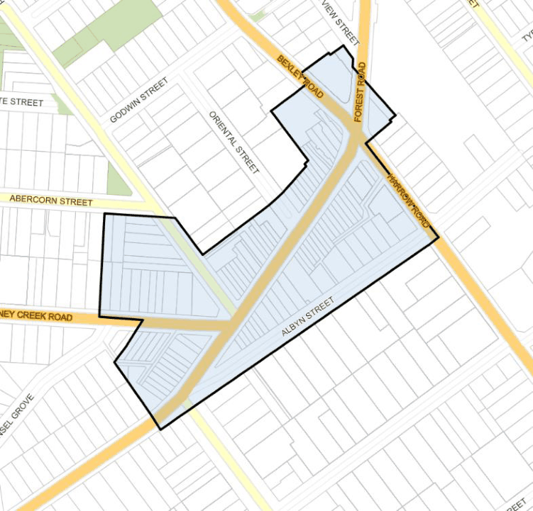

#### 7.1.1 Description

Bexley Town Centre is an important centre in Bayside, situated on a major roadway and surrounded by a large residential population within its walking catchment. The centre is currently dominated by the busy Forest Road which impacts upon the amenity of pedestrians and adjoining shopfronts and residences. However, the centre has convenient vehicle access and parking. Bexley Town Centre has an opportunity through redevelopment to gain greater pedestrian permeability and amenity, as well as improved character and function.

> [Picture on page 3: a picture, saved as a picture (images/section-07-specific-places-page-3-10.gif, 150 dpi).]

#### Figure 25: Bexley Town Centre Application Map
