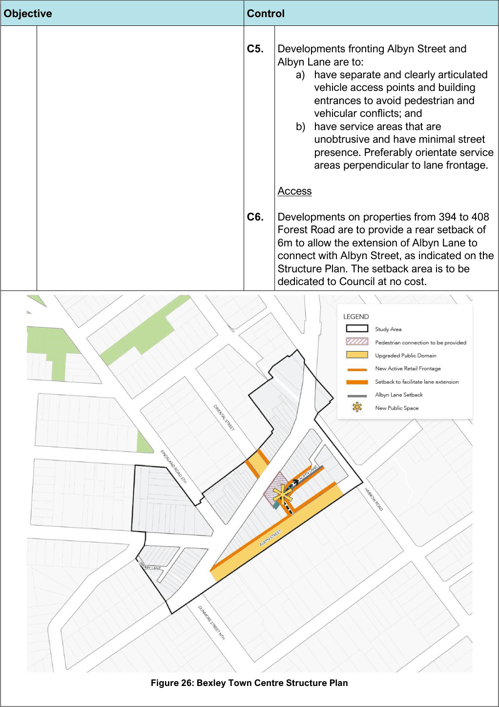

#### 7.1.3 Controls

| Objective |  |
|---|---|
| O1. | To facilitate the transformation of Albyn Street and Albyn Lane into active and vibrant retail areas, and provide an alternative pedestrian experience to Forest Road. |
| O2. | To improve the pedestrian permeability of the centre, particularly between Albyn Street and Forest Road. |
| O3. | To provide usable and lively public space at the heart of the centre that enhances the character of the town centre and provide places of gathering. |

| Control |  |
|---|---|
|  | Pedestrian Connection |
| C1. | A through site pedestrian arcade is encouraged within the area indicated on the Bexley Town Centre Structure Plan. |
| C2. | A through site pedestrian arcade is to: a. have active frontages on both sides, with retail units having a minimum depth of 8m; b. be a clear and direct throughway for pedestrians; c. have a minimum width of 4m non- leasable space clear of all obstructions (including columns, stairs and escalators); d. where practicable, have access to natural light; and e. where air conditioned, have clear glazed entry doors comprising at least 50% of the entrance. Public Domain |
| C3. | Development of Albyn Street Public Carpark is to provide an area of public open space which will: a) connect with the pedestrian arcade between Forest Road and Albyn Lane; b) facilitate the extension of Albyn Lane to connect with Albyn Street; c) be fronted by active retail uses; d) be open to the sky; and e) have a minimum area of 100m². Retail Activity |
| C4. | Albyn Street and Albyn Lane are the preferred street frontages for vehicle and service access. Notwithstanding, active retail frontages are to be provided along Albyn Street and Albyn Lane where possible, as indicated on the Bexley Town Centre Structure Plan in Figure 26. |

> [Picture on page 5: a picture, saved as a picture (images/section-07-specific-places-page-5-1.gif, 150 dpi).]

Figure 26: Bexley Town Centre Structure Plan

| Objective | Control |  |
|---|---|---|
|  | C5. | Developments fronting Albyn Street and Albyn Lane are to: a) have separate and clearly articulated |
|  |  | vehicle access points and building entrances to avoid pedestrian and vehicular conflicts; and b) have service areas that are |
|  |  | unobtrusive and have minimal street presence. Preferably orientate service areas perpendicular to lane frontage. Access |
|  | C6. | Developments on properties from 394 to 408 Forest Road are to provide a rear setback of 6m to allow the extension of Albyn Lane to |
|  |  | connect with Albyn Street, as indicated on the Structure Plan. The setback area is to be dedicated to Council at no cost. |

#### Rockdale Town Centre

An update to this Chapter is being prepared separately to the preparation of this Plan. Upon adoption, the Chapter will be inserted into the Plan.
