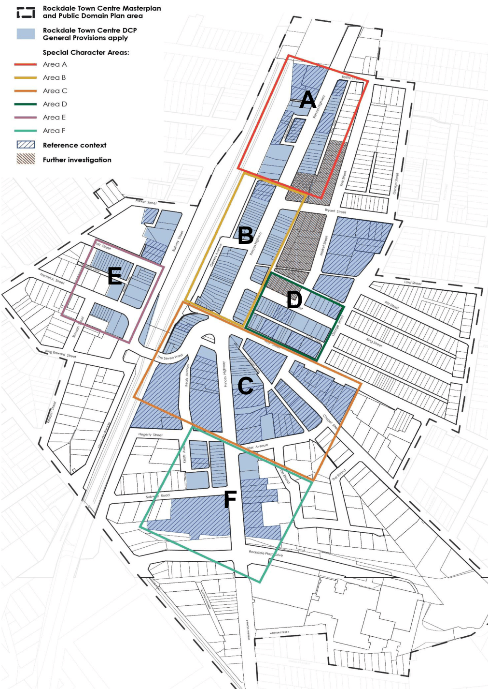

#### 7.2.3 Important – ‘Non-conforming’ development

The controls in this DCP intend to achieve an orderly, equitable and cohesive pattern of development that benefits all sites as well as the Rockdale Town Centre as a whole. If a development is proposed that:

• does not conform with the amalgamation pattern or built form controls (including the ‘Detailed Built Form Controls’) specified in this DCP, or

• modifies amalgamation patterns or building envelopes established as ‘Reference Context’,

the Development Application must:

1\. Include a detailed urban design study illustrating how the development relates to the intended height hierarchy, building massing distribution and public domain outcomes across the whole Town Centre.

2\. Demonstrate that the development achieves the desired future character of the Special Character Area where it is located. Where relevant, it must also demonstrate that the proposed development appropriately relates to the desired future character of adjoining area(s).

3\. Include a concept design illustrating, as a minimum, existing and future development on the subject block and on any sites that could have development potential or amenity affected by the proposal.

4\. Demonstrate that all sites, including the neighbouring sites can achieve their development potential, amenity and public domain outcomes as intended in the DCP and Public Domain Plan, or better.

5\. Demonstrate that an orderly and cohesive pattern of development can be maintained for the entire precinct, equal to or better than depicted in the ‘Detailed Built Form Controls’.

6\. Demonstrate that development on the whole block can comply with the objectives of the ADG as well as accommodate the required built form, public domain outcomes, vehicular access, basement parking, servicing facilities, loading, storage and waste management areas as detailed in this DCP.

Note: the maximum Height of Buildings controls specified in the Bayside LEP should not be expected to be achieved where development does not comply with the amalgamation pattern or where there are significant departures from the built form and public domain controls.

> [Picture on page 9: a picture, saved as a picture (images/section-07-specific-places-page-9-1.gif, 150 dpi).]

### A

### B

### E

### D

### C

### F

#### Figure 27: Application of this DCP
