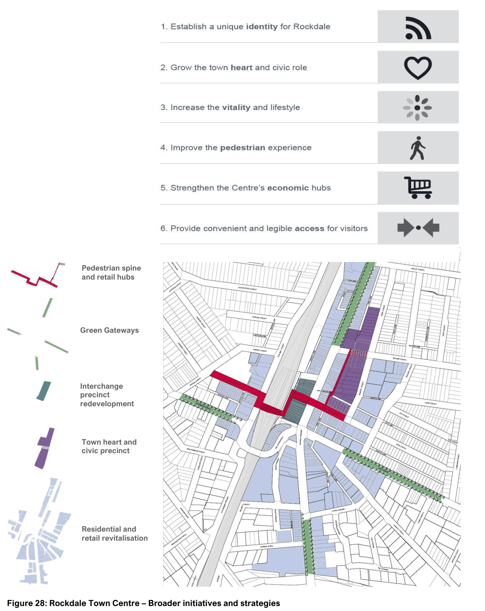

#### 7.2.4 Vision

The controls in this DCP support the vision established in the Rockdale Town Centre Masterplan 2012 to create a “vibrant and liveable inner- city town”, which is “a great place to shop, work, visit and live”.

The Masterplan was developed based on the community’s aspirations and vision for Rockdale, and established a series of design strategies and initiatives for transforming the town centre through redevelopment and placemaking. The vision and the key initiatives and strategies to help revitalise the town centre are reflected in Figure 28 and in the objectives of this DCP.

| Objective |  |
|---|---|
| O1. | To deliver new housing and retail/commercial offerings that complement the overall activation and revitalisation of Rockdale Town Centre. |
| O2. | To provide for appropriate employment opportunities in accessible locations within mixed use development. |
| O3. | To facilitate the redevelopment of the area through the amalgamation of existing lots to achieve a high quality urban form and architectural quality. |
| O4. | To ensure development responds to the characteristics of the site and individual areas to foster a sense of place and enhance a positive image of the Town Centre. |
| O5. | To ensure new development creates a legible landscape, contributes to the street and reinforces the “human scale” built form. |
| O6. | To encourage Ecologically Sustainable Design principles to reduce energy, materials and water consumption. |
| O7. | To ensure that an orderly and cohesive pattern of development is maintained as sites are redeveloped, allowing all sites to retain amenity and achieve quality built form outcomes |

> [Picture on page 11: a picture, saved as a picture (images/section-07-specific-places-page-11-1.gif, 150 dpi).]
> Words printed on the picture (title and legend, copied from the PDF):
> Pedestrian spine
> and retail hubs
> Green Gateways
> Interchange
> precinct
> redevelopment
> Town heart and
> civic precinct
> Residential and
> retail revitalisation

#### Figure 28: Rockdale Town Centre – Broader initiatives and strategies
