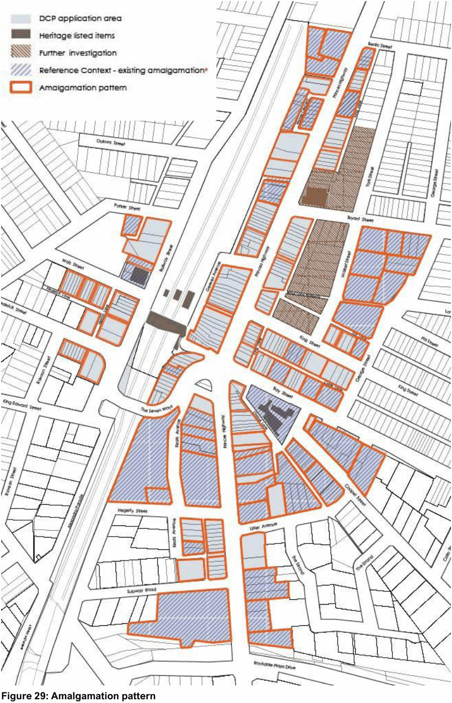
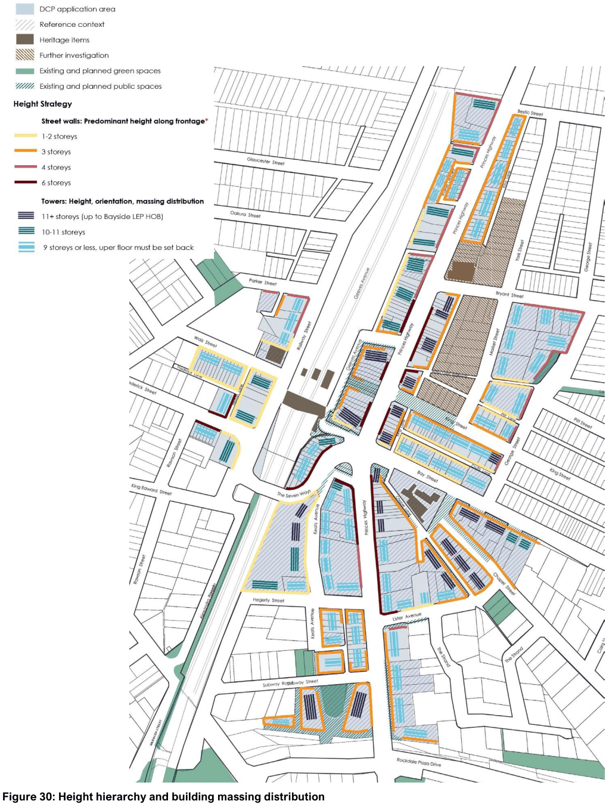
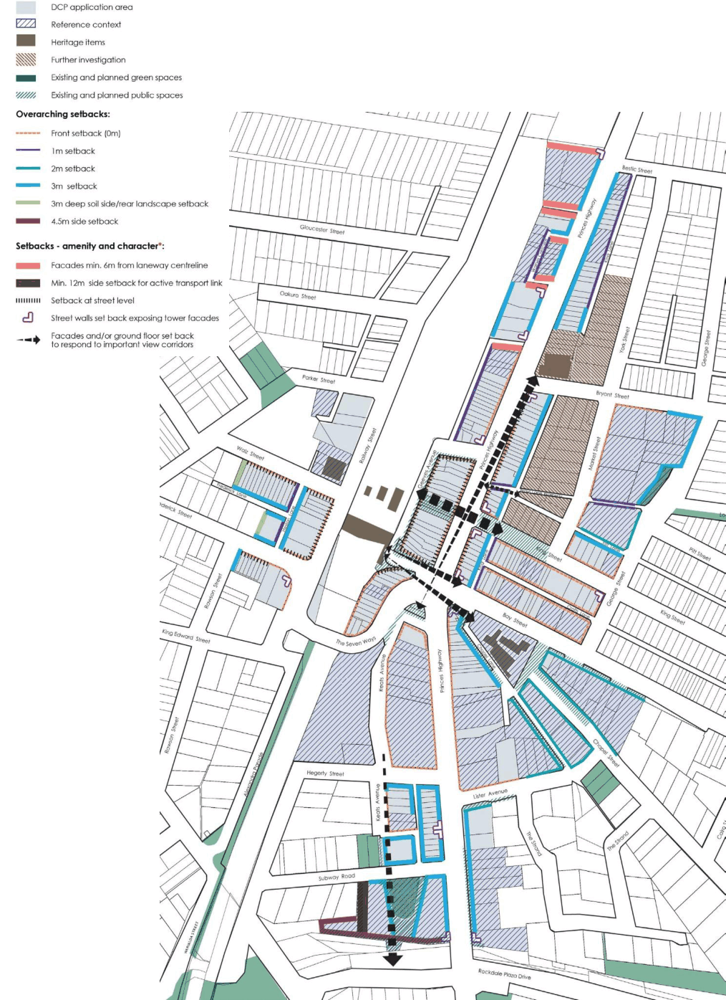
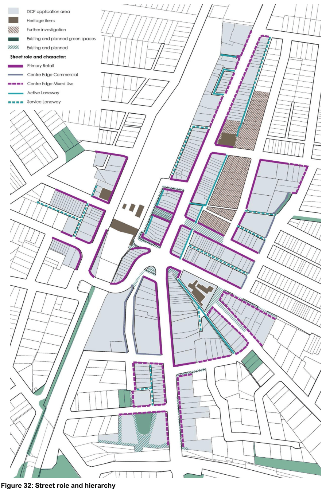
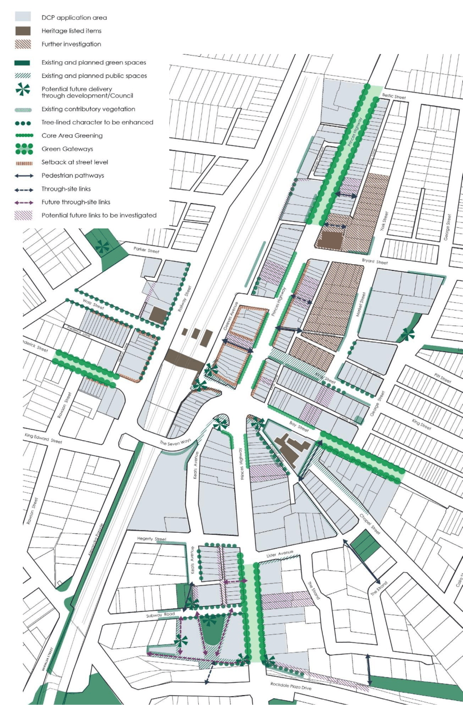
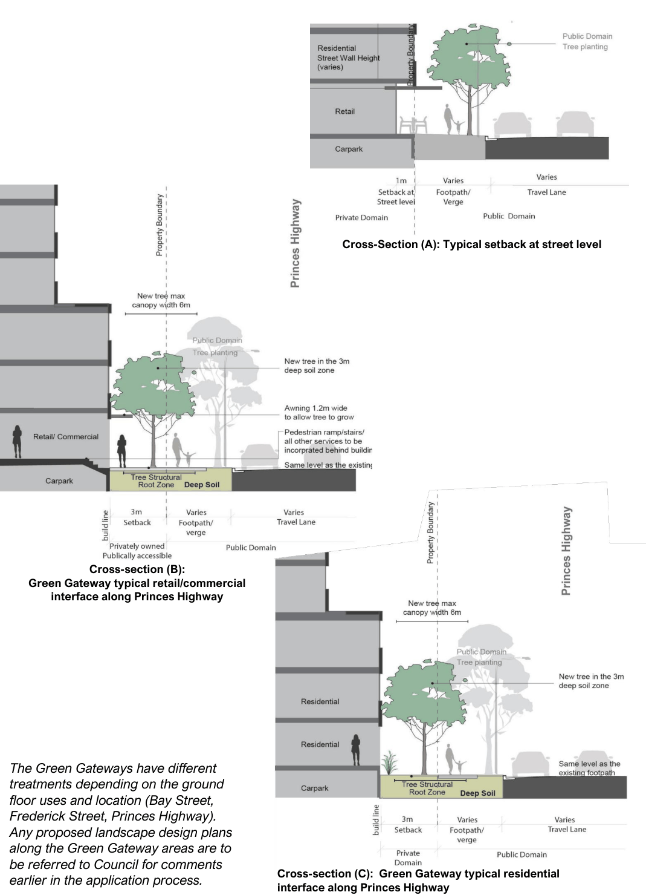

#### 7.2.5 General Provisions

The provisions in this section apply broadly to all development within the Rockdale Town Centre. Where more specific provisions apply under Sections 7.2.6, those provisions are to apply in the case of any inconsistency.

#### Site Amalgamation

Amalgamation of sites can achieve appropriate densities and improved amenity quality of an area. Site amalgamation is an attempt to balance planning requirements and intensification to revitalise the area, as well as achieving the desired character.

| Objective |  |
|---|---|
| O1. | To facilitate appropriate dwelling yields, generation of employment, and a built form that will provide a positive contribution to the spatial definition of the street. |
| O2. | To encourage site consolidation of allotments for development to promote the desired urban design outcomes and efficient use of land. |
| O3. | To ensure that redevelopment does not isolate lots, or prevent land parcels from reaching their redevelopment potential including meeting the NSW Apartment Design Guidelines (ADG). |
| O4. | To ensure efficient and safe vehicle and pedestrian entry points can be achieved. |
| O5. | To create and maintain amenity for existing and future occupants. |

| Control |  |
|---|---|
| C1. | Development is to comply with the relevant amalgamation patterns outlined in Figure 29. |
| C2. | If development is proposed on a site that does not conform to Council’s amalgamation pattern, the development application must: a. Demonstrate that negotiations were undertaken with neighbouring owners to seek amalgamation and enable coordinated redevelopment. b. Provide evidence that reasonable offers have been made to the owner(s) of each of the affected sites to purchase, including written valuations for each site undertaken by two independent Valuers registered with the Australian Institute of Valuers. c. Demonstrate that the site has sufficient width to accommodate the proposal whilst still maintaining quality design outcomes. Site amalgamation must not compromise the significant features of existing sites or adjoining sites, including streetscape and landscape features (e.g. trees, rocky outcrops). d. Demonstrate that development on the alternative amalgamation pattern can achieve equal or better outcomes than specified in this DCP – Refer to Section 7.2.1 ‘Introduction’ for details. e. Demonstrate that an alternative amalgamation pattern can be achieved by neighbouring sites and that an orderly and cohesive pattern of development can be maintained for the entire character area/ precinct achieving equal or better outcomes than specified in this DCP - Refer to |

| Objective | Control |  |
|---|---|---|
|  |  | Section 7.2.1 |
|  | C3. | On sites identified as Reference Context, any intensification of development or change to building forms may require further amalgamation in addition to any requirements specified in Section 7.2.1. Note: the maximum Height of Buildings as identified in the Bayside LEP should not be expected to be achieved where development does not comply with the intended amalgamation pattern or where there are significant departures from the built form and public domain controls. |

> [Picture on page 14: a picture, saved as a picture (images/section-07-specific-places-page-14-1.gif, 150 dpi).]

#### Figure 29: Amalgamation pattern

\* For Reference Context sites, the figure reflects the amalgamation of lots as per the latest approved development. Any intensification of development or change to building forms on those sites may require further amalgamation in addition to any requirements specified in Section 7.2.1.

#### Built Form Building Massing, Height and Articulation

Built form massing and articulation is fundamental to enhance the identity and character of streetscapes and neighbourhoods. Façade treatments create variety and interest while contributing to the continuity of the streetscape. A building should define and support adjacent streets, parks, and open spaces at an appropriate scale, fit harmoniously within the surrounding context and skyline and assist in achieving transition to lower-scale buildings. Long unarticulated façades provide less interest and variation at the pedestrian level. At upper storeys, long, continuous façades prevent sunlight access and sky views to the street. Building façades should be broken up both physically and visually. Breaks in long building façades provide mid-block connections for pedestrians and create additional public spaces.

| Objective |  |
|---|---|
| O1. | To minimise visual impact, provide relief to the high-density built form and create variety and interest while contributing to the streetscape. |
| O2. | To improve access to sky views, permit vistas between buildings and through sites, and contribute to a more attractive skyline. |
| O3. | To ensure that building massing distribution reinforces and improves the urban character of the locality and provide visual connections between the Town Centre and the features that shape its identity. |
| O4. | To ensure future built form reflects and considers the traditional fine-grained subdivision pattern of the area through architectural expression and built form principles. |
| O5. | To ensure building heights, massing and articulation respond to topography and other unique site features and constraints. |
| O6. | To ensure building massing distribution optimises design quality outcomes and does not prevent other sites from achieving quality redevelopment. |
| O7. | To ensure building massing distribution retains and/ or enhances solar access to |

| Control |  |
|---|---|
| C1. | Building massing and articulation including street wall heights and setbacks are to be provided in accordance with the relevant sections of this DCP. |
| C2. | Building heights in storeys and the siting of towers/ taller portions of buildings are to be provided as indicated in Figure 30. |
| C3. | Towers/ taller portions of buildings (above 9 storeys) are to be slender and orientated to avoid presenting its longest face to the public domain particularly along Princes Highway, Railway Street and King Street. |
| C4. | Lower-scale buildings/ tower forms (9 storeys or less) when orientated towards Princes Highway are to be read as a strong podium upon which sits a lighter, modulated building allowing vistas between buildings to the skyline beyond. |
| C5. | Floor to ceiling heights and spacing of built forms are to be consistent with the objectives of the ADG. |
| C6. | Development must maintain at least 3 hours of sunlight between 9am and 3pm on 22 June (winter solstice) to King Street Place. |
| C7. | Along narrow laneways, provide strong street edge definition on lower levels creating a human scale to the laneway with upper level units providing passive surveillance of the space. |

| Objective |  |
|---|---|
|  | open spaces, canopy cover and delivers improved public domain outcomes. |
| O8. | To ensure new development is appropriate to the scale of nearby streets, public spaces, and buildings. |
| O9. | To minimise overshadowing on surrounding development and public domain and minimise privacy issues between residential buildings. |
| O10. | To enhance energy efficiency and increase daylight within buildings. |
| O11. | To avoid a continuous wall of towers facing Princes Highway and to limit and clearly define the scale of the street wall. |
| O12. | To maintain solar access to King Street Place and achieve a consistent high pedestrian amenity character along King Street. |

| Control |  |
|---|---|
| C8. | The maximum building length should not exceed 45m above the street wall or 60m below the street wall. |
| C9. | Surface effects with limited depth are not to be relied on to provide articulation and modulation. |
| C10. | Within each development, towers, podiums and private open space are to be sited so that adjoining sites retain development potential and amenity. |
| C11. | On sites that share a boundary with a residential zone, the height of the podiums is to respond to the height of buildings in that residential zone, and the built form above the podium set back as to minimise amenity impacts. |
| C12. | Design of buildings in proximity to a heritage item should respond to alignment and street wall height, setbacks above street wall height, and façade articulation elements with bulk and scale that are sympathetic to the heritage item. |

#### Street Wall Heights

The role of the street wall is to frame the public realm, articulate entrances, and assist in the creation of an attractive and animated public realm which provides a safe, and interesting, pedestrian experience.

The street wall should define and support adjacent streets and open space at an appropriate scale. It should also integrate with adjacent street wall buildings, assist in achieving transition down to lower-scale buildings, and minimise the impact of parking and servicing on the public realm.

Within each character area, consistent street wall heights and podium-tower relationships help establish an identity for each area and a legible urban hierarchy across the Town Centre.

| Objective |  |
|---|---|
| O1. | To provide street edges that reinforce and reflect the various uses and the unique identity of each character area while defining a legible urban hierarchy across the town centre. |
| O2. | To ensure building heights at street level are responsive to the human scale. |
| O3. | To provide prominence to the street level, establish a clear presence for retail and increase the visibility, marketability and utility of ground floor space. |
| O4. | To promote views to the sky from the street or laneway. |
| O6. | To provide an appropriate transition to adjoining heritage places when viewed from the street |
| O7. | To provide appropriate transitions and be integrated with adjoining development, including planned future development. |

| Control |  |
|---|---|
| C1. | Street wall heights are to be in accordance with Figure 30. |

> [Picture on page 18: a picture, saved as a picture (images/section-07-specific-places-page-18-1.gif, 150 dpi).]

#### Figure 30: Height hierarchy and building massing distribution

\* Indicates the predominant street wall height required along each public domain frontage. Buildings and facades are to be designed to provide transitions between podiums of adjoining developments. Podiums are to wrap around corners at consistent heights unless the street walls are recessed to expose tower facades.

#### Setbacks

Street setback controls define the building line and determine the location of buildings relative to the street boundary allowing an existing or desired future street character to be reinforced.

Side and rear setbacks help provide sufficient space for trees and landscaped areas, protect privacy of habitable rooms and outdoor living areas of existing development and reduce building bulk. In certain areas, such as the town centre core, having buildings built to the side boundary help define a more urban character.

Placing buildings above the street wall away from streets, open space, and neighbouring properties will reduce visual and physical impacts of the tall buildings and allow the base (street wall section of a building) to be the primary defining element for the site and adjacent public realm. Appropriate upper level setbacks are required for taller buildings to fit harmoniously within an existing context, including sites that contain or are adjacent to heritage properties.

| Objective |  |
|---|---|
| O1. | To enhance the existing character of streets. |
| O2. | To define the street edge and contribute towards a consistent street enclosure. |
| O3. | To frame and enhance views and vistas to natural and constructed character defining features of the town centre. |
| O4. | To increase pedestrian amenity and provide pedestrian sight lines to the train station. |
| O5. | To increase amenity, minimising road noise propagation, wind tunnels and urban heat islands. |
| O6. | To minimise perceived building bulk and scale from the street. |
| O7. | To allow for sunlight and sky views. |
| O8. | To minimise adverse wind impacts on the pedestrian environment, noise propagation and urban heat islands. |
| O9. | To contribute towards the distinctive character of Rockdale Town Centre. |

| Control |  |
|---|---|
| C1. | Setbacks are to be provided in accordance with 31 and the relevant sections of this DCP. 31 indicates the overarching setbacks from |
| C2. | the property boundary and additional requirements such as setbacks at street level and locations where the street wall is to be ‘peeled back’ to provide additional public domain. Additional setbacks and building articulation |
| C3. | are to be provided to retain and enhance important view corridors and to improve visual connections to the train station, the Town Hall and Library buildings illustrated in 31. Lower-scale buildings/ tower forms indicated |
| C4. | in Figure 30 (9 storeys or less) are to provide a minimum 3m setback to the top floor. Towers are to be set back a minimum 3m |
| C5. | from the street wall and as so that buildings are read as distinctive podium-tower forms even from a distance. None of the building elements including building articulation or façade treatments should encroach on to the setback. On sites that share a boundary with a |
| C6. | residential zone, the built form above the podium is to be set back as needed to minimise amenity impacts. A minimum 9m rear setback is to be provided |
| C7. |  |

| Objective | Control |
|---|---|
|  | where development shares a rear boundary with a residential property. |

> [Picture on page 21: a picture, saved as a picture (images/section-07-specific-places-page-21-1.gif, 150 dpi).]

#### Figure 31: Setbacks

\* Refer to Section 7.2.6 Special Character Areas and to the Rockdale Town Centre Public Domain Plan for details

#### Building and Façade Design

The facades of a building visible from the street play an important role in contributing to the amenity, aesthetic quality and attractiveness of an area. Facades should therefore be designed to have a contextually responsive scale and aesthetic, proportion and rhythm, solid-to-void relationships and materiality. Care and attention should be given to their design to ensure the building stands up to critical observation from near and afar. It is essential that all building elevations are considered and designed as an integral part of the overall development.

#### Control

Ensure building façades are well resolved, and proportioned with an emphasis on the human scale by:

a. Reflecting and responding to the orientation of the site using elements such as sun shading and other passive environmental controls where appropriate.

b. Providing building articulation such as expressed vertical circulation, well designed roof form, shading devices and balconies.

c. Integrating car parking entry doors within the overall design of the façade.

d. Containing roof forms, building services and screening elements within the overall height controls and fully integrating those elements with the architectural concept.

e. For mixed use buildings and all buildings facing Princes Highway, using ‘podium-tower’ forms with emphasised detail at the ground floor to highlight the human scale of development.

f. Incorporating consolidated upper setbacks to avoid a tiered ‘wedding cake’ form, particularly where staggered setbacks are required to address matters like overshadowing.

g. Developing materials, textures and colours that respond to local characteristics.

h. Ensuring building façades are articulated to mitigate the appearance of building bulk and to express the elements of the building’s architecture.

Facades should respond to the location and hierarchical role of the building within the context of the town centre by:

a. Expressing street corner locations by giving visual prominence to parts of the façade such as varied building materials and colours, articulation, or well-designed roof form.

b. As identified in 31 and where possible, articulating podium facades at key street corners to deliver additional public domain and improved view corridors by ‘peeling back’ the podium façade and exposing the tower façade.

c. All exposed tower façades are to be well integrated within the architecture and present high-quality finishes as perceived from the street and from afar, creating new urban markers in highly visible locations.

d. The exposed facades are to be designed to ensure a high- quality experience of the public domain below, achieving weather protection and street activation.

e. Responding sympathetically to the existing natural and constructed character defining

#### C1.

#### C2.

#### C3.

features of the Town Centre (historic and emerging urban markers) including the Town Hall and Library buildings, the Guild Theatre, the train station, rock outcrops, significant trees and vegetation clusters.

f. Ensuring highly visible facades are unique and create interest while presenting a consistent rhythm of elements/articulation to reduce visual bulk.

Building and façade design should improve amenity by:

a. Providing articulated facades and edges which are modelled to maximise solar access and privacy to existing and future residents.

#### Control

b. Providing appropriate space for outdoor dining and include articulation/façade treatment to retain amenity of residential above, facilitating the development of a night-time economy.

c. Where in proximity to a heritage item, using appropriate materials, finishes and façade design and providing a bulk and scale which is sympathetic to the heritage item.

d. Minimising extensive expanses of blank, glass or solid walls.

e. Where development presents blank walls or incorporates a party wall that will be visible from the public domain (irrespectively of whether that could be hidden by any future adjoining development), using high quality materials, textures and variations in alignment consistent with the street façade. Reliance upon surface effects with no depth is not acceptable.

f. Along laneways, the whole podium will have a direct relationship with the lane and be composed to create interest and engage with laneway users.

g. Providing a definite edge to open spaces with an internal layout and façade design with encourages interaction between occupants of the building and the street. Building activity visible from the open space is to add sense of vibrancy and create further visual interest.

h. Integrating entries to basements and servicing such as substations, mailboxes, booster valves into the building design.

#### Public Domain Street Role and Hierarchy

This section complements the permissible land uses set out in Bayside LEP 2021. It controls how these uses are arranged and located within developments to ensure buildings interact with the street to achieve their desired role.

Active uses at ground level are encouraged within Rockdale Town Centre to ensure vibrant streetscapes and community meeting places.

| Objective |  |
|---|---|
| O1. | To ensure new development increases the level of activity and vibrancy of the Centre and positively addresses and engages with the public domain. |
| O2. | To ensure new development is sustainable by minimising environmental impact and being able to accommodate future changes to land use demands and social demographics. |
| O3. | To ensure that the non-residential character of Princes Highway, Bay Street, The Seven Ways and Walz St is maintained. |
| O4. | To maintain the existing fine grain character and human scale of the existing |

| Control |  |
|---|---|
| C1. | Development is to comply with the standards for ground floor building uses and access locations set out in the following table for all street frontage types, which are shown in Table 19 and Figure 32. |
| C2. | Along Activated Frontages and/or where predominantly retail/ commercial uses are provided: a. All developments are to face the street and/or public open spaces. Main building entries to be located along the streets. b. Entries to active frontage tenancies are to be accessible and at the same level as the adjacent footpath. c. Conserve the existing fine grain character of the precinct through built |

| Objective |  |
|---|---|
|  | retail strips around the station and the King Street pedestrian mall. |
| O5. | To ensure shopfronts and business premises complement the streetscape character. |
| O6. | To create a vibrant local activity centre. |
| O7. | To respond to the desired future character of the streets and avoid providing a back- of house interface to areas where there is opportunity for future activation such as the Civic Precinct, King Lane, Geeves Lane, Chapel Lane. |
| O8. | To provide a controlled visual connection between public and private domains. To enhance pedestrian safety, security and amenity around and within commercial premises. |
| O9. | To ensure efficient carparking and vehicle access which maximises the Centre’s existing service lane network and public parking, and does not detract from the quality and extent of retail services or street activity. |

| Control |  |
|---|---|
|  | form elements and architectural expression. d. Awnings are to be provided to the full extent of the frontages. e. The design of active street frontages must not incorporate security roller doors and window bars. f. The use of frosted screens or opaque glass is discouraged. g. On sloping sites, the maximum level change between ground floor tenancies and the adjacent footpath is to be 600 mm at any point. For flood prone land, advice should be sought from Council’s engineers. h. Integrate artworks into the design of private developments, in publicly accessible locations such as main entrances, lobbies, street frontages, gardens, walls and rooftops. i. Design is to facilitate outdoor dining particularly along open spaces, King Street, Walz Street, surrounding the station, and punctuated along Princes Highway where further protected from the Highway e.g. within setbacks at street level and wide corners. j. Design to facilitate night-time activation by providing features that help protect residential amenity (noise and light impacts) e.g. treatment and recesses to balconies on lower floors. |
| C3. | Where uses are not predominantly retail/commercial: a. Achieve a balance between active uses and services to ensure no frontage is completely dominated by servicing or carparking. b. Achieve a diversity of fine-grained frontages. c. Ensure ground floor building services including waste, loading and parking occupy less than 40% of the ground floor area. d. Provide awnings/ canopies over footpaths where retail uses are proposed. Note: Within this DCP, Activated Frontages is defined as any streets identified as Primary Retail, Centre Edge Mixed Use, Centre Edge |

| Objective | Control |
|---|---|
|  | Commercial, and Active Laneway. Note: Refer to the Rockdale Town Centre Public Domain Plan for details about street trees and further character defining features of the street hierarchy. |

#### Table 19: Street role and hierarchy

| Street Role | Description | Standard |
|---|---|---|
| Primary Retail | High activity with continuous ground floor retailing | • Minimum 80% of the ground floor frontage to be activated by retail and business premises • Residential lobbies can occupy no more than 20% of the total ground floor frontage • No ground floor residential permitted • No vehicle access permitted • No service access permitted |
| Centre Edge Commercial | Provides additional retail and commercial opportunities at the edge of the Centre | • Ground floor frontage to be activated by retail and business premises • Access to residential lobbies permitted and encouraged • No ground floor residential (Except for properties under Schedule 1 in the BLEP 2021.) • Vehicle access permitted where the development does not front a Service Laneway or Centre Edge Mixed Use street • Service access permitted where the development does not front a Service Laneway or Centre Edge Mixed Use street |
| Centre Edge Mixed Use | High density residential at the edge of the Centre with opportunities for retail or commercial uses | • Active retail uses on the ground floor frontage, preferably along Princes Highway and open space • Mixed use (commercial/residential) on the ground in other street frontages • Access to residential lobbies should be from this frontage • Ground floor residential with direct street access • Vehicle access permitted where the development does not front a Service Laneway • Service access permitted where the development does not front a Service Laneway |
| Active Laneway | Vibrant space activated by the co- location of pedestrian activity and service functions | • Ground floor frontage to be activated by retail and business premises • Residential lobbies can be accessed off active laneways • No ground floor residential permitted • Vehicle access permitted • Service access permitted |
| Service Laneway | Primarily serves service function and provides vehicle access | • No ground floor residential permitted • Vehicle access is to be provided from service lane • Service access is to be provided from service lane |

> [Picture on page 26: a picture, saved as a picture (images/section-07-specific-places-page-26-1.gif, 150 dpi).]

#### Figure 32: Street role and hierarchy

#### Movement and Pedestrian Connections

| Objective |  |
|---|---|
| O1. | To enhance connectivity through the Town Centre for pedestrians and cyclists as sites redevelop. |
| O2. | To ensure the safety of pedestrians and cyclists. |
| O3. | To improve connectivity to the train station. |
| O4. | To provide activated spaces with high pedestrian amenity offering protection from the surrounding busy road and railway |

| Control |  |
|---|---|
| C1. | Applicants are to deliver through site links in accordance with Figure 33 and engage with Council in investigating potential future links. |
| C2. | Existing connections are to be retained unless it can be demonstrated that an alternative connection point can deliver an improved public domain outcome and achieve a better pedestrian permeability outcome overall. |
| C3. | Relocation of existing connections are not acceptable in lieu of any requirement for providing additional pedestrian connection. Through-site links are to be privately owned |
| C4. | and maintained, but must be subject to a positive covenant on title ensuring unlimited, unimpeded access by the general public at all times. In addition to any other requirements in this DCP, through-site- links are to be designed to: a. be a clear and direct throughway for pedestrians and provide a clear line of sight between public places; b. be easily identified by users and include signage; c. provide active frontages on both sides; d. have a minimum width of 4.5 metres non leasable space clear of all obstructions (including columns, stairs and escalators); e. include materials and finishes such as paving materials, tree planting and furniture consistent with adjoining streets and public spaces and be graffiti and vandalism resistant; f. demonstrate compliance with Crime Prevention Through Environmental Design (CPTED) principles; g. where practicable, have access to natural light and include landscaping. Note: Refer to the Rockdale Town Centre Public Domain Plan for details about movement and connectivity. |

> [Picture on page 28: a picture, saved as a picture (images/section-07-specific-places-page-28-1.gif, 150 dpi).]

#### Figure 33: Intended public domain outcomes

#### Public Domain Character and Interfaces

| Objective |  |
|---|---|
| O1. | To increase outdoor dining opportunities, landscaping and space for pedestrians on the footpath by providing a balance between undercrofts, awnings and street tree planting. |
| O2. | Provide appropriate weather protection along public domain interfaces to increase pedestrian amenity as well as visually unify character areas and rows of retail premises. |
| O3. | To enhance and/or respond to existing character defining features of the Town Centre as presented to the public domain. |
| O4. | Provide Green Gateways that define the arrival experience into the Centre and enhance a positive image of Rockdale while mitigating negative amenity impacts from busy roads. |
| O5. | Increase canopy cover across the Town Centre and enhance existing vegetation to strengthen the character of tree-lined streets. |
| O6. | Provide appropriate conditions including deep soil, siting and species selection for landscaping to mature and allow for the continuation of the green canopy of the surrounding areas |
| O7. | Provide a greener outlook and improve the public domain even on constrained sites and/or areas where a distinctively urban character is intended through a combination of features such as greening of facades, coordinating awning design with setbacks at street levels. |

| Control |  |
|---|---|
| C1. | Development is to deliver public domain interfaces and respond to the intended public domain character as described in Figure 33. |
| C2. | Awnings are to be provided as follows: a. Awnings shall be a minimum 2m deep and the underside of the awning is to be a minimum 3.2m above the footpath. b. Alternative awning dimensions and setbacks will only be accepted unless where it can be demonstrated that: i. a better public domain outcome is achieved through additional setbacks at street level, above ground planting and/or additional street tree planting. ii. sufficient weather protection is achieved including protection from wind, sun and rain. c. Steps in awnings are only permissible to accommodate sloping streets and if required over vehicle entrances. In such cases, proposals are to demonstrate that the design has sought to minimise the height and visual appearance of each step. No steps over 600mm will be allowed. d. Awnings should be setback minimum 1m from the face of the kerb to accommodate traffic/parking and utility poles where those are not required to be removed. e. Where street trees are proposed, the awning should be setback from the kerb along its entire length by a minimum 1.5m to accommodate the trees. f. Where a specific design response and/ or alternative awning dimensions are identified for a Special Character Area (Section 7.2.6) or in the Public Domain Plan applicable the site, those will have precedence if conflicting with awning setbacks and dimensions above. g. The majority of the awning ceiling and underside of the fascia along the primary and secondary active street frontages is to be integrated with |

| Objective | Control |  |
|---|---|---|
|  |  | adjoining existing and approved developments. h. Awnings, lighting and signage are to be made of good quality materials and well integrated within the architecture particularly around corners and along other highly visible locations. i. Planting above awnings along the area identified as ‘Core Area Greening’ in Figure 33 is to be integrated as possible. Refer to Public Domain Plan. j. Spaces under awnings are to be well lit at all times through artificial and natural lighting. Consider incorporating glazing/ transparent material in the awning to allow solar access where planting on awnings is not provided. k. Awnings are not to slope towards the street. Gutters and downpipes are not allowed at the street edge. |
|  | C3. | Setbacks at street level are to be provided where indicated in 31 (Built Form - Setbacks) as follows: a. In addition to any other applicable setbacks from the property boundary, a further minimum 1m of setback at street level is required along the whole frontage generally as indicated in Cross-Section (A) below. b. The setback at street level is to be measured as an average across the frontage width to allow for variations and indentations that: • reflect a fine-grained, human- scale retail character, • integrate with adjoining development and read cohesively along the same footpath, and • provide transitions to avoid ‘dead- ends’ and ensure pedestrian safety. c. Deeper and/or taller (two-storey) spaces are required where specified in Section 7.2.6 or in the Public Domain Plan, and encouraged along larger-scale retail or to retain/ enhance view corridors and vistas. |

| Objective | Control |  |
|---|---|---|
|  |  | d. Recessed spaces at the street level are to be attractive and well proportioned (depth and height) as experienced from the footpath and from a distance. e. The recessed spaces are to be designed in conjunction with landscaping, footpaths, lighting and awnings to improve retail attractiveness and opportunities for outdoor dining, increase green canopy cover, discourage antisocial behaviour and improve pedestrian safety and amenity. f. Any pavement should use the same materials as the new footpath to promote public access to commercial premises. g. The setback areas are to remain in private ownership and are not intended to be dedicated to, or maintained by Council. h. Minimise the need for, and the impact of columns. Colonnades will only be permitted where it: • allows improved proportions and usability of recessed spaces, • does not obscure views of retail frontages or separates street frontage activity from the street, • can be made continuous for an entire street block, • is designed with narrow vertical elements, well integrated within the architecture of the building, responds to surrounding buildings and context. |
|  | C4. | Along Green Gateway frontages, unless otherwise specified in Section 7.2.6 or in the Rockdale Town Centre Public Domain Plan: a. A 3m deep soil zone and setback is to be provided generally as indicated in Cross-Sections (B) and (C) below. b. Basement and sub basement carpark design should be consolidated beneath building footprints. c. Any level changes including requirements to meet flood constraints should be incorporated within the footprint of the building. |

| Objective | Control |
|---|---|
|  | Any ramps/ stairs are not allowed in the 3m zone. d. Awning depth up to 1.5m to provide weather protection as well as allow space for trees to grow. e. The 3m landscape setback is to remain in private ownership and not intended to be dedicated to or maintained by Council. f. Any pavement should use the same materials as the new footpath to promote public access to commercial premises. |

> [Picture on page 33: a picture, saved as a picture (images/section-07-specific-places-page-33-1.gif, 150 dpi).]
> Words printed on the picture (title and legend, copied from the PDF):
> Cross-Section (A): Typical setback at street level
> Cross-section (B):
> Green Gateway typical retail/commercial
> interface along Princes Highway
> Cross-section (C):  Green Gateway typical residential
> interface along Princes Highway

The Green Gateways have different treatments depending on the ground floor uses and location (Bay Street, Frederick Street, Princes Highway). Any proposed landscape design plans along the Green Gateway areas are to be referred to Council for comments earlier in the application process.

#### Building Typologies

A variety of uses and new development is anticipated in Rockdale Town Centre. The general requirements for specific land uses are provided below.

#### Commercial

1\. Provide legible entry/ lobby areas accessed from a public street.

2\. Commercial uses should address streets to provide surveillance to increase safety and activation of streets.

3\. Ground floor tenancies and building entry lobbies are to have entries and ground floor levels at the same level as the adjacent footpath or public domain.

4\. Basement parking must not protrude above the level of the adjacent street or public domain.

5\. All parking provided within an above ground structure must be fully sleeved by either active uses or uses that provide surveillance of the street along all facades visible from the public domain, including facades that would be made visible when adjoining sites redevelop.

#### Mixed Use

1\. Provide a range of appropriately sized and configured tenancies that meet commercial, or market needs to avoid large (>100m2) floorplates that may remain vacant.

2\. Incorporate non-retail uses such as gymnasiums, childcare centres, community facilities and medical suites that service the local residential and worker population.

3\. Ensure that the location of ground floor uses either activates or provides surveillance to the public domain.

4\. Provide awnings to active street edges.

5\. Create clear legible entries for each use.

6\. Innovative solutions to provide the flexibility to meet future commercial space demand are encouraged. This includes but is not limited to:

• A series of large studio apartments on the same floor which could be fitted out for commercial use.

• Two storey units designed so that one floor could operate as a home office separate from the private living spaces.

• Utilising space within podiums to provide commercial tenancies where the building footprint is deeper than permissible for residential units.

• Wrapping above ground carparking in commercial space or residential uses that could be fully/partly converted into employment generating uses.

• Splitting lobbies to provide both residential and commercial use on the same flood providing the commercial space adjoining any railway or busy road and the residential space where the outlook is more amenable.

7\. For those areas in the B2 Local Area where ground floor residential apartments are permitted, the design of commercial/retail spaces should not be compromised. They should have enough space for sufficient internal circulation movement and able to accommodate a greater range of retail/commercial uses. This includes but is not limited to:

• Commercial/retail uses must have a street frontage.

• Each commercial/retail unit should be at least 6m in width and 13m in depth.

#### Residential Design

Given the Centre’s access to high frequency public transport and the available range of retailing, greater population density is encouraged. Increased population within the Centre’s walking catchment will also add to the Centre’s activity and vibrancy. Rockdale Town Centre is the ideal location to provide dense inner city style apartment living for a variety of household demographics.

A diversity of housing choice is to be offered by mixed use developments by providing a variety of apartment types and sizes. Innovative solutions to meeting current and future housing demands and changing household structures is encouraged. This includes but is not limited to:

1\. A diversity of housing choice is to be offered by mixed use developments by providing a variety of apartment types and sizes. Innovative solutions to meeting current and future housing demands and changing household structures is encouraged. This includes but is not limited to:

a. 3 bedroom units which can be divided into a 2 bedroom unit

b. and studio unit, sharing a common entry,

c. 2 or 3 bedroom units with all bedrooms having ensuites,

d. Units with large home office spaces which are separable from

e. private living areas,

f. Operable internal walls to allow multiple rooms or larger single

g. rooms to be created as needed.

2\. Where permitted, ground level residential units which are directly accessible from the street should include spaces suitable for use as a home office.

#### Site Access and Servicing

Site design, open space and streetscaping are imperative to enhance the public realm and the character and quality of Rockdale Town Centre. The following objectives and controls address specific elements of site design, open space and streetscaping such as parking and servicing. These elements should be well-designed and located to minimise their impact on the aesthetic quality and function of the site and the Town Centre as a whole.

#### Site Access

| Objective |  |
|---|---|
| O1. | To enhance pedestrian activity. |
| O2. | To improve the aesthetics of the Town Centre. |
| O3. | To enhance pedestrian and cyclist safety |

| Control |  |
|---|---|
| C1. | Access to parking, servicing and loading should be provided at the rear of the building, or via laneways. On corner sites, access should be provided from secondary streets provided the entrance facilities are well integrated into the rest of the frontage. |
| C2. | Consolidated/ shared vehicular access between developments within a block is encouraged to improve pedestrian safety and the amenity of the public domain, particularly where: a. the proposed development does not comply with the amalgamation |

| Objective | Control |  |
|---|---|---|
|  |  | pattern/ built form controls specified in this DCP; or b. the site is the first or the largest site to be developed within a block. |
|  | C3. | Where future shared access is proposed, knock out panels are to be provided at basement level(s) to allow safe and convenient access to all neighbouring sites. |
|  | C4. | Servicing and loading must be accommodated internally within the building. |
|  | C5. | Pedestrian access should always be prioritised for the safety and enjoyment of residents and visitors. |
|  | C6. | The number and width of vehicle access points should be minimised to avoid conflicts between pedestrians and vehicle traffic. |
|  | C7. | No on site loading bay is required for developments with less than 1000 m² of retail space. |
|  | C8. | Where no loading bay is provided on site, all retail tenancies are to have access to a street or lane with a marked loading bay, either directly or via a common retail servicing space separate from the residential basement parking area. |
|  | C9. | Where garbage trucks are required to enter the site for the collection of residential / commercial waste, developments should be designed to accommodate on-site truck movement. |
|  | C10. | Splay corners are to be dedicated in road reserves at intersections to improve pedestrian access as follows: a. Residential / Mixed use Subdivision 3m x 3m. b. Commercial subdivision 4m x 4m. |

#### Parking

| Objective |  |
|---|---|
| O1. | To minimise the visual impact of car parking from the street and adjoining sites. |
| O2. | To ensure pedestrian safety. |
| O3. | To provide resident and visitor car parking rates in accordance with the car parking rates required by the ADG. |

| Control |  |
|---|---|
| C1. | Underground parking structures should not encroach into the required landscape buffers above ground to ensure the long-term viability of mature trees and vegetation. |
| C2. | Where underground parking structures must unavoidably encroach beyond the building footprint or into a landscape buffer, a minimum depth of 1m of uncompacted soil should be provided below grade to support opportunities for tree planting and other landscaping along the streetscape. |
| C3. | All parking provided within an above ground structure must be fully sleeved by either active uses or uses that provide surveillance of the street along all facades visible from the public domain, including facades that would be made visible when adjoining sites redevelop. |
| C4. | Surface parking is discouraged and must be should be limited to visitor and retail / commercial parking and located at the rear of the building to be hidden from public view. |
| C5. | Surface parking is discouraged and must be limited to visitor and retail / commercial parking and located at the rear of the building to be hidden from public view. |
| C6. | Visitor carparking provided on site must be provided behind a security gate or shutter accessed via intercom. |
| C7. | Despite the requirements of the Parking and Loading Technical Specification, developments including residential accommodation are only required to provide on-site loading for removalists for a small rigid vehicle. |

#### Waste Storage and Recycling Facilities

| Objective |  |
|---|---|
| O1. | To encourage waste minimisation (source separation, reuse and recycling) and ensure efficient storage and collection of waste and the quality design of facilities. |
| O2. | To ensure that where Council garbage trucks are required to enter the site for the collection of residential waste, developments can accommodate on-site truck movement. |

| Control |  |
|---|---|
| C1. | Ensure that residential flat buildings and mixed use buildings have a communal Garbage and Recycling Room located in the basement of the building. This area should: a. be capable of accommodating Council’s required number of standard waste containers and should be designed in accordance with Council’s Technical Specification – Waste Minimisation and Management b. provide additional space for the storage of bulky waste, such as clean- up materials awaiting placement at the kerb, or recycling. |
| C2. | In buildings more than three storeys in height, provide a system for the transportation of garbage from each floor level to the Garbage and Recycling Room(s) such as a garbage chute system. Where such facilities are proposed, provide space on each floor for storage of recyclables, preferably adjacent to the lift well. Details of the garbage chute system should be provided with the Development Application. |
| C3. | Nominate on the site of residential flat buildings and mixed use buildings an area for communal composting. Although the operation of such a facility will depend upon the attitudes of unit holders and their management, the potential should exist. It is appropriate for this area to be incorporated in the landscaping plans for the development. Design communal composting with the following features: a. locate with consideration of proximity to units, odour and location of the drainage system b. purpose-build the facility. There are a variety of techniques available and advice on this and public health considerations should be obtained from Council c. the composting facility should be signposted, and should be made the responsibility of the body corporate. |

#### Service Lines / Cables

| Control |  |
|---|---|
| C1. | Developments are required to have all overhead cables on all frontages of the development site relocated underground (this includes all electricity cables, telecommunication cables etc.). |
| C2. | Redundant poles should be removed, and underground street lighting columns should be installed. |
| C3. | The under grounding and installation of street lighting is to be at no cost to Bayside Council. |

#### Urban Greening

| Objective |  |
|---|---|
| O1. | To provide high quality landscaping that softens built forms and positively contributes to urban amenity. |
| O2. | To provide sustainable and biodiverse landscapes with appropriate species selection and maintenance systems. |

| Control |  |
|---|---|
| C1. | Ensure that developments incorporate landscaping elements to soften the built form and introduce natural greenery. This can be delivered in several ways, outlined below. Vertical gardens • Green vertical gardens like green walls and facades are a space efficient way to incorporate vegetation into a development, providing shade, insulation and improving the urban environment. These can be implemented internally and externally in various ways including green façades, hanging gardens, living walls, vertical gardens and bio-façades. • If green walls are proposed: i. Design and locate green walls to suit the orientation and microclimate conditions (including width of the street and solar exposure) and enable access for maintenance. ii. Provide details of the support system, which should not affect the structural integrity or waterproofing of the building. iii. Ensure green walls have an integrated irrigation system using non-potable water. Ground floor gardens • In major developments, ground floor garden areas should be incorporated to contribute to visual amenity and soften building interfaces through deep soil planting and large trees. Ground floor |

| Objective | Control |  |
|---|---|---|
|  |  | garden areas should be considered in spaces with public realm access. Raised gardens • Raised gardens contribute positively to the amenity and visual interest of a development and can facilitate community interaction. Raised gardens can be implemented on structures such as podiums, (integrated with) awnings, rooftop terraces, private and common outdoor areas and balconies. Green Roofs Any proposal for green roofs shall: • Undertake a detailed site analysis to assess the site suitability, including consideration of the climate conditions (e.g., solar orientation and wind loads), surrounding environment and the structural capacity of the roof, etc. • Suitably identify roof access, growing medium (substrate) type and depth required for various types of vegetation, function and type of green roof and plant schedule in accordance with the roof structural capacity. • Select native and drought/heat tolerant plant species. • Be designed with high standard components, including waterproofing membrane, growing medium, vegetation layer, root barrier, insulation and drainage system, etc. • Maximise retention and reuse of stormwater. • Consider integration of solar panels on the green roof. |
|  | C2. | Landscaping should be considered holistically in the early design stages of a development to inform the building design. Retrofitting landscaping elements should be avoided to completed building designs as this can result in poor outcomes that may not be viable. |
|  | C3. | All landscaping should be regularly maintained and should not impact on the safety of public and private areas. Hardy and |

| Objective | Control |
|---|---|
|  | resilient species should be selected in an urban environment to ensure that all landscaping and vegetation is viable. |

#### Communal open space and landscape design

The density and intensity of develop envisaged in the Centre means that opportunities should be sought to utilise space within developments for communal use with soft landscaping to improve the amenity for residents and the character of the Centre.

| Control |  |
|---|---|
| C1. | Minimum communal open space is to be provided as required by the Apartment Design Guide. |
| C2. | At least 50% of the communal open space should be soft landscaping. |
| C3. | Refer to Sub-section 3.7.3 Communal Open Space for design specifications. |
| C4. | All soft landscaping areas in a development must have access to Greywater or Rainwater to meet their watering needs. |

#### Development on busy Roads

The New South Wales Development near Rail Corridors and Busy Roads– Interim Guideline aims to protect the health and wellbeing of residents from the impacts of road traffic pollutants. Council recognises that air quality and noise along and in proximity to the Princes Highway needs to be considered.

| Objective |  |
|---|---|
| O1. | To protect the health and wellbeing of residents through good design |

| Control |  |
|---|---|
| C1. | Development along Princes Highway and other busy roads within the Rockdale Town Centre must address SEPP (Transport and Infrastructure) 2021 requirements. |
| C2. | Different design solutions may be required to mitigate the effects of development along Princes Highway and other busy roads. Developments could incorporate recommendations on building design, internal layout, and architectural principles to achieve an acceptable internal acoustic environment in accordance with the Development in Rail Corridors and Busy Roads – Interim Guideline (2008) prepared by NSW Department of Planning to support the Transport and Infrastructure SEPP. |
