#### 7.2.6 Special Character Areas

In addition to the building design and built form controls which apply across the Centre, there are also a number of Key Precincts which have more detailed, site-specific requirements.

For sites yet to be developed in the Town Centre, the ‘Key Precincts’ section of this DCP provides detailed built form controls and outlines a ‘reference built form context’ established through consideration of existing development, sites with approved development applications and sites with site specific DCP controls.

Detailed built form controls have not been provided for sites with an established reference built form context. Should changes to these sites be proposed, applicants are required to undertake detailed urban design analysis to establish appropriate outcomes for their sites. The following controls are required in addition to any controls in Parts Error! Reference source not found. - 7.2.5.

The Rockdale Town Centre Masterplan envisages significant improvement and expansion to the public domain network through the re development of these precincts. Particular regard should be given to the relevant section of the Rockdale Town Centre Masterplan’s Structure Plan and the Public Domain Plan for these precincts.

#### Princes Highway North Desired Future Character

This area is located towards the northern edge of Rockdale Town Centre and provides an entry point to the centre on Princes Highway.

The Library building and the Town Hall are character defining features of this area and are crucial to the identity and sense of place of the whole Town Centre. The future built form should positively respond to, but not compete with or detract from their character. Design of adjoining buildings is to demonstrate careful consideration of all different façade features, while views and vistas that frame the arrival experience into

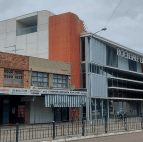

> [Picture on page 42: a picture, saved as a picture (images/section-07-specific-places-page-42-24.gif, 150 dpi).]

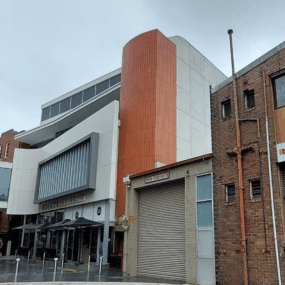

> [Picture on page 42: a picture, saved as a picture (images/section-07-specific-places-page-42-25.gif, 150 dpi).]

the Centre should be considered for all future surrounding buildings.

The area is identified as a “Green Gateway” and hence an integral part of the future character of the precinct will comprise significant street tree planting.

The street edge along Princes Highway will be defined by modulated built form transitioning from the taller forms and strong urban character in the core area to the more spacious and open character of the surrounding residential area. The built form will have regard to the high speeds of observers and to retaining a human-scale experience from the public domain, and be clearly read as a strong podium upon which sits a lighter, modulated building allowing vistas between buildings to the skyline beyond.

The design of retail spaces in this area is to increase diversity of offerings providing opportunities for business that can complement the Centre but do not need to be situated in the core such as alternative types of retail, hotels or entertainment uses like function centres, pubs.

The constrained land surrounded by Waines Crescent offers an opportunity for new development to deliver a more fine-grained human-scale response to the street as in important contrast to the

surrounding forms that relates to the Town Hall character and creates balance on both sites of Princes Highway.

Facades and public domain interfaces at King Lane, Geeves Lane and Waines Crescent require a well developed response that does not present a “back-of-house” outlook but reflect the future potential of the adjoining areas including the future of Geeves Lane carpark and the Town Centre Heart and Civic Precinct.

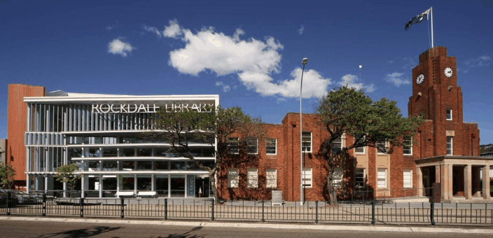

> [Picture on page 43: a picture, saved as a picture (images/section-07-specific-places-page-43-8.gif, 150 dpi).]

#### Controls Princes Highway North Quality Built Form

1\. Development to present a podium-tower nature.

2\. Overall massing to be lower in scale in relation to the core, with taller portions of buildings only allowed where massing can present as slender towers facing E-W (perpendicular to Princes Highway), with western facades slanted/articulated to minimize solar access and amenity impacts on developments to the south.

3\. On the eastern side of Princes Highway N-S facing buildings are to be lower in scale and spaced a minimum of 4.5m from the side boundary to provide amenity and avoid a wall of tall massing facing Princes Highway.

4\. Along Princes Highway, street walls are to be set back a minimum of 3m to deliver a Green Gateway as indicated in the General Provisions and detailed the Rockdale Town Centre Public Domain Plan.

5\. Along Princes Highway, towers are to be set back min 3m from the street wall except on corners where the street wall is ‘peeled back’ to deliver additional public domain.

6\. With exception of the corner of Fox Lane, where a new urban marker could create further interest, façade design and building articulation should respond to and not compete with the Library and Town hall buildings which are to remain the dominant character features of the streetscape.

#### Quality Public Domain

7\. Residential uses along King Lane are discouraged on the ground floor, particularly along the

#### Princes Highway North

area marked Active Laneway in Figure 32 (facing the B2 zone - the future Civic Precinct).

8\. Where residential uses are provided on the ground floor or if only service-related uses are provided on the ground-floor facing King Lane, increased setbacks are required to ensure amenity of residents and the laneway.

Note: Applicants are to refer to the Rockdale Town Centre Public Domain Plan and work in consultation with Council during the early stages of the public domain design, including pedestrian links and private-public domain interfaces (setbacks at street level/ corners, Core Area Greening, Green Gateways) identified in  Figure 33.

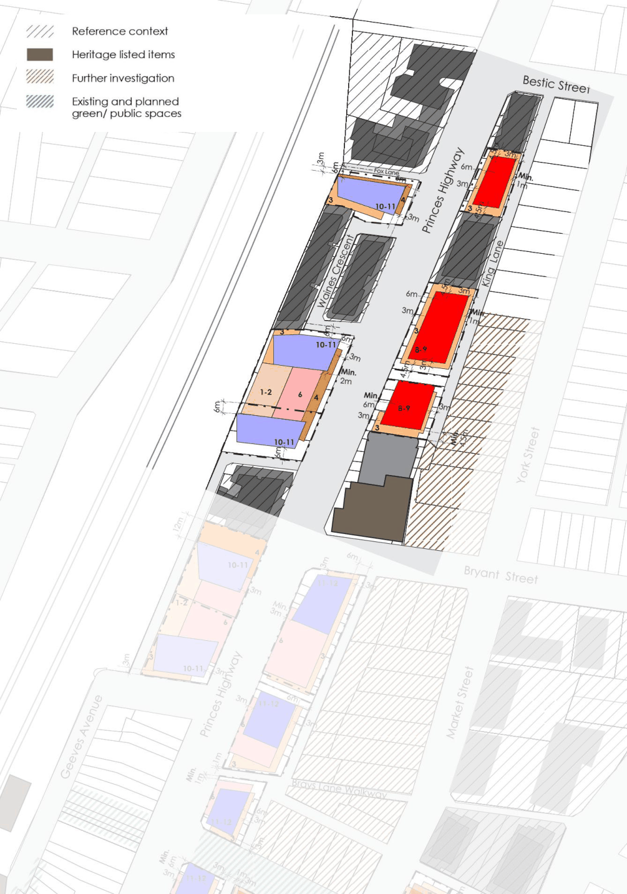

> [Picture on page 45: a picture, saved as a picture (images/section-07-specific-places-page-45-1.gif, 150 dpi).]

#### Figure 34: Area A - Built Form Controls

#### Princes Highway Core Desired Future Character

Development will enhance the identity and amenity of the core area by providing a legible built form hierarchy, visual and physical connections between the railway station, King Street and Bay Street, and improving the public domain to create a positive, recognisable image of Rockdale.

Strong bold buildings are presented generally built to the boundary with facades designed with regard to the speed of the observer, containing large scale elements and features that will read as a single

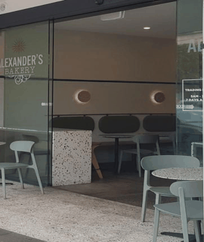

> [Picture on page 46: a picture, saved as a picture (images/section-07-specific-places-page-46-8.gif, 150 dpi).]

composition from afar and will become recognisable landmarks at key corners.

The built form response will become more subdued closer to the Town Hall and Library buildings are to the dominant character features within their surroundings and as perceived from Princes Highway (from north and south). View corridors between the Princes Highway station core area and the Town Hall are essential to the Town Centre’s sense of place and identity and must be retained.

From the public domain, the experience of a fine-grained human scale retail along Princes Highway is retained while additional setbacks are to be provided strategically to respond to different needs such as enhancing view corridors/visual connections, providing sufficient space for landscaping, outdoor dining and/or providing respite from major railway and road corridors.

The look and feel of the Princes Highway strip and the arrival experience from the train station will be improved by public domain upgrades and improvement to shop fronts delivered through the redevelopment of amalgamated sites. That will foster economic development by encouraging people to stay and experience the Town Centre instead of just passing by.

A stronger direct visual and physical link between King Street and Geeves Avenue will deliver the continuation of the “Retail Spine” as described in the Masterplan.

Facades and public domain interfaces along King Lane, Geeves Lane and Geeves Avenue should not reflect a “back of house” outlook.

The street interfaces should be activated reflecting the opportunities for future revitalisation of the Town Heart and Civic Precinct and the Geeves Street carpark. Building design should acknowledge that those facades will define how Rockdale is perceived by thousands of people travelling daily by train and arriving from Bryant, King and Bay Streets.

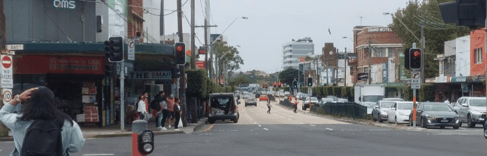

> [Picture on page 46: a picture, saved as a picture (images/section-07-specific-places-page-46-39.gif, 150 dpi).]

#### Controls Princes Highway Core Quality Built Form

1\. Development to be generally of a podium-tower nature towards the centre of the blocks exposing a strong, continuous landmark-quality tower facade at key corners and highly visible locations.

2\. The tallest building forms are located in this area, providing a differentiation from the rest of the Town Centre seen from different viewpoints (skyline and public domain) delivered through a strongly defined 6-storey street wall punctuated by slender tall towers.

3\. Taller portions of buildings are only allowed where massing can present as slender forms facing Princes Highway and King Lane, sufficiently separated as to emphasise their vertically.

4\. Western facades of buildings orientated E-W are to be modelled/ further articulated to minimise solar access and amenity impacts on developments to the south.

5\. At the north-western edge of the precinct, building massing and facade design should deliver a new urban marker/ landmark building as perceived both from Princes Highway and Bryant Street.

6\. In the north-eastern portion of the precinct (towards the Town Hall and library buildings), building massing and facade design should respond to, and not compete with the Town Hall by providing additional setbacks and/or modelling/ articulating facades to retain view corridors as well as using more subdued materials and finer-grained facades.

7\. Any development at the “Interchange Site” must first be subject to a detailed urban design/masterplanning study to establish additional built form and public domain controls that align with this DCP and the intended future character for the area.

8\. Building configuration within the Interchange site should provide a direct visual and physical connection between the King Street Mall and the train station.

9\. Development on sites along Tramway Arcade and Bay Street (including the southern portion of the Interchange site) must also respond to the intended future character, built form and public domain outcomes described in Area C (Princes Highway and Bay Street Junction).

#### Quality Public Domain

10\. Along the eastern side of Princes Highway, where identified in 31, the additional set back at street level is to be of a minimum 1.5m in depth along the frontage (allowing for indentations and transitions) with sufficient height to facilitate small-scale retail yet retaining the historical fine-grained, human-scale character.

11\. On the Interchange site (western side of Princes Highway fronting the station), the additional set back at street level is to be of a minimum depth of 3m along all frontages to the public domain and proportionate height commensurate with the importance of the site as the gateway to the Town Centre and to facilitate a larger-scale retail and higher pedestrian flow.

12\. On the Interchange site, a dedication for local road widening of (2.5m wide) it to be provided along Tramway Arcade and Geeves Avenue as per the Bayside LEP 2021.

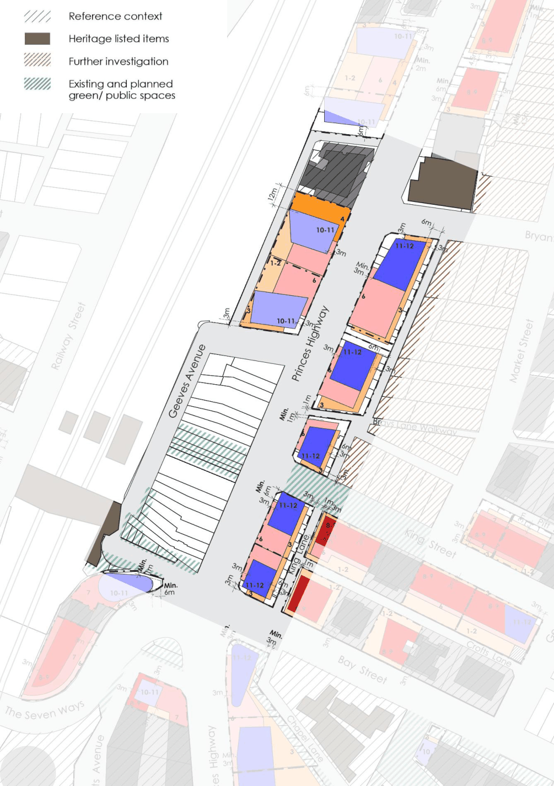

> [Picture on page 48: a picture, saved as a picture (images/section-07-specific-places-page-48-1.gif, 150 dpi).]

#### Figure 35: Area B - Detailed Built Form

#### Princes Highway and Bay Street Junction Desired Future Character

The Junction core area itself presents a unique urban structure that marks the arrival point into the heart of the Town Centre. The existing built form has traditionally provided unique, interesting site-specific designs that yet establish a cohesive dialogue between Town Centre landmarks including the Rockdale Hotel, the Station Corner, the Prince’s Corner and the heritage listed site.

The Junction core also enjoys an important direct visual connection to the Town Hall and has historical civic importance to the community as the site of an Anzac Memorial, although the existing space would need upgrading.

Restricted vehicular access and the irregular shape of lots along the Junction core limit built form outcomes yet offer opportunity to deliver unique landmark buildings that contribute to the identity of the Town Centre.

Development in the ‘Chapel Street Precinct’ has progressed and the emerging new character of high-pedestrian amenity, landscaped/ tree-lined places is to continue to be enhanced by future development. The large group of trees fronting the heritage listed site to the north of the precinct provides a rare ‘green landmark’ in the heart of the Town Centre to which future development is to relate.

Chapel Lane will have an important role connecting a rapidly increasing number of residents to the railway station, to the local park and playground and beyond to regional facilities. Future development in the northern end of Chapel Lane is to provide a clearly identifiable and highly accessible gateway between the station area and the laneway.

The public domain, view corridors and vistas between the station (Tramway Arcade) and Bay Street (31) are to be enhanced by any development along that corridor. Reconnecting the Town Centre with the train station is a key objective of the masterplan. Improving activation and public domain on the station surroundings is essential for the centre to fulfill its potential as an economic hub.

Development along Tramway Arcade and on the corner of Bay Street and Chapel Lane is to be set back and articulated to improve (besides retaining the existing) public domain and view corridors and vistas to and from the station.

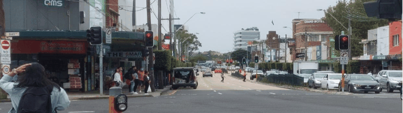

> [Picture on page 49: a picture, saved as a picture (images/section-07-specific-places-page-49-40.gif, 150 dpi).]

#### Controls Princes Highway and Bay Street Junction Quality Built Form

1\. The tallest building forms (10-12 storeys depending on topography) are to be located in distinct slender towers directly facing the corners of Bay Street and Tramway Arcade.

2\. A generously proportioned setback (minimum 2-storeys at street level) is to be provided along the southern portion of Tramway Arcade and the south western corner of Bay Street to enhance view corridors and provide additional public domain.

3\. Building forms and facades flanking the core Junction area are to be of high-quality design and materials, respond to the unique urban structure and use historical cues (see above) to deliver new Town Centre landmarks.

4\. Building forms and facades flanking the heritage listed site (EW) along Bay St are to be of high-quality design/ materials and articulated to frame and enhance vistas from the station area to the significant vegetation and beyond.

5\. Except at designated corners (31), towers are to be set back a minimum 3m from the street wall.

#### Quality Public Domain

6\. Residential At the corners of Bay Street and Tramway Arcade, the street wall is to be set back exposing the tower facades and providing additional pedestrian space.

7\. Development along Tramway Arcade adjoining the station is to provide additional high quality public spaces through setbacks and public domain upgrades.

8\. A high-quality pedestrian space establishing a direct connection between Chapel Lane and the train station is to be delivered at the south western corner of Bay Street (Princes Highway).

9\. Along Bay Street, development is to reinforce a distinct ‘boulevard’ character, facilitate an active transport corridor and deliver a ‘Green Gateway’ as specified.

10\. At the corners of Bay Street and Tramway Arcade, the street wall is to be set back to expose the tower facades and provide additional, high-quality pedestrian space.

11\. Development along Tramway Arcade adjoining the station is to provide additional high quality public spaces through setbacks and public domain upgrades.

12\. Development fronting the War Memorial is to engage with Council to coordinate upgrades to the public space and improve active transport access to Keats Avenue.

Note: Applicants are to refer to the Rockdale Town Centre Public Domain Plan and work in consultation with Council during the early stages of the public domain design, including pedestrian links and private-public domain interfaces (setbacks at street level/ corners, Core Area Greening, Green Gateways) identified in Figure 33.

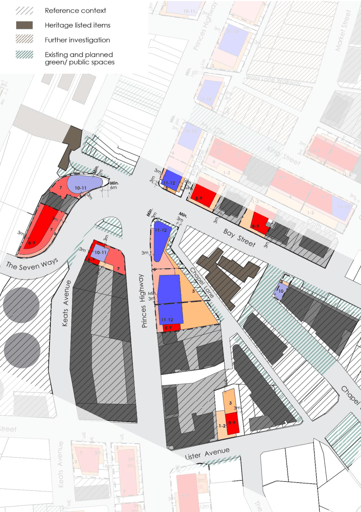

> [Picture on page 51: a picture, saved as a picture (images/section-07-specific-places-page-51-1.gif, 150 dpi).]

#### Figure 36: Area C - Detailed Built Form

#### King Street Desired Future Character

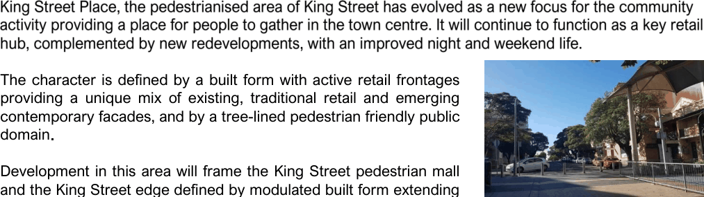

> [Picture on page 52: a picture, saved as a picture (images/section-07-specific-places-page-52-3.gif, 150 dpi).]

The character is defined by a built form with active retail frontages providing a unique mix of existing, traditional retail and emerging contemporary facades, and by a tree-lined pedestrian friendly public domain

Development in this area will frame the King Street pedestrian mall and the King Street edge defined by modulated built form extending the unique active frontages and tree-lined character towards George Street while transitioning from the strong urban character in the Centre core to the more open, greener character of the surrounding residential area.

The uniquely urban and active yet open, sunny and human-scale character of the built form is to be retained along the whole of King Street with relatively lower highly modulated building forms flanking the street and taller slender forms restricted to the edges of the street to mark the entry points and retain amenity.

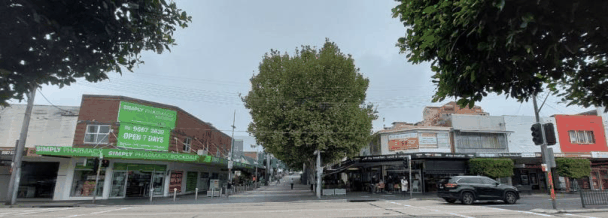

> [Picture on page 52: a picture, saved as a picture (images/section-07-specific-places-page-52-19.gif, 150 dpi).]

#### King Street Quality Built Form

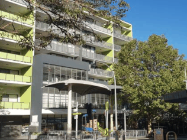

> [Picture on page 52: a picture, saved as a picture (images/section-07-specific-places-page-52-22.gif, 150 dpi).]

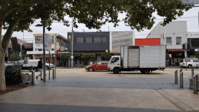

> [Picture on page 52: a picture, saved as a picture (images/section-07-specific-places-page-52-23.gif, 150 dpi).]

1\. Generous setbacks are to be provided to building forms on the southern side of King Street, to allow existing and future residential buildings on Bay Street to maintain ADG compliant solar access.

#### Quality Public Domain

2\. Development must maintain at least 3 hours of sunlight between 9am and 3pm on 22 June (winter solstice) to King Street Place.

3\. Development is to encourage outdoor dining and night-time activation. Building design should take into consideration providing protection from noise and light from outdoor dining spaces (e.g. articulation/treatment to balconies) as to not hinder night-time activation.

4\. Development is to protect and enhance significant vegetation, including the large tree at the corner of George Street and Crofts lane and deliver a tree-lined street along the full extent of King Street.

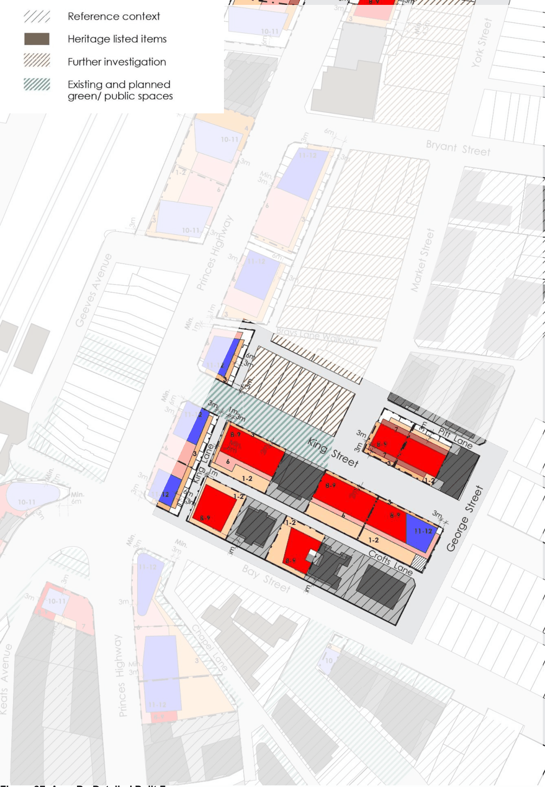

> [Picture on page 53: a picture, saved as a picture (images/section-07-specific-places-page-53-1.gif, 150 dpi).]

#### Figure 37: Area D - Detailed Built Form

#### Walz Street Desired Future Character

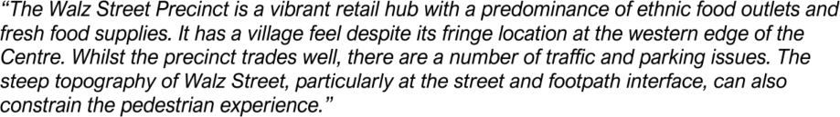

> [Picture on page 54: a picture, saved as a picture (images/section-07-specific-places-page-54-3.gif, 150 dpi).]

#### Walz Street Quality Built Form

1\. A two-storey street wall height along Walz Street and Railway Street maintains the character of the existing precinct and contributes to a cohesive street character as the emerging precinct develops.

2\. Architectural detailing and materiality is to provide a rich visual texture and a symbolic reference to the history of the place, the building’s use or occupant.

3\. The average maximum height of building form is 7 storeys. Increase the height of building form to 8 storeys along the edge of Railway Street to define the corners. A stepping down height of building to 4 storeys to response the residential character on Frederick Street. Refer to Figure

7.5.12 which indicates the maximum number of permissible storeys.

4\. For the flood affected lots, the maximum number of storeys may vary depending on the recommended freeboard allowance above the 1% Annual Exceedance Probability (AEP) level for floor levels.

5\. Zero front setback for most of the development sites to provide an active and urban frontage for the town centre.

6\. 3m front setback 23-25 Frederick Street to align with the neighbouring residential character.

7\. The average setback above the podium should be a minimum of 4m, it should be developed in accordance with Figure 38.

8\. Zero setback for the first 6 storeys (14-26 Frederick Street) of the new development.

9\. The minimum rear setback should be 3m to provide separation to the thoroughfares. Refer to Figure 38 for details.

10\. The minimum side setback should be 3m with landscaping to provide separation r to any adjoining residential buildings.

11\. In all circumstances residential components of the development must comply with the minimum building separation objectives of the ADG.

#### Walz Street Quality Public Domain

12\. The pedestrian-scale streetscape will include generous footpaths and landscaping.

13\. At ground level, awnings, canopies, sun shading and screening elements can project forward of the street setback line.

14\. A 1m wide street level set back (reference section) is to be provided in locations shown on 31 allowing extra space for outdoor dining and retail experience.

15\. Buildings are built to the street boundary and aligned with the street frontage.

16\. For any new development, engagement with Council planners and engineers should be sought during earlier design stages to ensure the ground floor level access will be appropriately connected to the public domain.

17\. Along Walz Street, the footpath must have a maximum 1:40 cross fall to the kerb. The east-west slope must be kept as close as possible to 1:25 for the length of the footpath to ensure a consistent slope along the building line.

18\. Continuous awnings provided for shops, cafes and other commercial uses, with a minimum of 2m in depth to allow sufficient space for street trees to grow.

19\. Landscaping provided along Walz Street, Frederick Street and Railway Street to improve amenity for pedestrians and outdoor diners.

20\. Refer to general provisions for active frontages, movement and access.

Note: Applicants are to refer to the Rockdale Town Centre Public Domain Plan and work in consultation with Council during the early stages of the public domain design, including pedestrian links and private-public domain interfaces (setbacks at street level/ corners, Core Area Greening, Green Gateways) identified in Figure 33.

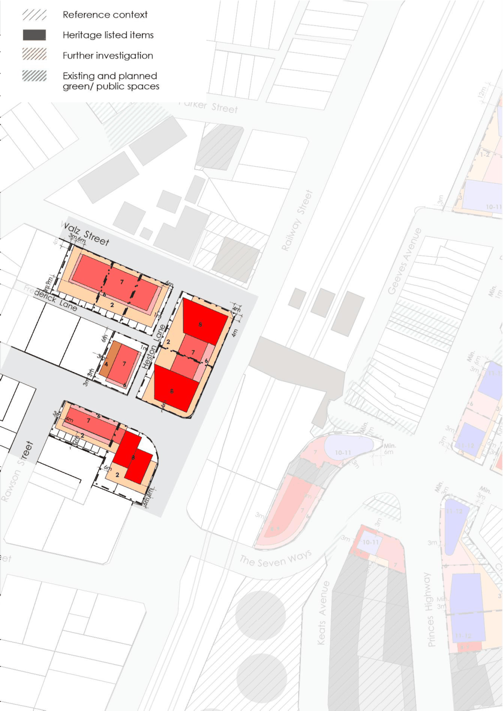

> [Picture on page 56: a picture, saved as a picture (images/section-07-specific-places-page-56-1.gif, 150 dpi).]

#### Figure 38: Area E - Detailed Built Form

#### Flooding

#### Figure 38

#### Walz Street Flooding

1\. Any new development should take the overland flooding into consideration in the design and should ensure that new development does not exacerbate flooding on adjoining properties and elsewhere in the area.

2\. All new development applications should be supported by a flood study to assess the potential hydraulic impacts of the development.

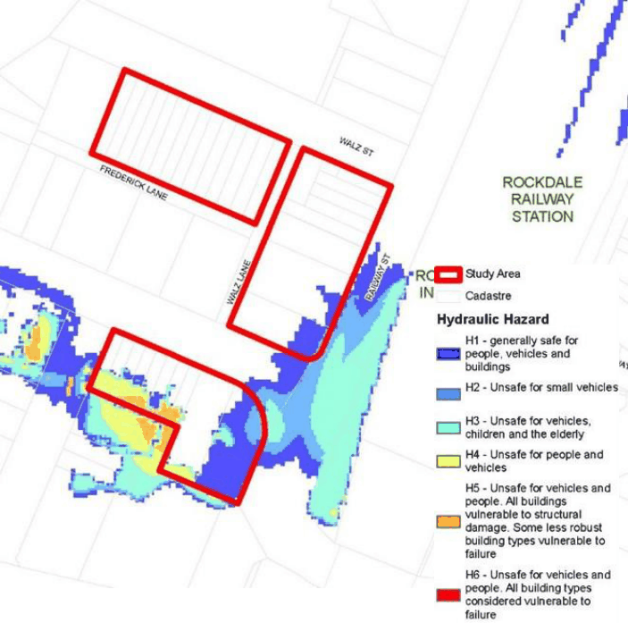

> [Picture on page 57: a picture, saved as a picture (images/section-07-specific-places-page-57-10.gif, 150 dpi).]

#### Figure 39: Walz Street Precinct 1% AEP Flooding

#### Princes Highway Southern Gateway Desired Future Character

As the Town Centre grows, it will expand along the Princes Highway into the stretch south of the centre which contains more traditional highway business uses and older building stock, and presents a pedestrian unfriendly environment due to traffic noise and lack of environmental protection (awnings, street trees). The existing uses along the highway and the Muddy Creek corridors have created a barrier to the rapidly growing number of residents in Kogarah and Rockdale to access services and retail across the two suburbs, dampening the economic opportunities of the area. Permeability along and around the highway and Muddy Creek corridors will be key to allowing a supporting residential population within convenient walking distance to patronise the Town Centre. The high-density residential area along Hayburn Avenue and The Strand (adjoining the emerging Chapel Street developments) offers greener, quieter streets. Yet, the lack of connectivity to the west and the south currently results in an underutilised/ less safe pedestrian environment. Development on the eastern side of the highway should consider further integration with this area to improve overall connectivity and amenity outcomes. The area to the west of the highway benefits from Keats Avenue as an emerging local spine that provides a more direct connection to the station protected from the railway and highway noise. The existing built form between Keats Avenue, Subway Road and Princes Highway creates visual and physical barriers to connectivity and amenity; the configuration of the existing ‘Pathway’ does not mitigate those issues. Development along and to the south of Keats Avenue is to strengthen this corridor as an active transport spine from the station to the Muddy Creek corridor and across the creek to Rockdale Plaza Drive. Revitalisation of the Muddy Creek has progressed along the corridor towards Rockdale and Kogarah including an active transport link. Development along Muddy Creek is to facilitate (and not preclude) that outcome and developers are to work with Council to deliver a coordinated approach to the corridor that also considers flood risk mitigation. It is also important that the Town Centre be differentiated from other centres and businesses along the highway to visitors travelling by motor vehicle to encourage people to stop and visit. Providing landscaped front setbacks to Princes Highway, retaining/ enhancing a greener outlook to the Muddy Creek corridor and providing landmark buildings at strategic corners will create a gateway and signify to passers-by that the Town Centre is a point of difference.

#### Princes Highway Southern Gateway Quality Built Form

1\. Building massing is to read distinctively as a 3-storey podium-tower form at street frontages and as seen from the public domain, and provide transitions towards adjoining residential areas.

2\. Buildings are to be set back a minimum 3m from the frontages facing the public domain and a minimum 4.5m from the boundaries adjoining land zoned for Special Purposes along the Muddy Creek corridor.

3\. Spacing of built forms are to be consistent with the objectives of the ADG.

4\. Further setbacks and articulation (e.g. setbacks at street level, exposed tower facades) are to be provided to protect and enhance view corridors and vistas (31).

5\. Building massing distribution is to enhance visual and physical connectivity along Keats Avenue from the station to, and beyond the Muddy Creek.

#### Princes Highway Southern Gateway

6\. Towers are to be set back 3m from the street wall and a minimum 6m from the property boundary. At strategic corners and where indicated in Figure 33, the street wall is to be ‘peeled back’ to expose the tower façade and provide additional high-quality public domain.

7\. Provide landmark buildings at the corners of Rockdale Plaza Drive.

8\. A continuous façade along the Muddy Creek frontage is to be avoided and not to exceed the maximum building lengths specified in Section 7.2.5.

#### Quality Public Domain

9\. Development along Princes Highway is to deliver a Green Gateway as specified.

10\. Retain and enhance vegetation at the corners of Rockdale Plaza Drive and along the Muddy Creek frontages

11\. Provide new connections and engage with Council to investigate potential integrated outcomes where identified in Figure 33.

12\. Development is to facilitate an active transport corridor along Keats Avenue towards and across Muddy Creek.

13\. Development along Muddy Creek is to facilitate (and not preclude) the revitalisation of the Muddy Creek Corridor and provision of an active transport corridor. Developers are to work with Council in the early design stages to achieve an integrated approach that includes flood mitigation.

#### For the site at 591-597 Princes Highway, Rockdale:

1\. A new public domain with an area of at least 1,950m2 is to be provided centrally on the site and fronting Subway Road. The public domain is to be privately owned and maintained but must be subject to an easement in favour of Council for its use by the general public.

2\. Pedestrian links are to be provided through the site as generally depicted in Figure 33 and the Rockdale Town Centre Public Domain Plan.

3\. Ground floor uses are to address and activate the public domain as well as road frontages where possible.

4\. Unless stated otherwise, building setbacks are to be in accordance with Figure 41.

5\. Establish a 3-storey street wall to Princes Highway and Subway Road and setbacks from the property boundary as follows:

i. A minimum 3m setback to level 3

ii. A minimum 6m setback above level 3

6\. Not limiting the requirements of Control C8 Sub-section 7.2.5.2 ‘Building Massing, Height and Articulation’, the length of the façade along the Princes Highway frontage may exceed the maximum 45m if it is demonstrated that the street wall achieved is complementary to the proportion/scale of the neighbouring street wall buildings. To facilitate this:

a. The levels above level 3 may project up to 3m into the required setback for a maximum of 30% of the length of the building.

b. The building must comply with the Green Gateways as specified in the Public Domain Plan.

7\. A continuous façade along the Muddy Creek frontage should be avoided where possible. Where the façade length exceeds 50m, a high degree of articulation is required to reduce the impact of the building. A combination of design solutions such as breaks in the building, varying heights,

#### Princes Highway Southern Gateway

blades and alternative finishes and treatments can be used to achieve a suitable outcome.

Note: Applicants are to refer to the Rockdale Town Centre Public Domain Plan and work in consultation with Council during the early stages of the public domain design, including pedestrian links and private-public domain interfaces (setbacks at street level/ corners, Core Area Greening, Green Gateways) identified in Figure 33.

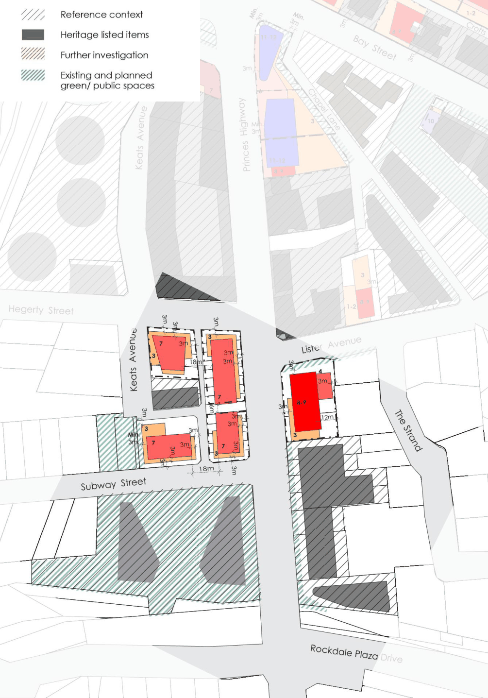

> [Picture on page 61: a picture, saved as a picture (images/section-07-specific-places-page-61-1.gif, 150 dpi).]

#### Figure 40: Area F - Detailed Built Form

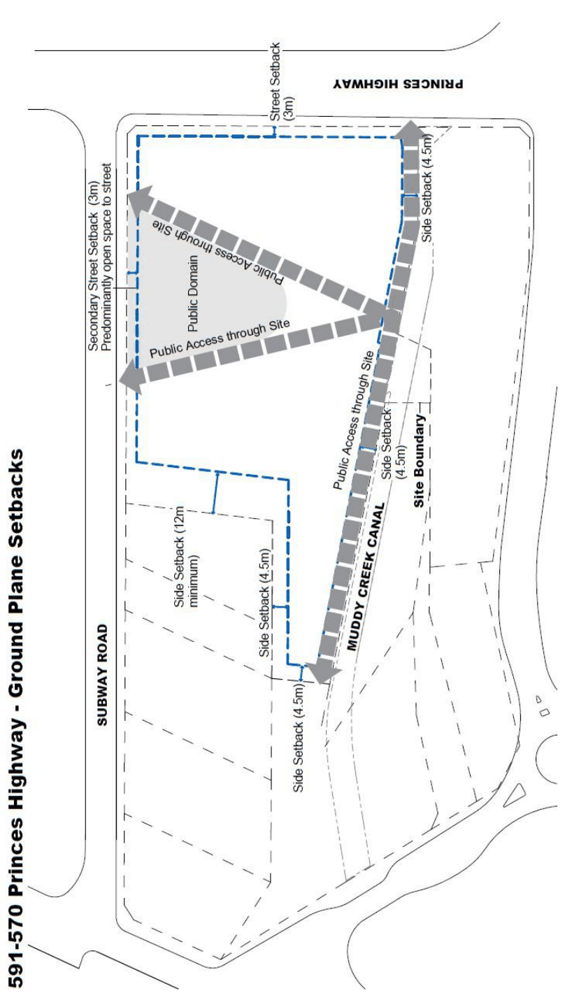

> [Picture on page 62: a picture, saved as a picture (images/section-07-specific-places-page-62-1.gif, 150 dpi).]

#### Figure 41: Area F - 591-570 Princes Highway - Ground Plane Setbacks
