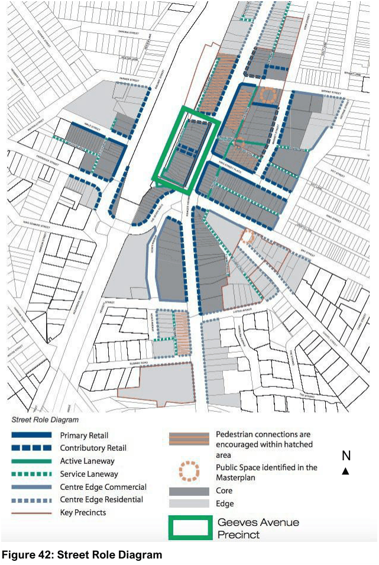
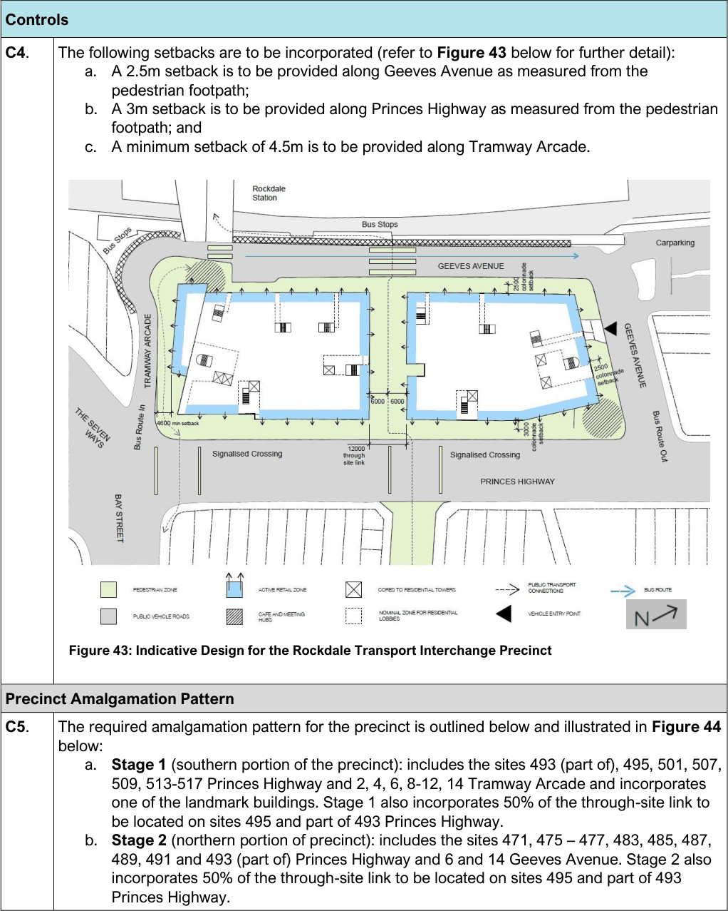
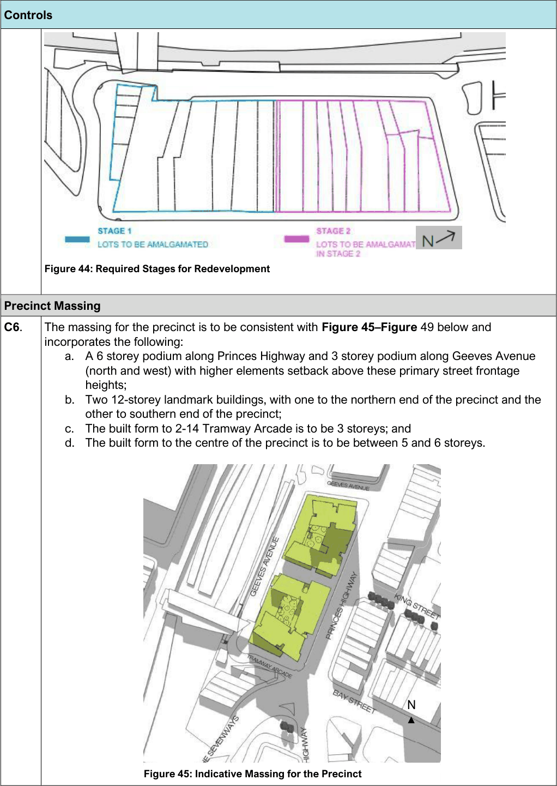
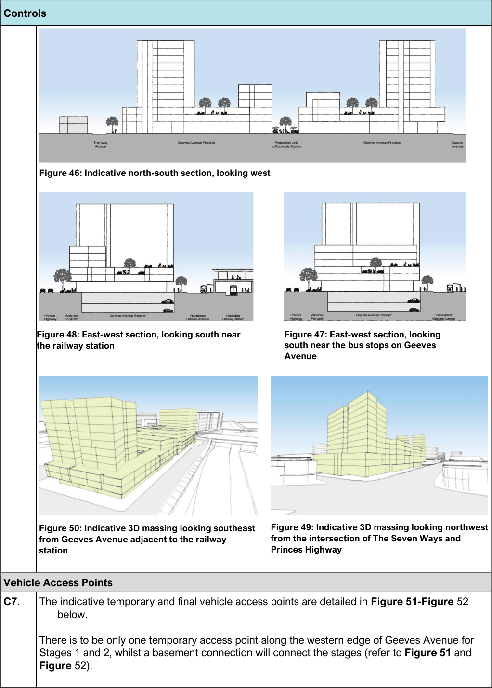
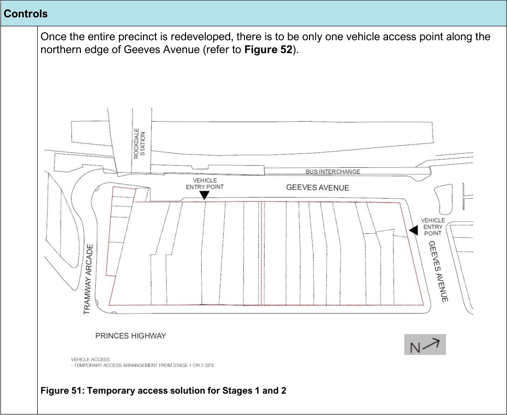
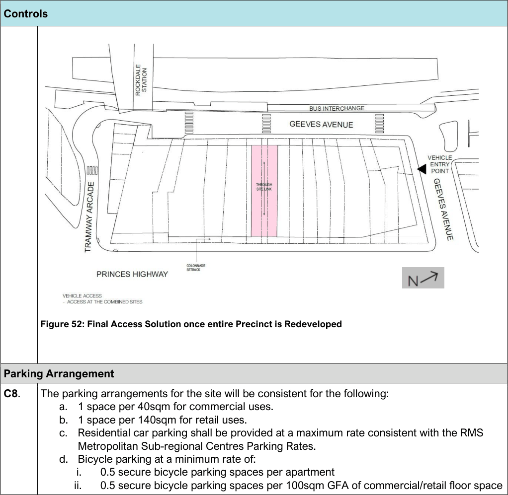

#### 7.2.7 Rockdale Transport Interchange Precinct (Geeves Avenue Precinct)

The Rockdale Transport Interchange Precinct (Geeves Avenue Precinct) is defined as 471 - 517 Princes Highway, 6 and 14 Geeves Avenue and 2-14 Tramway Arcade, Rockdale and as illustrated in Figure 42

> [Picture on page 63: a picture, saved as a picture (images/section-07-specific-places-page-63-4.gif, 150 dpi).]
> Words printed on the picture (title and legend, copied from the PDF):
> N

below - Street Role Diagram.

#### Figure 42: Street Role Diagram

#### Public Domain Desired Future Character

The Interchange Precinct is situated within the Rockdale Town Centre and forms a critical part of the Town Centre due to its proximity to the Rockdale Train Station and bus interchange, as well as the commercial properties along Princes Highway. The Interchange Precinct is in a highly accessible location adjacent to the Seven Ways intersection and experiences high levels of pedestrian traffic. Given its prominent location, the Interchange Precinct has the potential to transform into a landmark mixed use precinct with active street frontages and high density residential towers.

A pedestrian through site link and upgraded pedestrian footpaths with street level active uses will be incorporated to improve the pedestrian experience and positively contribute to the public domain. The Interchange Precinct will create a pedestrian-friendly focal point providing connectivity between the transport interchange and the Rockdale Town Centre.

At street level, a six-storey street wall defines the west side of Princes Highway, with a three-storey frontage to Geeves Avenue to present the human scale of the development. A tower will be provided at each end of the Precinct, presenting a distinctive element from both directions of Princes Highway.

| Objective |  |
|---|---|
| O1. | Provide streets and footpaths that prioritise pedestrians, cycling and public transport use. |
| O2. | Provide a well-connected pedestrian network that facilitates permeability of movement to and from the site. |
| O3. | Ensure the pedestrian footpaths and through site links are safe, highly accessible, well lit and promotes public use. |
| O4. | Provide suitable weather protection for pedestrian links through the provision of undercrofts, awnings or other design features. |
| O5. | Present appropriate frontages to the surrounding streets and public domain in terms of scale, finishes and architectural character. |
| O6. | Ensure active uses are provided on street level to contribute to active street frontages and enhance pedestrian amenity. |

#### Landscape Design and Green Architecture

| Objective |  |
|---|---|
| O1. | High quality and long lasting landscaping is to be provided throughout the site. |
| O2. | Landscaping is to be incorporated to foster environmental benefits such as mitigating the urban heat island effect, reducing flood impacts and improving air quality. |
| O3. | Ensure plant species are appropriately selected to suit the soil and micro-climatic conditions. |
| O4. | Encourage landscaping that is designed to integrate with the architectural design of the building and provide visual relief. |

#### Objective

#### O5.

#### O6.

Encourage well designed and maintained green roofs and green walls in suitable buildings and locations, including the podium setback areas along all street frontages.

Provide street tree planting to enhance the amenity of the public domain.

#### Controls Controls Pedestrian Site Link

C1. An open air pedestrianised through site link is to be provided at ground floor to the centre of the precinct which is 12m wide, with 6m of the links width accommodated within Stage 1 and the remaining 6m accommodated in Stage 2. The pedestrianised through site link will connect the Rockdale bus interchange and Princes Highway, as illustrated in Figure 7.5.17 below - Indicative Design.

#### Active Retail Zones

C2. Active retail zones are to be provided along the street frontages and through site link, as illustrated in Figure 43 – Indicative Design.

#### Indicative pedestrian access points

C3. The indicative pedestrian access points are illustrated in Figure 43 below – Indicative Design.

#### Setbacks

> [Picture on page 66: a picture, saved as a picture (images/section-07-specific-places-page-66-1.gif, 150 dpi).]
> Words printed on the picture (title and legend, copied from the PDF):
> pedestrian footpath;
> footpath; and
> below:

Figure 43: Indicative Design for the Rockdale Transport Interchange Precinct

#### Controls

C4. The following setbacks are to be incorporated (refer to Figure 43 below for further detail):

a. A 2.5m setback is to be provided along Geeves Avenue as measured from the

b. A 3m setback is to be provided along Princes Highway as measured from the pedestrian

c. A minimum setback of 4.5m is to be provided along Tramway Arcade.

#### Precinct Amalgamation Pattern

C5. The required amalgamation pattern for the precinct is outlined below and illustrated in Figure 44

a. Stage 1 (southern portion of the precinct): includes the sites 493 (part of), 495, 501, 507, 509, 513-517 Princes Highway and 2, 4, 6, 8-12, 14 Tramway Arcade and incorporates one of the landmark buildings. Stage 1 also incorporates 50% of the through-site link to be located on sites 495 and part of 493 Princes Highway.

b. Stage 2 (northern portion of precinct): includes the sites 471, 475 – 477, 483, 485, 487, 489, 491 and 493 (part of) Princes Highway and 6 and 14 Geeves Avenue. Stage 2 also incorporates 50% of the through-site link to be located on sites 495 and part of 493 Princes Highway.

> [Picture on page 67: a picture, saved as a picture (images/section-07-specific-places-page-67-1.gif, 150 dpi).]
> Words printed on the picture (title and legend, copied from the PDF):
> incorporates the following:
> N

Figure 44: Required Stages for Redevelopment

Figure 45: Indicative Massing for the Precinct

#### Controls

#### Precinct Massing

C6. The massing for the precinct is to be consistent with Figure 45–Figure 49 below and

a. A 6 storey podium along Princes Highway and 3 storey podium along Geeves Avenue (north and west) with higher elements setback above these primary street frontage heights;

b. Two 12-storey landmark buildings, with one to the northern end of the precinct and the other to southern end of the precinct;

c. The built form to 2-14 Tramway Arcade is to be 3 storeys; and

d. The built form to the centre of the precinct is to be between 5 and 6 storeys.

> [Picture on page 68: a picture, saved as a picture (images/section-07-specific-places-page-68-1.gif, 150 dpi).]
> Words printed on the picture (title and legend, copied from the PDF):
> the railway station
> south near the bus stops on Geeves
> Avenue
> from the intersection of The Seven Ways and
> Princes Highway
> from Geeves Avenue adjacent to the railway
> station
> below.

Figure 46: Indicative north-south section, looking west

Figure 48: East-west section, looking south near

Figure 47: East-west section, looking

Figure 49: Indicative 3D massing looking northwest

Figure 50: Indicative 3D massing looking southeast

Figure 52).

#### Controls

#### Vehicle Access Points

C7. The indicative temporary and final vehicle access points are detailed in Figure 51-Figure 52

There is to be only one temporary access point along the western edge of Geeves Avenue for Stages 1 and 2, whilst a basement connection will connect the stages (refer to Figure 51 and

> [Picture on page 69: a picture, saved as a picture (images/section-07-specific-places-page-69-1.gif, 150 dpi).]

Figure 51: Temporary access solution for Stages 1 and 2

#### Controls

Once the entire precinct is redeveloped, there is to be only one vehicle access point along the northern edge of Geeves Avenue (refer to Figure 52).

> [Picture on page 70: a picture, saved as a picture (images/section-07-specific-places-page-70-1.gif, 150 dpi).]

Figure 52: Final Access Solution once entire Precinct is Redeveloped

#### Controls

#### Parking Arrangement

C8. The parking arrangements for the site will be consistent for the following:

a. 1 space per 40sqm for commercial uses.

b. 1 space per 140sqm for retail uses.

c. Residential car parking shall be provided at a maximum rate consistent with the RMS Metropolitan Sub-regional Centres Parking Rates.

d. Bicycle parking at a minimum rate of:

i. 0.5 secure bicycle parking spaces per apartment

ii. 0.5 secure bicycle parking spaces per 100sqm GFA of commercial/retail floor space

#### Ramsgate Beach Commercial Area
