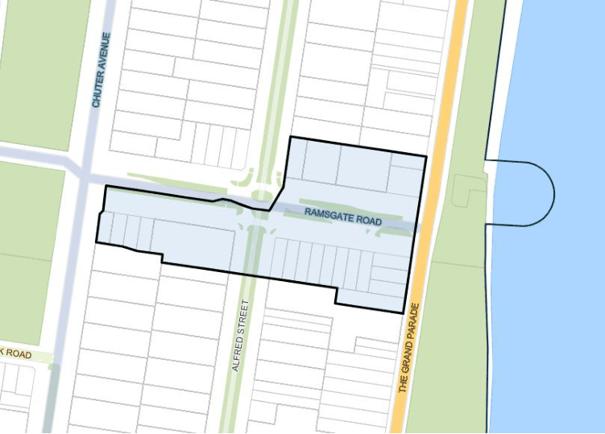

#### 7.3.1 Description

This section applies to all development on land zoned B4 Mixed Use in the Ramsgate Beach commercial area, shown in Figure 53. Ramsgate Beach commercial area is a vibrant local centre situated adjacent to the Botany Bay foreshore. It is situated in the southern area of the City, and serves the regular shopping needs of residents living on the peninsula. The current lot subdivision, prime beach side location, and generous public domain at Ramsgate Road offer the potential for the Centre to grow as a local centre, providing a greater range of retail services to residents, as well as becoming a lively beach side destination.

> [Picture on page 71: a picture, saved as a picture (images/section-07-specific-places-page-71-10.gif, 150 dpi).]

#### Figure 53: Ramsgate Beach Commercial Area Application Map
