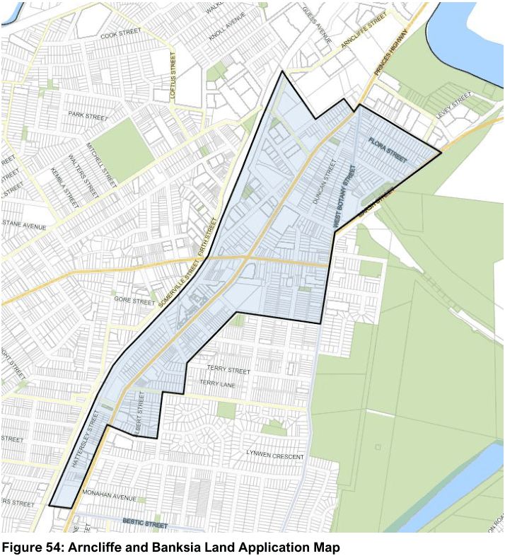

#### 7.4.1 Description

The Bayside West Precincts 2036 was prepared to guide the renewal of the Arncliffe and Banksia Precincts, after they were identified as Planned Precincts by the Department of Planning and Environment. The Strategy outlines the vision for growth in these areas and plans for the infrastructure needs to support this population increase. Detailed planning has been undertaken for areas within the Arncliffe and Banksia Precincts as part of the DP&E Planned Precincts program including detailed urban design analysis, economic testing and infrastructure planning. Together with the Rockdale Town Centre Master Plan, Wolli Creek and Bonar Street Precincts, the Arncliffe and Banksia Precincts propose to deliver a vibrant highway corridor with exceptional access to public transport, employment, accommodation and housing. The purpose of this section of the DCP is to guide the future development of the precinct by:

a. Identifying the vision, development principles, key elements and indicative structure for the future development of the Precinct;

b. Communicating the planning, design and environmental objectives and controls against which the consent authority will assess future development applications;

c. Ensuring the orderly, efficient and environmentally sensitive development of the Precinct; and

d. Promoting a high quality urban design outcome.

> [Picture on page 74: a picture, saved as a picture (images/section-07-specific-places-page-74-5.gif, 150 dpi).]

#### Figure 54: Arncliffe and Banksia Land Application Map
