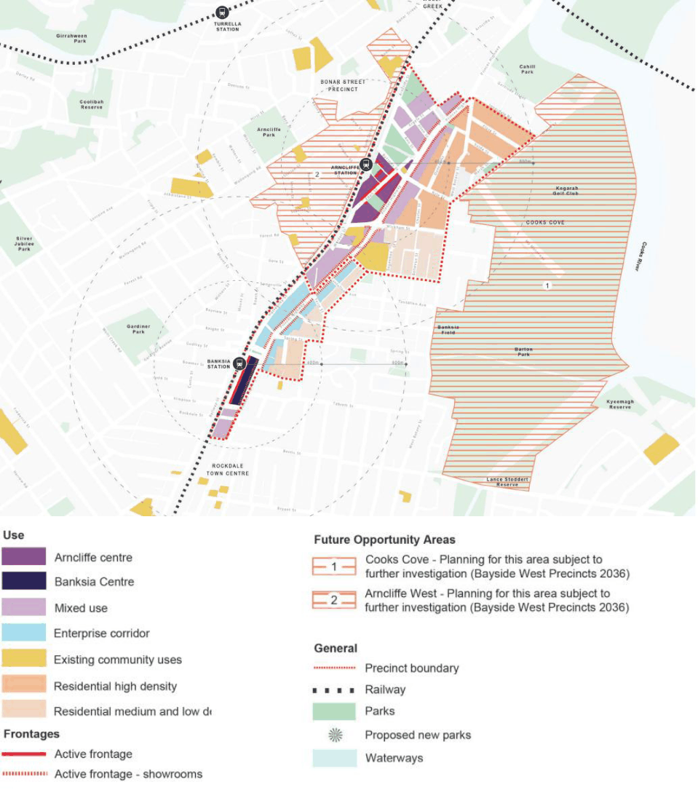

#### 7.4.2 Vision

The vision for the Arncliffe and Banksia Precincts is to create “vibrant, attractive and connected communities, where people live and work, with great access to public transport, community facilities, new open spaces, shops and local services.” The Objectives of this DCP are to support the Vision, and are outlined below.

• To create vibrant Town Centres that provide for the daily needs of the local and wider community.

• To provide a wide range of opportunities for different types of employment generating activities to meet local and regional needs.

• To provide high quality and a wide range housing choice.

• To promote the Princes Highway as a key regional employment and economic corridor.

• To ensure that new residential development provides a high level of amenity by adequately responding to the local and environmental context.

• To ensure a safe, connected, permeable and legible public domain that caters for the accessibility of pedestrians and cyclists.

• To promote the development of new buildings that display design excellence through a design review panel for buildings over 3 storeys and a competitive design process for buildings over 12 storeys.

• To provide access to a range of new and improved existing open space for all age groups.

• To maximise public safety and provide adequate protection of property against flood events.

• To ensure existing floodplain users do not experience any increase in flood levels.

• Represent “Placemaking” through the activation of space, creation of destination, and identifiable landmarks including mixed use and community facilities.

• Deliver exceptional environmental performance in new buildings, public and private realm and infrastructure.

• Foster innovation in sustainable design and construction of new apartment developments.

• Advocate for increased minimum environmental performance targets in new buildings.

• Promote upgrades through incentives and support to overcome the challenges for implementation in strata buildings.

• Empower communities to engage in sustainable choices and positive resident behaviour change.

> [Picture on page 76: a picture, saved as a picture (images/section-07-specific-places-page-76-1.gif, 150 dpi).]

#### Figure 55: Arncliffe and Banksia Structure Plan
