#### 7.4.3 Controls

#### Special Character Areas

The Arncliffe and Banksia Precincts have been divided into sub-precincts, each with a future desired characters and key points to consider as outlined on the following pages.

#### Control

C1. All development taking place in the wider Arncliffe and Banksia Precinct must be considered against the special character area provisions provided in this section.

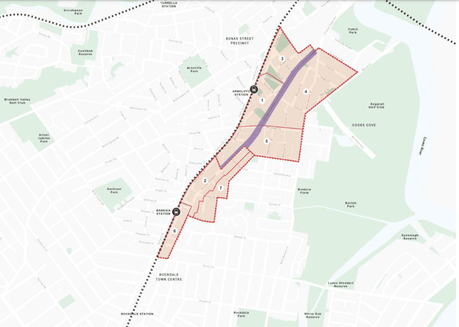

> [Picture on page 77: a picture, saved as a picture (images/section-07-specific-places-page-77-1.gif, 150 dpi).]

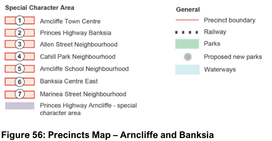

> [Picture on page 77: a picture, saved as a picture (images/section-07-specific-places-page-77-2.gif, 150 dpi).]

#### Figure 56: Precincts Map – Arncliffe and Banksia

#### Arncliffe Town Centre Sub-precinct

Arncliffe Town Centre is characterised by its historic built form, landscape core, steep streets and in some locations, exposed sandstone escarpment. To the western edge of the Town Centre is the Railway station, and to the east large sites that present opportunities for renewal.

Key points include:

1\. Remnant large tree planting along the rail line and cliffs contribute to the visual quality of the centre.

2\. Areas to the east of the railway offer some larger sites that may present opportunities for renewal. This part of the neighbourhood lacks clearly legible links, both west to the railway station and east to access and cross the Princes Highway.

3\. Wooroona Reserve, located directly adjacent to the railway station, provides valuable open space. The perimeter interface with blank fences and vehicular access/servicing areas detracts from the overall quality of the space.

#### Arncliffe Town Centre Desired Future Neighbourhood Character

1\. Provide a vibrant mixed use Town Centre, extending along the east side of the rail line, with activity during the day and night.

2\. Eden Street and Burrows Street become retail streets, complementing Firth Street and extending the Town Centre uses and activity to the east of the rail line. Streetscape improvements delivered alongside development will further enhance the character and amenity of these streets.

3\. Retain active uses and street edge alignment to the corner of Eden Street to mark entry into the Town Centre.

4\. Wooroona Reserve is transformed into the Town Square adjacent the rail station with outdoor dining terraces along the north and south-east edge.

5\. Existing and new pedestrian links improve access to the railway station and create a more walkable centre.

6\. Eden Street Park is a new local park catering to new residents with a centrally located lawn, gardens and significant tree planting.

7\. Taller buildings near the station visually reinforce the area as a centre and assist in highlighting the location of key connections and open spaces.

#### Land Use

8\. Ensure retail and business uses are provided at the ground level of existing and planned retail streets particularly on Eden Street and Burrows Street and sites adjoining Wooroona Reserve to the east.

9\. Development adjoining Princes Highway and parts of Eden Street should provide showroom and other commercial uses at lower levels.

10\. High-quality residential development is encouraged above retail and commercial uses within the town centre, and as a standalone use on sites outside of the centre.

#### Built Form

11\. Tall towers on larger sites should be slender and well proportioned.

12\. Side setbacks are to include deep soil zones and appropriate landscaped treatment.

13\. Building height controls should allow for generous 7 metre floor to ceiling heights for ground level showroom uses along the Princes Highway. This additional height would allow for small mezzanine levels to be incorporated.

14\. Retain street edge alignment and active frontages at the corner of Eden Street at Forest Road.

15\. A front setback of 3 metre is required, unless a specific setback is recommended elsewhere in this chapter.

#### Public Domain

#### Arncliffe Town Centre

16\. 6 metre setback and provision of a positive covenant applying to this setback, for the purposes of permitting unrestricted access for public thoroughfare, landscape and public domain maintenance on sites adjoining the Princes Highway. Where a site has more than one frontage, this requirement shall apply to each street frontage. Proposed landscape improvements include significant ‘boulevard’ tree planting and the creation of a dual footpath that allows for the staged delivery of the setback and continued pedestrian access during transition.

17\. 5 metre landscape zone within Wickham Street and Forest Road shall include large and medium size tree planting.

18\. A new plan for Wooroona Reserve and redevelopment of sites adjoining the park for active uses and outdoor terraces will increase usage and enjoyment.

19\. A new park to be delivered through the redevelopment of the Housing NSW site on Eden Street.

20\. Arncliffe Station Park on the M5 portal site will provide valuable open space for active and passive recreation.

21\. New through site links between Princes Highway and Eden Street.

#### The Princes Highway Arncliffe Sub-precinct

The Princes Highway is a major north-south arterial road serving the southern Sydney region and is a desirable location for vehicle-oriented light industrial, commercial and retail uses. The desired future character for this precinct is outlined below.

The Princes Highway Arncliffe Sub-Precinct Desired Future Neighbourhood Character

1\. Integrate boulevard tree planting along the Highway that reinforces the location of the Arncliffe Town Centre.

2\. Allow provision for destination commercial spaces and showrooms that are highly visible from passing vehicles.

3\. A key visual identity within the precinct is the Masjid Darul lmaan Mosque. It is vital that this remains a local landmark and signals an important street entry into the Town Centre.

4\. Improved pedestrian and cycle environment, and amenity for businesses and residents.

5\. Endorse and promote high-quality mixed use development.

#### Land Use

6\. Large format commercial uses at lower levels.

7\. Residential levels located above lower commercial levels with visual and acoustic separation from busy road frontage.

#### Road network and vehicular access

8\. Create a permeable road network that facilitates efficient vehicular access to and circulation within the area which can be conveniently used by all modes of transport.

#### Built Form

#### The Princes Highway Arncliffe Sub-Precinct

9\. Building height controls should allow for generous 7m floor to ceiling heights for ground level showroom uses along the Princes Highway. These spaces might comprise a small mezzanine.

10\. Communal open spaces are preferred on podiums or roof tops with high levels of amenity and less conflicts with large format commercial uses and associated service requirements.

11\. Where possible, vehicle entry to sites facing the Highway should be from a secondary street. Amalgamation is encouraged to minimise vehicle cross-overs.

12\. Winter gardens, shutters and glazing will further improve residential amenity above the busy road.

13\. A front setback of 3 metre is required, unless a specific setback is recommended elsewhere in this chapter.

#### Public Domain

14\. 6 metre setback and dedication on sites adjoining Princes Highway. Proposed landscape improvements include significant boulevard tree planting and the creation of a dual footpath that allows for the staged delivery of the setback and continued pedestrian access during transition.

#### The Princes Highway Banksia Sub-precinct

The desired future character for the Princes Highway Banksia precinct is provided below.

#### The Princes Highway Banksia Sub-Precinct Desired Future Neighbourhood Character

1\. To promote businesses along main roads and to encourage a mix of compatible uses.

2\. To provide a range of employment uses (including business, office, retail and light industrial uses).

#### Land Use

3\. The Banksia section of the Princes Highway will continue to encourage employment uses.

4\. Controls will allow the flexibility of a range of commercial uses which may not be in this location currently, such as offices.

#### Built Form

5\. Building heights are expected to remain typically around 2 storeys in the medium term however heights are permitted to encourage the development of other commercial building types (e.g. offices) where this is viable.

6\. Setbacks must be consistent with the “Highway Commercial” setbacks outlined in 6.3.2.

7\. Where possible, vehicle entry to sites facing the Highway should be from a secondary street. Amalgamation is encouraged to minimise vehicle crossovers.

8\. Retain vistas to Botany Bay. No building or structure is to detrimentally impact any view corridor.

#### Public Domain

#### The Princes Highway Banksia Sub-Precinct

9\. 6 metre setback for sites to contribute to intermittent deep soil zones (minimum 6 metre x 6 metre) along the Highway frontage allowing for the planting of large trees and contribute to a boulevard character.

#### Allen Street Neighbourhood Sub-precinct

This small neighbourhood is located between Arncliffe Town Centre and Wolli Creek and contained by the strongly defined edges of the M5 to the south, the rail line to west, Southern and Western Suburbs Ocean Outfall Sewer (SWSOOS) to the north, and Princes Highway to the east. It includes a mix of buildings types including industrial warehouses, small walk-up apartments, car dealerships and a furniture showroom. The large consolidated industrial site may provide the opportunity to deliver new public domain for future residents and to better manage stormwater in the area.

#### Allen Street Neighbourhood Sub-Precinct Desired Future Neighbourhood Character

1\. An emerging residential neighbourhood adjacent to the Town Centre located around a new local park at Allen Street with a small cafe or shop serving local residents.

2\. Adaptive re-use of the SWSOOS as an east-west pedestrian corridor connecting the neighbourhood to the regional parkland to the east, to the Bonar Street neighbourhood and school via the proposed rail underpass to the west.

3\. Perimeter block apartment buildings with discrete towers are sited to reinforce the street grid, mark the new park and transition between the Town Centre and Wolli Creek.

4\. Generally mid-rise development. Taller development adjacent the Allen Street Park to mark the park within the broader context.

#### Land Use

5\. Primarily residential development.

6\. Large format commercial development at the lower levels of sites adjoining Princes Highway.

7\. Cafe or retail uses at the lower levels of residential buildings where they adjoin an open space, to assist in activating the space.

8\. Rezone the isolated industrial site on the corner of Allen Street and Arncliffe Street to allow for mixed use development and the development of a new open space.

#### Built Form

9\. Development (including double height, 7 metre floor to ceiling height commercial ground floor) is proposed on sites fronting the Princes Highway, to provide a transition to Wolli Creek to the north.

10\. Taller buildings are proposed on the remaining industrial lot to allow for an equitable floor space on the site and the delivery of a new open space (refer to Allen Street Development Site).

11\. Street wall height of 6 storeys, with a 3 metre setback to upper levels.

12\. A front setback of 3 metre is required, unless a specific setback is recommended elsewhere in this chapter.

#### Allen Street Neighbourhood Sub-Precinct

13\. Side setbacks are to include deep soil zones and appropriate landscaped treatment.

#### Public Domain

10\. Proposed park on the corner of Allen and Arncliffe Streets will provide valuable open space with a northerly aspect, a new through-block connection and will help to detain storm water in a flood event.

11\. 6m landscape setback on sites adjoining Princes Highway.

12\. Arncliffe Station Park on the M5 portal site will provide valuable open space for active and passive recreation.

#### Cahill Park Neighbourhood Sub-precinct

This neighbourhood is part of the broader neighbourhood that extends north to Cahill Park. Pedestrian access to centres and open spaces requires crossing busy roads such as the Princes Highway, Marsh Street, Wickham Street and West Botany Street. The neighbourhood includes predominantly houses and car-oriented commercial uses along the Princes Highway. There is an existing unresolved scale transition between recent large apartment buildings to the north and the predominantly low scale residential neighbourhood to the south.

#### Cahill Park Neighbourhood Sub-Precinct Desired Future Neighbourhood Character

1\. An extension of the existing Cahill Park residential neighbourhood to the south.

2\. Leafy residential streets sheltered from the north-south busy arterial roads that traverse the neighbourhood.

3\. Generous landscape setbacks along Wickham Street, West Botany Road and Marsh Street enhance street character and provide improved amenity for adjacent residential uses.

4\. Buildings that step up the hill at the northern part of Duncan Street.

5\. Improved east-west pedestrian routes along Duncan Street and Valda Avenue connecting to nearby open spaces and along Kyle Street connecting to the Town Centre and rail station.

6\. Through site links through long urban blocks improve walkability within the neighbourhood and to surrounding open spaces and schools.

7\. A landmark building marks the corner at the junction of Princes Highway and West Botany Street.

8\. Rear gardens with tree planting reinforce existing mid-block and provide landscape transition between new developments and existing Princes Highway uses.

#### Land Use

9\. Primarily residential development.

10\. Large format commercial development at the lower levels of development adjoining Princes Highway.

#### Built Form

#### Cahill Park Neighbourhood Sub-Precinct

11\. Development (including double height, 7 metre floor to ceiling height commercial ground floor) is proposed on sites fronting the Princes Highway. These spaces might comprise a small mezzanine.

12\. Provide street edge aligned built form with active frontage to mark the corner at junction of the Princes Highway and West Botany Street.

13\. A front setback of 3 metre is required, unless a specific setback is recommended elsewhere in this chapter.

14\. Deep soil zones along rear boundary to facilitate mid-block tree planting and visual privacy between properties.

15\. Side setbacks are to include deep soil zones and appropriate landscaped treatment.

16\. Retain vistas to Botany Bay. No building or structure is to detrimentally impact any view corridor as identified.

#### Public Domain

17\. A 6 metre landscape setback on sites adjoining Princes Highway.

18\. A 5 metre landscape setback is required to Marsh Street, West Botany Street and Wickham Street comprising a 3 metre landscape zone with private courtyards behind to assist in ameliorating the impacts of busy roads on residential development. The landscape zone should include large and medium size tree planting.

19\. New through site connections (6 metre wide) between lnnesdale Road and Valda Avenue will break up the proposed continuous building form and encourage pedestrian links away from busy roads. Links should be provided on the side boundary of an amalgamated development

site. Through site links should generally align with Robert Lane.

20\. New through site connections (6 metre wide) between West Botany Road and Princes Highway will break up the proposed continuous building form and encourage pedestrian connection from the east to west. Links should be provided on the side boundary of an amalgamated development site.

#### Arncliffe School Neighbourhood Sub-precinct

At the heart of this small neighbourhood identified is the Arncliffe Public School and St Francis Xavier’s linked by a pedestrian bridge across the sandstone cutting of the highway. To the east this neighbourhood is primarily residential and to the south commercial. Forest Road/Wickham Street and the Princes Highway isolate the neighbourhood from the Arncliffe Town Centre while Marinea Street Reserve, just outside the neighbourhood boundary, and the school grounds provide some open space amenity.

#### Arncliffe School Neighbourhood Desired Future Neighbourhood Character

1\. The residential neighbourhood surrounds the two schools: Arncliffe Public School and St Francis Xavier Catholic Primary School.

2\. The enhanced pedestrian bridge spans the sandstone cutting at the Princess Highway connecting the two parts of the neighbourhood and the schools.

#### Arncliffe School Neighbourhood

3\. A proposed cycleway connects the Town Centre, neighbourhood and schools to Banksia Field and Barton Park in the east.

4\. Marinea Park to the immediate south is to provide local amenity and play space.

5\. A new through site link extends from Wardells Street to Hattersley Street in the south and provides easy access to Banksia rail station and centre.

6\. Generous landscape setbacks along Wickham Street and Forest Road enhance street character and provide improved amenity for adjacent residential uses.

7\. St Francis Xavier’s Catholic Church remains a local landmark along Forest Road.

8\. The strong building form with active frontage marks the corner at the intersection of Princes Highway and Forest Road and signals entry to the Town Centre.

#### Land Use

9\. Retain schools and improve connections.

10\. Primarily residential development.

11\. Large format commercial development at the lower levels of development adjoining Princes Highway, with residential uses above.

#### Built Form

12\. Smaller lots east of the Arncliffe Public School and south of Wickham Street can be developed for new 3 storey buildings, where there is a street frontage greater than 24 metre.

13\. A 5 metre landscape setback is required to Wickham Street and Forest Road comprising a 3 metre landscape zone with private courtyards behind to assist in ameliorating the impacts of busy roads on residential development. The landscape zone should include large and medium size tree planting.

14\. Provide street edge alignment and active use to south-western corner at Princes Highway and Forest Road to reinforce this important corner marking the Town Centre entry from the Highway.

15\. A front setback of 3 metre is required unless a specific setback is recommended elsewhere in this chapter.

16\. Side setbacks are to include deep soil zones and appropriate landscaped treatment.

17\. Solar access to the school grounds - the configuration of buildings and structures must ensure that the school grounds receive a minimum of 2 hours daylight during the hours of 12pm - 2pm on 21 June (mid winter).

18\. Retain vistas to Botany Bay, no building or structure is to build into or on a view corridor as identified.

#### Public Domain

19\. 6 metre setback and provision of a positive covenant applying to this setback, for the purposes of permitting unrestricted access for public thoroughfare, landscape and public domain maintenance on sites adjoining the Princes Highway. Proposed landscape improvements include significant boulevard tree planting and the creation of a dual footpath that allows for the staged delivery of the setback and continued pedestrian access during transition. At the sandstone cutting south of the Forest Road intersection, a setback shall be provided for tree planting and a footpath at the top of the cutting.

#### Arncliffe School Neighbourhood

20\. A new through site connection (6m wide) is proposed, which will connect Wardell Street to Hattersley Street and provide the missing link in the pedestrian and cycle route on the eastern side of the rail line. Links should be provided on the side boundary of an amalgamated development site.

21\. A new through site connection (6m wide) connecting Segenhoe Avenue to West Botany (aligning with Brennans Road) through to the Eve Street Wetlands active transport network. Links should be provided on the side boundary of an amalgamated development site.

#### Banksia Centre East Sub-precinct

East of the railway this neighbourhood includes an area between Hattersley Street and the Princes Highway which is a mix of residential and commercial.

#### Banksia Centre East Sub-Precinct Public Domain

1\. New through site connections (6m wide) is proposed, which will connect Banksia Avenue to Hattersley Street and connect Tabrett Street to Hattersley Street to provide pedestrian linkages to Banksia Station. Links should be provided on the side boundary of an amalgamated development site.

2\. A new through site connection (consistent with prevailing Hattersley street width) between Kimpton Street and Rockdale Street connecting Hattersley street on both sides.

#### Marinea Street Neighbourhood Sub-precinct

This is part of a wider neighbourhood which extends east from the Princes Highway to Barton Park and Banksia Field. The majority of this wider neighbourhood is affected by aircraft noise issues such that providing more homes here is not considered appropriate.

Key points include:

1\. The landmark figs and tree planting along the railway corridor are key existing features which will also contribute to the future character of this centre.

2\. Gardiner Park to the west is a focal point for this neighbourhood, providing a large field, play area and other spaces.

3\. There is a regularity to the lot pattern and many of the existing buildings running north-south.

4\. Pedestrian links to Banksia Railway Station and centres often rely on unattractive routes along the Princes Highway.

5\. This neighbourhood has some attractive and established trees within the streetscape.

6\. The Marinea Street Reserve (outside the precinct to the east) provides a key focal point for this locality.

#### Public Domain

The Public Domain and Open Space Network Diagram identifies the areas that will see improvements to the public domain through streetscape treatment, upgrades to existing open space, provision of new open space and active frontages in key commercial areas.

It is required that proponents liaise with Council during the design phase of the planning process to understand Council’s requirements, as in many cases, public domain improvements will be delivered as part of the redevelopment of the site.

| Objective |  |
|---|---|
| Street network and design |  |
| O1. | To strengthen the landscape character and quality of the precincts through street tree planting. |
| O2. | To encourage improvements to the amenity of the Princes Highway corridor through better landscaping and improved facilities for pedestrians and cyclists. |
| O3. | To provide for improved and safer street crossings for pedestrians throughout the precincts. |
| O4. | To enhance the precincts permeability including new and improved through site links and connections to adjacent areas outside the Precinct. |
| O5. | To create an attractive and comfortable streetscape for pedestrians and cyclists that comprises of consistent and high- quality paving, street furniture, street tree planting, bike stands and bike racks. |

| Control |  |
|---|---|
| C1. | The street network is to be generally consistent with the Public Domain and Open Space Network Diagram. |
| C2. | New streets are to be generally consistent with the Landscape Setbacks diagram. Significant individual trees in streets or on sites are to be retained and protected where possible and appropriate. |
| C3. | Streets and public spaces are to be defined with trees of appropriate scale and species and designed with reference to relevant Council guidelines. |
| C4. | Intersection and crossing design is to favour pedestrian convenience and safety. |
| C5. | Any proposed cycle links are to be delivered in accordance with best practice standards. |
| C6. | Liaison with Council’s Transport Planner is required during the design phase of the planning process. |
| C7. | Provision for ‘end of trip’ facilities are encouraged in developments close to Arncliffe and Banksia Stations. |
| C8. | Footpaths are to be provided as per the sections in the Landscape Setbacks diagram. Pavement width is to allow for comfortable walking, unimpeded by obstacles. The placement of trees, street furniture and signage is to provide for amenity without causing clutter. |
| C9. | New streets are to have shared services pits to reduce maintenance costs and reduce conflict with street planting. |

| Objective |  |
|---|---|
| Public Domain and Open Space Network |  |
| O6. | To provide a range of quality public spaces including parks and plazas, for recreation and community gatherings, to support residents, workers, and visitors. |
| O7. | To improve the amenity, facilities and usage of existing parks and public spaces. |
| O8. | To improve connections between open space and the broader network. |

| Control |  |
|---|---|
| C10. | Street furniture and lighting is to be provided with reference to the relevant Council guidelines. |
| C11. | Provision of new open space is to be in accordance with the Public Domain and Open Space Network Diagram. |
| C12. | New cycle links identified in the Public Domain and Open Space Network are to be delivered in accordance with best practice standards. Provision of end of trip facilities are to be encouraged in developments close to Arncliffe and Banksia Stations. Liaison with Council’s Transport Planner is required during the design phase of the planning process. |
| C13. | The configuration of buildings and structures must ensure that a minimum of 50% of the area of parks and green spaces receive a minimum of 3 hours during lunch hours (12pm - 2pm) on 21 June (mid-winter). |

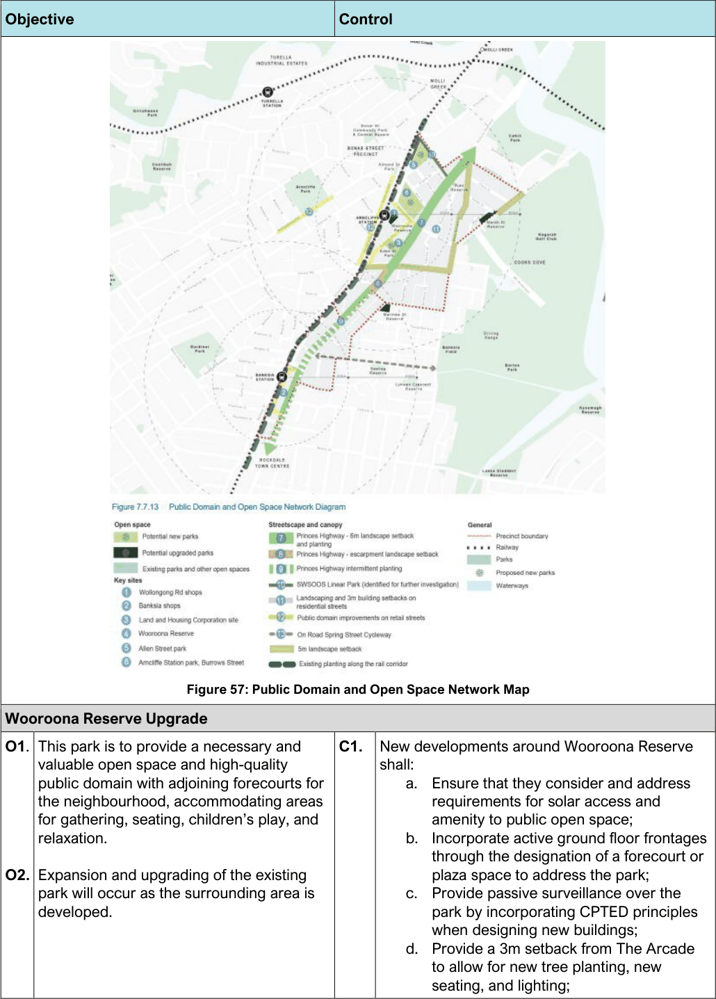

> [Picture on page 88: a picture, saved as a picture (images/section-07-specific-places-page-88-1.gif, 150 dpi).]

Figure 57: Public Domain and Open Space Network Map

#### Objective

#### Control

| Wooroona Reserve Upgrade |  |  |  |
|---|---|---|---|
| O1. | This park is to provide a necessary and valuable open space and high-quality public domain with adjoining forecourts for the neighbourhood, accommodating areas for gathering, seating, children’s play, and relaxation. | C1. | New developments around Wooroona Reserve shall: a. Ensure that they consider and address requirements for solar access and amenity to public open space; b. Incorporate active ground floor frontages |
| O2. | Expansion and upgrading of the existing park will occur as the surrounding area is developed. |  | through the designation of a forecourt or plaza space to address the park; c. Provide passive surveillance over the park by incorporating CPTED principles when designing new buildings; d. Provide a 3m setback from The Arcade to allow for new tree planting, new seating, and lighting; |

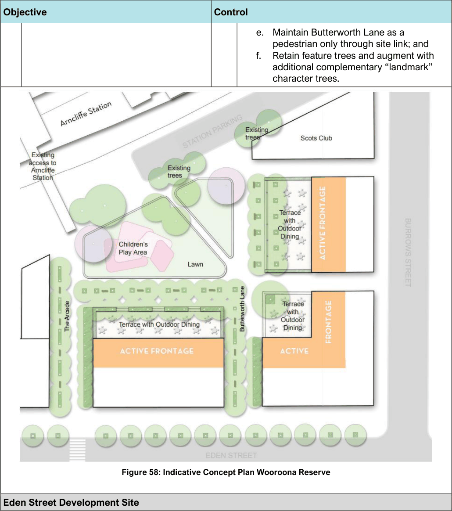

> [Picture on page 89: a picture, saved as a picture (images/section-07-specific-places-page-89-1.gif, 150 dpi).]
> Words printed on the picture (title and legend, copied from the PDF):
> additional complementary “landmark”
> character trees.

Figure 58: Indicative Concept Plan Wooroona Reserve

#### Objective

#### Control

e. Maintain Butterworth Lane as a pedestrian only through site link; and

f. Retain feature trees and augment with

#### Eden Street Development Site

| Objective |  |
|---|---|
| O1. | Provide the opportunity for a range of uses including integrated housing, employment and open space. |
| O2. | Provide a centrally located public open space that caters for a growing local population and offers a variety of activities. |
| O3. | Provision of the public open space will occur as these sites redevelop. |

| Control |  |
|---|---|
| C1. | Any redevelopment of the site is to include a new consolidated public park space that shall: a. Ensure the new public park is to be located to maximise solar access; b. Provide a minimum width of 50m along the Eden Street frontage with a site area of 4000m2; c. Ensure direct through site links are incorporated within the new park and integrate with the new space into the surrounding streetscape; d. Ensure new through site links will be provided in accordance with the diagrams on the following pages. e. Provide pathway connections through the public park connecting Princes Highway to Eden Street and Arncliffe Station; f. Ensure a generous landscape interface to Princes Highway with existing trees, additional tree planting, garden zones that must incorporate storm water treatment gardens; g. Provide landscape setbacks as per the Public Domain and Open Space Network Diagram; h. Ensure the new park will play a key role in the community providing new landscaping and areas for passive and active recreation activities. |
| C2. | New buildings on the site must comply with the following controls and shall: a. Ensure building setbacks and site through links are in accordance with the Built Form and Character image and through site links. b. The configuration of buildings and structures must ensure that a minimum of 50% of the area of parks and green spaces receive a minimum of 3 hours during lunch hours (12pm - 2pm) on 21 June (mid-winter). c. Promote slender buildings, towers exceeding 8 storeys. |

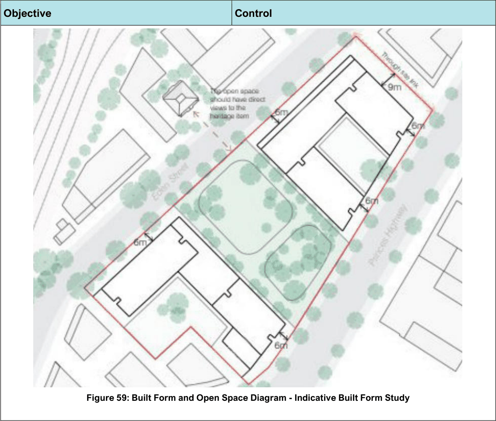

> [Picture on page 91: a picture, saved as a picture (images/section-07-specific-places-page-91-1.gif, 150 dpi).]

Figure 59: Built Form and Open Space Diagram - Indicative Built Form Study

#### Objective

#### Control

| Objective |  |
|---|---|
| Figure 60: Built Form and Open Space Diagram - Indicative Concept for proposed park |  |
| Allen Street Development Site |  |
| O1. | To provide opportunities for the provision of public open space as part of the site’s redevelopment. |
| O2. | To provide opportunities for play facilities, such as basketball courts for the nearby high school. |

| Control |  |
|---|---|
| C1. | Any redevelopment of the site shall include a new public park, and demonstrate compliance with the following controls and shall: a. Ensure that the new park is located in the area bounded by Allen Street, Arncliffe Street and the SWSOOS; b. Ensure the new park demonstrates compliance with Council’s water management and flooding controls. c. Ensure the area of the park is as identified at 5000m2 in the supporting studies, with the park being subject to extensive flood analysis and modelling d. Provide pathway connections for efficient access through the site to Allen Street and to the new pedestrian connection on top of the SWSOOS; e. Provide generous landscape garden interface to the new building to the south west with new tree planting; and f. Provide areas for passive and active recreation. |

| Objective | Control |  |
|---|---|---|
|  | C2. | New buildings must demonstrate compliance with the following controls and shall: a. Provide a 6m wide pedestrian link through the site to the Bonnie Doon Channel; b. Ensure through site links are in accordance with the Through Site Links Plan Arncliffe North; c. Provide residential entries along the park edge; d. Ensure the lower 6 storeys are setback 6 meters from Allen Street and Argyle Street frontages; e. Promote slender buildings, towers exceeding 8 storeys should have a maximum floor plate of 800m2 gross floor area. f. The configuration of buildings and structures must ensure that a minimum of 50% of the area of parks and green spaces receive a minimum of 3 hours during lunch hours (12pm - 2pm) on 21 June (mid-winter). |

| Objective |  |
|---|---|
| Figure 61: Indicative Concept Plan Arncliffe Station Park |  |
| Arncliffe Station Park |  |
| O1. | To provide opportunities for the provision of multifunctional open space. |
| O2. | To provide opportunities for active and passive recreation. |
| O3. | To activate the surrounding public domain and streetscape. |

| Control |  |
|---|---|
| C1. | A new public park is to be delivered, and demonstrate compliance with the following controls: a. Ensure the new park is to be of a relatively flat topography for ease of access and movement; b. Ensure that the new park demonstrates compliance with the 4.1.3 Water Management. Liaison with Council’s Flood Engineer is recommended during the design phase of the planning process; c. Incorporate stormwater detention features as required; d. Provide a variety of facilities for all age ranges and types of active and passive use; |

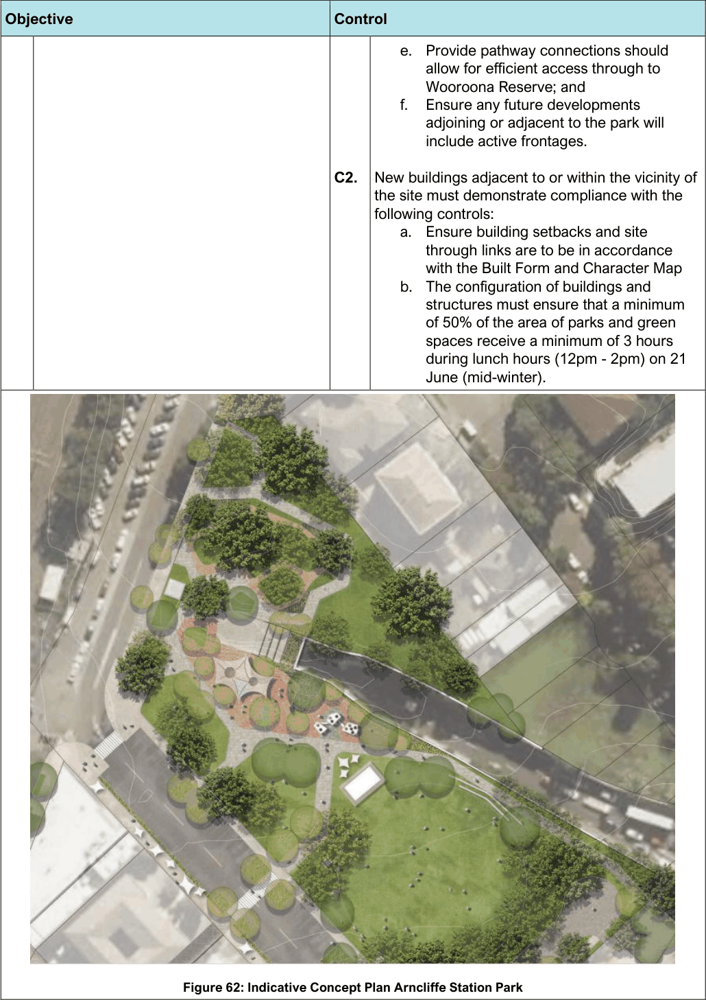

> [Picture on page 95: a picture, saved as a picture (images/section-07-specific-places-page-95-1.gif, 150 dpi).]

Figure 62: Indicative Concept Plan Arncliffe Station Park

| Objective | Control |  |
|---|---|---|
|  |  | e. Provide pathway connections should |
|  |  | allow for efficient access through to Wooroona Reserve; and f. Ensure any future developments adjoining or adjacent to the park will include active frontages. |
|  | C2. | New buildings adjacent to or within the vicinity of the site must demonstrate compliance with the following controls: |
|  |  | a. Ensure building setbacks and site |
|  |  | through links are to be in accordance with the Built Form and Character Map b. The configuration of buildings and structures must ensure that a minimum of 50% of the area of parks and green spaces receive a minimum of 3 hours during lunch hours (12pm - 2pm) on 21 June (mid-winter). |

#### Landscape Setbacks

| Objective |  | Control |  |
|---|---|---|---|
| Princes Highway Landscape Setback |  |  |  |
| O1. | To provide strong definition to the public domain and create a consistent and attractive streetscape. | C1. | New development in areas identified in the Princes Highway Landscape Setback are to: a. Provide a landscape corridor along |
| O2. | To provide enhanced pedestrian amenity. |  | the Princes Highway Corridor from Arncliffe to Banksia. A continuous 6 |
| O3. | To create a landscaped streetscape that can accommodate large tree species. |  | metre deep soil landscape setback is proposed and are required to: i. Retain existing trees, where |
| O4. | To reduce the visual bulk of buildings from the street. | C2. C3. a) | possible. These trees provide a gateway to the precinct and improve the amenity of the street environment for pedestrians, motorists and residents; ii. Where new trees are required landscape plans are to be developed in consultation with Council. New tree planting will be a minimum 600L pot size planted 8 metre apart, in accordance with Council guidelines; iii. Where awnings are located, they must provide adequate weather protection as well as ensuring tree planting has space to grow; b. Relocate footpaths to provide expanded verge and tree planting zones; c. Provide for the provision of under storey planting in garden zones, in accordance with Council guidelines; and d. Include an additional footpath adjacent to retail and ground floor uses with planting. Existing overhead power lines are to be moved underground as each site is redeveloped. New development in areas identified in the Princes Highway Intermittent Planting diagram are to: a. Provide a modified landscape corridor along the Princes Highway corridor from Avenal Street, South Arncliffe to Bestic Street, Banksia. |

| Objective | Control |
|---|---|
|  | In this location where there are B6 zones, retail frontages with on grade parking adjacent to the highway consolidated tree planting zones are to be provided. This allows on grade parking to be retained and for consolidated tree planting zones to be provided along the Princes Highway corridor in private land. Consolidated tree planting zones are to satisfy the following criteria: i. Minimum 6 x 6 metre deep soil zones along the Princes Highway frontage (minimum requirement one consolidated planting zone per 20 metres of street frontage); ii. Provision of large trees (minimum 15 metres high), in accordance with Council guidelines; iii. Provision of under storey planting in garden zones, in accordance with Council guidelines; and iv. Provision of WSUD treatment gardens in deep soil zones. |

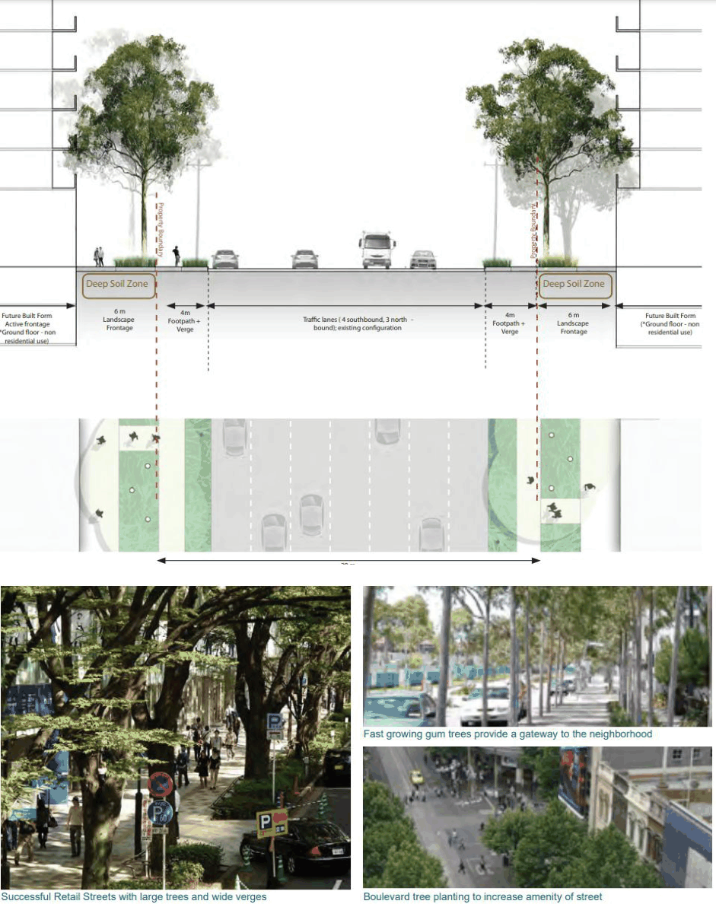

> [Picture on page 98: a picture, saved as a picture (images/section-07-specific-places-page-98-1.gif, 150 dpi).]

#### Figure 63: Princes Highway Indicative Section and Landscape Setback Precedents

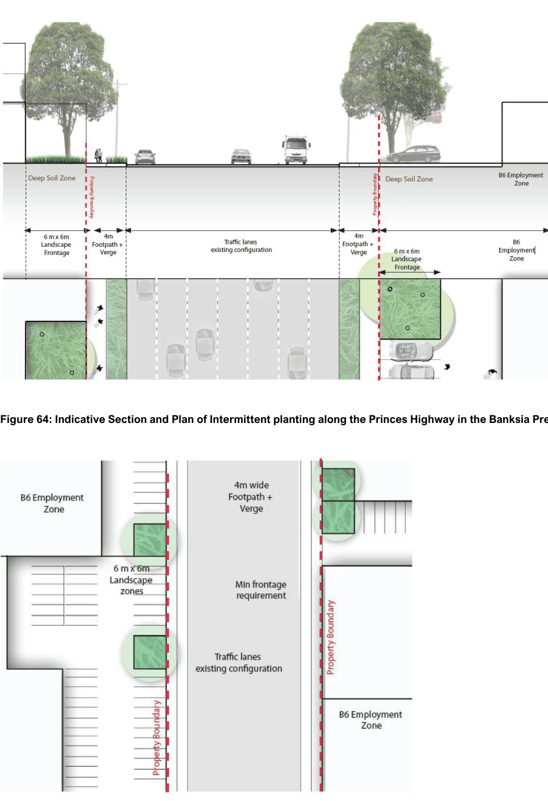

> [Picture on page 99: a picture, saved as a picture (images/section-07-specific-places-page-99-1.gif, 150 dpi).]

Figure 64: Indicative Section and Plan of Intermittent planting along the Princes Highway in the Banksia Precinct

Figure 65: Option for Tree Planting along Princes Highway in the Banksia Precinct

#### Controls Residential Streets Controls

C1. Improvements to existing residential streets are proposed to increase canopy cover and improve neighbourhood amenity. New development located in the areas identified in the Residential Streets Landscape Setback image are to:

a. Provide expanded footpath and verge zones and reduce carriage ways where possible;

b. Provide ground floor private open space;

c. Relocate footpaths to provide expanded verge and tree planting zones;

d. Provide additional street tree planting to street verges, in accordance with Council guidelines;

e. Provide additional tree planting between on street parking bays, in accordance with Council guidelines;

f. Provide gardens with low shrubs and ground cover rather than lawn verges, in accordance with Council guidelines;

g. Consolidate deep soil within setback frontages adjacent to existing streets to allow for additional tree planting in private land. This setback should not include private open space; and

h. Allow for the integration and provision of rain gardens within landscape areas.

C2. Existing overhead power lines are to be moved underground as each site is redeveloped.

#### Retail Streets Controls

C3. Several existing street reserves are generously proportioned and establish a precedent with large street trees providing amenity and shade. Streets such as Eden Street and Hattersley Street are to be improved through increased and high quality landscaping. New development in areas identified in the Retail Streets Landscape Setback image are to:

a. Retain existing large scale trees located in street reserves or setbacks or along the rail corridor;

b. Reduce excess carriageway areas and lane widths and providing expanded footpath zones for informal gathering, seating and outdoor dining;

c. Provide additional tree planting to provide shade and seasonal colour, in accordance with Council guidelines;

d. Provide new rain gardens that can filter street runoff;

e. Provide new streetscape elements including furniture and improved pedestrian lighting in accordance with Council guidelines; and

f. Incorporate distinctive lighting treatments that respond to local character to enhance the night time experience on primary retail streets, in accordance with Council guidelines.

C4. Existing overhead power lines are to be moved underground as each site is redeveloped.

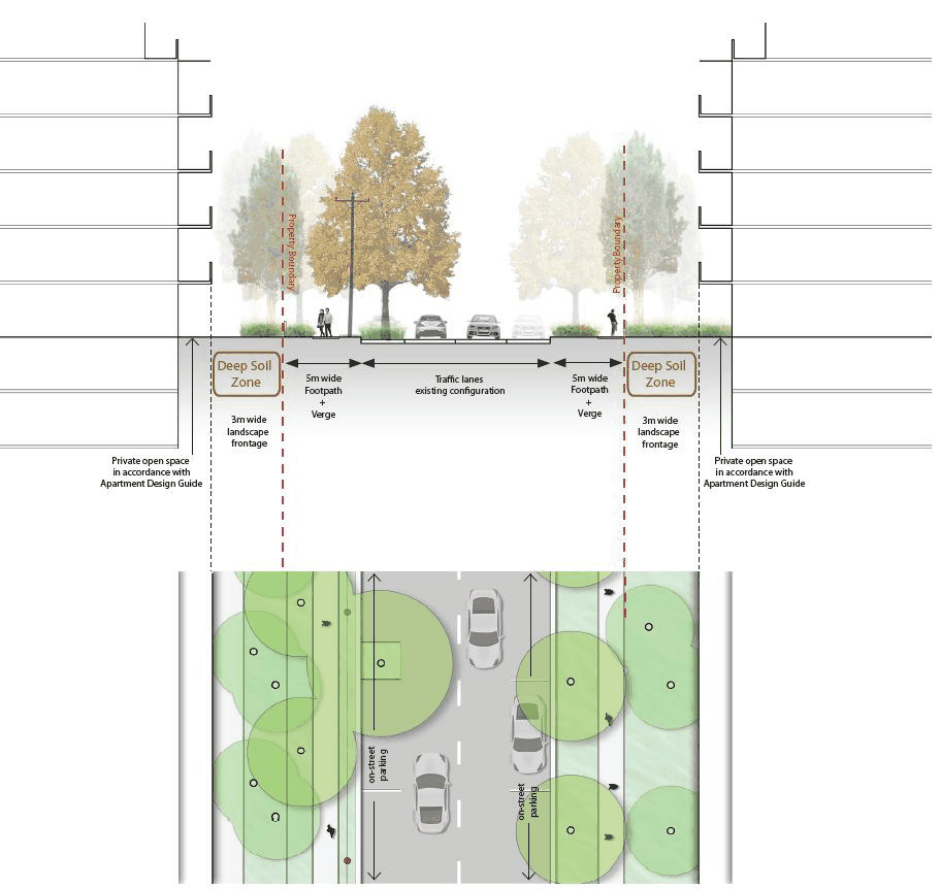

> [Picture on page 101: a picture, saved as a picture (images/section-07-specific-places-page-101-1.gif, 150 dpi).]

#### Figure 66: Indicative Residential Street Section and Plan

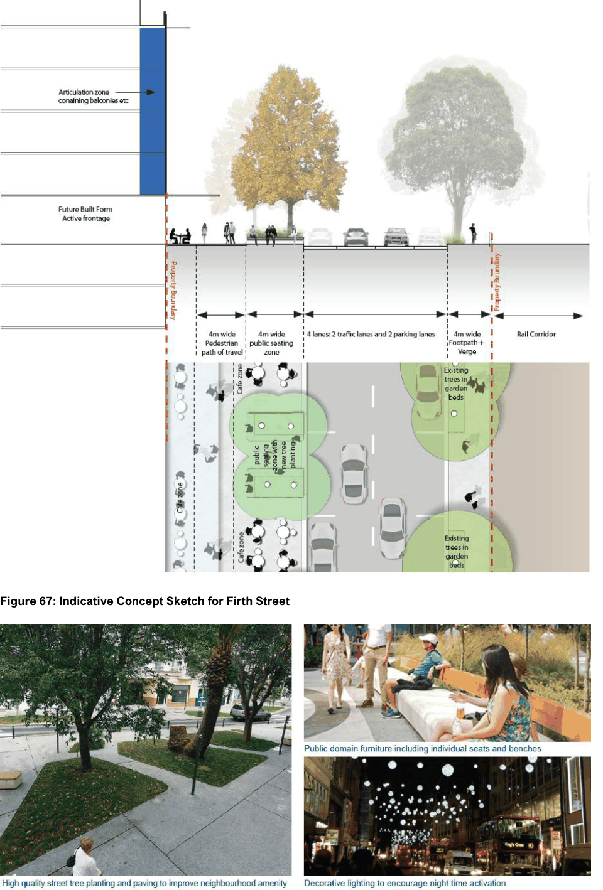

> [Picture on page 102: a picture, saved as a picture (images/section-07-specific-places-page-102-1.gif, 150 dpi).]

#### Figure 67: Indicative Concept Sketch for Firth Street

#### Figure 68: Retail Street Precedent

#### Through Site Links

| Objective |  |
|---|---|
| O1. | To enhance connectivity through the precinct for pedestrians and cyclists as sites redevelop. |
| O2. | To ensure the safety of pedestrians and cyclists. |

| Control |  |
|---|---|
| C1. | Through site links are to be publicly accessible connections through sites, (but not on land dedicated to Council for a public purpose) formalised through a positive covenant on the title of the land, that provides for unrestricted access for public thoroughfare and maintenance of the public domain. |
| C2. | Through site links are to be maintained by the land owner. |
| C3. | Through site pedestrian links are to be provided generally in the locations shown on the Through Site Link Plans for Arncliffe North, Arncliffe South, and Banksia. |
| C4. | Though site links and potential through site links need to be considered as part of any development application. |
| C5. | Where a through site link is provided on site, FSR is based on the total site area. |
| C6. | Pedestrian through site links can be provided in a number of ways, including arcades and open links between buildings. To ensure that pedestrian mobility and amenity can be effectively coordinated and integrated, the proponent is to liaise with Council prior to proceeding with detailed site planning and design. |
| C7. | Through site links or arcades must connect to a public street on both ends and must be of a straight alignment, with clear visual connections. |
| C8. | Through site links are to be publicly accessible connections through sites, (but not on land dedicated to Council for a public purpose) formalised through a positive covenant on the title of the land, that provides for unrestricted access for public thoroughfare and maintenance of the public domain. |
| C9. | Pedestrian through site links are to: a. provide active frontages on both sides with clear glazing for windows and doors from floor to ceiling at ground level; |

| Objective | Control |  |
|---|---|---|
|  |  | b. be a clear and direct throughway for pedestrians; c. provide a minimum for 6 metres setback to building line; d. have a minimum width of 4.5 metres non leasable space clear of all obstructions (including columns, stairs and escalators); e. demonstrate compliance with Crime Prevention Through Environmental Design (CPTED) principles; f. where practicable, have access to natural light; g. have the capacity to provide active frontages on both sides; and h. be air conditioned and have clear glazed entry doors comprising at least 50% of the entrance. |
|  | C10. | Through site links can be adjacent to active frontages, site boundaries (A), transport infrastructure (B) or public open spaces (C) as shown on the Through Site Links Plan. |

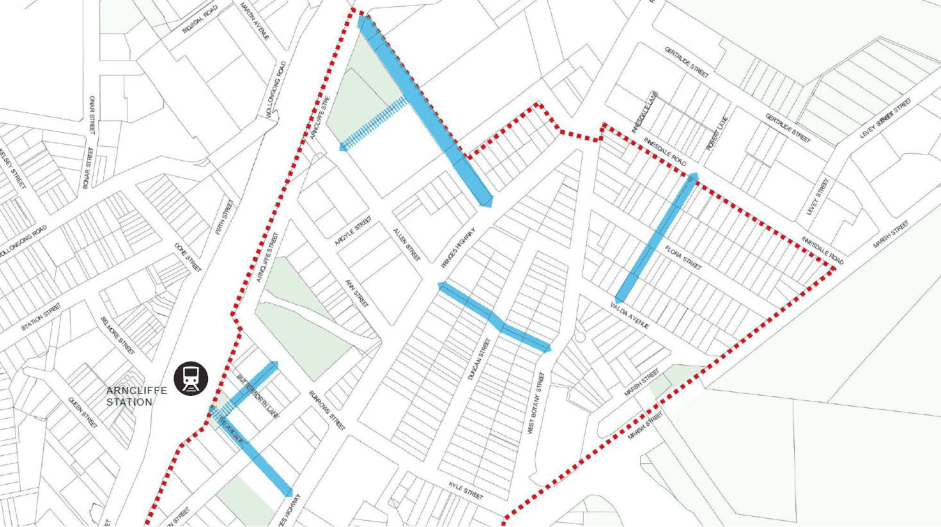

> [Picture on page 104: a picture, saved as a picture (images/section-07-specific-places-page-104-2.gif, 150 dpi).]

#### Figure 69: Through Site Links Plan Arncliffe North

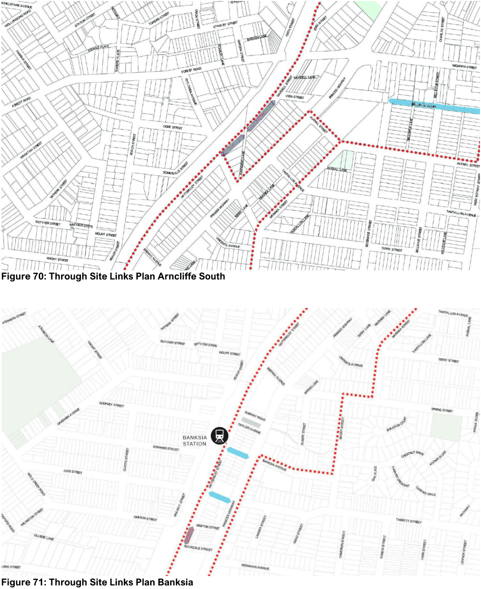

> [Picture on page 105: a picture, saved as a picture (images/section-07-specific-places-page-105-1.gif, 150 dpi).]

#### Figure 70: Through Site Links Plan Arncliffe South

#### Figure 71: Through Site Links Plan Banksia

#### Built Form

| Objective |  | Control |  |
|---|---|---|---|
| Retail Streets Controls |  |  |  |
| O1. | To ensure the development creates a positive streetscape and achieves high quality architectural design that promotes commercial, retail and business activity. | C1. | New development within the Arncliffe and Banksia Precincts is to provide ground floor building setbacks and provide new buildings |

| Objective | Control |  |
|---|---|---|
|  |  | to the street alignment in accordance with the Built Form and Character Map. |
|  | C2. | Buildings should be set back 6 metres along the Princes Highway. The setbacks should include significant tree planting, landscaping and a secondary footpath located closer to the shop fronts and away from the traffic. |
|  | C3. | 5 metres landscaped setbacks are to consist of 3 metres landscaping and 2 metres private courtyards. The landscape zone should include large and medium size tree planting, in accordance with Council guidelines. |

#### Street Wall Heights

| Objective |  |
|---|---|
| O1. | To coordinate building massing along streets and across blocks. |
| O2. | To ameliorate the effects of existing unevenly scaled and massed buildings. |

| Control |  |
|---|---|
| C1. | New development within the Arncliffe and Banksia Precincts is to provide street wall heights in accordance with the Built Form and Character Map. |
| C2. | The building envelope shall be set back a minimum of 3m above the Street Wall Heights as identified in the Street Wall Heights Map. |

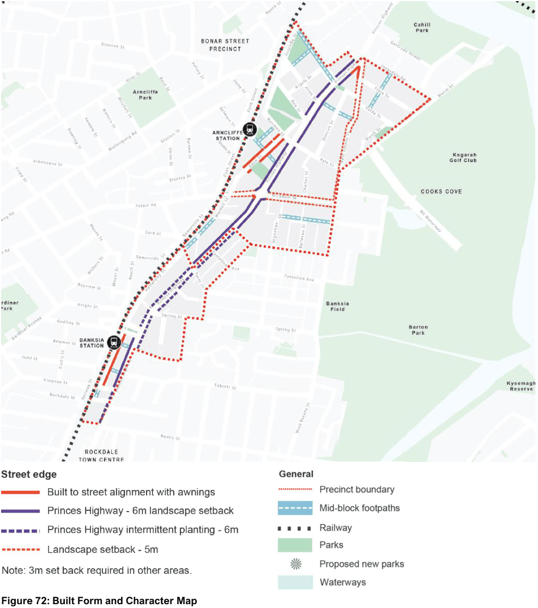

> [Picture on page 107: a picture, saved as a picture (images/section-07-specific-places-page-107-1.gif, 150 dpi).]

#### Figure 72: Built Form and Character Map

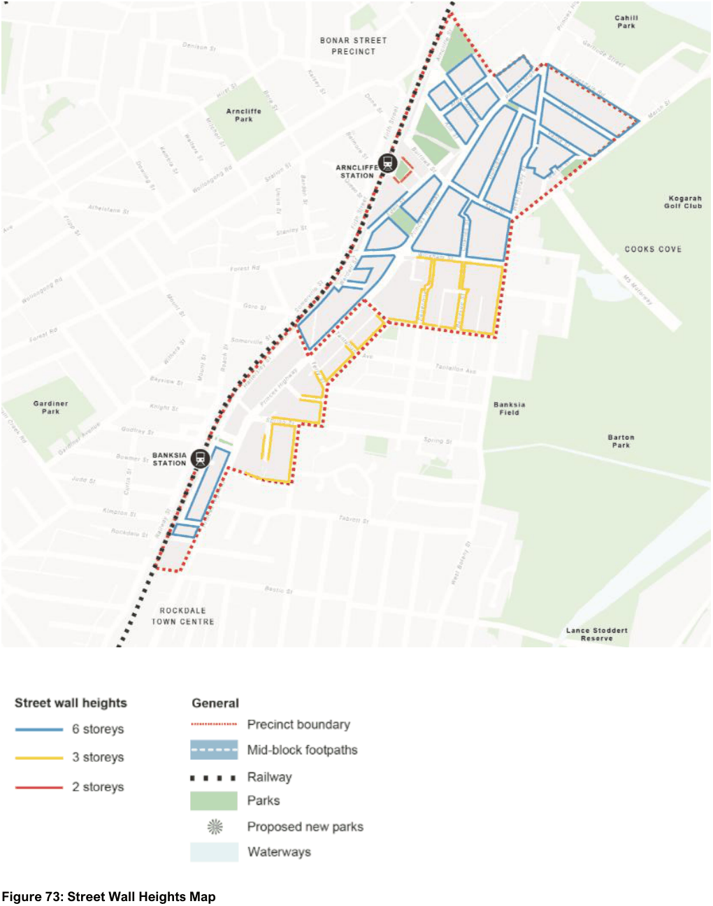

> [Picture on page 108: a picture, saved as a picture (images/section-07-specific-places-page-108-1.gif, 150 dpi).]

#### Figure 73: Street Wall Heights Map

#### Active Frontages

| Objective |  |
|---|---|
| O1. | To encourage active street frontages in suitable locations. |
| O2. | To provide active street frontages to promote activity on the street and public domain. |
| O3. | To enhance public security and passive surveillance, and improve the amenity to the public domain by encouraging pedestrian activity. |

| Control |  |
|---|---|
| C1. | New development is to provide an active street frontage in accordance with the Active Street Frontages Map. |
| C2. | New mixed-use development north of Forest Road and fronting the Princes Highway is to provide a floor to ceiling height of 7 metres to accommodate a wide range of retail showroom or commercial uses. |
| C3. | Development consent must not be granted for the erection of a building, or a change of use of a building, on land to which this clause applies unless the consent authority is satisfied that the building will have an active street frontage after its erection or change of use. |
| C4. | New buildings are to demonstrate compliance with the following controls: a. Ground floor frontage to be activated by retail and business premises; b. No ground floor residential is permitted; c. Site adjoining the Princes Highway within areas identified as Active Street Frontage - Showroom are to include entire ground floor retail activation to the Princes Highway for accommodating large format retail and commercial uses; d. Locate ground levels at grade with finished footpaths; e. Reinforce corner frontages on primary streets with shop front windows; f. Shop fronts that can open out for restaurants and cafes are encouraged; g. Residential lobbies are permitted off the street frontage; h. No vehicle access permitted unless the development has no other street frontage; i. No service access permitted unless the development has no other street frontage. j. Provision of a separate goods lift for operations associated with large format retail and commercial uses; and k. Access, circulation, parking and loading docks are designed to |

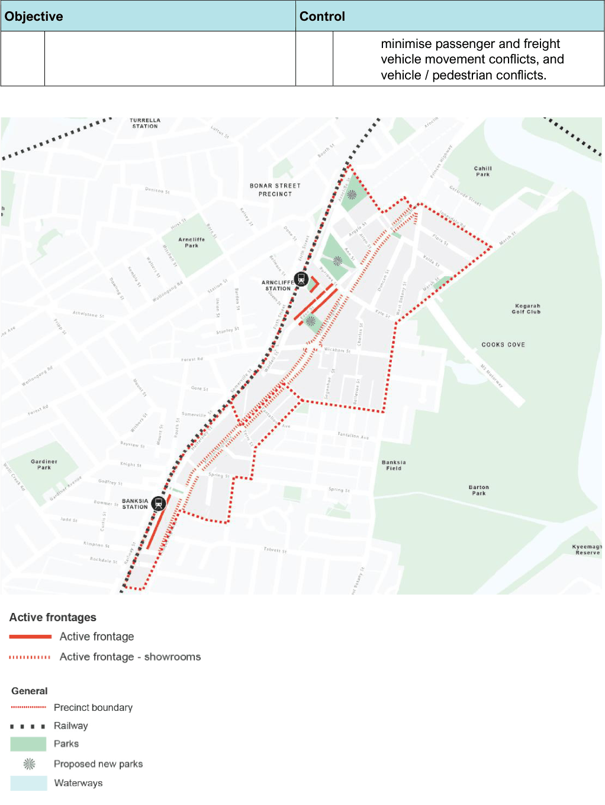

> [Picture on page 110: a picture, saved as a picture (images/section-07-specific-places-page-110-1.gif, 150 dpi).]
> Words printed on the picture (title and legend, copied from the PDF):
> minimise passenger and freight
> vehicle movement conflicts, and
> vehicle / pedestrian conflicts.

#### Objective

#### Control

#### Figure 74: Active Frontages Map

#### Bonar Street Precinct
