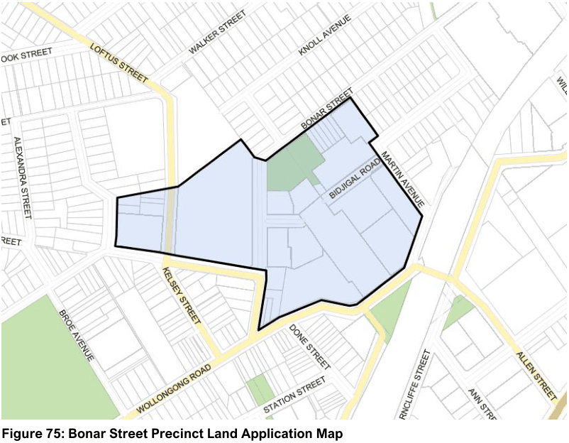

#### 7.5.1 Description

The Bonar Street precinct in Arncliffe is well served with public transport and is located in close proximity to Arncliffe shopping centre and Wolli Creek. The precinct will be transformed from an underutilised industrial area into a medium to high density residential environment. It is envisaged that the redevelopment of the precinct will be staged and that existing uses within the precinct will continue to operate.

Refer to the Wolli Creek and Bonar Street Precinct Public Domain Plan and Technical Manual for detailed controls for streetscape design, street tree planting and concept designs for the community park and plaza.

> [Picture on page 111: a picture, saved as a picture (images/section-07-specific-places-page-111-11.gif, 150 dpi).]

#### Figure 75: Bonar Street Precinct Land Application Map
