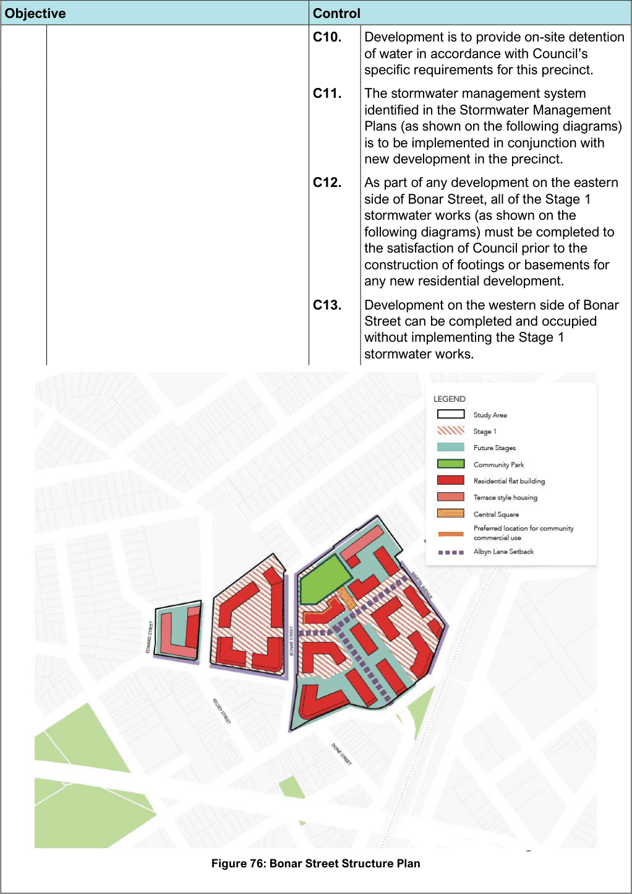
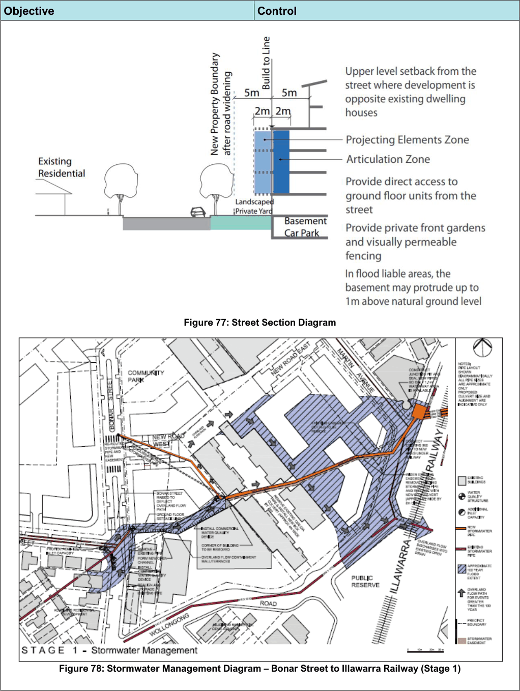
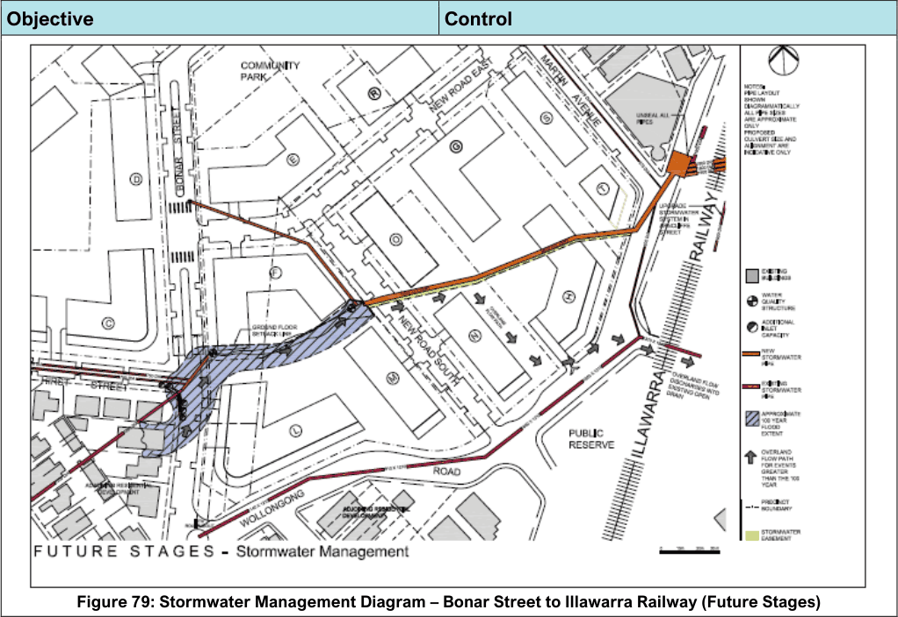

#### 7.5.2 Controls

| Objective |  |
|---|---|
| O1. | To promote the development of the land predominantly for medium-high density residential use with a mix of dwelling types, and compatible uses including retail, child care, community facilities and open space to serve local residents. |
| O2. | To allow for underutilised properties to be redeveloped while existing viable businesses in the precinct continue operations in the short term. |

| Control |  |
|---|---|
| C1. | Commercial uses, local shops, restaurants/ cafes or child care facilities should be located on at least part of the ground level of the building next to the Bonar Street/ New Road West intersection and the central square and community park. |
| C2. | Provide a street edge building form that defines streets and ensures legibility of the streetscape, provides street addresses for all buildings, view corridors through the precinct, and adequate setbacks for landscape treatment to the street edge. |

| Objective |  |
|---|---|
| O3. | To ensure that new residential development provides an acceptable level of amenity, by minimising noise, air quality and odour impacts, where located adjacent to non-residential land uses, through appropriate design responses. |
| O4. | To achieve buildings of a distinctive contemporary character articulated in response to the local and environmental context to ensure a safe, permeable and legible public domain. |
| O5. | To create attractive landscape settings for buildings with a clear definition between public and private spaces. |
| O6. | To integrate the stormwater drainage corridors with landscape features as far as practical. |
| O7. | To provide a range of open spaces for all age groups including a community park and central square. |
| O8. | To maximise public safety and provide adequate protection of property against flood events. |
| O9. | To ensure existing floodplain users do not experience any increase in flood level. |

| Control |  |
|---|---|
| C3. | Building setbacks from road frontages are to be wholly available as deep soil planting zones clear of car parking structures. Building façade articulation zones should be co-ordinated with deep soil planting zones and landscape plans to optimise root and canopy space for large trees along street frontages. |
| C4. | Provide direct access to the street from private yards where possible to maintain connection between public and private domains. |
| C5. | Provide passive surveillance of the street from the buildings. Definition between the private frontages and the public domain is to include visually permeable fencing and walling. |
| C6. | Fencing is to be designed to allow filtered views of the street to maintain passive surveillance. |
| C7. | Development is to comply with the Wolli Creek and Bonar Street Precinct Public Domain Plan and Technical Manual. |
| C8. | Development is to incorporate setbacks at the street frontage in accordance with the street section diagram. |
| C9. | New roads are to be provided as per the Bonar Street Precinct Structure Plan and the following table: Road Location Width (m) Bonar Between northern 18m Street end of new road 5 and Arncliffe Widening of west 4.5m side between No. 47 and 123 Wollongong Widening of west 1.27m Road side, Allen Street underpass to Martin Avenue Martin Widening of south 1.6m Avenue west side Table 20: Bonar Street Precinct Structure Plan |

> [Picture on page 113: a picture, saved as a picture (images/section-07-specific-places-page-113-1.gif, 150 dpi).]

Figure 76: Bonar Street Structure Plan

| Objective | Control |  |
|---|---|---|
|  | C10. | Development is to provide on-site detention of water in accordance with Council’s specific requirements for this precinct. |
|  | C11. | The stormwater management system identified in the Stormwater Management Plans (as shown on the following diagrams) is to be implemented in conjunction with new development in the precinct. |
|  | C12. | As part of any development on the eastern side of Bonar Street, all of the Stage 1 stormwater works (as shown on the following diagrams) must be completed to the satisfaction of Council prior to the construction of footings or basements for any new residential development. |
|  | C13. | Development on the western side of Bonar Street can be completed and occupied without implementing the Stage 1 stormwater works. |

> [Picture on page 114: a picture, saved as a picture (images/section-07-specific-places-page-114-1.gif, 150 dpi).]

Figure 77: Street Section Diagram

Figure 78: Stormwater Management Diagram – Bonar Street to Illawarra Railway (Stage 1)

#### Objective

#### Control

> [Picture on page 115: a picture, saved as a picture (images/section-07-specific-places-page-115-1.gif, 150 dpi).]

Figure 79: Stormwater Management Diagram – Bonar Street to Illawarra Railway (Future Stages)

#### Objective

#### Control

#### Wolli Creek
