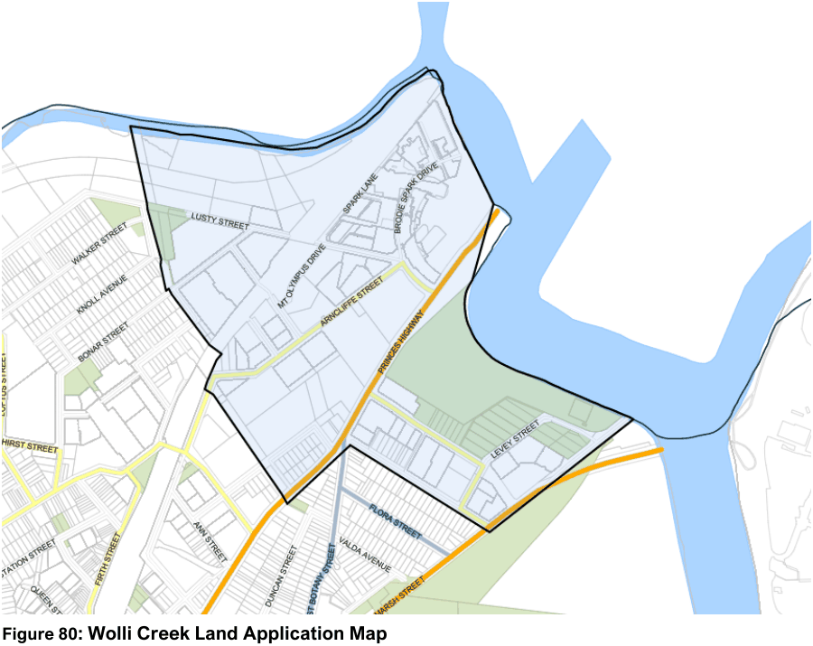

#### 7.6.1 Description

The Wolli Creek area to which this section applies is generally bounded by Wolli Creek and the Cooks River to the north, the Southern & Western Suburbs Ocean Outfall Sewer (SWSOOS) to the west, Innesdale Road to the south and Marsh Street to the east, as shown on Wolli Creek Redevelopment Area map.

Wolli Creek is evolving from an industrial area into a high-density mixed use, residential and commercial

area. In keeping with its unique location and accessibility to public transport, Wolli Creek will achieve some of the highest densities within the western area of the Bayside LGA. To ensure that this occurs in a way that benefits the city both economically and aesthetically, both a Vision and Structure Plan have been developed which, along with specific controls, will guide the achievement of this goal.

> [Picture on page 116: a picture, saved as a picture (images/section-07-specific-places-page-116-1.gif, 150 dpi).]

#### Figure 80: Wolli Creek Land Application Map

Wolli Creek contains some significant heritage items, namely the Wolli Creek Wetlands, the Tempe House Precinct incorporating Tempe House, St. Magdalen Chapel and their setting on the Cooks River, and the Southern and Western Suburbs Ocean Outfall Sewer (SWSOOS). These items illustrate Wolli Creek’s historical development and provide key reference points and landmarks in the area.

Historically, a range of industrial and urban activities have had a substantial impact on the natural environment and land contamination will be an issue during Wolli Creek’s redevelopment. Although located adjacent to the Airport, it is outside the flight path configuration thereby avoiding serious aircraft noise. However noise generated by the three railway lines and arterial roads will need to be mitigated.
