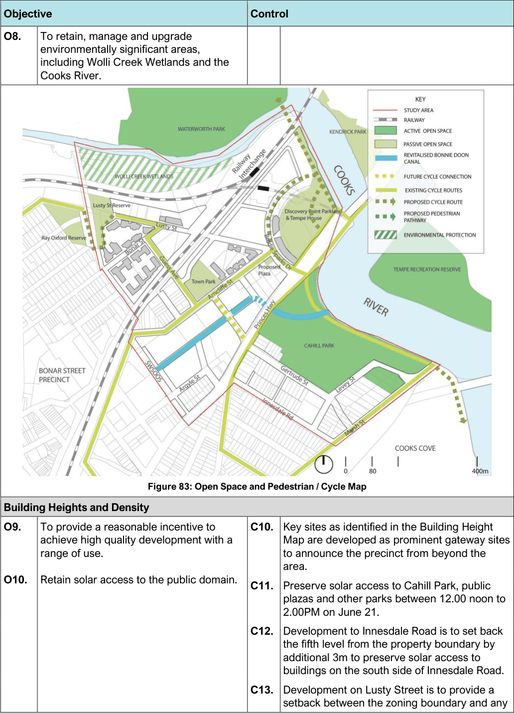
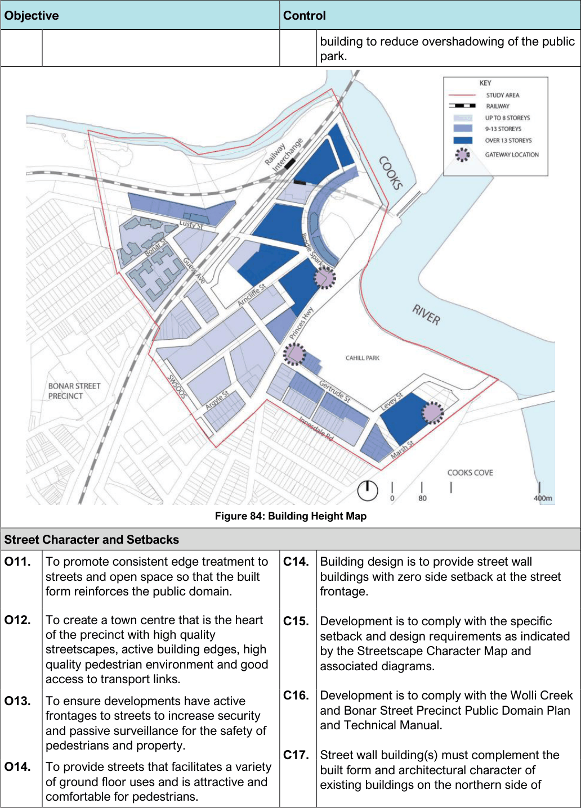
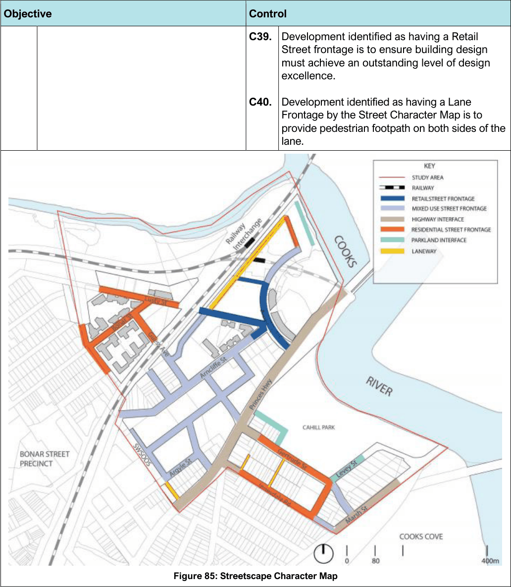
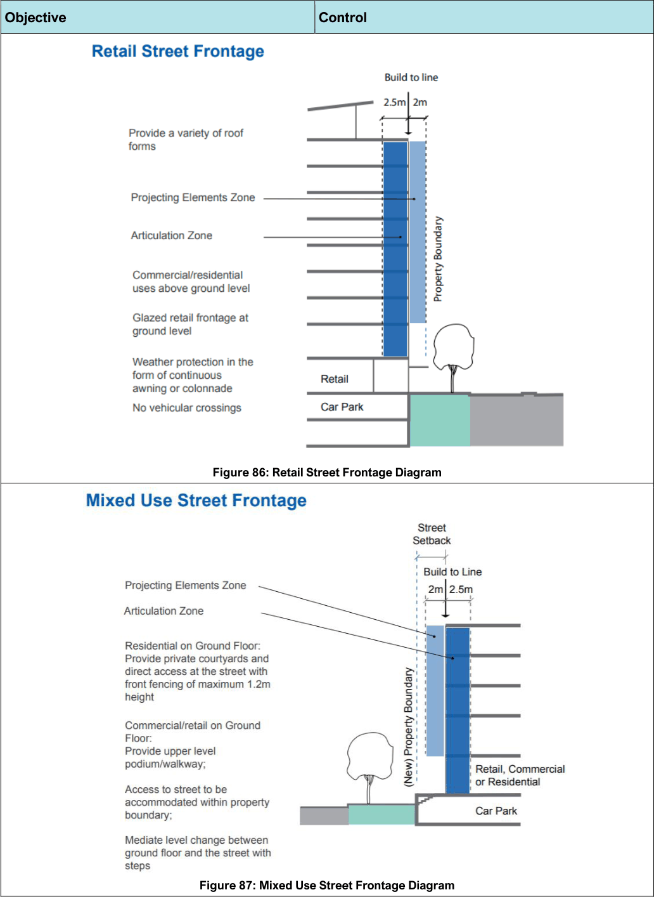
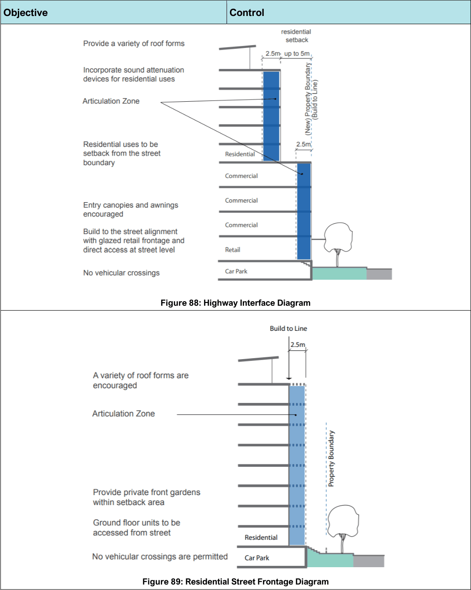
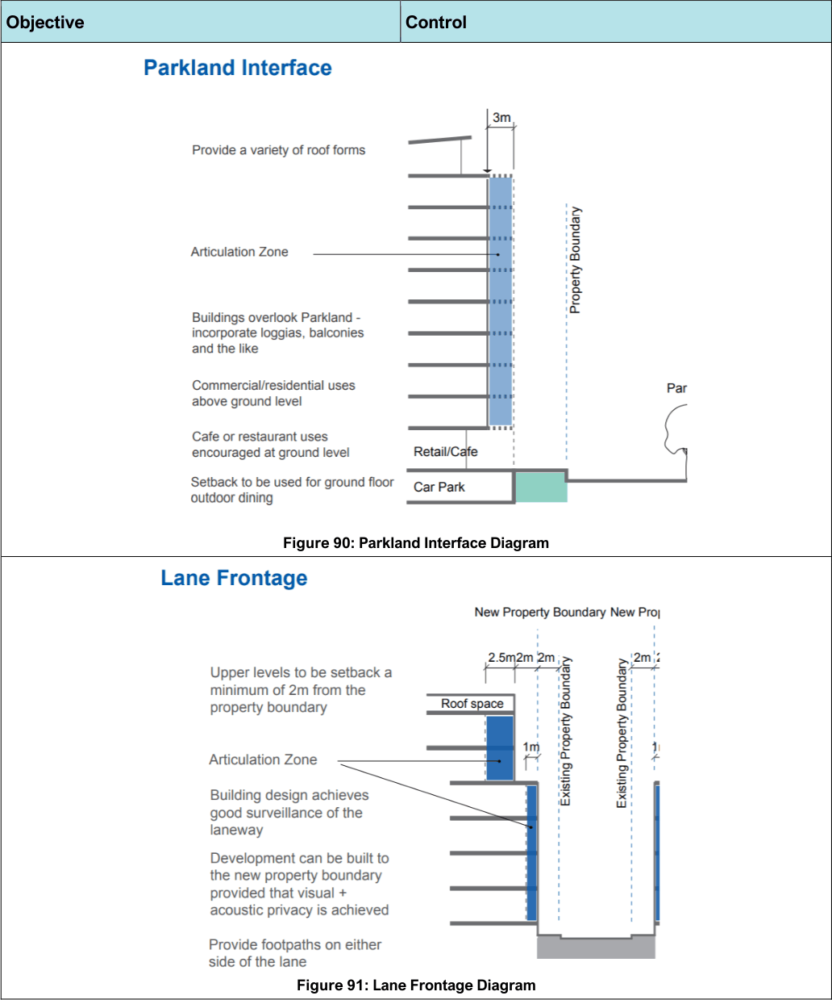

#### 7.6.3 Controls

| Objective |  | Control |  |
|---|---|---|---|
| Land Use |  |  |  |
| O1. | To provide a wide range of opportunities for different types of employment generating activities to meet regional and local needs. | C1. | Development is encouraged to provide commercial development in the area designated as town centre on the Wolli Creek Structure Plan Map. |
| O2. | To provide for the day-to-day shopping and service needs of the local community. | C2. | Where height difference between the street and the ground level of a building occurs (due to flooding constraints), ground floor uses should promote surveillance of the public domain by locating entrances, balconies, garden areas or locating steps between the street and dwellings. |

| Objective |  | Control |  |
|---|---|---|---|
| Figure 81: Wolli Creek Structure Plan Map |  |  |  |
| Road Network and Vehicular Access |  |  |  |
| O3. | To create a permeable road network that facilitates efficient vehicular access to and circulation within the area which can be conveniently used by all modes of transport. | C3. | New roads/road widenings are to be provided as per the Road Network and Vehicular Access Map and the following table: New roads Road Location Width (m) New Road Extension of 23m 1 Gertrude Street between Marsh and Levey Street New Road Extension of 23m 2 Gertrude between Princess New Road Between northern 18.4m 3 end of Argyle Street |

| Objective | Control |  |
|---|---|---|
|  |  | and Bonnie Doon Channel New Road Extension of Argyle 12m 4 Street adjacent to SWSOOS New Road Both sides of 10.5m 5 Bonnie Doon each side Channel New Road Between northern 18m 6 end of new road 5 and Arncliffe Princes Widening of west 4.5m Highway side between No. 47 and 123 Gertrude Widening of north 3.1m Street side between Princes Highway and Levey Street Arncliffe Widening of north 5m Street side between No. 15 and 29 Widening of south side between No. 34 and 94 Lusty Widening of north 2m Street side Argyle Widening adjacent 2m Street to SWSOOS Robert Widening on both 2m Lane sides Innesdale Widening on both 2m Lane sides Table 21: Road Network and Vehicular Access |
|  | C4. | Vehicular access to development sites is to comply with the Road Network and Vehicular Access Map. |
|  | C5. | Vehicular entries should be located on secondary frontages with a preference to rear lane access, where possible. |

| Objective |  |
|---|---|
| Figure 82: Road Network and Vehicular Access Map |  |
| Open Space and Movement |  |
| O4. | To ensure that the nature and distribution of public spaces, buildings and facilities enhances the public domain and links key features and activities within Wolli Creek. |
| O5. | To promote pedestrian and cycle links to encourage sustainable travel in the precinct. |
| O6. | To enhance local pedestrian and cycle routes and link them with regional networks, residential areas, work, shopping and recreation activities and public transport nodes. |
| O7. | To consider and take advantage of the SWSOOS and its location by incorporating it into an open space network. |

| Control |  |
|---|---|
| C6. | Pedestrian and cycle ways must be implemented as shown on the Open Space and Pedestrian/Cycle Network Map. |
| C7. | Provide safe pedestrian and cycle access across streets with ground level crossings preferable to pedestrian bridges and overpasses. |
| C8. | Provide two street level crossings across the Princes Highway at Gertrude Street and Brodie Spark Drive to maximise pedestrian and cycle connections at grade. |
| C9. | Provide a small plaza (min size 200m²) on the corner of Arncliffe Street and Brodie Spark Drive at 94 Arncliffe Street. |

> [Picture on page 121: a picture, saved as a picture (images/section-07-specific-places-page-121-1.gif, 150 dpi).]

Figure 83: Open Space and Pedestrian / Cycle Map

#### Objective

#### Control

O8. To retain, manage and upgrade environmentally significant areas, including Wolli Creek Wetlands and the Cooks River.

| Building Heights and Density |  |  |  |
|---|---|---|---|
| O9. | To provide a reasonable incentive to achieve high quality development with a range of use. | C10. | Key sites as identified in the Building Height Map are developed as prominent gateway sites to announce the precinct from beyond the area. |
| O10. | Retain solar access to the public domain. | C11. | Preserve solar access to Cahill Park, public plazas and other parks between 12.00 noon to 2.00PM on June 21. |
|  |  | C12. | Development to Innesdale Road is to set back the fifth level from the property boundary by additional 3m to preserve solar access to buildings on the south side of Innesdale Road. |
|  |  | C13. | Development on Lusty Street is to provide a setback between the zoning boundary and any |

> [Picture on page 122: a picture, saved as a picture (images/section-07-specific-places-page-122-1.gif, 150 dpi).]

Figure 84: Building Height Map

#### Objective

#### Control

building to reduce overshadowing of the public park.

| Street | Character and Setbacks |  |  |
|---|---|---|---|
| O11. | To promote consistent edge treatment to streets and open space so that the built form reinforces the public domain. | C14. | Building design is to provide street wall buildings with zero side setback at the street frontage. |
| O12. | To create a town centre that is the heart of the precinct with high quality streetscapes, active building edges, high quality pedestrian environment and good access to transport links. | C15. | Development is to comply with the specific setback and design requirements as indicated by the Streetscape Character Map and associated diagrams. |
| O13. | To ensure developments have active frontages to streets to increase security and passive surveillance for the safety of | C16. | Development is to comply with the Wolli Creek and Bonar Street Precinct Public Domain Plan and Technical Manual. |
|  | pedestrians and property. | C17. | Street wall building(s) must complement the |
| O14. | To provide streets that facilitates a variety of ground floor uses and is attractive and comfortable for pedestrians. |  | built form and architectural character of existing buildings on the northern side of |

| Objective |  |
|---|---|
| O15. | To encourage a range of commercial and retail uses along Princes Highway and Marsh Street that capitalise on close proximity to the airport and the future redevelopment of Cooks Cove. |
| O16. | To create streets that are characterised by distinctive residential apartment buildings within a landscaped setting. |
| O17. | To provide a ‘green finger’ through the precinct reinforced with street tree planting and the new town park at Arncliffe Street. |
| O18. | To improve pedestrian access along laneways and to facilitate vehicular access to development on the laneways. |
| O19. | To achieve adequate residential amenity for development along the laneway. |
| O20. | To provide a fitting entry into the St Georges region and the City of Rockdale and to reinforce the importance of Princes Highway and Marsh Street as gateways to the Rockdale LGA. |

| Control |  |
|---|---|
|  | Brodie Spark Drive and southern side of Magdalene Terrace. |
| C18. | Development on Gertrude Street is to set back the top level from the building edge fronting the communal open space by 3m. |
| C19. | Development on Lusty Street is to provide gaps between buildings (min 12m) on the north side to facilitate view corridors. |
| C20. | Brodie Spark Drive is to be a lively retail street that provides opportunities for social interaction, such as cafes and outdoor dining. |
| C21. | Development identified as having a Mixed Use Street Frontage is to activate the ground level whilst satisfying flooding constraints. |
| C22. | Development identified as having a Mixed Use Street Frontage is to ensure ground floor uses interact with the public domain and incorporate any of the following features: pedestrian areas; outdoor trading areas; walkways; garden and planted areas fronting residential uses; main entrances to buildings and suites. |
| C23. | Development identified as having a Retail Street Frontage is to ensure buildings address corners and engage the public domain at street level and provide pedestrian amenity with a consistent awning or shelter. |
| C24. | Development identified as having a Mixed Use Street Frontage is to provide active uses related to residential entrances and commercial uses on street level floor space to assist in creating a lively and active street. |
| C25. | Development identified as having a Mixed Use Street Frontage is to provide access stairs where there are height differences between the street and the ground floor. |
| C26. | Development identified as having a Retail Street frontage is to activate ground floor with retail and commercial uses. |
| C27. | Development identified as having a Retail Street frontage is to ensure building design must achieve an outstanding level of design excellence. |

| Objective | Control |  |
|---|---|---|
|  | C28. | Development identified as having a Highway Interface is to ensure building design achieve an outstanding level of design excellence. |
|  | C29. | Development identified as having a Highway Interface is to accommodate uses that benefit from exposure to passing traffic in lower storeys, such as retail, showrooms, studios and galleries. |
|  | C30. | Development identified as having a Highway Interface is to offer water and park views suited to upper storey commercial and residential development. |
|  | C31. | Development identified as having a Highway Interface is to use building design to minimise conflicts between highway and users. |
|  | C32. | Development identified as having a Residential Street Frontage is to address the street with balconies, building entrances and living rooms or bedrooms on the ground floor. |
|  | C33. | Development identified as having a Residential Street Frontage is to provide a front fence with a maximum height of 1.2m. |
|  | C34. | Development on Lusty Street is to provide a minimum 3m setback between the railway line corridor and any multi-level parking structure to allow deep soil planting to screen the structure. |
|  | C35. | Development identified as having a Parkland Interface is to activate ground floors with retail and commercial uses. |
|  | C36. | Development identified as having a Parkland Interface is to provide good surveillance of the park. |
|  | C37. | Development identified as having a Parkland Interface is to be predominantly glazed on ground floor to promote views to the park. |
|  | C38. | Development identified as having a Retail Street frontage is to activate ground floor with retail and commercial uses. |

> [Picture on page 125: a picture, saved as a picture (images/section-07-specific-places-page-125-1.gif, 150 dpi).]

Figure 85: Streetscape Character Map

#### Objective

#### Control C39.

#### C40.

Development identified as having a Retail Street frontage is to ensure building design must achieve an outstanding level of design excellence.

Development identified as having a Lane Frontage by the Street Character Map is to provide pedestrian footpath on both sides of the lane.

> [Picture on page 126: a picture, saved as a picture (images/section-07-specific-places-page-126-1.gif, 150 dpi).]

Figure 86: Retail Street Frontage Diagram

Figure 87: Mixed Use Street Frontage Diagram

#### Objective

#### Control

> [Picture on page 127: a picture, saved as a picture (images/section-07-specific-places-page-127-1.gif, 150 dpi).]

Figure 88: Highway Interface Diagram

Figure 89: Residential Street Frontage Diagram

#### Objective

#### Control

> [Picture on page 128: a picture, saved as a picture (images/section-07-specific-places-page-128-1.gif, 150 dpi).]

Figure 90: Parkland Interface Diagram

Figure 91: Lane Frontage Diagram

#### Objective

#### Control

#### Mascot West Employment Lands
