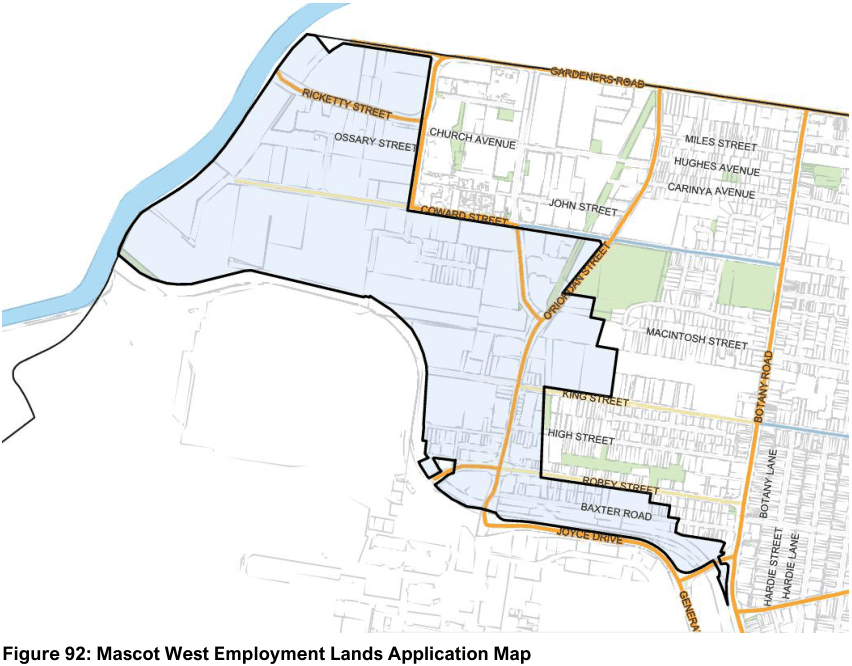

#### 7.7.1 Description

The Mascot West Employment Lands are bounded by Alexandra Canal to the west, the airport to the south, Gardeners Road and the Mascot Station Town Centre to the north, and Botany Road at the eastern extent. The precinct’s boundaries are shown below. Most of the area is affected by the 25-30 ANEF Noise Contour as well as road and rail noise. The precinct contains a mix of land zoned for industrial, business development, and business park purposes generally to the north of the airport in the vicinity of O’Riordan Street, Coward Street, and Gardeners Road.

Land uses comprise warehouse and distribution developments (related to freight transportation); and industrial developments including smash repair stations and welding businesses. Newer buildings include commercial and office premises with active street frontages comprising coffee shops and retail outlets. Company headquarters occupy the commercial buildings in close proximity to their warehouse operations. Part of this area is also within the zone of influence of the High Pressure Gas Pipeline that follows the ARTC Rail Corridor.

> [Picture on page 129: a picture, saved as a picture (images/section-07-specific-places-page-129-16.gif, 150 dpi).]

#### Figure 92: Mascot West Employment Lands Application Map
