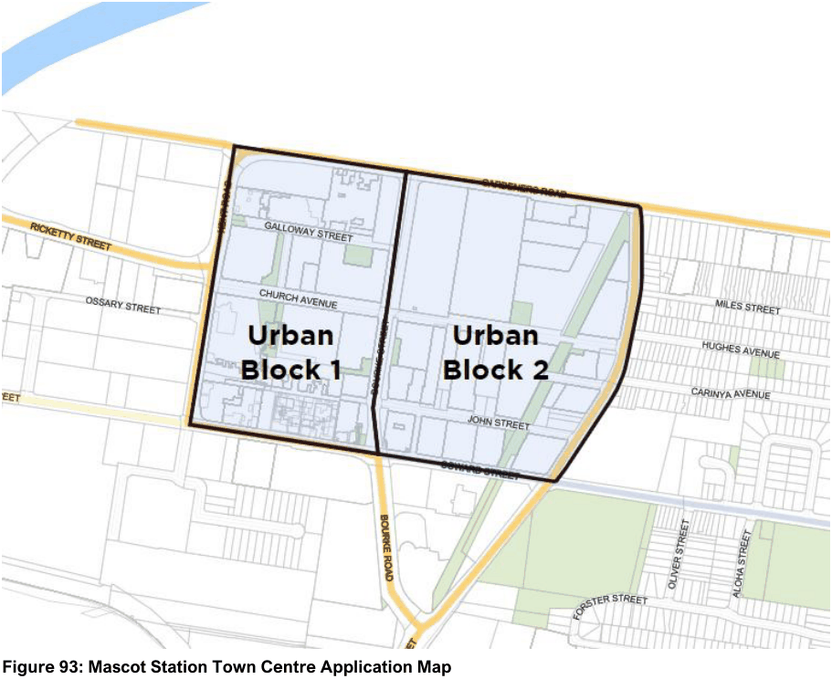

#### 7.8.1 Description

The Mascot Station Town Centre Precinct is centred around Mascot railway station and has been targeted for population and employment growth in State and Local planning strategies. The Precinct has been progressively redeveloped since the 2010s from an industrial area into a vibrant and creative town centre.

The planning framework contained in this Section adopts a place-based planning approach by defining appropriate building types and developing place-specific building envelopes. This is supported by detailed design and environmental controls aimed at achieving a high-quality built environment, landscape setting and community spaces. The provisions of this Section provide urban design controls to address the scale and density of development, traffic and pedestrian management, landscaping, and other public domain improvements. This will ensure that the Precinct develops in a cohesive manner and capitalises on its location.

The boundaries of the Mascot Town Centre are shown in the figure below. Land on the eastern side of O’Riordan Street is not subject to this Part. The Centre is split into different “urban blocks” which are demonstrated in Figure 93 below.

> [Picture on page 134: a picture, saved as a picture (images/section-07-specific-places-page-134-4.gif, 150 dpi).]

#### Figure 93: Mascot Station Town Centre Application Map
