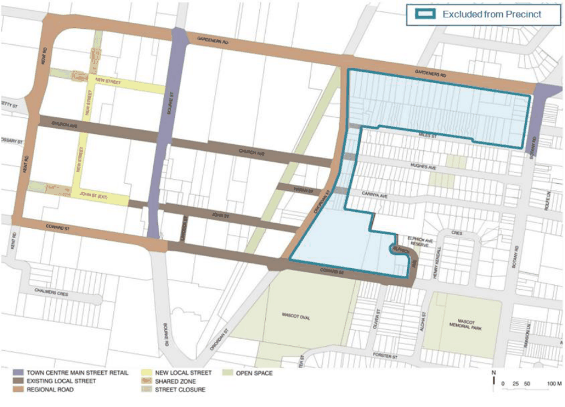

#### 7.8.2 Vision Statement

The Mascot Station Town Centre Precinct presents the opportunity to create a vibrant and diverse town centre, where a spacious, high quality public domain is the setting for thriving activities and cohesive built

form. The Town Centre has the opportunity to evolve into a place of activity, with a range of transport modes, interconnectivity, permeability and accessibility. The growth potential of Mascot Town Centre Precinct is to be guided by an urban framework that emphasises an extensive and revitalized public domain, excellence in its urban and architectural design, an integrated transport network and sustainable development in the public and private domains.

#### Town Centre Role and Character

Mascot Station Town Centre is within the Sydney City to Airport corridor and is recognised as being strategically important in the Metropolitan Plan for Sydney. The Mascot Station Town Centre Precinct is also within the environs of the Sydney Airport specialised centre in the Metropolitan Plan East Sub-regional Plan. This close proximity to Sydney Airport, and its location within the Airport Corridor, provides Mascot Station Town Centre with a role as a mixed use centre where commercial uses, including retail shopping and community uses provide diversity in what has, until recently, been a centre predominantly focused on industrial and commercial development.

The boundaries of the Town Centre are defined by Coward Street in the south, Kent Road in the west, Gardeners Road in the north and generally, O’Riordan Street in the east. These four major roads create clear edges to the Town Centre. They also carry regional vehicular traffic including regional truck movements.

An important aim of this Part is that Bourke Street and Church Avenue have high levels of pedestrian amenity, calmed vehicular traffic and a balance between transport modes such as bicycles, buses and other vehicles. This Part aims to ensure that the design of the interface between the public domain and private development provides pedestrian interest and amenity.

> [Picture on page 135: a picture, saved as a picture (images/section-07-specific-places-page-135-9.gif, 150 dpi).]

#### Figure 94: Street Character Map

#### Land Use

• Retail and Commercial: The main retail and commercial area will allow for small and medium scale business and retail opportunities including commercial offices, banks, post offices, hairdressers, convenience stores and cafes and restaurants looking out on to a new park.

• Residential: New residential uses within the precinct will primarily be apartment buildings either within stand-alone buildings or as mixed-use buildings above retail and commercial (shop top housing).

• Public Open Space and Streetscape Improvements: This Development Control Plan looks to substantially increase the amount of open space in the Town Centre. The Town Centre streets are to be designed as urban streets, where the interface between public and private domains is designed to promote pedestrian amenity.
