#### 7.8.3 Controls - General

| Objective |  |
|---|---|
| Open Space and Movement |  |
| O1. | To increase the quantum of public space in the town centre, to cater for the needs of an increased population, and greater visitor numbers. |

| Control |  |
|---|---|
| C1. | Development is in accordance with the Urban Block 1 and Urban Block 2 Public Domain Maps. |
| C2. | Widened footpaths, new street paving and pedestrian and cycle links must be provided in accordance with the principles of the Public Domain Strategy and Appendix A of the Mascot Town Centre Precinct Masterplan. |
| C3. | Street paving, lighting, bins, seating, bicycle racks and other street furniture must be provided in accordance with the principles of the Public Domain Strategy and Appendix A of the Mascot Town Centre Precinct Masterplan and any other Council Public Domain Plan. These works must be robust, easily cleaned, and designed and specified in consultation with Council's landscape officer to ensure a consistent design standard is implemented. |
| C4. | Street lighting must be provided throughout the public domain to improve public safety. Note: Any proposed street lighting must be in accordance with relevant Roads and Maritime Services standards, Austroads standards and Australian Standards. |
| C5. | Public art must be provided on key development sites in accordance with the principles of the Public Domain Strategy and Appendix A of the Mascot Town Centre Precinct Masterplan. The provision of art works on these larger sites must be negotiated with Council, with details to be provided at Development Application stage. |
| C6. | All existing above ground service cables, including power lines, telecommunications cables and other similar services (“overhead service cables”) in the streets adjacent to and within the confines of the development site will be placed underground at no cost to the Council. |
| C7. | All work is to be in accordance with Council specifications, plans, details or the Urban Design Strategy. |

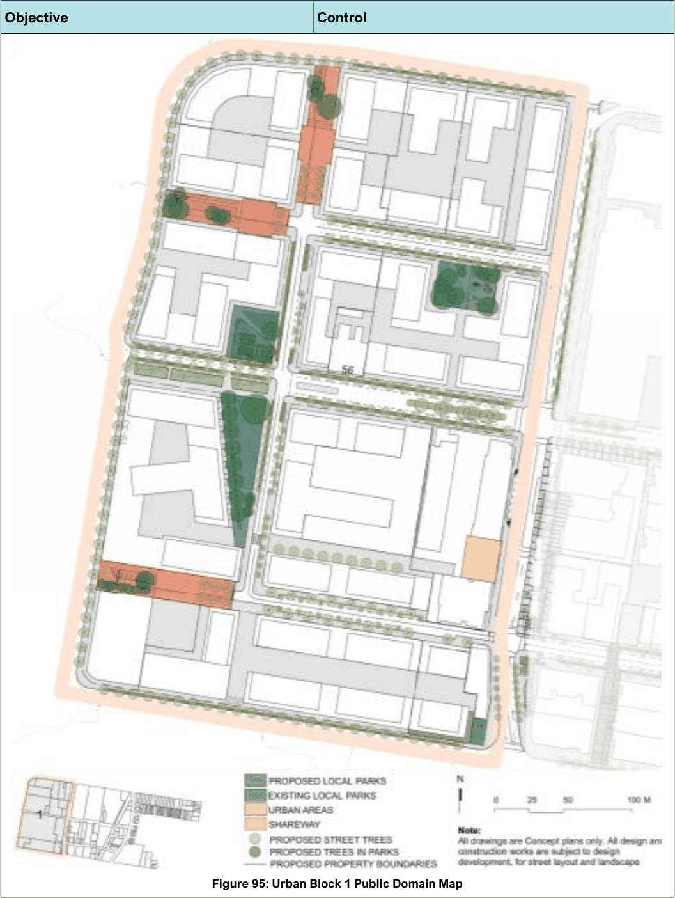

> [Picture on page 137: a picture, saved as a picture (images/section-07-specific-places-page-137-1.gif, 150 dpi).]

Figure 95: Urban Block 1 Public Domain Map

#### Objective

#### Control

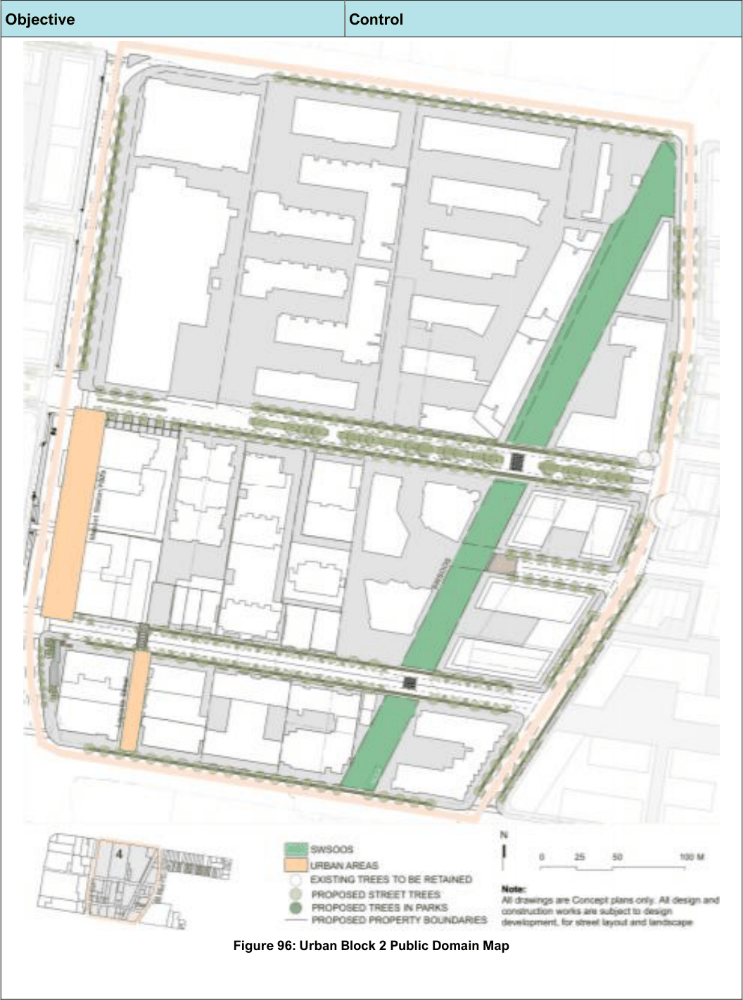

> [Picture on page 138: a picture, saved as a picture (images/section-07-specific-places-page-138-1.gif, 150 dpi).]

Figure 96: Urban Block 2 Public Domain Map

#### Objective

#### Control

| Objective |  |
|---|---|
| Built Form and Design |  |
| O2. | To ensure the scale of new buildings is consistent with the Local Character Statement of each urban block within the Mascot Station Town Centre Precinct. |
| O3. | To ensure development has minimal impact on neighbouring properties in terms of the potential loss of views, loss of privacy, overshadowing or visual intrusion. |

| Control |  |
|---|---|
| C8. | Development is in accordance with the Urban Block 1 and Urban Block 2 height maps and the height controls of the Bayside LEP 2021. |
| C9. | Council may require a reduction in height shown for the land on the Height of Buildings Map where the proposed building height would have unacceptable adverse impacts with regard to: a. the overshadowing of a dwelling, private open space or public open space b. an inappropriate transition in built form and land use intensity c. the design excellence of a building d. view loss e. the Obstacle Limitation Surface |
| C10. | Shadow diagrams must be provided for all development proposals for the summer and winter solstices. Shadow diagrams must illustrate the shadow impacts at 9.00AM, 12.00 noon and 3.00PM for both solstices. Additional building setbacks may be required where impacts within the site and/or upon adjoining properties are considered to be unreasonable. |

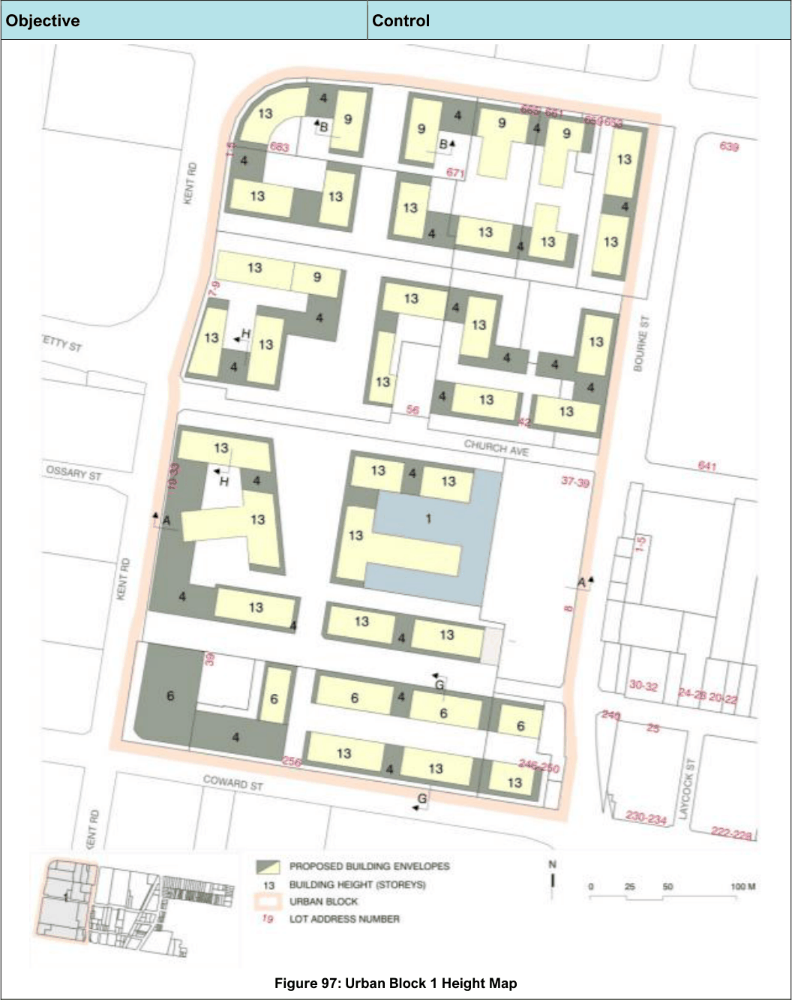

> [Picture on page 140: a picture, saved as a picture (images/section-07-specific-places-page-140-1.gif, 150 dpi).]

Figure 97: Urban Block 1 Height Map

#### Objective

#### Control

| Objective |  |
|---|---|
| Figure 98: Urban Block 2 Height Map |  |
| O4. | To provide appropriate bulk and scale relationships between buildings within the Mascot Station Town Centre Precinct. |
| O5. | To consolidate and align allotments to allow for development of built forms that |

| Control |  |
|---|---|
| C11. | Council may require a reduction in FSR shown for the land on the Floor Space Ratio Map where a building built to the Floor Space Ratio Map would have unacceptable adverse impacts with regard to: a. the overshadowing of a dwelling, private open space or public open space |

| Objective | Control |  |
|---|---|---|
| make a positive contribution to the spatial definition of the street. |  | b. an inappropriate transition in built form and land use intensity c. the design excellence of a building d. view loss e. the Obstacle Limitation Surface |
|  | C12. | Development must conform to the Urban Block 1 and Urban Block 2 Site Amalgamation Maps. |
|  | C13. | Development must conform to the Urban Block 1 and Urban Block 2 Lot Alignment Maps. |
|  | C14. | Where land needs to be excised to create new parks, public domain spaces or roadways, a subdivision plan will be required as part of any development application. |

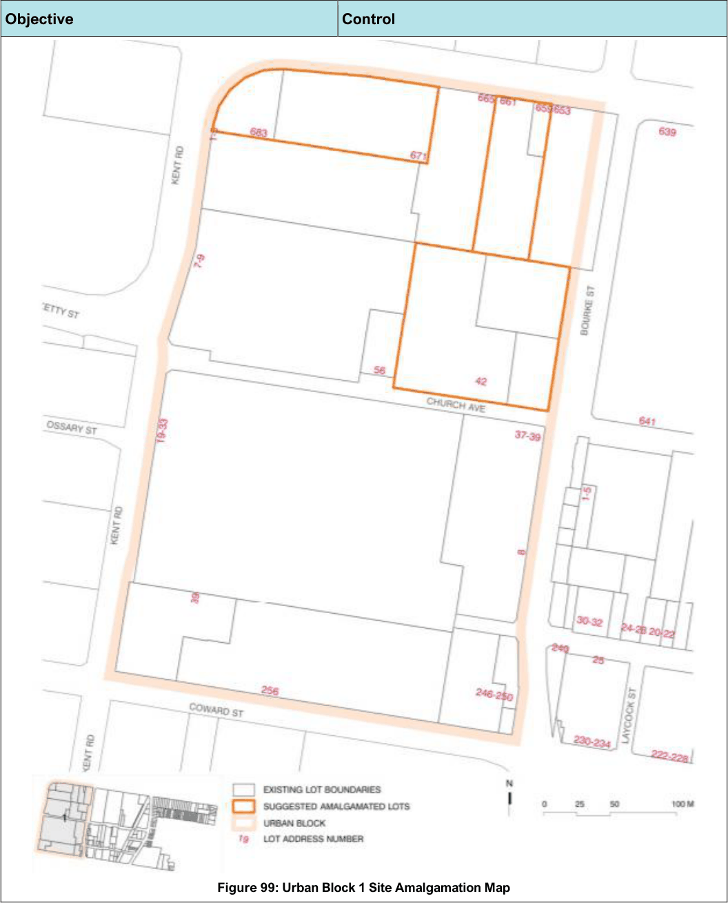

> [Picture on page 143: a picture, saved as a picture (images/section-07-specific-places-page-143-1.gif, 150 dpi).]

Figure 99: Urban Block 1 Site Amalgamation Map

#### Objective

#### Control

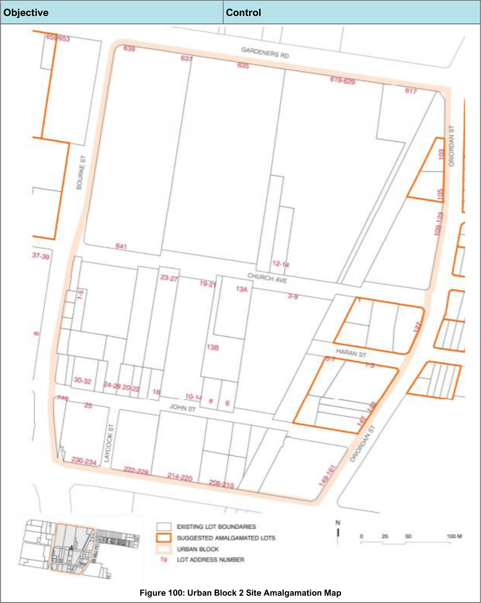

> [Picture on page 144: a picture, saved as a picture (images/section-07-specific-places-page-144-1.gif, 150 dpi).]

Figure 100: Urban Block 2 Site Amalgamation Map

#### Objective

#### Control

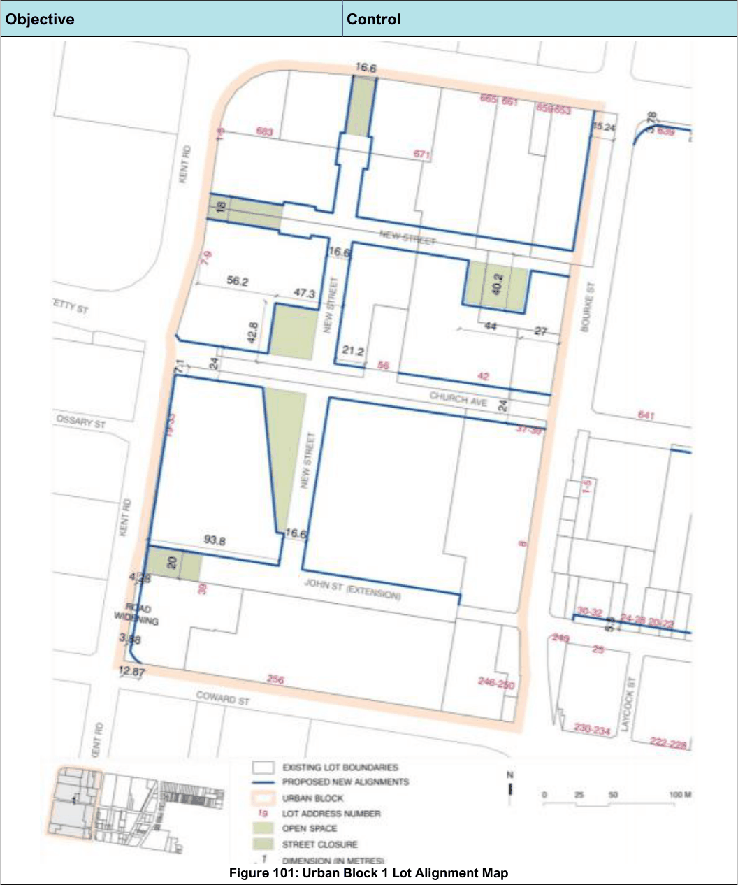

> [Picture on page 145: a picture, saved as a picture (images/section-07-specific-places-page-145-1.gif, 150 dpi).]

Figure 101: Urban Block 1 Lot Alignment Map

#### Objective

#### Control

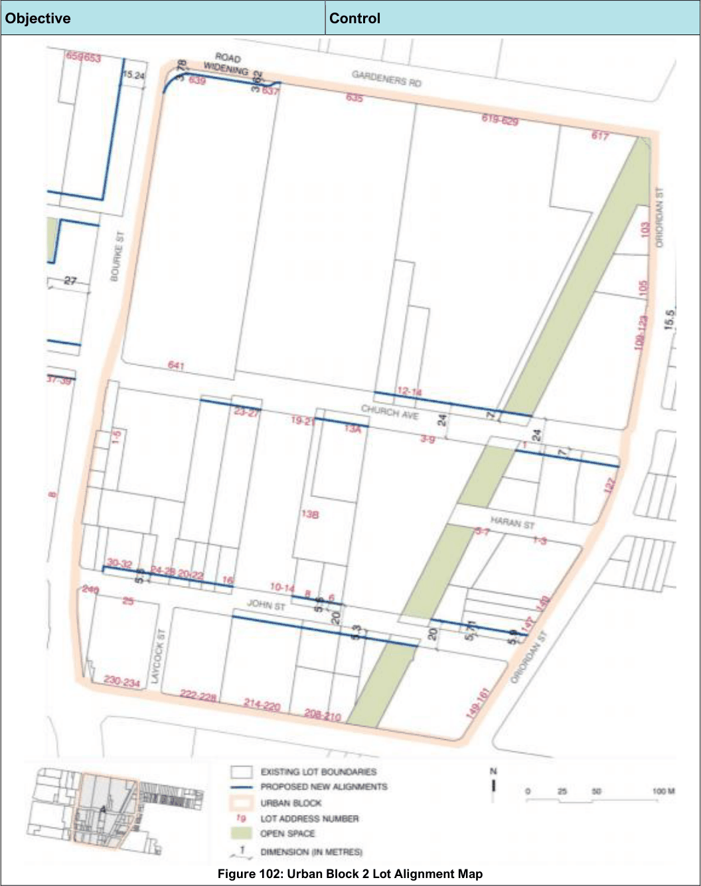

> [Picture on page 146: a picture, saved as a picture (images/section-07-specific-places-page-146-1.gif, 150 dpi).]

Figure 102: Urban Block 2 Lot Alignment Map

#### Objective

#### Control

| Objective |  |
|---|---|
| O6. | To provide excellent design quality in the Mascot Station Town Centre Precinct. |
| O7. | To support the safe occupation of buildings. |
| O8. | To ensure new development provides adequate visual and acoustic privacy levels internally and externally for neighbours and residents. |
| O9. | To achieve sustainable building design through the design, construction and operation of buildings within the Mascot Station Town Centre Precinct. |
| O10. | To ensure new developments consider design features that cater towards managing wind patterns that infiltrate through the area to maintain comfortable conditions for pedestrians. |
| O11. | To ensure long life and ease of maintenance for all development. |

| Control |  |
|---|---|
| C15. | Development must identify through a SEPP 65 Design Statement and/or annotated drawings how design excellence will be achieved in the proposed development. |
| C16. | Any construction plans with the development application must show the location of smoke detectors, together with a specification on their installation in accordance with the Building Code of Australia (BCA). |
| C17. | Buildings and open space areas will be designed to: a. enable casual surveillance of streets, open space and entrances to buildings b. minimise access between roofs, balconies and windows of adjoining developments c. ensure adequate lighting to access routes, car park areas and open space |
| C18. | External lighting must be provided to mixed use developments, commercial developments and industrial areas where pedestrian ways, main building entries, driveways, communal areas and car parks require public access at night or after normal trading hours. |
| C19. | External lighting is to comply with the requirements of Section 9.21: Lighting in the Vicinity of Aerodromes, Manual of Standards, Part 139 – Aerodromes Version 1.1, February 2003. All lighting, regardless of location, which may affect the safe operation of aircraft operating at Sydney Airport are required to be compatible with the above requirements. |
| C20. | Communal walls and floors connecting buildings are to be designed in accordance with the noise transmission and insulation requirements of the Building Code of Australia (BCA). |
| C21. | New development adjacent to high noise sources (e.g. busy roads) are to generally locate habitable rooms and design private open spaces away from noise sources. Alternatively, if such spaces/rooms front a major noise source they must be protected by appropriate noise shielding devices to minimise noise intrusion. |
| C22. | Development incorporates sustainable design. Note: A development application must identify and explain how sustainable building design will be achieved throughout the design, construction and operation stage. |

| Objective |  |
|---|---|
| Street Character and Development Setbacks |  |
| O12. | To provide new buildings that spatially define streets with well-articulated facades. |

| Control |  |
|---|---|
|  | Development proposals will address the following: a. energy efficiency (solar design, insulation, hot water, lighting, and ventilation systems) b. water resources c. landscaping d. construction materials e. finishing materials f. waste management g. indoor environment quality h. stormwater management and Water Sensitive Urban Design i. ongoing building and site management |
| C23. | Taller buildings must consider the shape, location and height of buildings to satisfy wind measurements for public safety and comfort at ground level. In addition, open terraces and balconies must not be detrimentally affected by wind. Note: Council may request a Wind report be submitted with a Development Application. |
| C24. | Landscaping is to be utilised to ameliorate the impacts of wind tunnels and enhance the comfort of outdoor spaces. |
| C25. | A reflectivity report examining the effects of possible solar glare on pedestrians and motorists may be necessary, subject to the scope of a proposal and the nature of glazing and reflective materials. |
| C26. | Windows must be designed to enable cleaning from inside the building, where possible. |
| C27. | The building must incorporate and integrate building maintenance systems into the design of the building form, roof, and facade. |
| C28. | Development must conform to the Urban Block 1 and Urban Block 2 Setback Maps. |
| C29. | Development must be conform with the section plans for Urban Blocks 1 and 2. |
| C30. | Corner buildings must address both street frontages. |
| C31. | Development does not result in blank external walls of greater than 100m². |

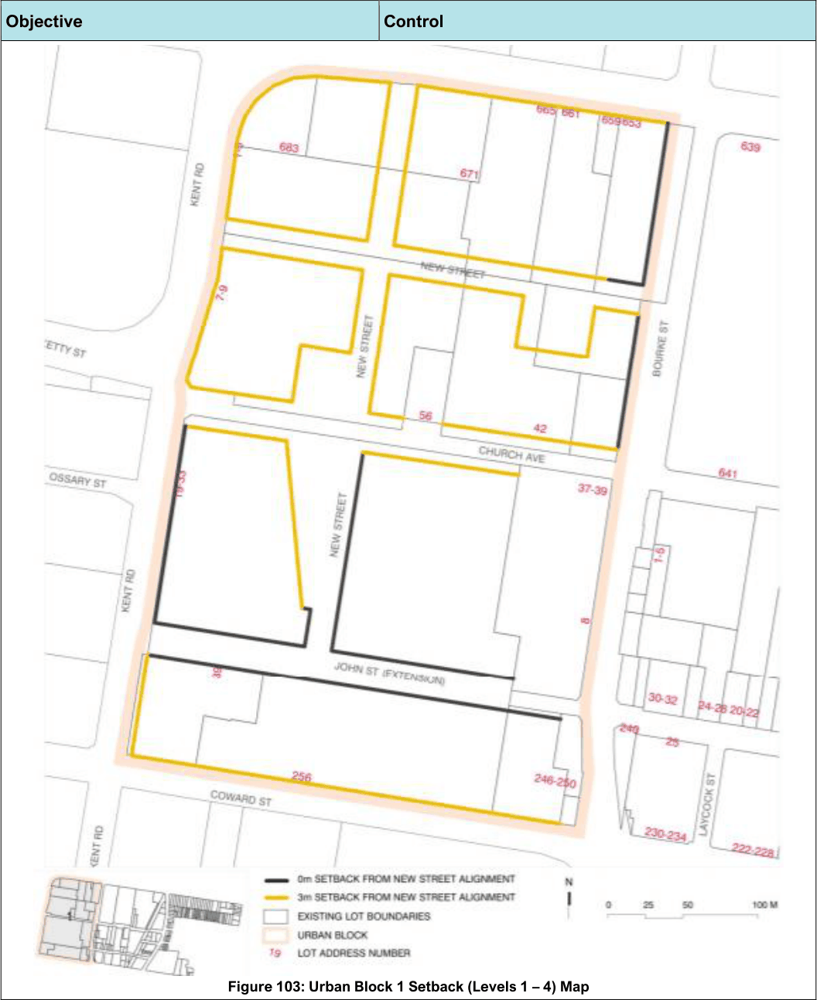

> [Picture on page 149: a picture, saved as a picture (images/section-07-specific-places-page-149-1.gif, 150 dpi).]

Figure 103: Urban Block 1 Setback (Levels 1 – 4) Map

#### Objective

#### Control

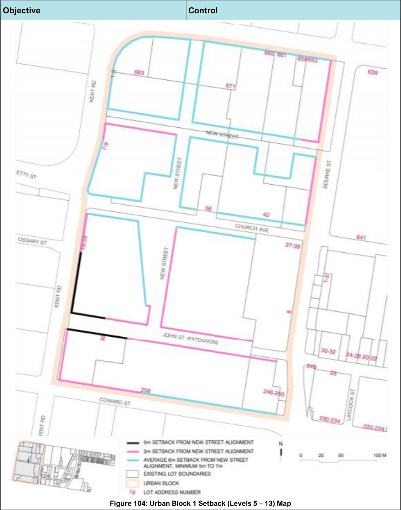

> [Picture on page 150: a picture, saved as a picture (images/section-07-specific-places-page-150-1.gif, 150 dpi).]

Figure 104: Urban Block 1 Setback (Levels 5 – 13) Map

#### Objective

#### Control

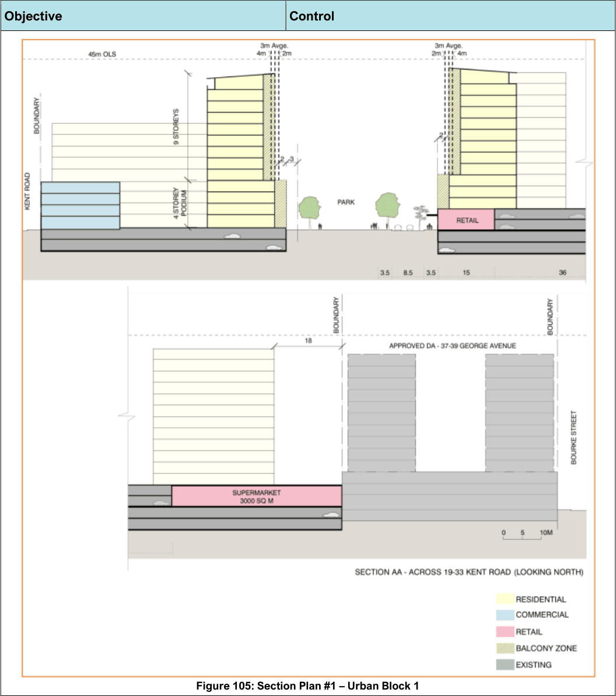

> [Picture on page 151: a picture, saved as a picture (images/section-07-specific-places-page-151-1.gif, 150 dpi).]

Figure 105: Section Plan #1 – Urban Block 1

#### Objective

#### Control

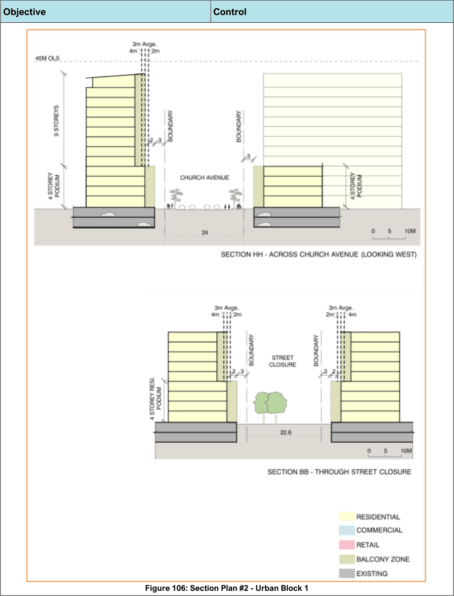

> [Picture on page 152: a picture, saved as a picture (images/section-07-specific-places-page-152-1.gif, 150 dpi).]

Figure 106: Section Plan #2 - Urban Block 1

#### Objective

#### Control

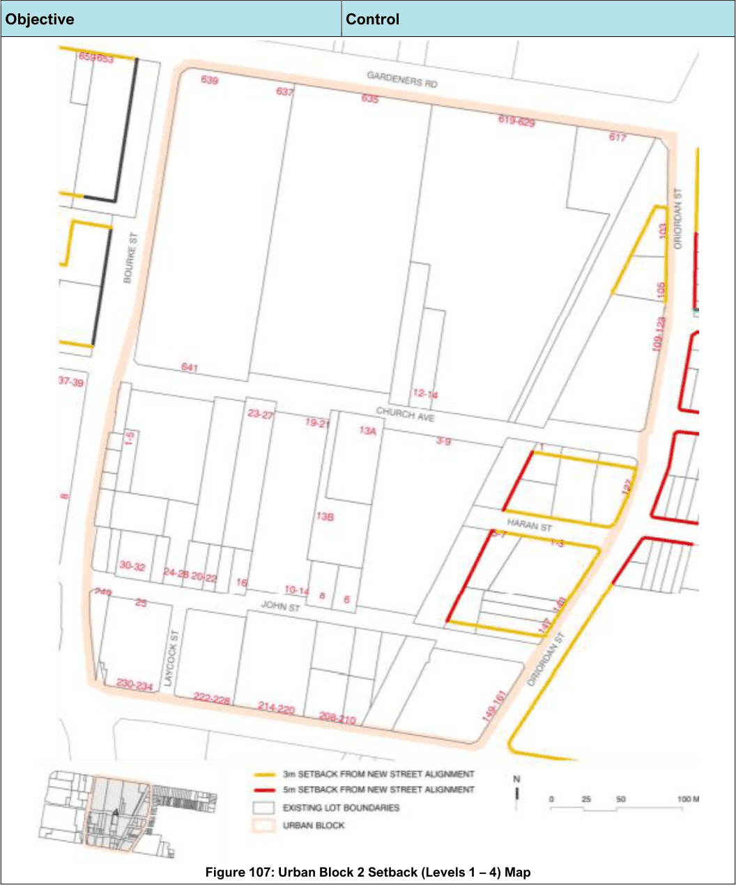

> [Picture on page 153: a picture, saved as a picture (images/section-07-specific-places-page-153-1.gif, 150 dpi).]

Figure 107: Urban Block 2 Setback (Levels 1 – 4) Map

#### Objective

#### Control

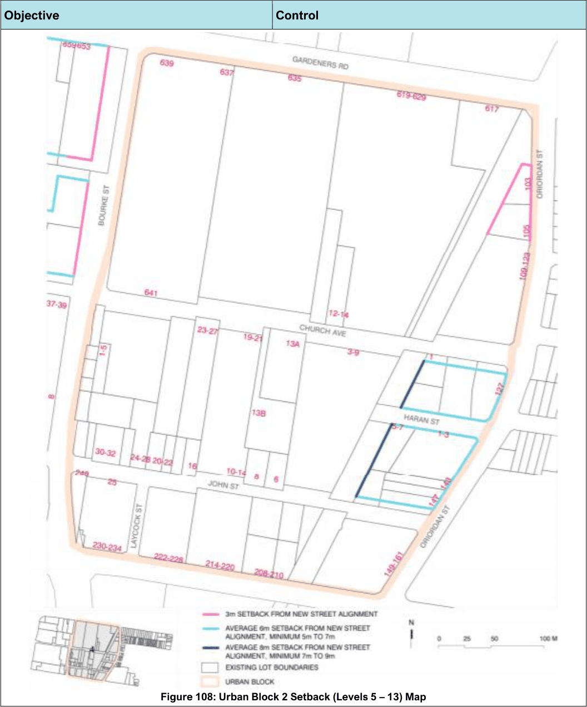

> [Picture on page 154: a picture, saved as a picture (images/section-07-specific-places-page-154-1.gif, 150 dpi).]

Figure 108: Urban Block 2 Setback (Levels 5 – 13) Map

#### Objective

#### Control

| Objective |  |
|---|---|
| Figure 109: Urban Block 2 – Section Plan |  |
| O13. | To create cohesive streetscapes with consistent building alignments particularly at ground level in order to accommodate canopy street tree planting. |
| O14. | To ensure that all ground level elements of buildings visible from the street make a positive contribution to the public domain. |
| O15. | To provide active street frontages from the ground floor retail areas of the Precinct in order to create vitality and vibrancy in the centre. |
| O16. | To enhance pedestrian amenity by providing sun and rain protection. |
| O17. | To create a suitable interface between private and public spaces that ensures the safety, amenity and protection of privacy for residents. |

| Control |  |
|---|---|
| C32. | All property boundary front setbacks must be deep soil and landscaped and must not have any underground intrusions such as underground car parking or on-site detention. Note: The development site boundaries may not correspond to the existing allotment boundaries due to proposed streets and public domain works that may be required as part of redevelopments. Development site boundaries are shown on the site layout plans for each urban block and, where re-subdivision is required, will become the new allotment boundaries from which street setbacks are measured. |
| C33. | Setbacks are to maximise the retention of existing trees and their root systems (including those on adjoining properties) and may need to be varied to achieve this. |
| C34. | Setbacks are to include the planting of canopy trees, both small and large varieties. Developments are not to rely solely on street trees to ameliorate buildings. |
| C35. | Buildings must have a consistent street wall height (in terms of the number of storeys) and provide a continuous street frontage along all significant streets. |

| Objective | Control |  |
|---|---|---|
|  | C36. | Diversity and activity is to be ensured by providing a variety of frontage widths for retail shops along the street. |
|  | C37. | Blank walls fronting principal streets and the public domain are to be avoided. |
|  | C38. | The primary area of outdoor private open space must not be located on the street frontage. |
|  | C39. | Ground floor residential with a street frontage must incorporate landscaping as part of the common area/setback. Such landscaping is to encourage privacy and a consistent, attractive and well- maintained frontage. The private terraces should also contain some landscaping. |
|  | C40. | The landscaped street setback area shall be on one level or at a slight slope, not terraced or stepped or containing narrow planter boxes, to allow adequate lateral root space and soil volume for medium to large canopy trees. |
|  | C41. | Side or rear boundary fencing is not permitted fronting the public domain except where appropriate landscaping is provided in front of the fence. |
|  | C42. | The visual connection between the building frontage and the public domain must be considered carefully in all development. This may require the floorplate of development to step with the topography to ensure that the floor level of the building frontage is generally at footpath level. |
|  | C43. | Development provides ground floor frontages in accordance with the below Urban Block 1 Retail and Commercial Frontage Map. |
|  | C44. | Outdoor dining areas must allow for safe pedestrian circulation and access and must not compromise or restrict sight lines for motorists. |

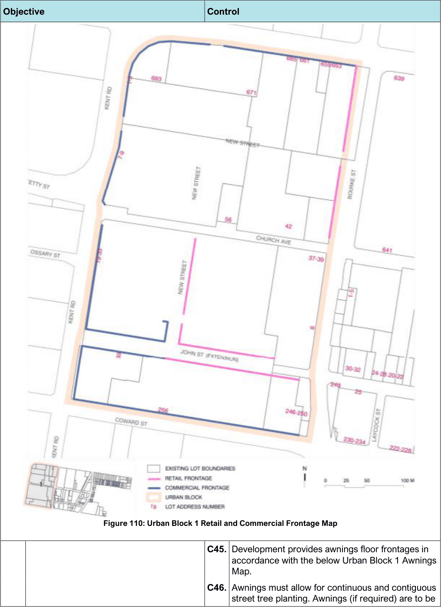

> [Picture on page 157: a picture, saved as a picture (images/section-07-specific-places-page-157-1.gif, 150 dpi).]

Figure 110: Urban Block 1 Retail and Commercial Frontage Map

#### Objective

#### Control

C45. Development provides awnings floor frontages in accordance with the below Urban Block 1 Awnings Map.

C46. Awnings must allow for continuous and contiguous street tree planting. Awnings (if required) are to be

| Objective | Control |
|---|---|
|  | located and sized to adequately accommodate trees. Ground floor retail areas should be indented into the building so that awnings do not hinder street tree planting. |

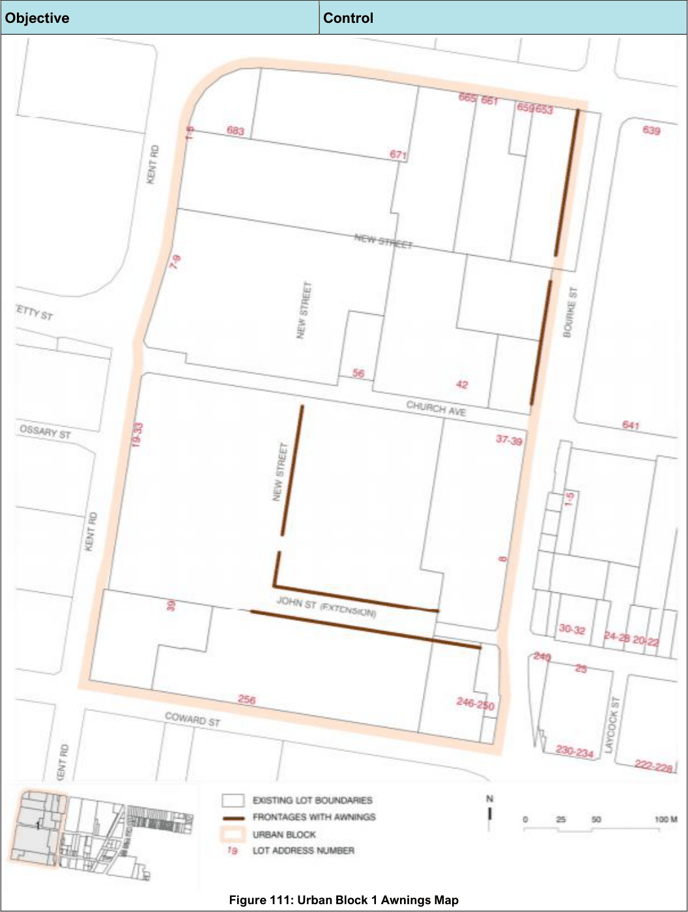

> [Picture on page 159: a picture, saved as a picture (images/section-07-specific-places-page-159-1.gif, 150 dpi).]

Figure 111: Urban Block 1 Awnings Map

#### Objective

#### Control

| Objective | Control |  |
|---|---|---|
|  | C47. | Boundary fences will not provide opportunities for seclusion and are to be of a height that allows surveillance of streets. |
|  | C48. | Where fencing of the front boundary is proposed for residential buildings the design must consider the following: a. solid metal panel fences (colourbond/sheet metal) of any height are not permitted along street frontages b. masonry/brick fences over 600mm and timber/steel picket/palisade or plain picket fences c. fencing over 1m high may be permitted. The design of fencing over 1m in height will take into consideration sightline issues when exiting from the subject site or adjacent properties. The design of the fence can be modified by setback or by using splays at least 1m x 1m in size d. a mixture of materials is preferable with a maximum of 60% solid material over the whole fence surface e. the design will consider the need for horizontal rhythms along the street such as vertical entry elements, boundary markers or fence post frequency f. where possible, the design will avoid the use of continuous lengths of fencing (a maximum of 6m without articulation) at the street frontage g. access gates are to be hung so that the direction of swing is inward h. satisfactory provision is to be made for access to public utility installations |
|  | C49. | Maximum height of side or rear fences is 1.8m. Where the fence /side returns are to be erected on or adjacent the common allotment boundary, the written consent of the adjacent property owner(s) is required. |
|  | C50. | Landscape documentation is to be provided that include details of all fencing to be used in a proposal – privacy, boundary, frontage, pool, dividing and so on. The details are to include style (manufacturer, product code, name), materials, colour/s and installation method. |

| Objective | Control |  |
|---|---|---|
| Traffic and Parking |  |  |
|  | C51. | Alterations and additions to existing premises will not be required to provide additional car parking, provided: a. the gross floor area of the premises is not increased by more than 75% b. it is not otherwise possible to provide the parking on site |
