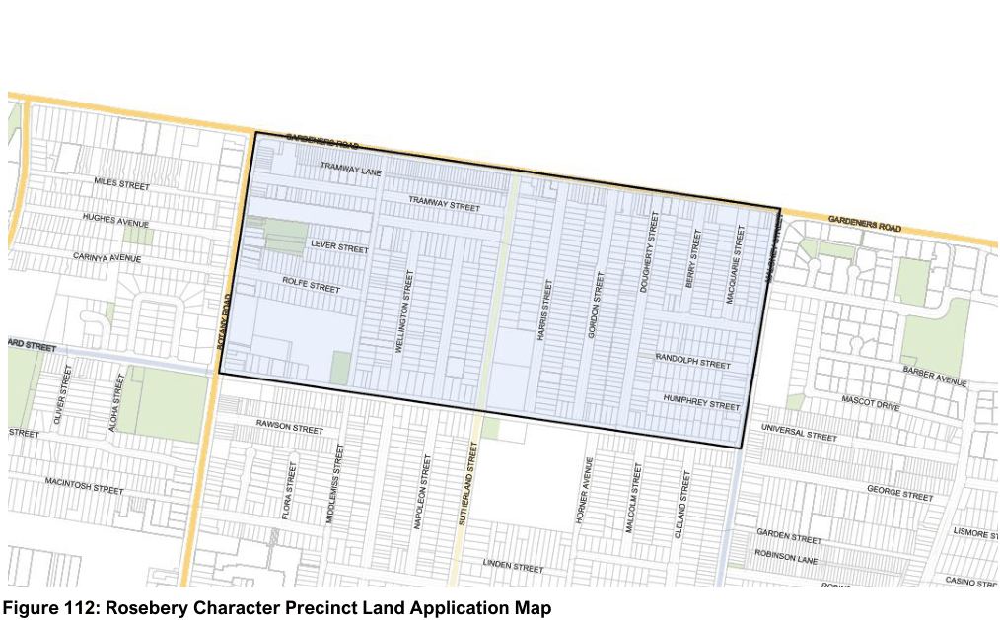

#### 7.9.1 Description

The Rosebery Precinct is predominately a consistent low-density scale of development with larger detached dwelling houses. The majority of the Precinct comprises of one and two-storey brick dwellings with multi-unit housing developments including townhouse, semi-detached and villa style developments scattered throughout the Precinct. The one-storey cottages are depicted in two predominant styles – inter-war and post-war. These buildings are constructed of brick, fibro or timber cladding and contribute to the heritage conservation in the LGA. This low to medium density style of development promotes tree-lined streets with a focus on urban amenity and generous street setbacks.

The Precinct is within the 20 to 25 ANEF contour which is conditional for residential development. The Rosebery Neighbourhood Centre is located along Gardeners Road and subject to more specific controls outlined in this section.

> [Picture on page 165: a picture, saved as a picture (images/section-07-specific-places-page-165-1.gif, 150 dpi).]

#### Figure 112: Rosebery Character Precinct Land Application Map
