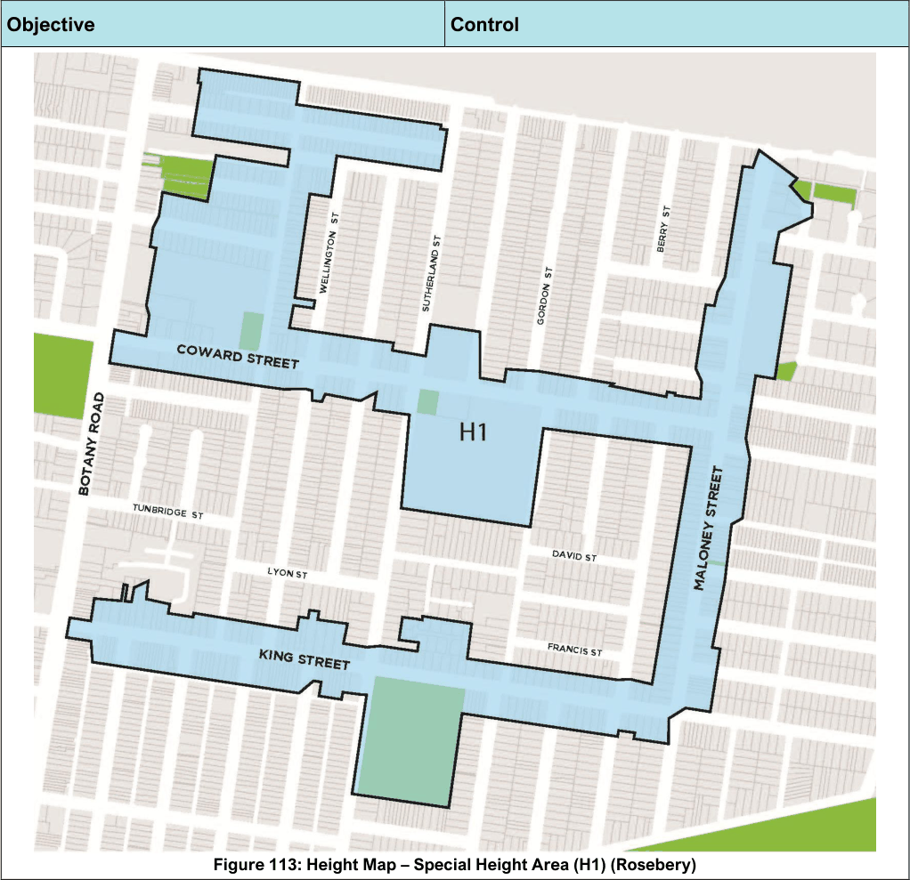

#### 7.9.3 Controls

| Objective |  |
|---|---|
| O1. | To maintain the Rosebery Precinct as a residential area that is characterised by a distinct style of dwelling houses. |
| O2. | To encourage and focus retail activity and shop top housing within Rosebery Neighbourhood Centre. |
| O3. | To encourage new development to have minimal impact on traffic flow, demand for on-street parking and the streetscape. |
| O4. | To encourage new development or alterations and additions to existing development which complement the height and architectural style found in the immediate vicinity, particularly where there is an established character. |

| Control |  |
|---|---|
| C1. | Site layout, building styles and designs promote commonality and a visual relationship with the surrounding built form and dwelling styles. |
| C2. | The Rosebery Precinct is maintained as a residential area that is characterised by the distinct housing styles of dwelling houses. |
| C3. | Development comprises predominantly low- density residential accommodation in the form of detached/attached dwellings throughout the Precinct with a maximum height of 2 storeys. |
| C4. | Dwelling styles maintain and complement existing development patterns. |

| Objective |  |
|---|---|
| O5. | To ensure that the scale, design, material of construction and nature of the development contributes positively to the visual amenity of the area. To encourage increases in height and |
| O6. | density in the form of terrace style housing in Special Area H1. To ensure that new development provides |
| O7. | an acceptable level of amenity for its occupants through appropriate design responses. |

| Control |  |
|---|---|
| C5. | An increased height and density in the form of terrace style housing (maximum height of 9m) occurs in Special Area H1. |
| C6. | Maintain roof forms which are characteristic of the prevailing designs within the street. |
| C7. | Retain front setbacks which are consistent within a street and promote landscaping to soften the built form. |
| C8. | Retain side setbacks, where they are consistent within a street. |
| C9. | Promote landscaping in rear private open space areas to provide privacy to adjoining properties. |
| C10. | Only fencing of a low scale height is to be provided. |

> [Picture on page 167: a picture, saved as a picture (images/section-07-specific-places-page-167-1.gif, 150 dpi).]

Figure 113: Height Map – Special Height Area (H1) (Rosebery)

#### Objective

#### Control
