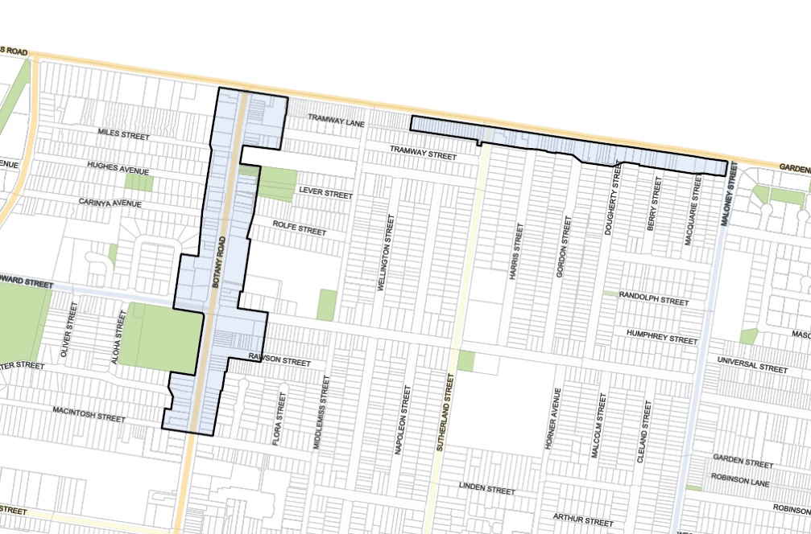
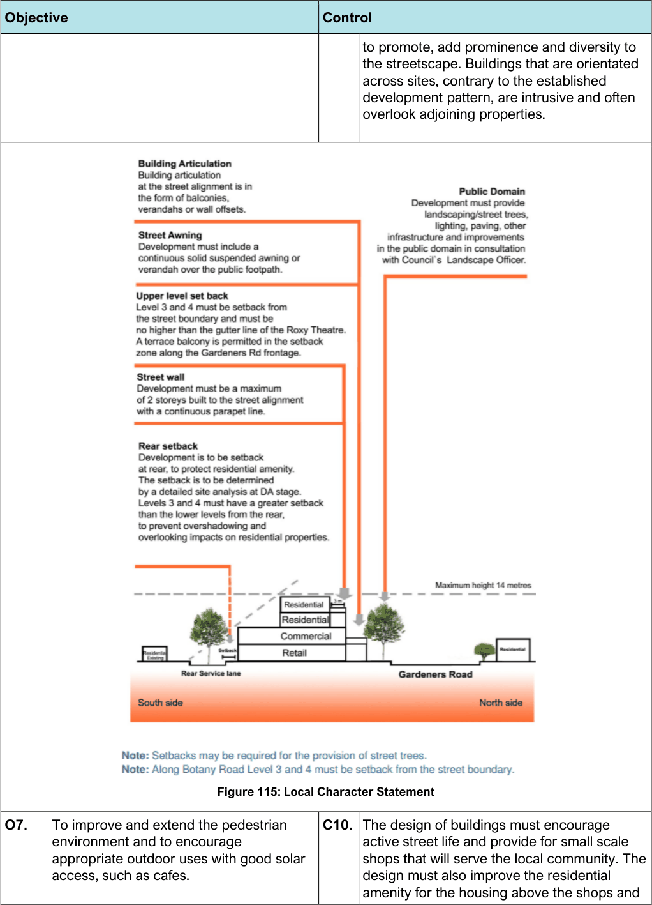

#### 7.9.4 Rosebery Neighbourhood Centre

#### Description

The Rosebery Neighbourhood Centre is a reasonable sized local centre which must cater for the needs of the local community. It is located along Gardeners Road and Botany Road on a flat section of land, on the boundary of the Rosebery Precinct. The Centre consists of a good mix of local shops (around 100 shops) which service the local community. The historic former Roxy Theatre is a Heritage Item, located at the middle of the Centre (along Gardeners Road) and provides a landmark for the Neighbourhood Centre.

> [Picture on page 168: a picture, saved as a picture (images/section-07-specific-places-page-168-1.gif, 150 dpi).]

#### Figure 114: Rosebery Neighbourhood Centre Land Application Map

#### Desired Future Character

Public domain improvements, such as landscaping, footpath paving and public seating, are necessary to improve the amenity of the centre and will be required with any future redevelopment. The Roxy Theatre is a visually prominent Heritage Building at the middle of the Centre along Gardeners Road and sets a benchmark for the scale and form of development within the Centre.

The redevelopment of this area to provide increased densities in the future may be possible, however this would be contingent upon site consolidation occurring, in conjunction with considerable public domain improvements including increased public car parking and traffic management, and through site pedestrian links. Further studies and analysis of the centre would be required to establish appropriate controls to facilitate redevelopment.

#### Controls

| Objective |  |
|---|---|
| Road Network and Vehicular Access |  |
| O2. | To minimise vehicular access and servicing from the primary road frontage. |
| O3. | To enhance pedestrian connectivity, access, and safety within the Centre. |
| Built Form |  |
| O4. | To ensure development complements the height and architectural style found in the immediate vicinity, particularly where this has a clearly established character. |
| O5. | To retain a coherent streetscape with a consistent street wall and parapet line. |
| O6. | To retain and conserve the Rosebery Neighbourhood Centre and encourage a viable and attractive Neighbourhood Centre by improving the public domain and the public/private interface. |

| Control |  |
|---|---|
| C1. | Vehicular access from Gardeners Road and Botany Road must be avoided where access is available from a side street or rear laneway. |
| C2. | Where a rear laneway exists loading and unloading must occur from the laneway and be within the site. |
| C3. | Redevelopment of shops in the Centre is contingent upon additional public car parking. |
| C4. | Traffic management measures minimise impacts on the adjoining residential area. |
| C5. | The provision of through site pedestrian links or arcades from Gardeners Road to the rear and from Botany Road to the Lever Street Reserve are encouraged to improve pedestrian access, amenity, and safety. |
| C6. | Pedestrian amenity and connectivity must be enhanced in conjunction with new development. Through site links and arcades to the rear are encouraged with redevelopment to provide improved access and safety for pedestrians. The creation of street closures in the side streets and the provision of decorative fencing and planting will assist in encouraging active street retail uses such as outdoor dining. |
| C7. | Whilst a maximum of 4 storeys is permitted, buildings must have a maximum height of 2 storeys along the street frontage with a continuous parapet line, consistent with existing development. |
| C8. | Development must provide landscaping, street trees, decorative fencing, lighting, public seating, paving and other street plaza and public domain improvements identified by Council, generally in accordance with the Local Character Statement diagram below. |
| C9. | Buildings must address the street, and their entries are to be readily apparent from the street. Developments on sites with two or more frontages must address both frontages, |

> [Picture on page 170: a picture, saved as a picture (images/section-07-specific-places-page-170-1.gif, 150 dpi).]

Figure 115: Local Character Statement

| Objective | Control |
|---|---|
|  | to promote, add prominence and diversity to the streetscape. Buildings that are orientated across sites, contrary to the established development pattern, are intrusive and often overlook adjoining properties. |

C10. The design of buildings must encourage

O7. To improve and extend the pedestrian environment and to encourage appropriate outdoor uses with good solar access, such as cafes.

active street life and provide for small scale shops that will serve the local community. The design must also improve the residential amenity for the housing above the shops and

| Objective |  |
|---|---|
| O8. | To retain existing trees within the streetscape, including the avenue of tall gum trees along Gardeners Road. |
| O9. | To ensure that development recognises predominant streetscape qualities (i.e. setbacks & design features). |
| O10. | To allow reasonable redevelopment and to improve the architectural quality of building stock. |
| O11. | To ensure that redevelopment has a positive interface to, and maintains the amenity of, residential areas. |
| O12. | To encourage development of awnings as balconies for residential units above (to improve amenity for unit dwellers and promote passive surveillance of streets). |

| Control |  |
|---|---|
|  | provide for passive surveillance of the surrounding streets. |
| C11. | New development is to take into account and respond sympathetically to an established streetscape with strong architectural features and identity. New buildings are to reinforce these features and contribute to its character. |
| C12. | Contemporary architectural design solutions are encouraged; however, designs will need to demonstrate that they will not lead to a replacement or diminution of a street’s existing character. Council encourages diversity in building designs provided that development outcomes complement the existing character of the suburb. |
| C13. | The top 2 storeys must be set back (a minimum of 3m) from Gardeners Road and Botany Road to create articulation of the street facades. A setback to the rear is also required and is to be determined following a detailed site analysis at development application stage. The analysis must satisfy Council that the amenity of neighbouring residential properties is protected in terms of natural sunlight access, and privacy and visual amenity, and that the development is in accordance with the Local Character Statement diagram above. Impacts on residential areas are to be minimised. |
| C14. | With redevelopment of the Centre, landscape planting must be provided along the rear boundary where a site adjoins a residential property, to provide a visual separation between the shops and the residential area. Such landscaping must not result in overshadowing of the residential property. |
| C15. | The design of new development must improve the residential amenity of housing above shops by providing direct access to balconies and private open space, and passive surveillance of surrounding streets and pedestrian walkways. |
| C16. | All designs must provide awnings above the footpath. Awnings above the footpath are encouraged to be trafficable verandahs for the use of residents on the first floor and are to provide for passive surveillance of the streets. If the verandah is built over the street, |

| Objective |  |
|---|---|
| Heritage |  |
| O13. | To develop sympathetically with heritage items within or in the vicinity of the Centre. |
| O14. | To retain the former Roxy Theatre as a visual landmark in the middle of the Centre. |

| Control |  |
|---|---|
|  | then a lease fee is payable to Council. The fee is set out in Council’s Fees and Charges. |
| C17. | Awnings must be provided continuously and at the same height along the shop frontages to provide weather protection for pedestrians. |
| C18. | Development is to retain and complement existing heritage items including significant vegetation. |
| C19. | Redevelopment retains inter-war 2 storey shop-top housing built to the street alignment with continuous awnings and parapets. |
| C20. | The Roxy Theatre informs the scale and form of development within the Centre along Gardeners Road. |

#### Mascot Local Centre
