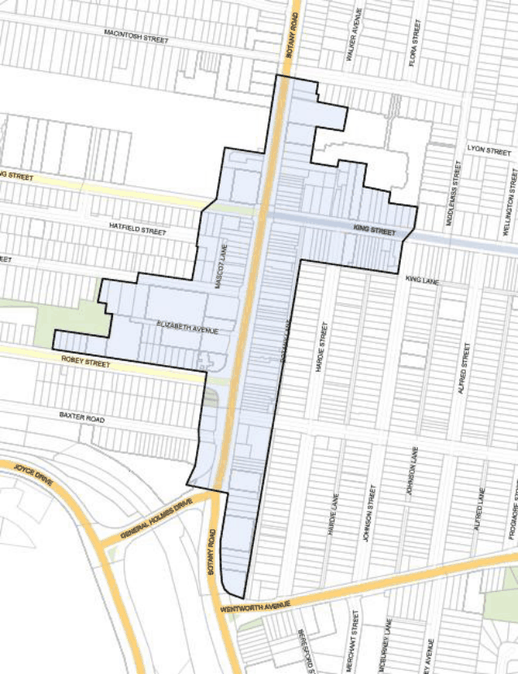

#### 7.10.1 Description

The Mascot Local Centre is located along Botany Road on a flat section of land. It is a medium size Local Centre with over 100 shops including a small local supermarket servicing the surrounding community. It has a good mix of local shops and services. It benefits from two Council car parking areas (one on either side of Botany Road) with over 140 public car spaces provided.

The Centre runs north-south along Botany Road and is surrounded by a predominantly low density residential area. Botany Road is a major arterial road that carries substantial traffic volumes which impacts on the amenity of the Centre. The Centre is affected by the 25 to 30 ANEF Contour and road traffic noise. Part of the suburb is within the zone of influence of the High Pressure Gas Pipeline that follows the ARTC Rail Corridor to the Qenos Site at the Botany Industrial Park, Denison Street, Banksmeadow. Development Applications, planning proposals and rezoning of land received by Council for land within the Zone of Influence will be referred to the APA Group for consideration and comment.

> [Picture on page 173: a picture, saved as a picture (images/section-07-specific-places-page-173-1.gif, 150 dpi).]

#### Figure 116: Mascot Local Centre (Botany Road) Land Application Map
