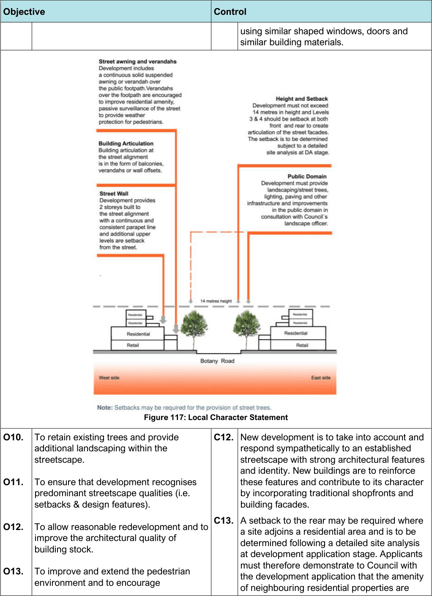

#### 7.10.3 Controls

| Objective |  |
|---|---|
| Land Use |  |
| O1. | To encourage site consolidation and the provision of through-site pedestrian links or arcades that provide rear access to the public car parking areas. |
| O2. | To achieve an integrated redevelopment outcome along Botany Road. |

| Control |  |
|---|---|
| C1. | Redevelopment is encouraged through logical lot consolidation of sites and infill development. |

| Objective |  |
|---|---|
| Road Network and Vehicular Access |  |
| O3. | To minimise vehicular access and servicing from the primary road frontage, allow for future upgrades and provide sufficient on-site car parking. |
| O4. | To enhance pedestrian connectivity, access, and safety within the Centre. |
| Built Form: Building Heights and Density |  |
| O5. | To ensure development complements the height and architectural style found in the immediate vicinity, particularly where there is a clearly established character. |
| O6. | To maintain the operational safety and efficiency of the airspace. |
| O7. | To retain a coherent streetscape with a consistent street wall and parapet line. |
| Street Character and Development Setbacks |  |
| O8. | To retain and conserve the Mascot shopping strip and encourage a viable and attractive Local Centre by improving the public domain and the public/private interface. |
| O9. | To protect the distinctive and characteristic elements of Mascot Local Centre shops and ensure the integration of these features into subsequent uses. |

| Control |  |
|---|---|
| C2. | Vehicular access from Botany Road must be avoided where access is available from a side street or rear laneway. |
| C3. | All loading and unloading is to be carried out on-site or from the rear laneway where it exists. Loading and unloading on main roads is to be avoided at all times. |
| C4. | Pedestrian amenity and connectivity must be enhanced in conjunction with new development. |
| C5. | Through site links and arcades are encouraged with redevelopment to improve pedestrian access, amenity, and safety. |
| C6. | Development which seeks the maximum building height under the Bayside LEP 2021 and is south of Hollingshed Street will penetrate the Obstacle Limitation Surface (OLS) and is required to be assessed by CASA, Airservices Australia and the Airlines before an application can be submitted to the Department of Infrastructure and Transport for their determination. |
| C7. | Building height at the street frontage is a maximum of 2 storeys with levels 3 and 4 to be set back from the street by at least 9m. |
| C8. | Development must provide landscaping, street trees, lighting, public seating, paving and other public domain improvements identified by Council, generally in accordance with the Local Character Statement diagram below. |
| C9. | The design of development must be generally consistent with the Local Character Statement of the centre identified in the Local Character Statement diagram below. |
| C10. | Alterations and additions are to reflect the architectural design of the existing building. Materials and finishes are to be compatible with the existing building. |
| C11. | New development when viewed from the street is to be compatible with the character of buildings within the site’s visible locality by |

> [Picture on page 175: a picture, saved as a picture (images/section-07-specific-places-page-175-1.gif, 150 dpi).]

Figure 117: Local Character Statement

| Objective | Control |
|---|---|
|  | using similar shaped windows, doors and similar building materials. |

| O10. | To retain existing trees and provide additional landscaping within the streetscape. | C12. | New development is to take into account and respond sympathetically to an established streetscape with strong architectural features |
|---|---|---|---|
| O11. | To ensure that development recognises predominant streetscape qualities (i.e. setbacks & design features). |  | and identity. New buildings are to reinforce these features and contribute to its character by incorporating traditional shopfronts and building facades. |
| O12. | To allow reasonable redevelopment and to improve the architectural quality of building stock. | C13. | A setback to the rear may be required where a site adjoins a residential area and is to be determined following a detailed site analysis at development application stage. Applicants |
| O13. | To improve and extend the pedestrian environment and to encourage |  | must therefore demonstrate to Council with the development application that the amenity of neighbouring residential properties are |

| Objective |  |
|---|---|
|  | appropriate active outdoor uses with good solar access, such as cafes and retail. |
| O14. | To encourage development of awnings as balconies for residential and commercial units above (to improve amenity for unit dwellers and promote passive surveillance of streets). |
| O15. | To develop a high-quality streetscape with minimal visual impact or clutter. |
| Heritage |  |
| O16. | To develop sympathetically with heritage items within or in the vicinity of the Centre. |

| Control |  |
|---|---|
|  | protected in terms of sunlight and natural daylight access privacy and visual amenity. |
| C14. | Shop top housing must have windows and/or verandahs facing the street elevation to encourage surveillance of the street. If the verandah is built over the street then a lease fee is payable to Council. The fee is set out in Council’s Fees and Charges. |
| C15. | Contemporary architectural design solutions are encouraged; however, designs will need to demonstrate that they will not lead to a replacement or diminution of a street’s existing character. Council encourages diversity in building designs provided that development outcomes complement the existing character of the centre. |
| C16. | Buildings must address the street and their entries are to be readily apparent from the street. Developments on sites with two or more frontages must address both frontages, to promote, add prominence and diversity to the streetscape. Buildings that are orientated across sites, contrary to the established development pattern, are intrusive and often overlook adjoining properties. |
| C17. | Awnings must be provided continuously and at the same height along the shop frontages to provide weather protection for pedestrians. |
| C18. | Redevelopment retains inter-war 2 storey shop-top housing built to the street alignment with continuous awnings and parapets. |

#### Maloney Street Neighbourhood Centre
