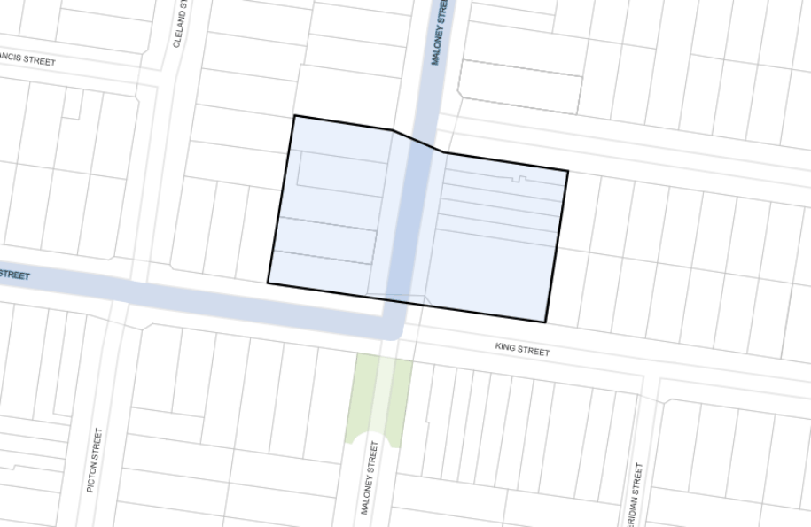

#### 7.11.1 Description

Maloney Street Neighbourhood Centre is a small Centre with less than 10 shops and comprises of several inter-war (1950’s) two storey shop-top buildings, on both sides of the road. The shop-top buildings are all built to the street alignment with mostly continuous awnings and parapets.

The building stock around the Maloney Neighbourhood Centre is represented by mainly detached residential dwellings. The houses are predominantly single-storey Federation Bungalows and California bungalows. The existing commercial buildings are predominantly two storeys in height and are of a simple post war design, with attractive art deco detailing on the facades. There are also several residential buildings within the Centre and a service station.

> [Picture on page 177: a picture, saved as a picture (images/section-07-specific-places-page-177-1.gif, 150 dpi).]

#### Figure 118: Maloney Street Neighbourhood Centre Land Application Map
