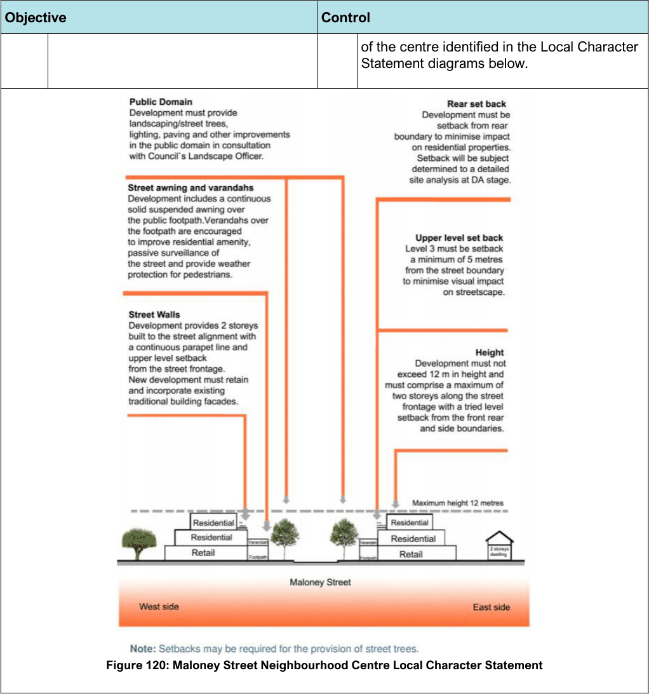
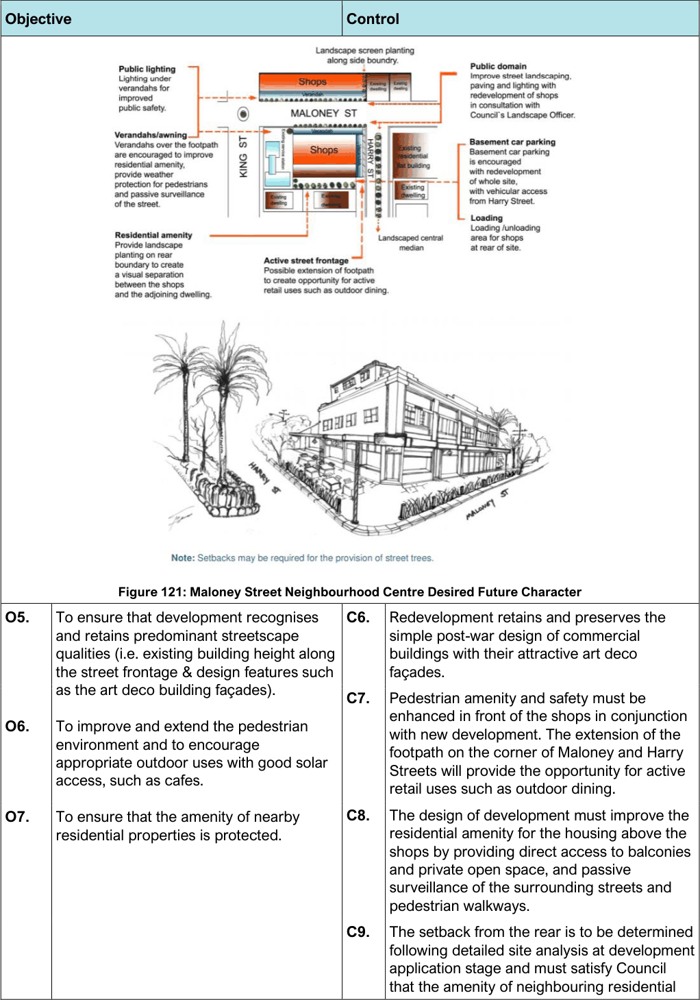

#### 7.11.3 Controls

| Objective |  | Control |  |
|---|---|---|---|
| Land use |  |  |  |
| O1. | To achieve an integrated redevelopment outcome along Maloney Street. | C1. | Redevelopment of the shops requires site amalgamation generally in accordance with site amalgamation diagram below to avoid inappropriate lot consolidation patterns that would isolate and unreasonably restrict redevelopment on a single lot. |

| Objective |  |
|---|---|
| Figure 119: Maloney Street Neighbourhood Centre Lot Consolidation Map |  |
| Built Form: Building Heights and Density |  |
| O2. | To retain a coherent streetscape with a consistent street wall and parapet line. |
| Street Character and Development Setbacks |  |
| O3. | To retain and conserve the shopping strip and encourage a viable and attractive Neighbourhood Centre with an improved and safer public domain. |
| O4. | To protect the distinctive and characteristic elements of the Maloney Street Neighbourhood Centre and ensure the integration of these features into subsequent development. |

| Control |  |
|---|---|
| C2. | A maximum street wall height of 2 storeys applies along the street frontage, with a third level permitted which is set back from the street frontages and the rear (where the shops adjoins a residential property). |
| C3. | Redevelopment of the Maloney Street Shops is contingent upon the provision of public domain improvements such as landscaping, paving of the footpaths, public seating and lighting identified by Council, generally in accordance with the Local Character Statement diagrams below. |
| C4. | The design must encourage active street life while providing a high residential amenity and small scale shops that will serve the local community. |
| C5. | The design of development must be generally consistent with the Local Character Statement |

> [Picture on page 179: a picture, saved as a picture (images/section-07-specific-places-page-179-1.gif, 150 dpi).]

Figure 120: Maloney Street Neighbourhood Centre Local Character Statement

#### Objective

#### Control

of the centre identified in the Local Character Statement diagrams below.

> [Picture on page 180: a picture, saved as a picture (images/section-07-specific-places-page-180-1.gif, 150 dpi).]

Figure 121: Maloney Street Neighbourhood Centre Desired Future Character

#### Objective

#### Control

| O5. | To ensure that development recognises and retains predominant streetscape qualities (i.e. existing building height along the street frontage & design features such | C6. | Redevelopment retains and preserves the simple post-war design of commercial buildings with their attractive art deco façades. |
|---|---|---|---|
|  | as the art deco building façades). | C7. | Pedestrian amenity and safety must be |
| O6. | To improve and extend the pedestrian environment and to encourage appropriate outdoor uses with good solar access, such as cafes. |  | enhanced in front of the shops in conjunction with new development. The extension of the footpath on the corner of Maloney and Harry Streets will provide the opportunity for active retail uses such as outdoor dining. |
| O7. | To ensure that the amenity of nearby residential properties is protected. | C8. | The design of development must improve the residential amenity for the housing above the shops by providing direct access to balconies and private open space, and passive surveillance of the surrounding streets and pedestrian walkways. |
|  |  | C9. | The setback from the rear is to be determined following detailed site analysis at development application stage and must satisfy Council that the amenity of neighbouring residential |

| Objective | Control |  |
|---|---|---|
|  |  | properties are protected in terms of sunlight and natural daylight access, privacy and visual amenity. |
|  | C10. | With redevelopment of the Centre, landscape planting must be provided along the rear or side boundary where a site adjoins a residential property, to provide a visual separation between the shops and the residential area. |

#### Botany
