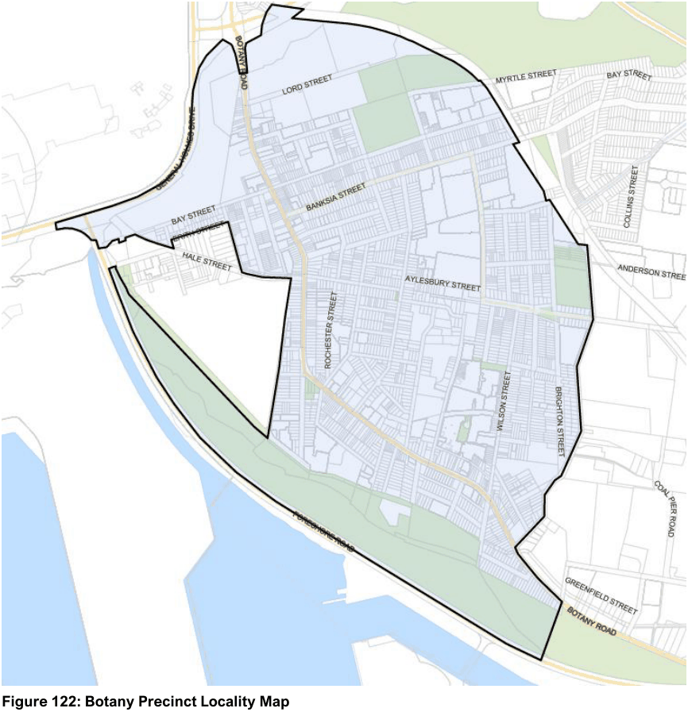

#### 7.12.1 Description

The Botany Precinct is bounded by the Airport, parklands abutting Botany Bay, Banksmeadow industrial area and the goods railway line. The dominant land uses are industrial and residential, which co-exist throughout the Precinct. Two linear retail shopping strips are located along Botany Road - Botany Local Centre within a Heritage Conservation Area and Banksmeadow Local Centre. The Botany Precinct has seen a transition with the conversion of industrial zoned land to residential zoned land, which has resulted in the emergence of stylish and high-quality medium density housing in the areas of Daphne Street, Banksia Street and William Street.

The main road through the area is Botany Road with Stephen Road providing access to and from other parts of the LGA. As a result, Botany is somewhat isolated from the adjoining residential areas. The street network within the Precinct is a combination of regular and irregular grids with some large blocks utilising private internal access ways. As a result, the permeability of the area is highly varied.

The focal points for retailing and services are Botany and Banksmeadow shopping strips; both of which are located on Botany Road. Botany Road has a concentration of Heritage Items as well as a Heritage Conservation Area at Botany Local Centre.

The quality of residential streetscapes varies although is generally good however traditional centres feature average quality public domain and are impacted by heavy traffic volumes.

Open space are generally larger parks that lack facilities and are located towards the edges of the Precinct. Major open spaces areas including Booralee Park, Garnet Jackson Reserve and the Sir Joseph Banks Park. Landscaping provided through street trees and planting within properties have created a pleasant environment, which results in a contrast to the industrial built form.

Setbacks within the Precinct vary markedly, with the area between the building line and front boundary line ranging from nil for some residential buildings to 10 metres for the larger industrial sites. Fences are varied in height and style but the majority of residential fences are of a low-scale.

Traditional detached housing occupies a large proportion of residential land, although more recent villas, townhouses and apartments provide a significant number of dwellings, particularly in the east. Some shop top housing occurs in the traditional strip shopping centres of Botany and Banksmeadow.

The precinct contains five localities which are subject to more specific design outcomes, as provided further within this Chapter:

• The Botany Local Centre

• The Botany West Industrial Precinct

• The Lord Street Business Park Precinct

• The Banksmeadow Neighbourhood Centre

• Swinbourne Street Neighbourhood Centre

> [Picture on page 182: a picture, saved as a picture (images/section-07-specific-places-page-182-4.gif, 150 dpi).]

#### Figure 122: Botany Precinct Locality Map
