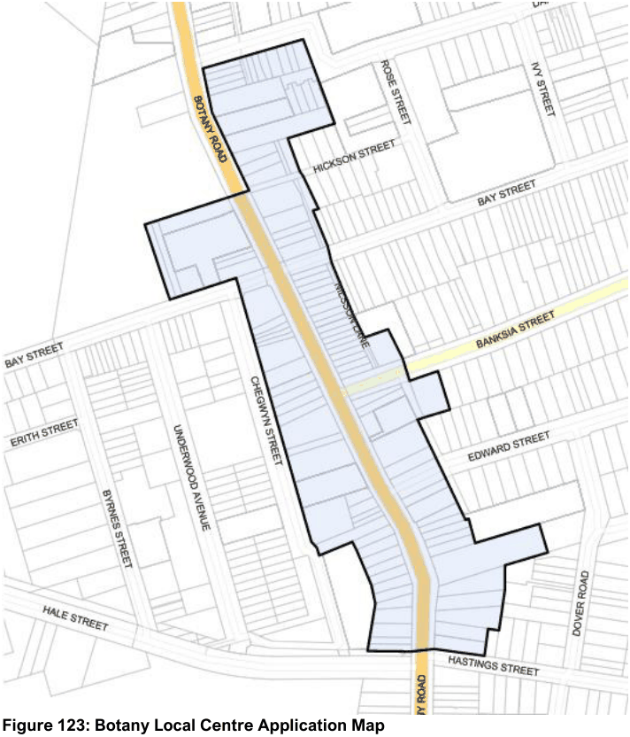
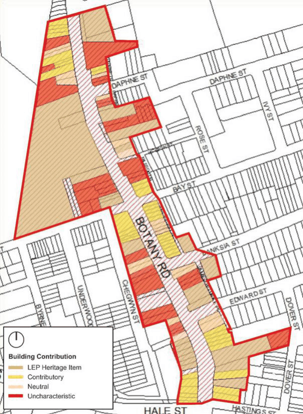
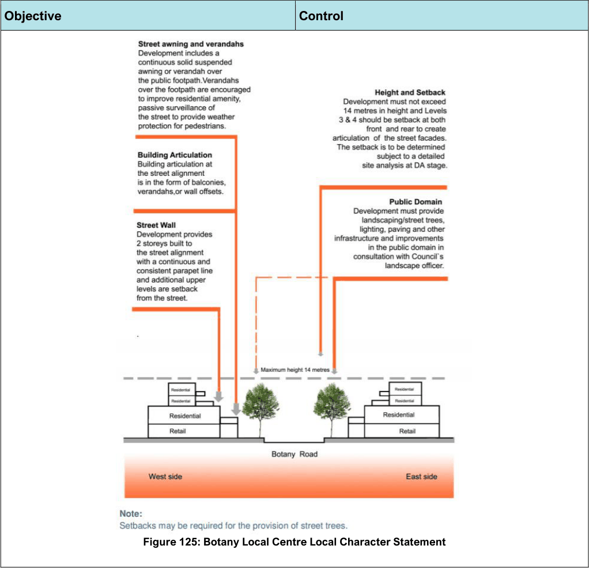
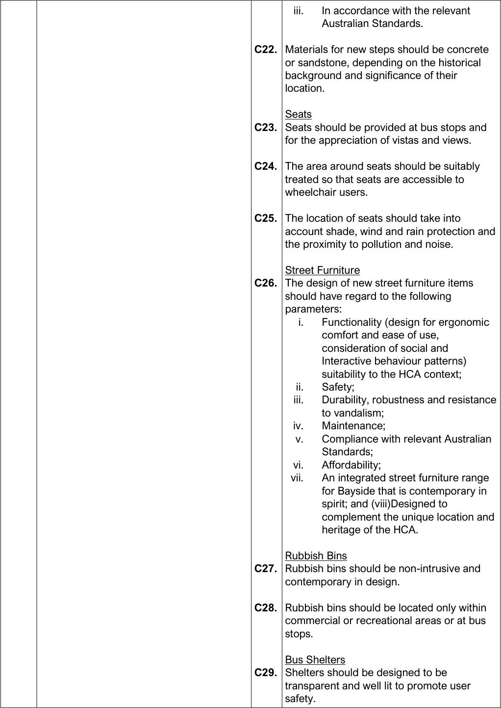

#### 7.12.3 Botany Local Centre

#### Description

Botany Local Centre is located along Botany Road and is a medium sized centre with over 70 shops servicing the local community. The Centre comprises the majority of the Botany Township Heritage Conservation Area and is characterised by a considerable number of heritage buildings and traditional shopfronts/facades. The Botany Town Hall is a Heritage Item which forms a focal point at the southern end of the Centre.

The suburb of Botany was created in the 1830’s with the creation of parishes in Sydney. The suburb evolved as subdivisions were approved. The area in the 1860’s had a variety of landholdings but it wasn’t until 1882 when the tramway came down Botany Road that the area expanded. The easy availability of water in the Botany area encouraged industrial uses and the area expanded in the 1904-1914 period. Shops developed to cater for the factory staff that moved into the area as industry expanded.

> [Picture on page 185: a picture, saved as a picture (images/section-07-specific-places-page-185-1.gif, 150 dpi).]

#### Figure 123: Botany Local Centre Application Map

#### Character Statement

The character of the Botany Township HCA is made up of a number of architectural styles and building typologies, which include late Victorian workers’ cottages at the northern and southern ends of the HCA, and a central traditional commercial shopping strip comprised of two- to three-storey Federation buildings. The character of the distinct commercial and residential precincts of the HCA should be preserved and retained through the retention of contributory buildings, public open space, and the existing subdivision pattern.

Characteristic elements to be preserved include:

• the prevailing two to three-storey character of the traditional commercial shopping strip at the core of the HCA

• active street frontages in commercial buildings at the ground level

• the prevailing character of the Victorian cottages at the northern and southern ends of the HCA, comprised of single-storey cottages

• the range of surviving architectural styles and historic buildings, particularly the existing heritage items, landmark buildings and contributory buildings

• consistent decorative parapets, awnings and terraced retail shopfronts with shop-top housing built to the street alignment

• original sandstone and trachyte kerb and guttering, and prominent street plantings. Uncharacteristic development includes housing from the late twentieth and early twenty-first century, residential flat developments, over-scaled additions, large multi-storey mid-rise commercial buildings,

rendering of face brickwork and the addition of garages and carports forward of the front building line in the residential precincts of the HCA.

#### Classification of Buildings within the Botany Township HCA

> [Picture on page 186: a picture, saved as a picture (images/section-07-specific-places-page-186-4.gif, 150 dpi).]

#### Figure 124: Classification of buildings within the Botany Township HCA

#### Desired Future Character

Future development is to be sympathetic to, and not detract from, the form and character of traditional shopfronts within the HCA or any Heritage Items. Development is to protect the distinctive and characteristic elements of commercial buildings and ensure the integration of these features into subsequent uses. The ‘main street’ character should be reinforced through new development, with original characteristics and traditional features of the retail buildings retained and enhanced. The centre will feature minimal signage, complimenting rather than dominating the Heritage Conservation Area.

#### Controls (General)

| Objective |  |
|---|---|
| Road Network and Vehicular Access |  |
| O1. | To minimise vehicular access and servicing from the primary road frontage and provide sufficient on-site car parking. |
| O2. | To enhance pedestrian connectivity, access, and safety within the Centre. |
| Built Form: Building Heights and Density |  |
| O3. | To ensure new development complements the height and architectural style found in the immediate vicinity, particularly where this has a clearly established character. |
| O4. | To retain a coherent streetscape with a consistent street wall and parapet line. |
| Street Character and Development Setbacks |  |
| O5. | To retain and conserve the Botany Local Centre and encourage a viable and attractive Local Centre by improving the public domain and the public/private interface. |

| Control |  |
|---|---|
| C1. | Vehicular access from Botany Road must be avoided where access is available from a side street or rear laneway. |
| C2. | Pedestrian amenity and connectivity must be enhanced in conjunction with new development. |
| C3. | Through site links and arcades are encouraged with redevelopment to improve pedestrian access, amenity, and safety. |
| C4. | Building height along the street frontage is a maximum of 2 storeys, with levels 3 and 4 to be set back from the street by at least 9m in accordance with the Local Character Statement identified for the Centre in the Local Character Statement diagram below. |
| C5. | Development must provide landscaping, street trees, lighting, public seating, paving, decorative fencing and other public domain improvements identified by Council, generally in accordance with the Local Character Statement diagram below. |
| C6. | The design of development must be generally consistent with the Local Character Statement of the centre identified in the Local Character Statement diagram below and the existing character of buildings within the Botany Township Heritage Conservation Area. |

> [Picture on page 188: a picture, saved as a picture (images/section-07-specific-places-page-188-1.gif, 150 dpi).]

Figure 125: Botany Local Centre Local Character Statement

#### Objective

#### Control

| Objective |  |
|---|---|
| O6. | To improve and extend the pedestrian environment and to encourage appropriate outdoor uses with good solar access, such as cafes. |
| O7. | To retain existing trees and provide additional trees within the streetscape. |
| O8. | To ensure that dwellings provide passive surveillance, resident interaction and amenity and address the street. |
| O9. | To protect and reinforce the distinctive and characteristic elements (i.e. setbacks & traditional facades and design features) of the Botany Township Heritage Conservation Area. |
| O10. | To encourage development of awnings as balconies for residential and commercial units above (to improve amenity for unit dwellers and promote passive surveillance of streets). |

| Control |  |
|---|---|
| C7. | Dwellings within a mixed use development and shop top housing are to have windows and/or verandahs (where a heritage item) in the street elevation to encourage surveillance of the street. |
| C8. | A setback to the rear may be required where a site adjoins a residential area and is to be determined following detailed site analysis at development application stage. Applicants must therefore demonstrate that the amenity of neighbouring residential properties are protected in terms of sunlight and natural daylight access, privacy and visual amenity. |
| C9. | Alterations and additions are to reflect the architectural design of the existing building. Materials and finishes are to be compatible with the existing building. |
| C10. | New development when viewed from the street is to be compatible with the character of buildings within the site’s visible locality by using similar shaped windows, doors and similar building materials. |

#### Controls (Heritage Conservation Area)

| Objective |  |
|---|---|
| Character and Form |  |
| O1. | To conserve and respect the main architectural features and form of Heritage Items. |
| O2. | To retain Botany Town Hall as a focal point at the southern end of the Centre. |
| O3. | To protect the distinctive and characteristic elements of commercial buildings and ensure the integration of these features into subsequent uses. |

| Control |  |
|---|---|
| C1. | Redevelopment retains inter-war 2 storey shop-top housing built to the street alignment with continuous awnings and parapets and their traditional building facades. |
| C2. | Preservation, reinstatement and maintenance of original façades and shopfronts are required. The removal or alteration of original shopfronts is not permitted. |
| C3. | To achieve appropriate development to the original façades and shopfronts within the Heritage Conservation Area proposals must satisfy the following: i. Preserve and maintain original parapets, with existing detailing, |

|  | unpainted and free of hoarding and signs; ii. Restore and maintain original upper level windows, with alternatives, being sympathetic in scale and proportion; and iii. Retention of continuous awning at unified heights and fascia to each shop. |
|---|---|
| C4. | New shopfronts must reflect original details and proportions including the siting of recessed entrance doors. |
| C5. | First floor balconies should remain open as important functional and architectural elements of the front façade. Enclosure of balconies will only be permitted if compatibility with original window types can be demonstrated. |
| C6. | Rear elevations and structures are to be treated and maintained in a manner that is of quality and character appropriate to the Heritage Conservation Area and its controls. |
| C7. | The profile of the front parapet wall should be maintained as a silhouette against the sky. |
| C8. | The removal of first floor windows that have altered the profile of former openings is encouraged, with the original window to be restored. |
| C9. | The level of overhead awnings above footpath level should match existing. |
| C10. | Overhead awnings shall be of a uniform depth and form to match that which is predominantly within the group. Where appropriate, timber fascia and gutter are to be maintained or reinstated on buildings that originally featured a timber fascia. |
| C11. | Contemporary designs for shopfronts must relate to the building type, streetscape and precinct. They must incorporate traditional features such as the division of frontages. The configuration of windows must use appropriate materials. Note: Where non-contributory or intrusive fabric exists in significant shopfront |

| Pubs, Religious, Institutional and Public Buildings |  |
|---|---|
| O4. | To ensure that the original characteristics of pubs in the HCA are retained and enhanced. |
| O5. | To ensure that any new work is carried out with due regard to the significance of the building and its setting. |
| Public Domain |  |
| O6. | To ensure the public domain is consistent and sympathetic to the heritage significance of the Heritage Conservation Area. |

|  | locations, it may be replaced by a modern shopfront if the design is consistent with the historical context in terms of materials, proportions, details, colour and signage. |
|---|---|
| C12. | Shopfronts must not be amalgamated. Where properties are amalgamated, the original building elements and shopfronts must be conserved. |
| C13. | Original façades including areas of tiling are to be retained and conserved. |
| C14. | Original pub names must be retained. |
| C15. | Significant interior features and spaces must be retained. |
| C16. | Original public areas and former pub accommodation areas, including their form, details, materials and finishes, should be retained. |
| C17. | Work to a significant religious, institutional or public building must be compatible with the existing building. Parks |
| C18. | The formal layout of existing parks should be retained or reinstated so that placement of built elements, path location and cultural planting reflect the key development period of the park. |
| C19. | Structures such as toilet blocks, playgrounds, shade structures and shelters should be located to protect and enhance public vistas and designed (in terms of their character scale, massing, form, colour and materials) to enhance the character of the Heritage Conservation Area. Steps |
| C20. | Original stone steps and retaining walls should be retained and conserved in place using appropriate conservation methods. |
| C21. | New steps should be designed: i. So that their scale and proportion relates to the surrounding built form; ii. For pedestrian comfort and safety; and |

> [Picture on page 192: a picture, saved as a picture (images/section-07-specific-places-page-192-1.gif, 150 dpi).]

|  | iii. In accordance with the relevant Australian Standards. |
|---|---|
| C22. | Materials for new steps should be concrete or sandstone, depending on the historical background and significance of their location. Seats |
| C23. | Seats should be provided at bus stops and for the appreciation of vistas and views. |
| C24. | The area around seats should be suitably treated so that seats are accessible to wheelchair users. |
| C25. | The location of seats should take into account shade, wind and rain protection and the proximity to pollution and noise. Street Furniture |
| C26. | The design of new street furniture items should have regard to the following parameters: i. Functionality (design for ergonomic comfort and ease of use, consideration of social and Interactive behaviour patterns) suitability to the HCA context; ii. Safety; iii. Durability, robustness and resistance to vandalism; iv. Maintenance; v. Compliance with relevant Australian Standards; vi. Affordability; vii. An integrated street furniture range for Bayside that is contemporary in spirit; and (viii)Designed to complement the unique location and heritage of the HCA. Rubbish Bins |
| C27. | Rubbish bins should be non-intrusive and contemporary in design. |
| C28. | Rubbish bins should be located only within commercial or recreational areas or at bus stops. Bus Shelters |
| C29. | Shelters should be designed to be transparent and well lit to promote user safety. |

| C30. | New bus shelters should be contemporary in design. Drinking fountains |
|---|---|
| C31. | Drinking fountains should be designed to be easily useable by people of all ages, including those with disabilities. |
| C32. | Placement of drinking fountains should not inhibit pedestrian or wheelchair access along the footpaths. Footpath Paving Treatments |
| C33. | A continuity of surface treatments throughout street blocks should be maintained or provided in cases where replacement of surfaces is necessary. |
| C34. | A homogeneity of colour and texture in paving materials should be maintained. Kerbs and Gutters |
| C35. | All original sandstone kerbs and gutters should be retained. |
| C36. | All original sandstone and trachyte kerbs and gutters should be retained where possible. If stone kerbs and gutters are required to be removed they should be stockpiled for reuse in new works. |
| C37. | Damaged original stone kerbs and gutters should be restored where possible or replaced with new stone kerbs and gutters and detailed to match existing. |
| C38. | New crossovers and chicanes will not be permitted as they interrupt the original line of the streets and stone kerbing. |
| C39. | The kerb alignment should be retained parallel to the building line to preserve the character of streets. |
| C40. | Where footpaths are widened, original stone or fly-ash kerbs should be left in their original position so that the earlier street form can be understood. |
| C41. | The profile of all new kerbs should reflect the traditional kerb detail. |

| C42. | Where concrete kerbs are to be used, precast segmental elements are preferred. |
|---|---|
| C43. | All street name inlays in kerbs and gutters are to be retained. Parking Areas |
| C44. | Public off-street car parking areas should be planted with appropriate species to soften visual impact, provide shade and screen parking from adjacent residential development. Traffic Management Devices |
| C45. | Traffic and transport investigations are to be undertaken prior to the introduction of new traffic management devices. These investigations should, depending on their scope, include public participation and must include consideration of access issues generally for all people and the impact on heritage significance resulting from traffic management options to enable the least possible impact on significance |
| C46. | The design and location of traffic management devices (such as traffic signals, speed humps, roundabouts and road signage) should not obscure public views and should minimise visual impact on significant items and the streetscape. Signage |
| C47. | Signage should be discreet, of slender appearance and of contemporary design consistent with other street furniture. |
| C48. | Street name signs should, where possible, be attached to buildings. Interpretive signs should incorporate brief historical information to assist in the comprehension of specific areas. |
| C49. | Parking and traffic control signs should be rationalised and minimised. |
| C50. | Corporate and advertising signs are not permitted within the public domain. Services |
| C51. | Future substations should be recessed within a wall rather than freestanding. |
