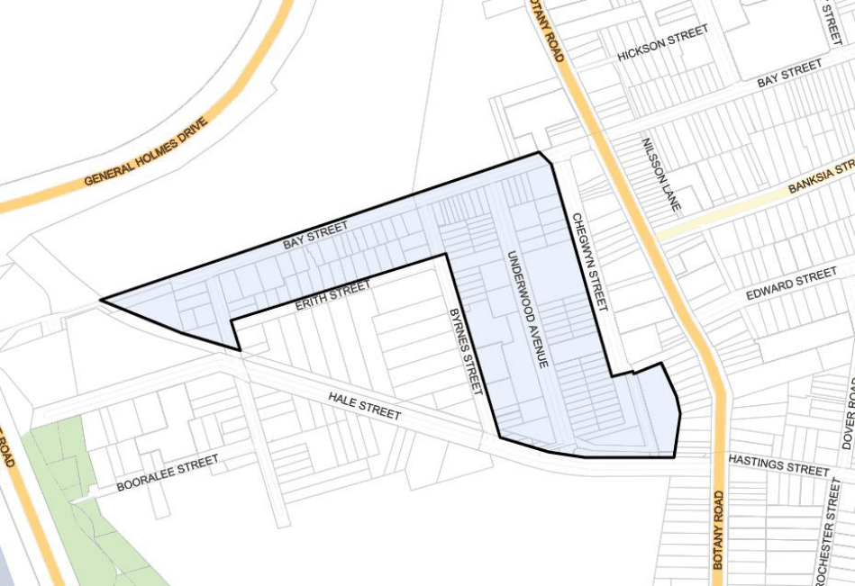

#### 7.12.4 Botany (West) Industrial Area

#### Description

| C52. | Existing substations should be screened or treated so that their impact is minimised. |
|---|---|
| C53. | Overhead power lines and telecommunication lines should be located underground in order to protect significant vistas. |
| C54. | New excavation for the installation or repair of underground services should not damage significant stone guttering or footpaths. Stone kerbs and guttering must be carefully replaced in their original locations. |
| C55. | New services should be located so as not to conflict with substantial existing street trees. Street Lighting |
| C56. | New lighting fixtures should be of simple and sophisticated design to compliment the Heritage Conservation Area. |
| C57. | Public lighting should be provided to ensure legibility and visual orientation for pedestrians and enhance the sense of place. |
| C58. | Lighting should be energy efficient. For example: Lighting should incorporate solar- powered lighting systems and economy measures for usage during daylight saving periods where appropriate. |

This area is characterised by industrial uses on single and relatively small allotments, interspersed with residential uses. The area generally to the north of Erith Street is zoned IN1 Industrial and B7 Business Park whilst the area to the south of Erith Street is zoned IN1-General Industrial under State Environmental Planning Policy (Transport and Infrastructure) 2021.

The B7 zone allows light industry to continue, as well as other industries such as high technology industries and more creative industries including film studios, art galleries and architect’s offices. Due to the allotment sizes in this area large scale industrial uses would not be economically viable hence the need to promote other employment generating uses.

The small land sizes reflect the heritage items along Bay Street that represent the last known fishing village cottages in the area. This heritage listing means the sites could not be amalgamated for larger scale industrial units.

Bay Street and Erith Street are narrow streets which limit the size of trucks able to access the area and manoeuvre within the street network. This access issue will also limit the type of industrial uses that would be able to function in this area.

Council is not seeking to reduce or remove the employment generating opportunities within this area but rather promote businesses which best fit within the constraints of the area.

> [Picture on page 196: a picture, saved as a picture (images/section-07-specific-places-page-196-3.gif, 150 dpi).]

#### Figure 126: Botany (West) Industrial Precinct Land Application Map

#### Desired Future Character

Future development within the industrial area will respect the integrity of its heritage items and the Botany Township Heritage Conservation Area. Amenity in the north will need to be protected by limiting the size of delivery vehicles, whilst new business park and industrial uses will be designed to be compatible with adjoining residential areas.

#### Controls

| Objective |  |
|---|---|
| O1. | Ensure that the business park and business development uses are compatible with the adjoining established residential area. |
| O2. | To protect the northern precinct’s amenity by limiting the size of delivery vehicles. |
| O3. | To ensure that the scale, design, material of construction and nature of the development, in the opinion of the Council, contributes positively to the visual amenity and the gateway function of the area. |
| O4. | Ensure that industrial uses concentrate in the southern part of the Precinct with access to Foreshore Drive through the Hale Street extension. |
| O5. | Protect the heritage integrity of the Heritage Items within the precinct and the Botany Township Heritage Conservation Area. |

| Control |  |
|---|---|
| C1. | The maximum size of any vehicle accessing sites in the Precinct shall not exceed a Medium Rigid Vehicle (MRV) as defined by AS2890.2. |
| C2. | The design and function of development shall assist in protecting the heritage significance of the precinct and the integrity and significance of heritage items within the Precinct and of the adjacent Botany Township Heritage Conservation Area. |
| C3. | Developments within the precinct shall submit a detailed Flood Study/Assessment for 1 in 100 year average recurrence interval (ARI) design storm events and probable maximum flood (PMF). |
| C4. | Development shall: i. Have finished floor levels of a minimum 500mm above the 1 in 100 year flood level for habitable areas and 300mm for industrial areas and garages; and ii. Not impede the passage of floodwater to cause a rise (afflux) in the flood level upstream and/or increase the downstream velocities of flow. |
| C5. | Development within the precinct shall require submission of a Risk Management Plan to address potential risks related to coastal sea levels (projected to increase above Australian Height Datum by 40cm by 2050 and by 90cm by 2100). The Risk Management Plan shall be prepared by a qualified consultant and in accordance with the following policies and documents: i. Any current policy of Council relating to projected future sea level rises and related inundation mapping; ii. NSW Coastal Planning Guidelines: Adapting to Sea Level Rise; iii. Flood Risk Management Guide: Incorporation Sea Level Rise Benchmarks in Flood Risk Assessment and; and (iv) NSW Flood Plain Development Manual. |
| C6. | In addition, the Risk Management Plan shall minimise the exposure of development to |

| Objective | Control |  |
|---|---|---|
|  |  | coastal risk and provide management responses and adaptation strategies to identify and manage risk and coastal hazards associated with the following: i. The safety of future workers and occupants on-site; ii. The safety of the public off-site; iii. The safety of adjoining properties; iv. The safe evacuation route during storm and flood events; and v. The freeboard above the flood planning levels. |
|  | C7. | The introduction of noise abatement measure to achieve compliance with current AS 2021 must be done in a manner that does not compromise the architectural design of a building or impact on the character of an existing streetscape. |
