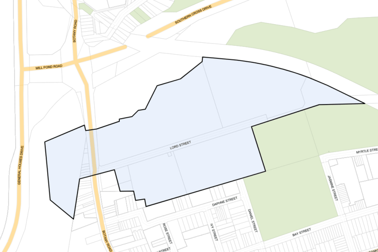

#### 7.12.5 Lord Street Business Park

#### Description

The Lord Street Business Park Precinct has a "Business Park / High Technology" appearance. A main feature of the Lord Street development is the Mill Ponds, which forms a visual gateway to Botany. The Mills Ponds are part of the State listed Heritage Item – Botany Water Reserves, which stretch from the northern part of The Lord Street Business Park, east of the goods railway line and up to Gardeners Road. Botany Water Reserves contain two threatened ecological communities. The wetlands are also identified as being of National significance within the Directory of Important Wetlands of Australia.

The Lord Street Park Precinct is adjacent to the Botany Township Heritage Conservation Area and the St Matthew’s Anglican Church at 1331 Botany Road, Botany which is a heritage item in the Bayside Local Environmental Plan 2021. The Church is also listed in the Register of the National Estate. The Precinct is affected by the 20 to 25, 25 to 30 and 30 to 35 ANEF Contours and significant road and rail noise. Part of the suburb is within the zone of influence of the High Pressure Gas Pipeline that follows the ARTC Rail Corridor to the Qenos Site at the Botany Industrial Park, Denison Street, Banksmeadow.

The precinct contains a site at 1-3 Lord Street which is  adjacent to the St Matthew’s Anglican Church. This site is uniquely positioned in a transitional location between residential, church and commercial land

uses. The interface between any proposed building and the adjoining historic church is of paramount importance.

> [Picture on page 199: a picture, saved as a picture (images/section-07-specific-places-page-199-1.gif, 150 dpi).]

#### Figure 127: Lord Street Business Park Precinct Land Application Map

#### Desired Future Character

New development within the Lord Street Business Park will enhance the environmental and visual amenity of the locality, especially the Mill Ponds (east and west of Botany Road), whilst ensuring no adverse impact on the heritage significance of internal and adjacent heritage items and heritage conservation areas. Proposed uses will be compatible with the adjoining residential area, and withstand the stresses of flooding and sea level rise. Development at 1-3 Lord Street will be undertaken in accordance with the specific provisions that apply under Section 7.12.5.3.

#### Controls

| Objective |  |
|---|---|
| Built Form: Building Height and Density |  |
| O1. | To ensure that any new development enhances the environmental and visual amenity of the locality, especially the Mill Ponds (east and west of Botany Road). |

| Control |  |
|---|---|
| C1. | Development, including alterations and additions, shall be of a high standard and shall maintain the Business Park/High technology appearance of the Precinct. |
| C2. | Development, including alterations and additions, is to comply with Sydney Airport’s regulations with regard to safety, lighting and height of buildings. |
| C3. | Development which seeks the maximum building height under the Bayside LEP 2021 and is within land bounded by Coward Street, O’Riordan Street and Bourke Road; development along eastern side of O’Riordan Street; and development within land bounded by Baxter Road, O’Riordan Street, Joyce Drive and Botany Road, will penetrate the Obstacle Limitation Surface (OLS) and would need to be assessed by CASA, Airservices Australia & the |

| Objective |  |
|---|---|
| Environmental Management |  |
| O2. | To ensure that development minimises the quantity of stormwater runoff. Its impact on the aquatic environment and the potential disturbance of contaminated sediments and is guided by the Risk-based Framework for Considering Waterway Health Outcomes in Strategic Land-use Planning Decisions (EPA, Office of Environment and Heritage, 2017) and NSW Water Quality and River Flow Objectives. |

| Control |  |
|---|---|
|  | Airlines before an application could be submitted to the Department of Infrastructure & Transport for their determination. |
| C4. | Any development fronting the Mill Ponds shall include a buffer zone or setback area between the waterbody and any buildings, structures or pavements to minimise environmental and visual impact on the wetlands and its environs and maintain existing environmental amenity. The extent of the buffer shall be assessed on the merit of each case and may be required to be embellished with landscaping using appropriate species. |
| C5. | Development north of Lord Street and west of Botany Road shall submit a detailed Flood Study/Assessment for 1 in 100 year average recurrence interval (ARI) design storm events and probable maximum flood (PMF). The Flood Study/Assessment is to be prepared by a suitably qualified and experienced civil engineer. The Flood Study/Assessment is required to: i. Be in accordance with the current version of Australian Rainfall and Runoff (ARR) and the NSW Floodplain Development Manual; and ii. Consider the impacts from Climate Change and Sea Level Rise. |

#### Site Specific Controls for 1-3 Lord Street

The site is unique in that each façade of a future building on the site will respond to different contextual conditions and relationships. The site’s gateway location adjacent to the St Mathews Church heritage item has a transitional role from the open, garden character of the church grounds to the treed and garden commercial frontages of Lord Street, as well as between commercial uses north and east of the site with residential uses to the south.

This places a high degree of importance on ensuring each façade responds to the unique visual qualities and characteristics of its context. Articulation, materials and finishes of each façade play an important role in ensuring a sympathetic and contextually appropriate response to the surrounding context and maintenance of the visual prominence of the church.

#### Building Character

A key consideration informing any future built form on the site is establishing an appropriate visual relationship between that built form and the adjacent St Matthew’s Anglican Church. The transition and interface between business uses and the St Matthew’s Anglican Church and establishing a sympathetic design response to the Church are important factors to consider in this regard.

| Objectives |  |
|---|---|
| O1. | To provide built form controls that facilitate development consistent with the objectives of the site's B7 Business Park zoning within the Lord Street Business Park precinct. |
| O2. | To create a bookend style development that visually integrates with and provides an activated edge to the adjoining church. |
| O3. | To retain and enhance the visual prominence of the St Matthew’s Anglican Church as viewed from Botany Road and Lord Street. |
| O4. | To establish a high quality interface between any future built form on the site and the adjacent St Matthew’s Anglican Church and adjoining lawn area. |
| O5. | To facilitate the transition of use between the site at the edge of the employment precinct and the adjacent St Matthew’s Anglican Church. |

| Controls |  |
|---|---|
| C1. | Any future built form on the site is to reflect the Business Park character of the precinct as well as provide a sympathetic design response to the adjacent Church through design articulation, modulation of form, variation in texture, finishes and materials. |
| C2. | Development must be of a high visual quality and must include appropriate architectural articulation and modulation of form particularly to the northern frontage to Lord Street and the western frontage to the Church. |
| C3. | Setbacks to the western façade of the building (i.e. facing the St Matthew’s Anglican Church) are to provide space to enable the activation of the ground-floor edge between the site and its boundary with the Church. |
| C4. | Landscaping of the setback to the western boundary is to facilitate the future integration and transition between the site and the adjoining lawn area within the adjacent Church grounds. Should fencing be proposed between the two properties, ground level setbacks are to ensure the ground floor of the building remains accessible in perpetuity. |
| C5. | The ground floor of the building is to be designed to enable activation of the ground level and is to include outward facing floorspace that is oriented towards the northern and western boundaries of the site. |
| C6. | Landscaping of the setback to the northern boundary is to be designed so as to contribute positively to the building frontage as viewed from Lord Street and to enhance the visual appearance of the site as a gateway corner to the Lord Street Business Park. |

#### Building Envelope

The site's transitional location adjacent to the Church and medium density residential uses require careful consideration to establish a functional building envelope that is capable of meeting employment-based industry operational requirements as well as appropriately managing impacts on the Church and residential uses. Maintaining appropriate levels of solar access to existing residential dwellings and facilitating a scale of built form that is compatible with neighbouring uses are key considerations in this regard.

| Objectives |  |
|---|---|
| O6. | To establish a functional building envelope that is capable of meeting employment-based industry operational requirements of the site. |
| O7. | To maintain appropriate solar access and ensure privacy to residential buildings in the adjacent R3 Medium Density Residential zone. |

| Controls |  |
|---|---|
| C7. | Development on the site must not exceed a height of 16.5 metres and RL 21.82 metres (i.e. height of the church spire). |
| C8. | Setbacks for any future development on the site are to be in accordance with those outlined in Table 22. |
| C9. | Upper level setbacks are to minimise solar overshadowing impacts to adjacent residential properties. Front Side Side Rear (South) (Lord St (East) (West) North) Ground Min. 3m Min. 8m Min. 7m Min 6m from Level from site from site from site neighbouring boundary boundary* boundary* building Upper Min 3m Min 3.5m Min 4m Setback to Levels from site from from site increase by 1-3 boundary. boundary* boundary* one metre for every additional metre in height above 5m in building height. * Where a setback is increased to the western boundary for the purpose of providing careful articulation of upper levels that improves access to natural light to the east facing church windows, a commensurate reduction may be permitted at any point along the eastern setback to a maximum setback reduction of 0.5m. Table 22: Upper-level Setbacks |

#### Building Frontage and Façade Design

The site is unique in that each façade of a future building on the site will respond to different contextual conditions and relationships. The site’s gateway location adjacent to the St Mathews Church heritage item has a transitional role from the open, garden character of the church grounds to the treed and garden commercial frontages of Lord Street, as well as between commercial uses north and east of the site with residential uses to the south. This places a high degree of importance on ensuring each façade responds to the unique visual qualities and characteristics of its context. Articulation, materials and finishes of each façade play an important role in ensuring a sympathetic and contextually appropriate response to the surrounding context and maintaining the visual prominence of the church.

| Objectives |  |
|---|---|
|  | West Façade Objectives |
| O8. | To ‘bookend’ the Lakes Business Park precinct with subtle articulation of form and relatively simple composition of façade elements so as to establish a visually sympathetic relationship with the church. |

| Controls |  |
|---|---|
| C10. | Development is to be provided in accordance with the objectives for the façade outcomes at each frontage. |

#### O9.

#### O10.

#### O11.

#### O12.

#### O13.

#### O14.

#### O15.

#### O16.

#### O17.

#### O18.

#### O19.

#### O20.

To use a material palette, building articulation and roof design that provides a backdrop to the Church and creates a sympathetic visual relationship between built form on the site and the adjacent church when viewed from Botany Road.

To provide a contemporary design response that uses high quality materials that work to maintain and enhance the visual prominence of the Church as viewed from Botany Road, with the use of glazing, shading and screening devices, softer articulation and simple composition of façade elements.

To establish a visual and/or physical connection between internal ground floor commercial floorspace and external landscaped areas through façade treatments at ground level such as fixed and/or operable glazing.

To create active pedestrian access at ground level between the western façade of the building and the western boundary, including seating, soft landscaping and a visual connection to the historic church.

To ensure the appropriate access to light is provided to the stained glass windows of the adjoining historic church, through careful consideration of building articulation, building materials, colours and design of façade and roof elements.

To provide protection to openings from the west sun.

#### North Façade Objectives

To provide a level of articulation that provides a unique architectural response, accentuates street presence and provides a strong visual identity to the main frontage of the building.

To create a sense of visual interest and design quality to the façade facing Lord Street by way of modulation of form and the visual articulation of colour, texture, and materials.

To include materials and finishes that reflect the commercial and industrial context of Lord Street.

To enhance the visual qualities of the gateway to the Lakes Business Park precinct.

To include soft landscaping at ground level between the site boundary and the building, to reflect the garden character of Lord Street.

#### East Façade Objectives

To provide a high degree of articulation and include a visually interesting composition of materials that reflect the adjacent industrial and commercial context.

#### O21. O22.

#### O23.

#### South Façade Objectives

To provide articulation and modulation to maintain solar access.

To provide appropriate screening devices to manage any potential overlooking from south facing openings or balconies.

To provide landscaping within the rear setback to screen adjoining residential uses and ameliorate any impacts of development.

#### Safety and Security

| Objectives |  | Controls |  |
|---|---|---|---|
| O24. | To facilitate ongoing safety and security. | C11. | Development on the Site should be supported by a Crime Prevention Through Environmental Design (CPTED) study to demonstrate how the development incorporates ‘Safer by Design’ principles of: Surveillance: maximise visibility and surveillance of the public domain and publicly accessible spaces. Access Movement and Sight lines: establish direct connections and sight lines that minimise residual spaces and concealment opportunities. Activation: maximise activity in the public domain by providing outward-facing land uses, especially at ground level. Where complementary land uses such as takeaway/ food and beverage (e.g. café) are proposed, these should be located at ground level to front onto public streets and/or publicly accessible spaces. Ownership/ Management: provide clear definition of public and private areas of the development to ensure that public spaces (e.g. Lord Street/ public street), publicly accessible private space (e.g. laneway link/ lobby spaces) and private space (e.g. commercial premises) facilitate a logical and intuitive understanding of purpose of spaces and the permissibility of access to the public and when. Management: establish clearly defined maintenance and management roles between adjoining land (i.e. the Site and adjacent Church) to ensure ongoing maintenance. |
