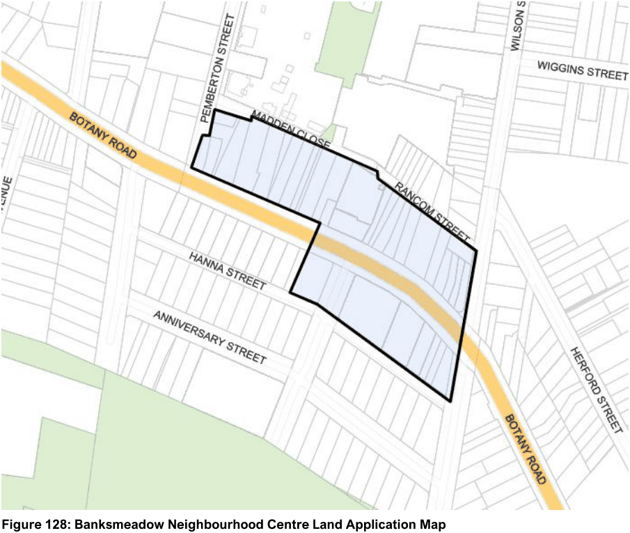
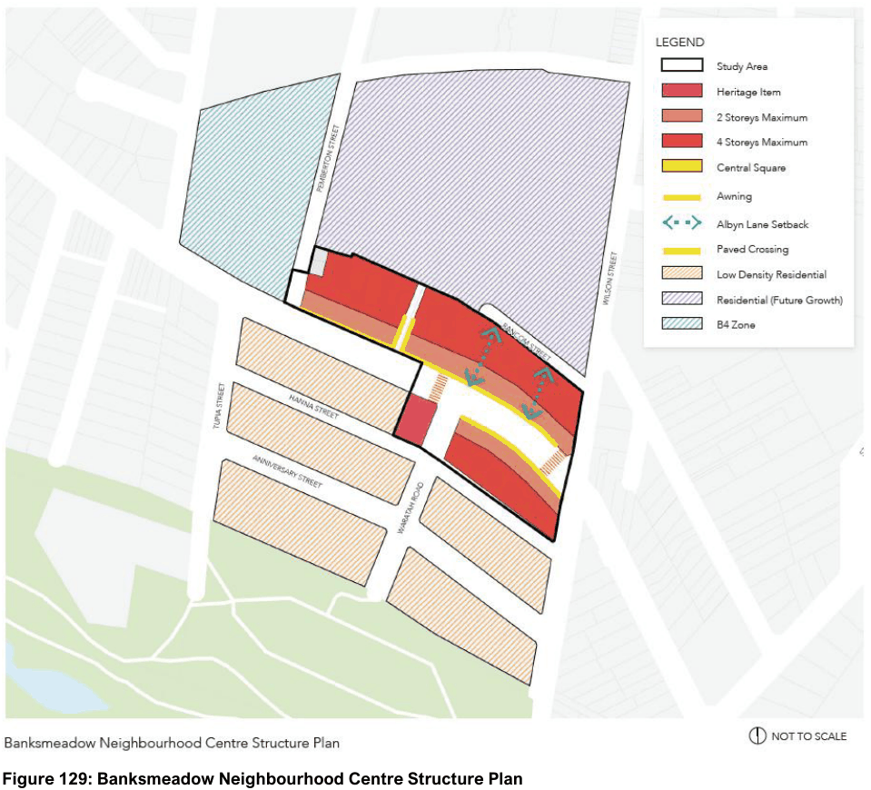
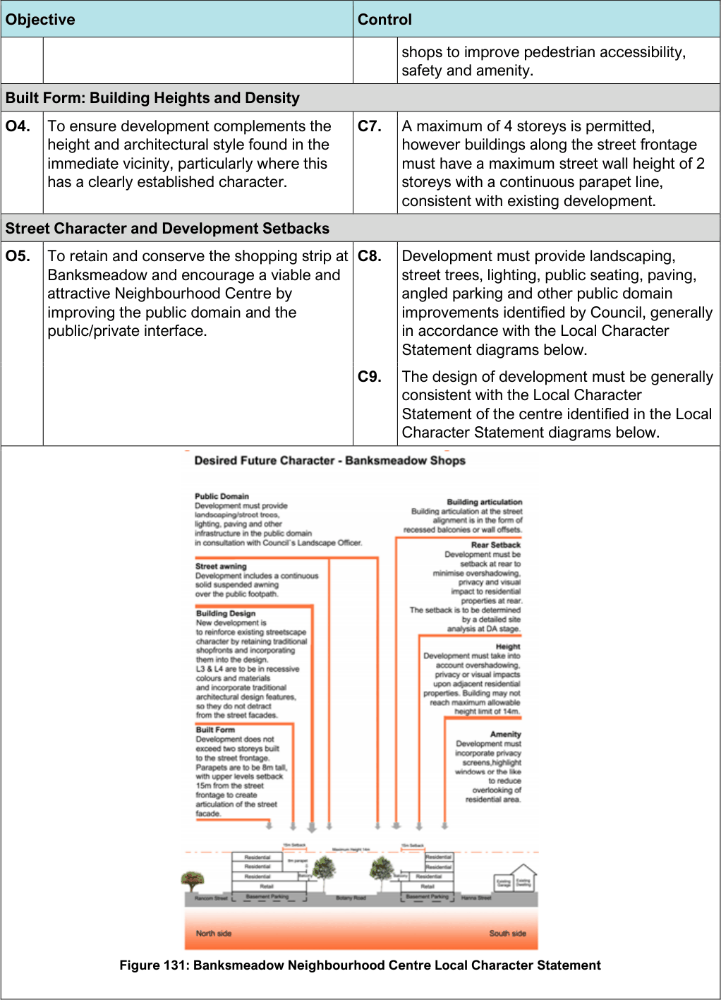
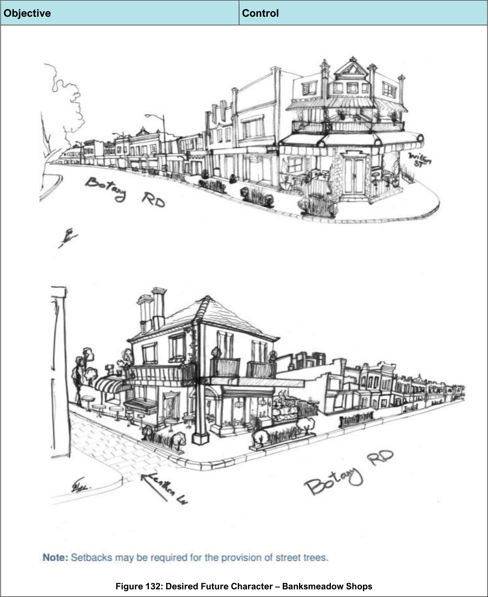

#### 7.12.6 Banksmeadow Neighbourhood Centre

#### Description

Banksmeadow Neighbourhood Centre is located along Botany Road at Banksmeadow and is a medium sized centre with nearly 20 shops including the historic Sir Joseph Banks Hotel which provides a focal point at the centre of the shops. It has a good mix of local shops and cafes. Given the predicted residential growth, within the Pemberton-Wilson Street Precinct, which is in close proximity to the centre, there is the need for further shops such as a supermarket, to service the local community.

> [Picture on page 205: a picture, saved as a picture (images/section-07-specific-places-page-205-8.gif, 150 dpi).]

#### Figure 128: Banksmeadow Neighbourhood Centre Land Application Map

#### Desired Future Character

The Banksmeadow Neighbourhood Centre is anticipated to develop into a high quality centre with a balanced mix of retail, commercial, community and residential uses which cater for the needs of the local community, in accordance with the Structure Plan shown below.

Given the predicted residential growth within close proximity to the Centre, there is a need for further shops such as a supermarket, to service the increasing local community. Public domain improvements, such as landscaping, public seating, lighting of pedestrian walkways, further angle street parking and a signalised pedestrian crossing in Botany Road at the centre of the shops would be required in conjunction with new development (Note: this is subject to approval by Transport for NSW). Through site links and arcades leading to the residential precinct to the rear is also encouraged with future redevelopment of the shops.

> [Picture on page 206: a picture, saved as a picture (images/section-07-specific-places-page-206-1.gif, 150 dpi).]

#### Figure 129: Banksmeadow Neighbourhood Centre Structure Plan

#### Controls

| Objective |  |
|---|---|
| Land Use |  |
| O1. | To develop a high quality centre with a balanced mix of retail, commercial, community and residential uses which cater for the needs of the local community, including a future supermarket. |
| O2. | To achieve an integrated redevelopment outcome along Botany Road. |

| Control |  |
|---|---|
| C1. | The Banksmeadow Neighbourhood Centre develops in accordance with the structure plan above. |
| C2. | Redevelopment of the shops requires site amalgamation generally in accordance with the site amalgamation diagram to avoid inappropriate lot consolidation patterns that would isolate and unreasonably restrict redevelopment on a single lot. |

| Objective |  |
|---|---|
| Figure 130: Banksmeadow Neighbourhood Centre: Site Amalgamation |  |
| Road Network and Vehicular Access |  |
| O3. | To improve pedestrian accessibility, connections and safety within the Centre and reduce vehicular and servicing impacts on Botany Road. |

| Control |  |
|---|---|
| C3. | Vehicular access on Botany Road must be avoided where access is available from a side street or rear laneway. |
| C4. | Where a rear laneway exists loading and unloading must occur from the laneway (loading and unloading must be within the site). |
| C5. | The provision of through site links and arcades is encouraged with new development to provide pedestrian connections to the residential precinct. |
| C6. | Pedestrian amenity and connectivity must be enhanced in conjunction with new development. For instance, a signalised pedestrian crossing on Botany Road at the centre of the shops would be required to improve pedestrian safety and connections. Through site links and arcades leading to the residential precinct to the rear is also encouraged with future redevelopment of the |

> [Picture on page 208: a picture, saved as a picture (images/section-07-specific-places-page-208-1.gif, 150 dpi).]

Figure 131: Banksmeadow Neighbourhood Centre Local Character Statement

| Objective |  | Control |  |
|---|---|---|---|
|  |  |  | shops to improve pedestrian accessibility, safety and amenity. |
| Built | Form: Building Heights and Density |  |  |
| O4. | To ensure development complements the height and architectural style found in the immediate vicinity, particularly where this has a clearly established character. | C7. | A maximum of 4 storeys is permitted, however buildings along the street frontage must have a maximum street wall height of 2 storeys with a continuous parapet line, consistent with existing development. |
| Street Character and Development Setbacks |  |  |  |
| O5. | To retain and conserve the shopping strip at Banksmeadow and encourage a viable and attractive Neighbourhood Centre by improving the public domain and the public/private interface. | C8. | Development must provide landscaping, street trees, lighting, public seating, paving, angled parking and other public domain improvements identified by Council, generally in accordance with the Local Character Statement diagrams below. |
|  |  | C9. | The design of development must be generally consistent with the Local Character Statement of the centre identified in the Local Character Statement diagrams below. |

> [Picture on page 209: a picture, saved as a picture (images/section-07-specific-places-page-209-1.gif, 150 dpi).]

Figure 132: Desired Future Character – Banksmeadow Shops

#### Objective

#### Control

| Objective |  |
|---|---|
| Figure 133: Banksmeadow Shops Masterplan |  |
| O6. | To retain existing trees and provide additional advanced trees within the streetscape. |
| O7. | To ensure that development recognises predominant streetscape qualities (i.e. setbacks, traditional shopfronts & design features) that contribute to local character. |
| O8. | To allow reasonable redevelopment and to improve the architectural quality of building stock. |
| O9. | To retain a coherent streetscape with a consistent street wall and parapet line. |
| O10. | To ensure that redevelopment of the shops minimises impacts on the adjoining residential precinct. |
| O11. | To encourage development of awnings as balconies for residential and commercial units above (to improve amenity for unit dwellers and promote passive surveillance of streets). |
| O12. | To encourage appropriate active outdoor |

| Control |  |
|---|---|
| C10. | New development is to take into account and respond sympathetically to an established streetscape with strong architectural features and identity. New buildings are to reinforce these features and contribute to its character. |
| C11. | Traditional shopfronts and façades must be retained and incorporated into new developments. |
| C12. | Contemporary architectural design solutions are encouraged; however, designs will need to demonstrate that they will not lead to a replacement or diminution of a street’s existing character. Council encourages diversity in building designs provided that development outcomes complement the existing character of the suburb as detailed in the Character Statement. |
| C13. | The top two stories must be setback from the street alignment to create articulation of the street façades. Setbacks to the rear are required (and will be determined subject to site analysis at the development application stage) to ensure that potential overshadowing, privacy and visual impacts on residential properties are minimised, in |

| Objective |  |
|---|---|
|  | uses with good solar access, passive surveillance, and a street address. |
| O13. | To develop a high-quality streetscape with minimal visual impact or clutter. |
| Heritage |  |
| O15. | To protect and maintain Heritage Items such as the Sir Joseph Banks Hotel in the vicinity of the Centre and provide a visual landmark. |
| O16. | To retain traditional building façades in any redevelopment of the shops. |

| Control |  |
|---|---|
|  | accordance with the Local Character Statement diagram. Applicants must demonstrate at development application stage that appropriate setbacks are provided so that amenity impacts on residential properties are minimised. |
| C14. | With redevelopment of the shops, landscape planting must be provided along the rear boundary where a site adjoins a residential property, to provide visual separation between the shops and the residential area. |
| C15. | The design of new development must improve the residential amenity for the housing above the shops by providing direct access to balconies and private open space, and passive surveillance of the surrounding streets and pedestrian walkways. |
| C16. | All designs must provide awnings above the footpath. Awnings above the footpath are encouraged to be trafficable verandahs for the use of residents on the first floor and to provide for passive surveillance of the streets. If the verandah is built over the street then a lease fee is payable to Council. The fee is set out in Council’s Fees and Charges. |
| C17. | Awnings must be provided continuously and at the same height along the shop frontages to provide weather protection for pedestrians. |
| C18. | The design of buildings must encourage active street life and provide for small scale shops that will serve the local community. The design must also improve the passive surveillance of the surrounding streets. |
| C19. | Redevelopment retains the inter-war 2 storey shop-top housing built to the street alignment. |
