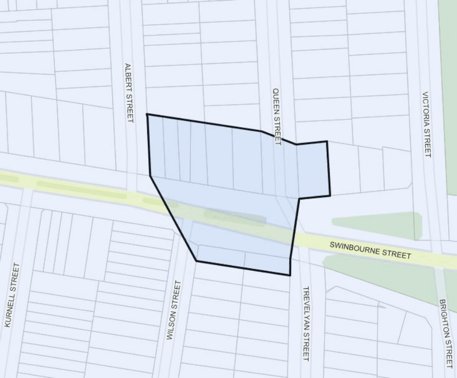
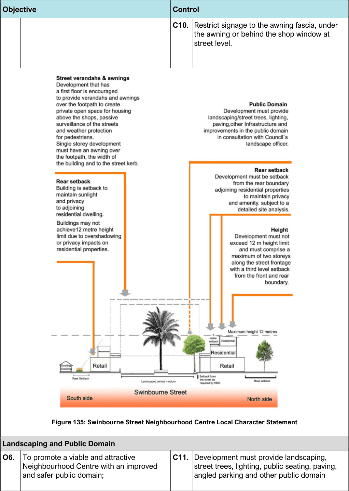

#### 7.12.7 Swinbourne Street Neighbourhood Centre

#### Description

Swinbourne Street is located in the suburb of Botany. It was established in the 1920’s with the subdivision of land known as “Wilson”. The Neighbourhood Centre is located along Swinbourne Street on a flat section of land with a large garden medium strip dividing the road (refer to Figure 134). It is a small centre with only four local shops.

> [Picture on page 212: a picture, saved as a picture (images/section-07-specific-places-page-212-7.gif, 150 dpi).]

#### Figure 134: Swinbourne Street Neighbourhood Centre Land Application Map

#### Desired Future Character

The Swinbourne Street Neighbourhood Centre will be a viable and attractive centre with an improved and safer public domain. Development will recognise predominant streetscape qualities, complement the height and architectural style found in the immediate vicinity. Reasonable development outcomes will improve the architectural quality of the building stock and retain a coherent streetscape.

#### Controls

| Objective |  | Control |  |
|---|---|---|---|
| Built Form: Building Heights and Density |  |  |  |
| O1. | To ensure that development recognises predominant streetscape qualities (i.e. setbacks and design features). | C1. | Notwithstanding the maximum height of 12m, a maximum height of 2 storeys applies along the street frontage with a third level permitted which is setback from the street frontages and |

| Objective |  |
|---|---|
| O2. | To allow reasonable redevelopment and to improve the architectural quality of building stock. |
| Street Character and Development Setbacks |  |
| O3. | To ensure development complements the height and architectural style found in the immediate vicinity, particularly where this has a clearly established character. |
| O4. | To retain a coherent streetscape with a consistent street wall and parapet line. |
| O5. | To ensure development complements the height and architectural style found in the immediate vicinity, particularly where this has a clearly established character. |

| Control |  |
|---|---|
|  | the rear. The setback from the rear is to be determined following a detailed site analysis at development application stage and must satisfy Council that the amenity of neighbouring residential properties are protected in terms of sunlight and natural daylight access, privacy and visual amenity. Applicants must therefore demonstrate that impacts on the residential area are minimised. |
| C2. | Redevelopment is encouraged through logical lot consolidation of sites and infill development. Avoid inappropriate lot consolidation patterns that would isolate and unreasonably restrict redevelopment on a single lot. |
| C3. | Shop top housing must be provided in any redevelopment of the existing shops. |
| C4. | The design of development must be generally consistent with the Desired Future Character of the centre identified in the diagrams below. |
| C5. | New development is to take into account and respond sympathetically to an established streetscape with strong architectural features and identity. New buildings are to reinforce these features and contribute to its character. |
| C6. | Alterations and additions are to reflect the architectural design of the existing building. Materials and finishes are to be compatible with the existing building. |
| C7. | The design must improve the residential amenity for the housing above the shops by providing direct access to balconies and private open space; and provide for passive surveillance of the surrounding streets and pedestrian walkways. |
| C8. | The design must encourage active street life while providing a high residential amenity and provide for small scale shops that will serve the local community. |
| C9. | Maintain limited advertisements and business signage to minimise visual impact on the surrounding residential area. |

> [Picture on page 214: a picture, saved as a picture (images/section-07-specific-places-page-214-1.gif, 150 dpi).]

Figure 135: Swinbourne Street Neighbourhood Centre Local Character Statement

#### Objective

#### Control

C10. Restrict signage to the awning fascia, under the awning or behind the shop window at street level.

| Landscaping and Public Domain |  |  |
|---|---|---|
| O6. To promote a viable and attractive Neighbourhood Centre with an improved and safer public domain; | C11. | Development must provide landscaping, street trees, lighting, public seating, paving, angled parking and other public domain |

| Objective |  |
|---|---|
| O7. | To retain existing heritage trees and supplement existing landscaping within the streetscape; |
| O8. | To ensure that access driveways do not dominate the streetscape. |

| Control |  |
|---|---|
|  | improvements identified by Council, generally in accordance with the diagram above. |
| C12. | Pedestrian amenity must be enhanced in front of the shops in conjunction with new development. |
| C13. | With redevelopment of the shops, landscape planting must be provided along the rear boundary where a site adjoins a residential property, to provide a visual separation between the shops and the residential area. |

#### Botany South
